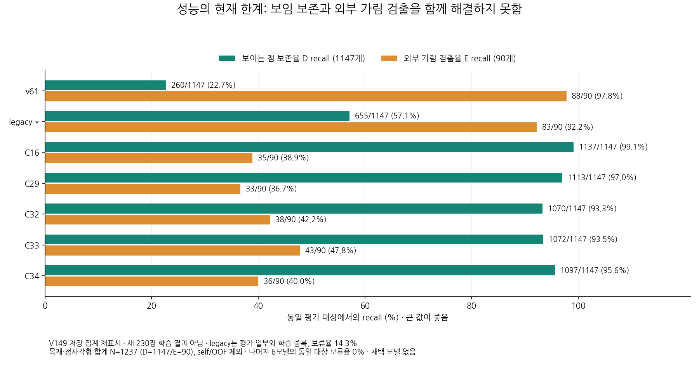
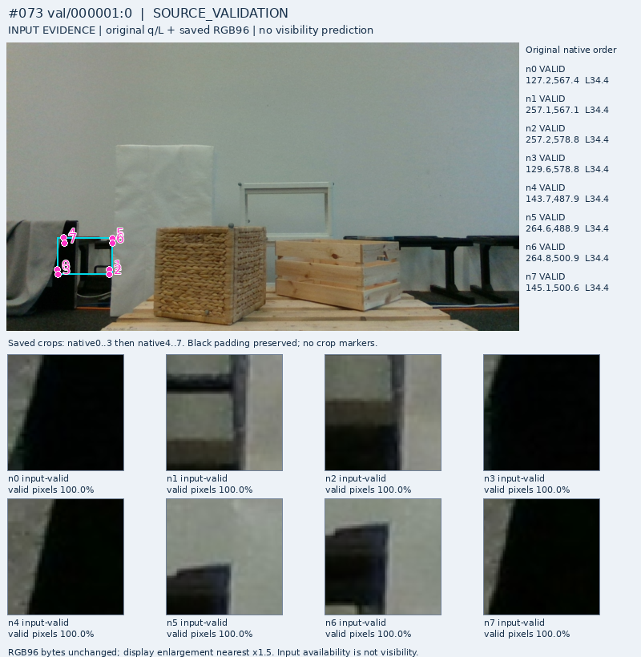
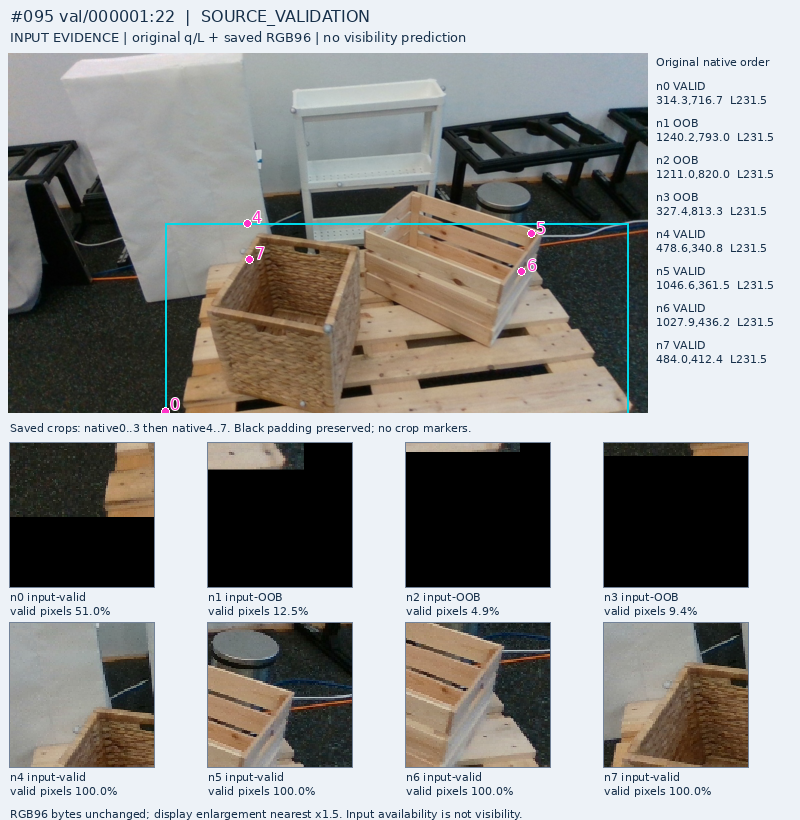
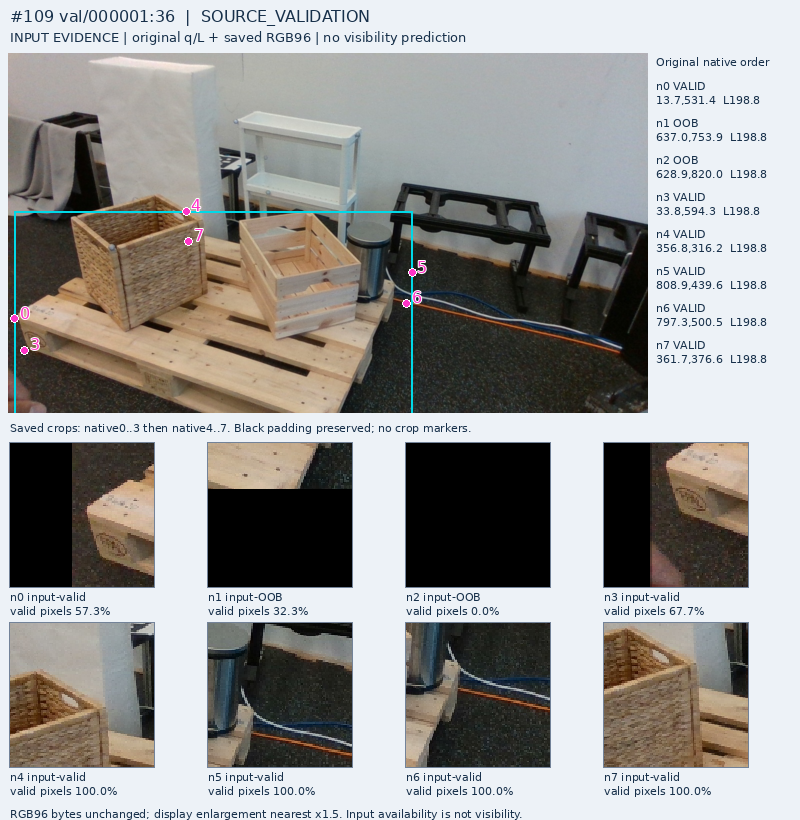

# V153 — query_visibility_mr6d_full_public_source_20261024_v153

기존 보고서에서 추출한 게시용 파생 개요입니다. 원본 파일을 수정하거나 실험·평가를 다시 실행하지 않았습니다. 원문 해시와 링크 대응은 publication manifest로 확인합니다.

**상태:** {"completed":true,"selected_model":null,"fully_solved":false,"goal_status":"active_unsolved"}

원본:

- [ROOT_PHASE_RESULT.json](ROOT_PHASE_RESULT.json) — SHA256 `0ac1a2e9b45a70c5f912144caddef05243692d1311bb06a55804299f4388454a`
- [ROOT_READOUT_KO.html](ROOT_READOUT_KO.html) — SHA256 `864032d3e0ded55954cb35b33a5e6f27b24137806a714e77528a3bccaf326f3e`
- [ROOT_RESULTS_KO.json](ROOT_RESULTS_KO.json) — SHA256 `782b5c6ee19a3e3a6c47fc2fd386edb99122a61f59c610f71fd4993da69ae194`

## 방법·목표의 원문 필드

`$.phase`

```text
V153_FULL_PUBLIC_INPUTS_FEATURES_AND_SEPARATE_HEAD_PREPARATION_COMPLETE
```


## 입력·학습·평가 분모의 원문 필드

`$.aggregate_primary`

```text
{
  "excerpt": "[{\"model\": \"v61\", \"CM_D_E_by_pred_D_E_U\": [[260, 887, 0], [2, 88, 0]], \"D_precision\": 0.9923664122137404, \"D_recall\": 0.22667829119442023, \"E_precision\": 0.09025641025641026, \"E_recall\": 0.9777777777777777, \"U\": 0.0, \"counts\": {\"N\": 1237, \"visible_support\": 1147, \"occluded_support\": 90, \"TP\": 260, \"FN_decided\": 887, \"FP\": 2, \"TN\": 88, \"U_visible\": 0, \"U_occluded\": 0, \"out_of_task_S_visible\": 0, \"out_of_task_S_occluded\": 0, \"other_unresolved_visible\": 0, \"other_unresolved_occluded\": 0}}, {\"model\": \"legacy\", \"CM_D_E_by_pred_D_E_U\": [[655, 319, 173], [3, 83, 4]], \"D_precision\": 0.9954407294832827, \"D_recall\": 0.5710549258936356, \"E_precision\": 0.2064676616915423, \"E_recall\": 0.9222222222222223, \"U\": 0.14308811641067098, \"counts\": {\"N\": 1237, \"visible_support\": 1147, \"occluded_support\": 90, \"TP\": 655, \"FN_decided\": 319, \"FP\": 3, \"TN\": 83, \"U_visible\": 173, \"U_occluded\": 4, \"out_of_task_S_visible\": 0, \"out_of_task_S_occluded\": 0, \"other_unresolved_visible\": 0, \"other_unresolved_occluded\": 0}}, {\"model\": \"C16\", \"CM_D_E_by_pred_D_E_U\": [[1137, 10, 0], [55, 35, 0]], \"D_precision\": 0.9538590604026845, \"D_recall\": 0.99128160418483, \"E_precision\": 0.7777777777777778, \"E_recall\": 0.3888888888888889, \"U\": 0.0, \"counts\": {\"N\": 1237, \"visible_support\": 1147, \"occluded_support\": 90, \"TP\": 1137, \"FN_decided\": 10, \"FP\": 55, \"TN\": 35, \"U_visible\": 0, \"U_occluded\": 0, \"out_of_task_S_visible\": 0, \"out_of_task_S_occluded\": 0, \"other_unresolved_visible\": 0, \"other_unresolved_occluded\": 0}}, {\"model\": \"C29\", \"CM_D_E_by_pred_D_E_U\": [[1113, 34, 0], [57, 33, 0]], \"D_precision\": 0.9512820512820512, \"",
  "truncated": true
}
```

`$.actual_executions`

```text
{
  "R0_primary_frames": 230,
  "R0_explicit_predict_calls": 232,
  "R0_total_forward_hooks": 233,
  "DINO_primary_encoder_calls": 230,
  "DINO_repeat_calls": 10,
  "DINO_total_calls": 240,
  "DINO_views_per_call": 17,
  "visibility_classifier_forward_calls": 0,
  "new_head_training_updates": 0,
  "new_private_model_calls": 0,
  "private_data_input_or_tuning_calls": 0,
  "PnP_or_xy_correction_calls": 0
}
```


## 결론·실패·한계의 원문 필드

`$.outcome_KO`

```text
공개 실사230장·원래query1840개·동결 feature를 실제 확보하고, 작은 세 출력 head와 합성 위치품질 감독을 준비했다. 새 head 학습 또는 현재223 성능 개선은 아직 없다.
```

`$.current_legacy_limit_KO`

```text
legacy CAL46은 평가 일부와 학습이 겹치는 과거 참고이며 독립 일반화 비교로 인증하지 않는다.
```

`$.limits_KO`

```text
[
  "새 데이터 준비와 prototype 검산은 실제 모델 성능 개선의 증거가 아니다.",
  "현재 약점은 외부 가림의 누락과 보이는 점의 보존을 함께 개선하지 못한 것이다. 기존 모델보다 전체적으로 낫다고 채택한 모델은 없다.",
  "공개 source의 제공 pose/CAD는 cm급 명목 reference이며, 겹치는 mask는 배타적 owner/native 가림 gold가 아니다.",
  "실제 query가 다른 물체나 배경을 가리키는 경우와 대상 팔레트의 가림을 분리해야 한다. 정상 crop만으로 대상·좌표가 맞다는 뜻은 아니다.",
  "공개 scene 분리 검증이며 같은 물리 물체의 반복 가능성이 있다. 공식 MR6D blind test나 독립 평가 인증은 아니다.",
  "Euro 목재와 몇 가지 적재물의 공개 실사는 정사각형 실사·다양한 가림의 감독 공백을 모두 채우지 못한다."
]
```


## 코드·검증·전체 표·갤러리

아래 목록은 원 보고서가 참조한 파일의 경로를 다시 연결한 것입니다. 이 개요 작성 중 이미지 내용이나 raw 평가 데이터를 새로 검사하지 않았습니다.

- [query_visibility_mr6d_full_public_source_20261024_v153/ROOT_READOUT_KO.html](ROOT_READOUT_KO.html)
- [query_visibility_mr6d_full_public_source_20261024_v153/ROOT_RESULTS_KO.json](ROOT_RESULTS_KO.json)
- [query_visibility_mr6d_full_public_source_20261024_v153/ROOT_REPORT_VISUAL_QA.json](ROOT_REPORT_VISUAL_QA.json)
- [query_visibility_mr6d_full_public_source_20261024_v153/ROOT_FINAL_INDEPENDENT_REPORT_REVIEW.json](ROOT_FINAL_INDEPENDENT_REPORT_REVIEW.json)
- [query_visibility_mr6d_full_public_source_20261024_v153/ROOT_POLICY_BEFORE_NEW_SOURCE_BODIES.json](ROOT_POLICY_BEFORE_NEW_SOURCE_BODIES.json)
- [query_visibility_mr6d_full_public_source_20261024_v153/full_source_v1/FULL_SOURCE_INTAKE_COMPLETE.json](full_source_v1/FULL_SOURCE_INTAKE_COMPLETE.json)
- [query_visibility_mr6d_full_public_source_20261024_v153/full_source_v1/FULL_SOURCE_DOWNLOAD_COMPLETE.json](full_source_v1/FULL_SOURCE_DOWNLOAD_COMPLETE.json.parts.json)
- [query_visibility_mr6d_full_public_source_20261024_v153/full_intake_preparation/FIRST_DOWNLOAD_FAILURE_DIAGNOSIS.json](full_intake_preparation/FIRST_DOWNLOAD_FAILURE_DIAGNOSIS.json)
- [query_visibility_mr6d_full_public_source_20261024_v153/ROOT_EXPLICIT_REMAINING4_CONTINUATION_AFTER_ZERO_RESPONSE.json](ROOT_EXPLICIT_REMAINING4_CONTINUATION_AFTER_ZERO_RESPONSE.json)
- [query_visibility_mr6d_full_public_source_20261024_v153/actual_full230_initializer_v1/PREDICTION_SEAL.json](actual_full230_initializer_v1/PREDICTION_SEAL.json)
- [query_visibility_mr6d_full_public_source_20261024_v153/independent_saved_pipeline_review/INITIALIZER_REVIEW.json](independent_saved_pipeline_review/INITIALIZER_REVIEW.json)
- [query_visibility_mr6d_full_public_source_20261024_v153/full230_native_DINO_v1/FEATURE_COMPLETE.json](full230_native_DINO_v1/FEATURE_COMPLETE.json)
- [query_visibility_mr6d_full_public_source_20261024_v153/initializer_feature_preparation/FULL230_SAVED_FEATURE_REVIEW.json](initializer_feature_preparation/FULL230_SAVED_FEATURE_REVIEW.json)
- [query_visibility_mr6d_full_public_source_20261024_v153/native_reference_preparation/provided_reference_v1/REFERENCE_PROJECTION_COMPLETE.json](native_reference_preparation/provided_reference_v1/REFERENCE_PROJECTION_COMPLETE.json)
- [query_visibility_mr6d_full_public_source_20261024_v153/native_reference_preparation/source_validation_visual_review_agent/FINAL_REVIEW_DELIVERY.json](native_reference_preparation/source_validation_visual_review_agent/FINAL_REVIEW_DELIVERY.json)
- [query_visibility_mr6d_full_public_source_20261024_v153/ROOT_SOURCE_PROPOSAL_HOLD.json](ROOT_SOURCE_PROPOSAL_HOLD.json)
- [query_visibility_mr6d_full_public_source_20261024_v153/head_preparation/saved_synthetic_point_quality_v1/RESULTS.json](head_preparation/saved_synthetic_point_quality_v1/RESULTS.json)
- [query_visibility_mr6d_full_public_source_20261024_v153/head_preparation/SEPARATED_HEAD_PROTOTYPE_CHECKS.json](head_preparation/SEPARATED_HEAD_PROTOTYPE_CHECKS.json)
- [query_visibility_mr6d_full_public_source_20261024_v153/initializer_feature_preparation/SEPARATED_HEAD_AND_QUALITY_REVIEW.json](initializer_feature_preparation/SEPARATED_HEAD_AND_QUALITY_REVIEW.json)
- [query_visibility_mr6d_full_public_source_20261024_v153/original_query_evidence_full230/EVIDENCE_RENDER_COMPLETE.json](original_query_evidence_full230/EVIDENCE_RENDER_COMPLETE.json)
- [query_visibility_mr6d_full_public_source_20261024_v153/ROOT_STATUS_INDEPENDENT_REVIEW.json](ROOT_STATUS_INDEPENDENT_REVIEW.json)
- [query_visibility_mr6d_full_public_source_20261024_v153/SEMANTIC_PROPOSAL_METADATA_APPENDIX.json](SEMANTIC_PROPOSAL_METADATA_APPENDIX.json)
- [query_visibility_public_native_frozen_current_benchmark_20261024_v149/ROOT_RESULTS_KO.json](../query_visibility_public_native_frozen_current_benchmark_20261024_v149/ROOT_RESULTS_KO.json)
- [query_visibility_mr6d_full_public_source_20261024_v153/original_query_evidence_full230/index.html](original_query_evidence_full230/index.html)

## 원 보고서의 그림

원 보고서 참조 순서의 처음 최대4개를 표시합니다. 새 outcome 선택이나 전수 이미지 검증을 뜻하지 않습니다. 전체 갤러리는 위 원문 링크에서 확인합니다.

[query_visibility_mr6d_full_public_source_20261024_v153/CURRENT_PROGRESS_AND_LIMITS_KO.png](CURRENT_PROGRESS_AND_LIMITS_KO.png)



[query_visibility_mr6d_full_public_source_20261024_v153/original_query_evidence_full230/frames/FRAME_073_val_000001_0.png](original_query_evidence_full230/frames/FRAME_073_val_000001_0.png)



[query_visibility_mr6d_full_public_source_20261024_v153/original_query_evidence_full230/frames/FRAME_095_val_000001_22.png](original_query_evidence_full230/frames/FRAME_095_val_000001_22.png)



[query_visibility_mr6d_full_public_source_20261024_v153/original_query_evidence_full230/frames/FRAME_109_val_000001_36.png](original_query_evidence_full230/frames/FRAME_109_val_000001_36.png)




현재 사용자 목표 전체의 해결·새 모델 채택·실사 가림 원인 확정을 이 파생 개요가 추가로 주장하지 않습니다. UNKNOWN/U와 불리한 결과, 실패 실행 및 수정 provenance는 원문대로 보존해야 합니다.

큰 원문 링크는 무손실 gzip의 `.parts.json` descriptor로 연결합니다. 원문 SHA와 복원 방법은 게시 안내를 따릅니다.
