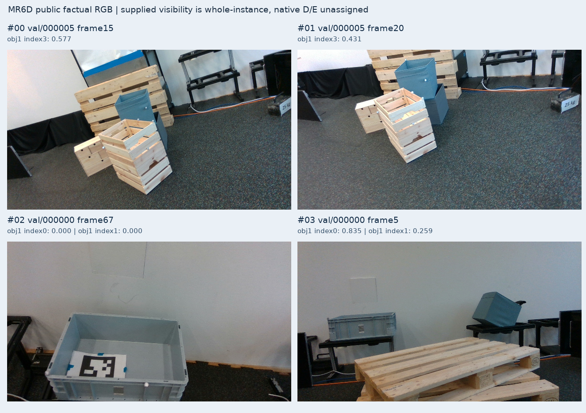
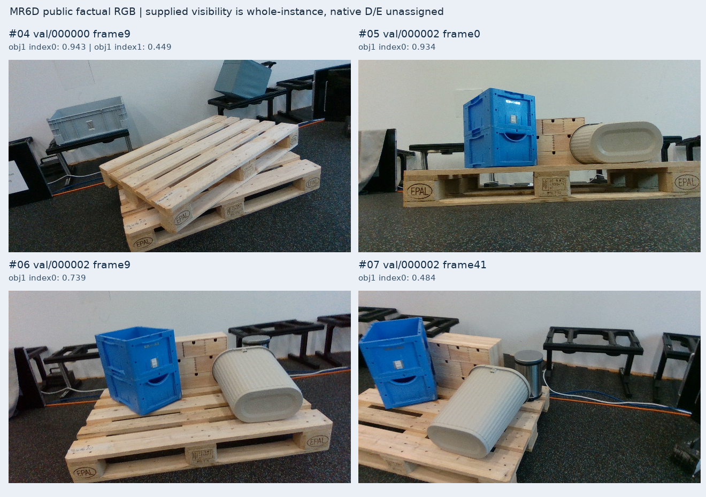
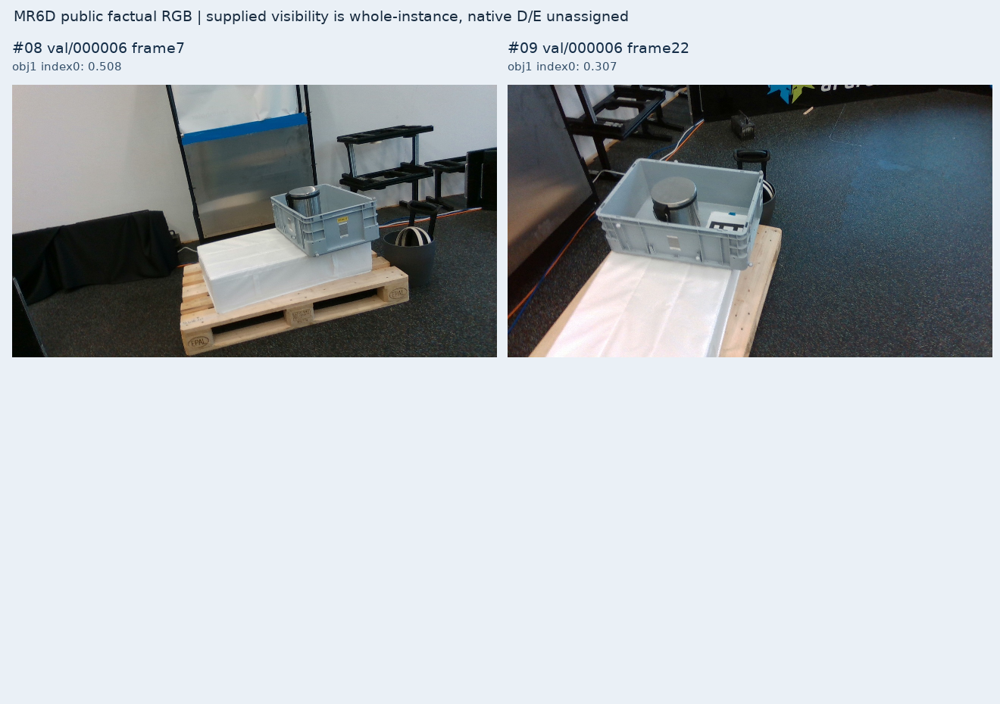
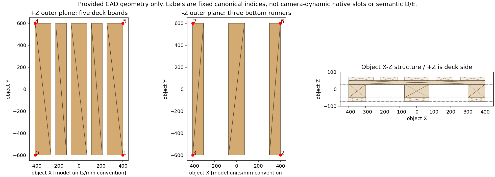

# V151 — query_visibility_mr6d_public_native_intake_20261024_v151

기존 보고서에서 추출한 게시용 파생 개요입니다. 원본 파일을 수정하거나 실험·평가를 다시 실행하지 않았습니다. 원문 해시와 링크 대응은 publication manifest로 확인합니다.

**상태:** {"completed":true,"selected_model":null,"goal_status":"active"}

원본:

- [ROOT_PHASE_RESULT.json](ROOT_PHASE_RESULT.json) — SHA256 `3b895bccb8e53de53ad0ab2127b02a2a2da3abaf1165535f7e30017055fc0a67`
- [ROOT_READOUT_KO.html](ROOT_READOUT_KO.html) — SHA256 `3d77daeec1cc724e3f65e9d0f1ca8ef63db214659b303d1cc6f6781dd696952f`
- [ROOT_RESULTS_KO.json](ROOT_RESULTS_KO.json) — SHA256 `3905a1580844787bb2662cfef53002a7c177c6a08f561ae5c8be646f5b68ba5b`

## 방법·목표의 원문 필드

`$.phase`

```text
V151_PUBLIC_MR6D_TINY_INTAKE_COMPLETE
```

`$.full_goal_solved`

```text
false
```

`$.current223_or_forbidden_phase_access`

```text
0
```


## 입력·학습·평가 분모의 원문 필드

`$.source_training_ready`

```text
false
```

`$.new_training_or_PnP_q_L_correction`

```text
0
```


## 결론·실패·한계의 원문 필드

`$.conclusion_KO`

```text
실제 평판형 Euro 팔레트의 독립 공개 source를 확보했다. 겹친 팔레트와 다양한 적재물은 실제 RGB로 확인했으며, 제공 mask가 배타적 pixel-owner gold가 아니라는 한계도 확인했다. native 역할 대응·보임/외부 가림·query 위치 증거의 라벨 정의를 먼저 맞춘 뒤 학습으로 이어가야 한다.
```


## 코드·검증·전체 표·갤러리

아래 목록은 원 보고서가 참조한 파일의 경로를 다시 연결한 것입니다. 이 개요 작성 중 이미지 내용이나 raw 평가 데이터를 새로 검사하지 않았습니다.

- [query_visibility_mr6d_public_native_intake_20261024_v151/factual_sample_v1/TINY_SOURCE_DOWNLOAD_COMPLETE.json](factual_sample_v1/TINY_SOURCE_DOWNLOAD_COMPLETE.json)
- [query_visibility_mr6d_public_native_intake_20261024_v151/independent_factual_review/REVIEW.json](independent_factual_review/REVIEW.json)
- [query_visibility_mr6d_public_native_intake_20261024_v151/native_readiness_review/actual_tiny_audit/AUDIT_COMPLETE.json](native_readiness_review/actual_tiny_audit/AUDIT_COMPLETE.json)
- [query_visibility_mr6d_public_native_intake_20261024_v151/ROOT_RESULTS_KO.json](ROOT_RESULTS_KO.json)
- [query_visibility_mr6d_public_native_intake_20261024_v151/ROOT_READOUT_KO.html](ROOT_READOUT_KO.html)
- [query_visibility_mr6d_public_native_intake_20261024_v151/ROOT_READOUT_QA.json](ROOT_READOUT_QA.json)
- [query_visibility_mr6d_public_native_intake_20261024_v151/ROOT_MR6D_SCENE_SPLIT_BEFORE_ANY_FIT_OR_EXTRA_PIXELS.json](ROOT_MR6D_SCENE_SPLIT_BEFORE_ANY_FIT_OR_EXTRA_PIXELS.json)
- [query_visibility_mr6d_public_native_intake_20261024_v151/factual_sample_v1/FIXED_SOURCE_SAMPLE_SELECTION_BEFORE_PIXELS.json](factual_sample_v1/FIXED_SOURCE_SAMPLE_SELECTION_BEFORE_PIXELS.json)
- [query_visibility_public_native_saved_mechanism_20261024_v150/ROOT_READOUT_KO.html](../query_visibility_public_native_saved_mechanism_20261024_v150/ROOT_READOUT_KO.html)
- [query_visibility_mr6d_public_native_intake_20261024_v151/metadata/PROVIDED_METADATA_DOWNLOAD_RECEIPT.json](metadata/PROVIDED_METADATA_DOWNLOAD_RECEIPT.json)
- [query_visibility_mr6d_public_native_intake_20261024_v151/factual_sample_v1/FACTUAL_SAMPLE_INTAKE_COMPLETE.json](factual_sample_v1/FACTUAL_SAMPLE_INTAKE_COMPLETE.json)
- [query_visibility_mr6d_public_native_intake_20261024_v151/factual_sample_v1/ACTUAL_RAW_CONTACT_VIEW_QA_AND_SOURCE_LIMITS.json](factual_sample_v1/ACTUAL_RAW_CONTACT_VIEW_QA_AND_SOURCE_LIMITS.json)
- [query_visibility_mr6d_public_native_intake_20261024_v151/PROVIDED_MASK_OVERLAP_PLOT_RECEIPT.json](PROVIDED_MASK_OVERLAP_PLOT_RECEIPT.json)

## 원 보고서의 그림

원 보고서 참조 순서의 처음 최대4개를 표시합니다. 새 outcome 선택이나 전수 이미지 검증을 뜻하지 않습니다. 전체 갤러리는 위 원문 링크에서 확인합니다.

[query_visibility_mr6d_public_native_intake_20261024_v151/factual_sample_v1/RAW_FACTUAL_RGB_CONTACT_01.png](factual_sample_v1/RAW_FACTUAL_RGB_CONTACT_01.png)



[query_visibility_mr6d_public_native_intake_20261024_v151/factual_sample_v1/RAW_FACTUAL_RGB_CONTACT_02.png](factual_sample_v1/RAW_FACTUAL_RGB_CONTACT_02.png)



[query_visibility_mr6d_public_native_intake_20261024_v151/factual_sample_v1/RAW_FACTUAL_RGB_CONTACT_03.png](factual_sample_v1/RAW_FACTUAL_RGB_CONTACT_03.png)



[query_visibility_mr6d_public_native_intake_20261024_v151/native_readiness_review/actual_tiny_audit/MESH_ZUP_BOARD_LAYOUT_GEOMETRY_ONLY.png](native_readiness_review/actual_tiny_audit/MESH_ZUP_BOARD_LAYOUT_GEOMETRY_ONLY.png)




현재 사용자 목표 전체의 해결·새 모델 채택·실사 가림 원인 확정을 이 파생 개요가 추가로 주장하지 않습니다. UNKNOWN/U와 불리한 결과, 실패 실행 및 수정 provenance는 원문대로 보존해야 합니다.
