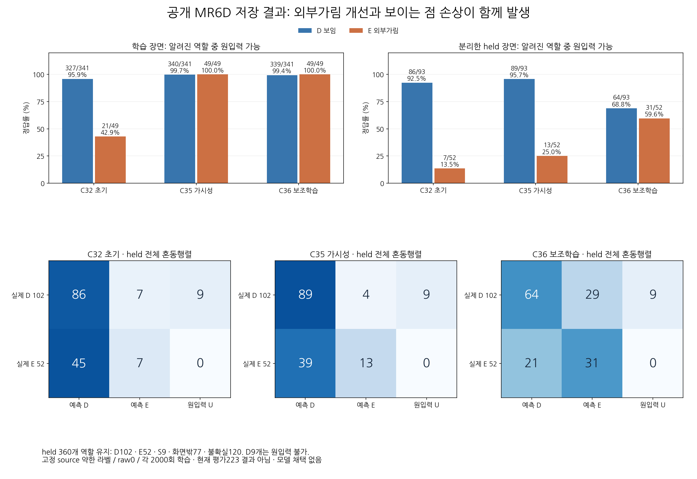
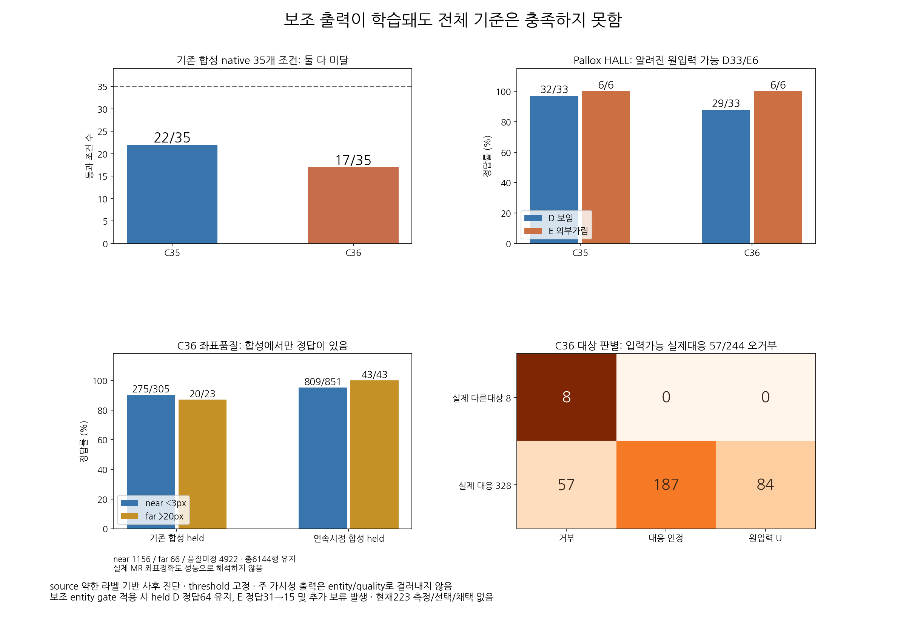
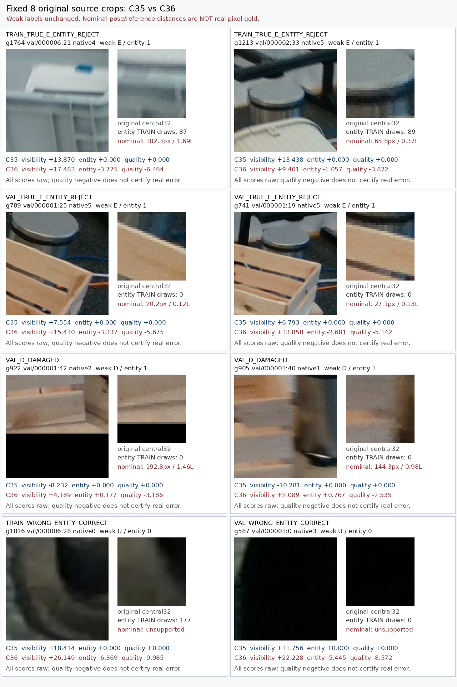
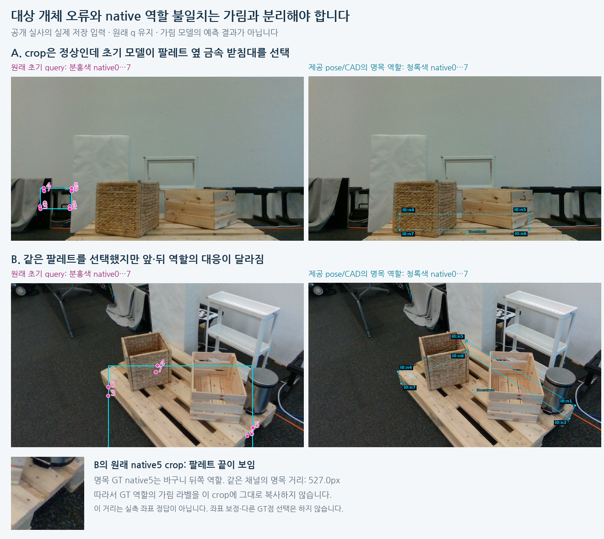

# V154 — query_visibility_mr6d_source_supervision_bridge_20261024_v154

기존 보고서에서 추출한 게시용 파생 개요입니다. 원본 파일을 수정하거나 실험·평가를 다시 실행하지 않았습니다. 원문 해시와 링크 대응은 publication manifest로 확인합니다.

**상태:** {"completed":true,"selected_model":null,"adopted":false,"fully_solved":false,"goal_status":"active_unsolved"}

원본:

- [ROOT_PHASE_RESULT.json](ROOT_PHASE_RESULT.json) — SHA256 `ba3117cc85afd6aa9ffddb98a4a3f0e5ab3d7f5dcfe2b11d388f01be4c1cc488`
- [ROOT_READOUT_KO.html](ROOT_READOUT_KO.html) — SHA256 `8410e4900f6397fa1fcfbfaa4e386e2b86982289794e83c1ec0825f472c6c419`
- [ROOT_RESULTS_KO.json](ROOT_RESULTS_KO.json) — SHA256 `c691cdfbb87677e3d16bb9222ced6298237c92a7655a196e4537258c0271d91d`

## 방법·목표의 원문 필드

`$.schema`

```text
V154_SOURCE_WEAK_QUERY_SUPERVISION_MATCHED_HEAD_RESULTS
```


## 입력·학습·평가 분모의 원문 필드

`$.execution_QA_PASS_is_not_scientific_qualification`

```text
true
```

`$.actual_execution`

```text
{
  "excerpt": "{\"completed\": true, \"PASS\": true, \"root_observed_session_id\": 67120, \"root_observed_terminal_exit_code\": 0, \"actual_source_optimizer_updates\": 4000, \"updates_each\": 2000, \"control_complete\": {\"path\": \"query_visibility_mr6d_source_supervision_bridge_20261024_v154/runs/C35_C36_SEPARATE_QUERY_FIXED2000/CONTROL_COMPLETE.json\", \"sha256\": \"45279eeb0bdb6d21c73d796062a279516f187970134e8c9ffa983e3ce17d476c\"}, \"entry\": {\"path\": \"query_visibility_mr6d_source_supervision_bridge_20261024_v154/ROOT_APPROVED_SOURCE_HEAD_FIT_ENTRY.json\", \"sha256\": \"42e2bd89d20fae06a9fb70b6df44b2b7cbd662fc238dc88b647bb2b2542eb989\"}, \"prepared_protocol_review\": {\"path\": \"query_visibility_mr6d_source_supervision_bridge_20261024_v154/independent_prepared_fit_review/REVIEW.json\", \"sha256\": \"f14d068220d18b998631ad32827c1d6b5afdddcc519f5c7f49cd774bd0e522ef\"}, \"independent_saved_fit_review\": {\"path\": \"query_visibility_mr6d_source_supervision_bridge_20261024_v154/independent_saved_fit_review/REVIEW.json\", \"sha256\": \"48d5e6950325c3adefba3d2cdb08302c4169a8ec7a04c09453c062ac4f1e0cd3\"}, \"actual_model\": \"Two SeparatedQueryHead224643 fits and saved source inference; frozen precomputed DINO features reused.\", \"new_encoder_R0_private_or_PnP_or_q_L_correction_calls\": 0, \"selected_model\": null, \"scientific_source_qualification_pass\": ",
  "truncated": true
}
```

`$.MR_paired_primary`

```text
{
  "excerpt": "{\"ALL\": {\"C32_initial_to_C35\": {\"D\": {\"CM_previous_D_E_U_rows_next_D_E_U_columns\": [[411, 2, 0], [18, 3, 0], [0, 0, 18]], \"recovered\": 18, \"damaged\": 2}, \"E\": {\"CM_previous_D_E_U_rows_next_D_E_U_columns\": [[38, 35, 0], [1, 27, 0], [0, 0, 0]], \"recovered\": 35, \"damaged\": 1}}, \"C32_initial_to_C36\": {\"D\": {\"CM_previous_D_E_U_rows_next_D_E_U_columns\": [[391, 22, 0], [12, 9, 0], [0, 0, 18]], \"recovered\": 12, \"damaged\": 22}, \"E\": {\"CM_previous_D_E_U_rows_next_D_E_U_columns\": [[21, 52, 0], [0, 28, 0], [0, 0, 0]], \"recovered\": 52, \"damaged\": 0}}, \"C35_to_C36\": {\"D\": {\"CM_previous_D_E_U_rows_next_D_E_U_columns\": [[403, 26, 0], [0, 5, 0], [0, 0, 18]], \"recovered\": 0, \"damaged\": 26}, \"E\": {\"CM_previous_D_E_U_rows_next_D_E_U_columns\": [[21, 18, 0], [0, 62, 0], [0, 0, 0]], \"recovered\": 18, \"damaged\": 0}}}, \"SOURCE_DEVELOPMENT\": {\"C32_initial_to_C35\": {\"D\": {\"CM_previous_D_E_U_rows_next_D_E_U_columns\": [[327, 0, 0], [13, 1, 0], [0, 0, 9]], \"recovered\": 13, \"damaged\": 0}, \"E\": {\"CM_previous_D_E_U_rows_next_D_E_U_columns\": [[0, 28, 0], [0, 21, 0], [0, 0, 0]], \"recovered\": 28, \"damaged\": 0}}, \"C32_initial_to_C36\": {\"D\": {\"CM_previous_D_E_U_rows_next_D_E_U_columns\": [[327, 0, 0], [12, 2, 0], [0, 0, 9]], \"recovered\": 12, \"damaged\": 0}, \"E\": {\"CM_previous_D_E_U_rows_next_D_E_U_columns\": [[0, 28, 0], [0, 21, 0], [0, 0, 0]], \"recovered\": 28, \"damaged\": 0}}, \"C35_to_C36\": {\"D\": {\"CM_previous_D_E_U_rows_next_D_E_U_columns\": [[339, 1, 0], [0, 1, 0], [0, 0, 9]], \"recovered\": 0, \"damaged\": 1}, \"E\": {\"CM_previous_D_E_U_rows_next_D_E_U_columns\": [[0, 0, 0], [0, 49, 0], [0, 0, 0]], \"recovered\": 0, \"dama",
  "truncated": true
}
```

`$.private_used_for_training_threshold_checkpoint_arm_selection`

```text
false
```


## 결론·실패·한계의 원문 필드

`$.interpretation_KO`

```text
[
  "같은 공개 held의 C32→C35 AUC .610→.785, 보임86→89/93, 외부가림7→13/52는 유용한 진전이다. common native/Pallox/MR 손실이 함께 계속되어 MR 데이터만의 인과효과는 아니다.",
  "C35→C36은 외부가림18개 회복과 보임25개 손상이 함께 발생했다. AUC도 .785→.702이며 두 손실 추가의 공동 효과이지 각 보조손실의 독립 효과는 아니다.",
  "가림 점수를 정렬하는 능력은 일부 개선됐으나 보임90%를 유지할 때 최대 외부가림 recall도 C35 16/52(30.8%)이다. 단순 문턱 조정으로 현재 목표를 해결한다는 근거는 없다. 이 수는 사후 진단이며 문턱을 선택하지 않았다.",
  "대상 entity gate는 맞게 가림으로 판단한31개 중16개를 보류시켜15개만 남긴다. real quality 정답은 없으며 합성 quality 결과를 실사 성과로 바꾸지 않는다.",
  "실제 crop의 foreign bin/crate와 target role visibility는 서로 다른 질문이다. D 손상 사례의 명목 좌표 편차가144/193px인 경우 이를 정확한 위치의 순수 가림 전이 실패라고 부를 수 없다.",
  "세 출력의 강한 상관과 shared hidden은 확인됐으나 hidden rank 붕괴나 특정 보조손실의 인과 원인은 아직 증명하지 않았다.",
  "성공 가능성을 뒷받침하는 신호는 있으나 배치 가능한 모델은 없다. Euro 목재 weak source를 정사각형 실사 및 사용자223 성능의 증명으로 확대하지 않는다."
]
```

`$.limits_KO`

```text
[
  "공개 역할 감독은 assistant 시각 검토 기반 약한 라벨이다. 제공 pose는 cm 수준 오차 가능성이 있어 실사3px 정답이 아니다.",
  "held는 장면을 분리했지만 동일 물리 물체 재사용과 장면내 반복 촬영이 가능하다. 52개 가림 query가52개 독립 물체는 아니다.",
  "held entity 음성8개는 한 프레임의8개 query이다. 범용 wrong-entity 성능을 증명하지 않는다.",
  "known D/E154 외206행(S9/OOF77/U120)과 원입력 불가D9를 모두 보존했다. 입력가능145행 지표와 전체154행 지표를 구분한다.",
  "native35는 모든 기준 통과가 아니며 기존 AUX29를 새로 재검증했다는 주장도 아니다. 목재/정사각형과 native8 전체 범위는 유지한다.",
  "사용자223은 과거 반복 평가로 이미 개발에 노출된 자료이며 blind test가 아니다. 이번 단계에서는 private body를 새로 읽지 않았고 학습·선택에도 쓰지 않았다."
]
```


## 코드·검증·전체 표·갤러리

아래 목록은 원 보고서가 참조한 파일의 경로를 다시 연결한 것입니다. 이 개요 작성 중 이미지 내용이나 raw 평가 데이터를 새로 검사하지 않았습니다.

- [query_visibility_mr6d_source_supervision_bridge_20261024_v154/ROOT_RESULTS_KO.json](ROOT_RESULTS_KO.json)
- [query_visibility_mr6d_source_supervision_bridge_20261024_v154/ROOT_READOUT_KO.html](ROOT_READOUT_KO.html)
- [query_visibility_mr6d_source_supervision_bridge_20261024_v154/ROOT_REPORT_VISUAL_QA.json](ROOT_REPORT_VISUAL_QA.json)
- [query_visibility_mr6d_source_supervision_bridge_20261024_v154/ROOT_SUPERVISION_SEAL.json](ROOT_SUPERVISION_SEAL.json)
- [query_visibility_mr6d_source_supervision_bridge_20261024_v154/runs/C35_C36_SEPARATE_QUERY_FIXED2000/CONTROL_COMPLETE.json](runs/C35_C36_SEPARATE_QUERY_FIXED2000/CONTROL_COMPLETE.json)
- [query_visibility_mr6d_source_supervision_bridge_20261024_v154/ROOT_ACTUAL_SOURCE_FIT_EXECUTION_RECEIPT.json](ROOT_ACTUAL_SOURCE_FIT_EXECUTION_RECEIPT.json)
- [query_visibility_mr6d_source_supervision_bridge_20261024_v154/ROOT_NEXT_SOURCE_COMMITMENT_BEFORE_FUTURE_PRIVATE_READS.json](ROOT_NEXT_SOURCE_COMMITMENT_BEFORE_FUTURE_PRIVATE_READS.json)
- [query_visibility_mr6d_source_supervision_bridge_20261024_v154/independent_saved_fit_review/RANKING_DIAGNOSTIC.json](independent_saved_fit_review/RANKING_DIAGNOSTIC.json)
- [query_visibility_mr6d_source_supervision_bridge_20261024_v154/saved_output_cause_diagnosis/CAUSE_ASSESSMENT_KO.html](saved_output_cause_diagnosis/CAUSE_ASSESSMENT_KO.html)
- [query_visibility_public_native_frozen_current_benchmark_20261024_v149/ROOT_READOUT_KO.html](../query_visibility_public_native_frozen_current_benchmark_20261024_v149/ROOT_READOUT_KO.html)
- [query_visibility_mr6d_source_supervision_bridge_20261024_v154/ROOT_POLICY_BEFORE_SOURCE_BRIDGE_REVIEW.json](ROOT_POLICY_BEFORE_SOURCE_BRIDGE_REVIEW.json)
- [query_visibility_mr6d_source_supervision_bridge_20261024_v154/actual_query_association_agent/ASSOCIATION_REVIEW_COMPLETE.json](actual_query_association_agent/ASSOCIATION_REVIEW_COMPLETE.json)
- [query_visibility_mr6d_source_supervision_bridge_20261024_v154/development_native_review_scene0_2_agent/SOURCE_ROLE_REVIEW_COMPLETE.json](development_native_review_scene0_2_agent/SOURCE_ROLE_REVIEW_COMPLETE.json)
- [query_visibility_mr6d_source_supervision_bridge_20261024_v154/development_native_review_scene5_6_agent/SEMANTIC_REVIEW_COMPLETE.json](development_native_review_scene5_6_agent/SEMANTIC_REVIEW_COMPLETE.json)
- [query_visibility_mr6d_source_supervision_bridge_20261024_v154/ROOT_DEVELOPMENT_WEAK_ROLE_ADMISSION.json](ROOT_DEVELOPMENT_WEAK_ROLE_ADMISSION.json)
- [query_visibility_mr6d_source_supervision_bridge_20261024_v154/ROOT_SOURCE_VALIDATION_WEAK_ROLE_ADJUDICATION.json](ROOT_SOURCE_VALIDATION_WEAK_ROLE_ADJUDICATION.json)
- [query_visibility_mr6d_source_supervision_bridge_20261024_v154/ROOT_SUPERVISION_INPUT_BINDING_APPENDIX.json](ROOT_SUPERVISION_INPUT_BINDING_APPENDIX.json)
- [query_visibility_mr6d_source_supervision_bridge_20261024_v154/independent_supervision_review/REVIEW.json](independent_supervision_review/REVIEW.json)
- [query_visibility_mr6d_source_supervision_bridge_20261024_v154/MATCHED_EXPERIMENT_DESIGN_BEFORE_LABEL_COUNTS.json](MATCHED_EXPERIMENT_DESIGN_BEFORE_LABEL_COUNTS.json)
- [query_visibility_mr6d_source_supervision_bridge_20261024_v154/head_fit_preparation/PROTOCOL_BEFORE_SOURCE_FEATURE_OR_CHECKPOINT_BODIES.json](head_fit_preparation/PROTOCOL_BEFORE_SOURCE_FEATURE_OR_CHECKPOINT_BODIES.json)
- [query_visibility_mr6d_source_supervision_bridge_20261024_v154/independent_prepared_fit_review/REVIEW.json](independent_prepared_fit_review/REVIEW.json)
- [query_visibility_mr6d_source_supervision_bridge_20261024_v154/development_native_review_scene5_6_agent/INDEPENDENT_MATCHED_TRAINER_CODE_REVIEW.json](development_native_review_scene5_6_agent/INDEPENDENT_MATCHED_TRAINER_CODE_REVIEW.json)
- [query_visibility_mr6d_source_supervision_bridge_20261024_v154/ROOT_APPROVED_SOURCE_HEAD_FIT_ENTRY.json](ROOT_APPROVED_SOURCE_HEAD_FIT_ENTRY.json)
- [query_visibility_mr6d_source_supervision_bridge_20261024_v154/independent_saved_fit_review/REVIEW.json](independent_saved_fit_review/REVIEW.json)

## 원 보고서의 그림

원 보고서 참조 순서의 처음 최대4개를 표시합니다. 새 outcome 선택이나 전수 이미지 검증을 뜻하지 않습니다. 전체 갤러리는 위 원문 링크에서 확인합니다.

[query_visibility_mr6d_source_supervision_bridge_20261024_v154/source_result_summary_agent/MR_PRE_POST_COMPARISON_KO.png](source_result_summary_agent/MR_PRE_POST_COMPARISON_KO.png)



[query_visibility_mr6d_source_supervision_bridge_20261024_v154/source_result_summary_agent/AUXILIARY_AND_SOURCE_GATES_KO.png](source_result_summary_agent/AUXILIARY_AND_SOURCE_GATES_KO.png)



[query_visibility_mr6d_source_supervision_bridge_20261024_v154/saved_output_cause_diagnosis/FIXED8_SAVED_CROP_DIAGNOSIS.png](saved_output_cause_diagnosis/FIXED8_SAVED_CROP_DIAGNOSIS.png)



[query_visibility_mr6d_source_supervision_bridge_20261024_v154/ROLE_AND_ENTITY_ALIGNMENT_FAILURES_KO.png](ROLE_AND_ENTITY_ALIGNMENT_FAILURES_KO.png)




현재 사용자 목표 전체의 해결·새 모델 채택·실사 가림 원인 확정을 이 파생 개요가 추가로 주장하지 않습니다. UNKNOWN/U와 불리한 결과, 실패 실행 및 수정 provenance는 원문대로 보존해야 합니다.
