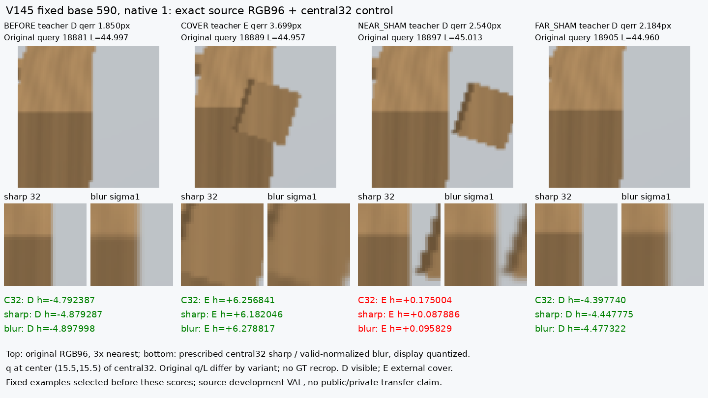
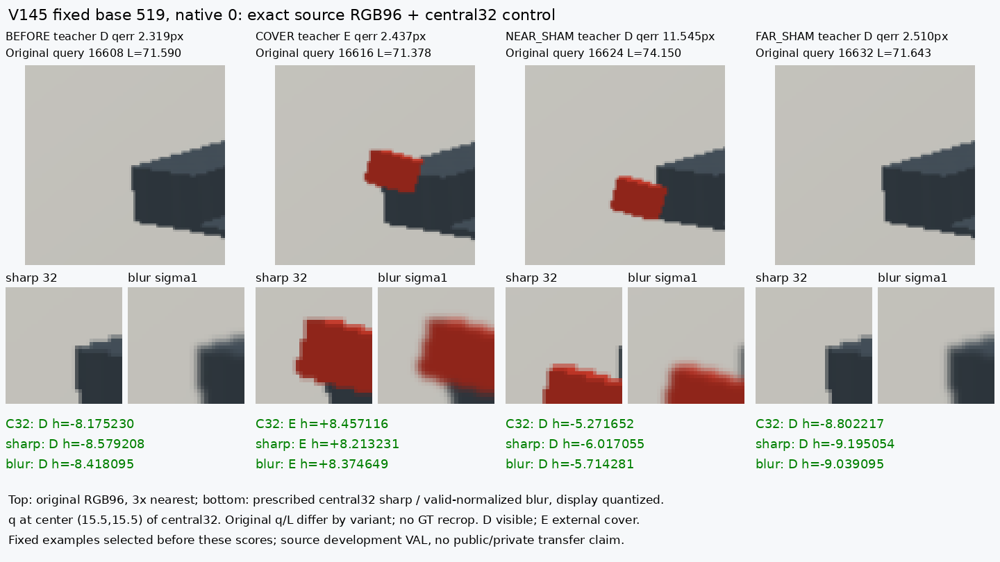

# V145 — query_visibility_native_fine_rgb_control_20261024_v145

기존 보고서에서 추출한 게시용 파생 개요입니다. 원본 파일을 수정하거나 실험·평가를 다시 실행하지 않았습니다. 원문 해시와 링크 대응은 publication manifest로 확인합니다.

**상태:** {"completed":true,"selected_model":null,"fully_solved":false,"goal_status":"active"}

원본:

- [ROOT_PHASE_RESULT.json](ROOT_PHASE_RESULT.json) — SHA256 `bb4118a2963691829a861f7396efd028dcaaf3edb34fcc062977359933fc2e0d`
- [ROOT_READOUT_KO.html](ROOT_READOUT_KO.html) — SHA256 `f489c2b11e565b7f0b6b02740f39f2573ae1781b3b7d0e25beaa909a9406e1b2`
- [ROOT_RESULTS_KO.json](ROOT_RESULTS_KO.json) — SHA256 `a9b869a81f6b8ef49e343f0582c4f9e1bcabaf929f113c9ccebb16d112384ab4`

## 방법·목표의 원문 필드

`$.goal_turn_classification`

```text
PROGRESS: actual2x2000 source finepixel control and independent numerical review complete; source/public weak role dataset advanced.
```


## 입력·학습·평가 분모의 원문 필드

`$.inputU184_preserved`

```text
true
```


## 결론·실패·한계의 원문 필드

`$.outcome_KO`

```text
이 고정 대조에서는 선명한 central32 세부정보 추가가 해결책이라는 증거가 나오지 않았다. Sharp는 E와 가림/근접쌍 성공에서 소폭 악화했고, blur는 D 오판을 조금 줄였지만 native35 통과는 기존C32와같은20/35다.
```

`$.scope_limits_KO`

```text
[
  "기존RGB CNN·local residual·SAM 경로는 이미 있었다. 이번 차이는 actual registered-native 감독/G42 조건화/stride1 공간 유지와 sharp-vs-blur 통제다.",
  "고정 C32의 DINO 정보가 두 arm에 남는다. 고주파 증분 비교이며 모든 미세 영상 정보가 무용하다는 증명이 아니다.",
  "새 probe는 native35만 평가했다. 이전64 기준은 바꾸지 않았고 AUX29 통과를 주장하지 않는다.",
  "단일 seed/final2000 조건의 source 대조다. 두 topology의 합성 결과이며 실사 전이·성공·모델 채택을 뜻하지 않는다."
]
```


## 코드·검증·전체 표·갤러리

아래 목록은 원 보고서가 참조한 파일의 경로를 다시 연결한 것입니다. 이 개요 작성 중 이미지 내용이나 raw 평가 데이터를 새로 검사하지 않았습니다.

- [query_visibility_native_fine_rgb_control_20261024_v145/ROOT_RESULTS_KO.json](ROOT_RESULTS_KO.json)
- [query_visibility_native_fine_rgb_control_20261024_v145/ROOT_READOUT_KO.html](ROOT_READOUT_KO.html)
- [query_visibility_native_fine_rgb_control_20261024_v145/ROOT_REPORT_VISUAL_QA.json](ROOT_REPORT_VISUAL_QA.json)
- [query_visibility_native_fine_rgb_control_20261024_v145/independent_saved_review/REVIEW.json](independent_saved_review/REVIEW.json)
- [query_visibility_public_selected_native_labels_20261024_v144/ROOT_READOUT_KO.html](../query_visibility_public_selected_native_labels_20261024_v144/ROOT_READOUT_KO.html)
- [query_visibility_native_fine_rgb_control_20261024_v145/saved_fine_control_diagnosis_v1/ALL_KNOWN_CF_PAIRS.json](saved_fine_control_diagnosis_v1/ALL_KNOWN_CF_PAIRS.json.parts.json)
- [query_visibility_native_fine_rgb_control_20261024_v145/runs/SHARP_BLURRED_NATIVE_FIXED2000/CONTROL_COMPLETE.json](runs/SHARP_BLURRED_NATIVE_FIXED2000/CONTROL_COMPLETE.json)
- [query_visibility_native_fine_rgb_control_20261024_v145/independent_saved_review/PAIR_VAL_AND_FIXED_CASE_CHECK.json](independent_saved_review/PAIR_VAL_AND_FIXED_CASE_CHECK.json)
- [query_visibility_native_fine_rgb_control_20261024_v145/saved_fine_control_diagnosis_v1/DIAGNOSIS_COMPLETE.json](saved_fine_control_diagnosis_v1/DIAGNOSIS_COMPLETE.json)
- [query_visibility_public_selected_native_labels_20261024_v144/ROOT_RESULTS_KO.json](../query_visibility_public_selected_native_labels_20261024_v144/ROOT_RESULTS_KO.json)

## 원 보고서의 그림

원 보고서 참조 순서의 처음 최대4개를 표시합니다. 새 outcome 선택이나 전수 이미지 검증을 뜻하지 않습니다. 전체 갤러리는 위 원문 링크에서 확인합니다.

[query_visibility_native_fine_rgb_control_20261024_v145/saved_fine_control_diagnosis_v1/BASE_590_NATIVE_1_C32_SHARP_BLUR.png](saved_fine_control_diagnosis_v1/BASE_590_NATIVE_1_C32_SHARP_BLUR.png)



[query_visibility_native_fine_rgb_control_20261024_v145/saved_fine_control_diagnosis_v1/BASE_519_NATIVE_0_C32_SHARP_BLUR.png](saved_fine_control_diagnosis_v1/BASE_519_NATIVE_0_C32_SHARP_BLUR.png)




현재 사용자 목표 전체의 해결·새 모델 채택·실사 가림 원인 확정을 이 파생 개요가 추가로 주장하지 않습니다. UNKNOWN/U와 불리한 결과, 실패 실행 및 수정 provenance는 원문대로 보존해야 합니다.

큰 원문 링크는 무손실 gzip의 `.parts.json` descriptor로 연결합니다. 원문 SHA와 복원 방법은 게시 안내를 따릅니다.
