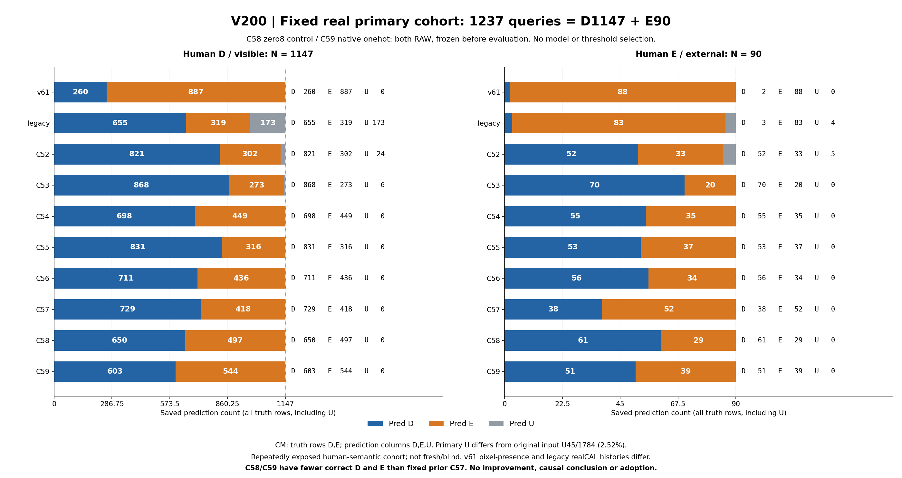

# V200 동결 native 조건 head 실사 비교

이번 시도에서 native 번호 조건을 추가한 C59는 실사 개선을 보이지 않았다. 고정 주평가1237(D1147/E90)에서 C58 zero8 control은 D650·E29, C59 native onehot은 D603·E39를 맞혔다. 이전 C57은 D729·E52로 새 두 팔보다 두 클래스 정답 수가 모두 많다. C55 대비 C59는 E39대37로2개 많지만 D603대831로228개 적으므로 종합 개선이라고 부를 수 없다. 어떤 모델도 선택·채택하지 않았고 전체 목표는 계속 미해결이다.

이번에 완료한 것은 source의 두 최종8000 상태를 동결한 뒤 같은 원초기 q/L/native·저장 crop에서 두 팔 모두 평가하고, 기존8모델과 동일 분모의 수치·고정68 gallery를 연결한 절차다. 새2모델×(current1784+public360)=4288행을 봉인한 후 별도 평가했다. current의 기존 인간 semantic D/E/S 기준은 유효한 authority로 유지한다. 반복 노출된 cohort이므로 fresh/blind 또는 자연실사 일반화 증명으로 해석하지 않는다.

새 두 팔은 모두 RAW다. C58은 zero8 control, C59는 native onehot이며 각각116407 stored parameters·8000steps다. 같은 parameter 수가 같은 유효 함수공간을 뜻하지 않고 shared backbone도 바뀔 수 있다. 기존5loss와 별도 direct objective, 원좌표·query crop·고정 decoder를 유지한 결과이며 이 수치로 threshold·모델·입력·architecture를 고르지 않았다.

## 저장 수치 readout

## 고정 실사 주평가: 이번 번호 조건 시도에서 개선 확인 없음

C58(zero8 control)은 D 650/1147·E 29/90, C59(native onehot)는 D 603/1147·E 39/90이다. 이전 C57은 D 729/1147·E 52/90으로, 새 두 팔보다 두 클래스의 정답 수가 모두 많다. 이 고정 결과는 이번 시도의 개선을 뒷받침하지 않는다. C57을 새로 선택하거나 어떤 모델을 채택하는 절차도 수행하지 않았다. 실패 원인·일반적 불가능성·통계적 우열을 확정하지 않는다.

## 주평가 10모델: N1237 = D1147 + E90

D는 인간 semantic visible, E는 인간 semantic external이다. CM은 [truth D: pred D,E,U]; [truth E: pred D,E,U]. Precision은 known D/E의 해당 예측 열을 분모로, recall은 U를 포함한 해당 truth 전체를 분모로 쓴다. U/N도 명시했다. 초기 품질·owner·reference error로 주평가를 거르지 않았다.

| 모델 | CM [D,E,U] 두 행 | D P | D R | E P | E R | U/N |
|---|---|---|---|---|---|---|
| v61 | [260,887,0]; [2,88,0] | 99.24% | 22.67% | 9.03% | 97.78% | 0/1237 (0.00%) |
| legacy | [655,319,173]; [3,83,4] | 99.54% | 57.11% | 20.65% | 92.22% | 177/1237 (14.31%) |
| C52 | [821,302,24]; [52,33,5] | 94.04% | 71.58% | 9.85% | 36.67% | 29/1237 (2.34%) |
| C53 | [868,273,6]; [70,20,0] | 92.54% | 75.68% | 6.83% | 22.22% | 6/1237 (0.49%) |
| C54 | [698,449,0]; [55,35,0] | 92.70% | 60.85% | 7.23% | 38.89% | 0/1237 (0.00%) |
| C55 | [831,316,0]; [53,37,0] | 94.00% | 72.45% | 10.48% | 41.11% | 0/1237 (0.00%) |
| C56 | [711,436,0]; [56,34,0] | 92.70% | 61.99% | 7.23% | 37.78% | 0/1237 (0.00%) |
| C57 | [729,418,0]; [38,52,0] | 95.05% | 63.56% | 11.06% | 57.78% | 0/1237 (0.00%) |
| C58 | [650,497,0]; [61,29,0] | 91.42% | 56.67% | 5.51% | 32.22% | 0/1237 (0.00%) |
| C59 | [603,544,0]; [51,39,0] | 92.20% | 52.57% | 6.69% | 43.33% | 0/1237 (0.00%) |

## 동일 슬롯 cohort는 별도: N1248

위1237은 paired_same_query_RGB 주평가다. 아래 same_slot_pipeline1248은 분모가 달라 합치지 않는다.

| 모델 | CM [D,E,U] 두 행 | D P/R | E P/R | U/N |
|---|---|---|---|---|
| v61 | [269,888,0]; [3,88,0] | 98.90% / 23.25% | 9.02% / 96.70% | 0/1248 (0.00%) |
| legacy | [655,319,183]; [3,83,5] | 99.54% / 56.61% | 20.65% / 91.21% | 188/1248 (15.06%) |
| C52 | [829,304,24]; [53,33,5] | 93.99% / 71.65% | 9.79% / 36.26% | 29/1248 (2.32%) |
| C53 | [875,276,6]; [71,20,0] | 92.49% / 75.63% | 6.76% / 21.98% | 6/1248 (0.48%) |
| C54 | [703,454,0]; [56,35,0] | 92.62% / 60.76% | 7.16% / 38.46% | 0/1248 (0.00%) |
| C55 | [838,319,0]; [54,37,0] | 93.95% / 72.43% | 10.39% / 40.66% | 0/1248 (0.00%) |
| C56 | [719,438,0]; [57,34,0] | 92.65% / 62.14% | 7.20% / 37.36% | 0/1248 (0.00%) |
| C57 | [737,420,0]; [39,52,0] | 94.97% / 63.70% | 11.02% / 57.14% | 0/1248 (0.00%) |
| C58 | [657,500,0]; [62,29,0] | 91.38% / 56.78% | 5.48% / 31.87% | 0/1248 (0.00%) |
| C59 | [611,546,0]; [52,39,0] | 92.16% / 52.81% | 6.67% / 42.86% | 0/1248 (0.00%) |

## WOOD·SQUARE: 주평가 material별10모델

등록 frame은 WOOD105·SQUARE118이다. 주평가 슬롯은 WOOD645(D616/E29), SQUARE592(D531/E61)이다. 두 material CM의 합은 각 모델 주평가 CM과 일치한다.

| material | 모델 | CM [D,E,U] | D P/R | E P/R | U/N |
|---|---|---|---|---|---|
| WOOD_PRIMARY105 | v61 | [145,471,0]; [0,29,0] | 100.00% / 23.54% | 5.80% / 100.00% | 0/645 |
| SQUARE118 | v61 | [115,416,0]; [2,59,0] | 98.29% / 21.66% | 12.42% / 96.72% | 0/592 |
| WOOD_PRIMARY105 | legacy | [448,65,103]; [2,23,4] | 99.56% / 72.73% | 26.14% / 79.31% | 107/645 |
| SQUARE118 | legacy | [207,254,70]; [1,60,0] | 99.52% / 38.98% | 19.11% / 98.36% | 70/592 |
| WOOD_PRIMARY105 | C52 | [475,120,21]; [21,5,3] | 95.77% / 77.11% | 4.00% / 17.24% | 24/645 |
| SQUARE118 | C52 | [346,182,3]; [31,28,2] | 91.78% / 65.16% | 13.33% / 45.90% | 5/592 |
| WOOD_PRIMARY105 | C53 | [471,144,1]; [24,5,0] | 95.15% / 76.46% | 3.36% / 17.24% | 1/645 |
| SQUARE118 | C53 | [397,129,5]; [46,15,0] | 89.62% / 74.76% | 10.42% / 24.59% | 5/592 |
| WOOD_PRIMARY105 | C54 | [427,189,0]; [21,8,0] | 95.31% / 69.32% | 4.06% / 27.59% | 0/645 |
| SQUARE118 | C54 | [271,260,0]; [34,27,0] | 88.85% / 51.04% | 9.41% / 44.26% | 0/592 |
| WOOD_PRIMARY105 | C55 | [492,124,0]; [23,6,0] | 95.53% / 79.87% | 4.62% / 20.69% | 0/645 |
| SQUARE118 | C55 | [339,192,0]; [30,31,0] | 91.87% / 63.84% | 13.90% / 50.82% | 0/592 |
| WOOD_PRIMARY105 | C56 | [395,221,0]; [15,14,0] | 96.34% / 64.12% | 5.96% / 48.28% | 0/645 |
| SQUARE118 | C56 | [316,215,0]; [41,20,0] | 88.52% / 59.51% | 8.51% / 32.79% | 0/592 |
| WOOD_PRIMARY105 | C57 | [401,215,0]; [16,13,0] | 96.16% / 65.10% | 5.70% / 44.83% | 0/645 |
| SQUARE118 | C57 | [328,203,0]; [22,39,0] | 93.71% / 61.77% | 16.12% / 63.93% | 0/592 |
| WOOD_PRIMARY105 | C58 | [344,272,0]; [19,10,0] | 94.77% / 55.84% | 3.55% / 34.48% | 0/645 |
| SQUARE118 | C58 | [306,225,0]; [42,19,0] | 87.93% / 57.63% | 7.79% / 31.15% | 0/592 |
| WOOD_PRIMARY105 | C59 | [310,306,0]; [14,15,0] | 95.68% / 50.32% | 4.67% / 51.72% | 0/645 |
| SQUARE118 | C59 | [293,238,0]; [37,24,0] | 88.79% / 55.18% | 9.16% / 39.34% | 0/592 |

## native0..7 전체 유지

아래는 C57·새 두 팔의 정답 수를 표시한 축약표다. 모든10모델×8native×ALL/WOOD/SQUARE=240행의 CM/P/R/U는 연결 CSV에 그대로 보존했다. source 직접 감독이 없던 native6·7도 실사 평가에서 제외하지 않았다.

| native | N (D/E) | C57 D정답; E정답; U | C58 D정답; E정답; U | C59 D정답; E정답; U |
|---|---|---|---|---|
| 0 | 200 (179/21) | 135/179; 12/21; U0 | 127/179; 7/21; U0 | 115/179; 11/21; U0 |
| 1 | 203 (196/7) | 129/196; 6/7; U0 | 105/196; 0/7; U0 | 105/196; 1/7; U0 |
| 2 | 193 (187/6) | 100/187; 3/6; U0 | 90/187; 0/6; U0 | 88/187; 1/6; U0 |
| 3 | 172 (157/15) | 89/157; 11/15; U0 | 86/157; 7/15; U0 | 75/157; 10/15; U0 |
| 4 | 196 (182/14) | 149/182; 5/14; U0 | 119/182; 6/14; U0 | 109/182; 5/14; U0 |
| 5 | 187 (163/24) | 86/163; 14/24; U0 | 74/163; 8/24; U0 | 66/163; 10/24; U0 |
| 6 | 38 (36/2) | 16/36; 0/2; U0 | 21/36; 1/2; U0 | 19/36; 1/2; U0 |
| 7 | 48 (47/1) | 25/47; 1/1; U0 | 28/47; 0/1; U0 | 26/47; 0/1; U0 |

## SELF136과 paired21: 별개 binary response

all SELF136은 same_slot_pipeline이며 모두 WOOD다. paired_same_query_RGB는21이다. 차이115는 기존 paired_same_query_RGB_D_vs_ES eligibility 밖이지만, 저장 summary에 세부 제외사유가 없어 원인을 추정하지 않는다. 두 표의 E 반응은 learned self 분류나 external/self 식별 정답이 아니다.

| 모델 | all136 D/E/U | paired21 D/E/U |
|---|---|---|
| v61 | 115/21/0 | 9/12/0 |
| legacy | 13/118/5 | 13/3/5 |
| C52 | 95/38/3 | 18/2/1 |
| C53 | 106/27/3 | 15/6/0 |
| C54 | 98/38/0 | 19/2/0 |
| C55 | 103/33/0 | 16/5/0 |
| C56 | 85/51/0 | 16/5/0 |
| C57 | 101/35/0 | 13/8/0 |
| C58 | 77/59/0 | 15/6/0 |
| C59 | 81/55/0 | 15/6/0 |

## 기존 reference≤3 461과 manual376은 별개

461은 등록된 humanD 중 기존 general reference error≤3 association이다.376은 manual-click direct valid-query error≤3 표의 합(WOOD153+SQUARE223)이다. 동일 집합으로 가정하지 않으며 primary 필터·원좌표 오차 인증·좌표 보정으로 쓰지 않았다.

| 모델 | reference461 D/E/U | manual376 D/E/U |
|---|---|---|
| v61 | 95/366/0 | 85/291/0 |
| legacy | 270/118/73 | 205/108/63 |
| C52 | 323/128/10 | 260/111/5 |
| C53 | 339/118/4 | 272/100/4 |
| C54 | 269/192/0 | 217/159/0 |
| C55 | 330/131/0 | 257/119/0 |
| C56 | 290/171/0 | 239/137/0 |
| C57 | 291/170/0 | 240/136/0 |
| C58 | 262/199/0 | 216/160/0 |
| C59 | 250/211/0 | 205/171/0 |

## publicheld360 weak owner: 별도9모델 task

45frame의360슬롯 중 known center204(T24/nonT180=F96+BG84), truth UNKNOWN156이다. 원 inputU108/available252, crop 미구성24, center4 invalid112를 보존한다. v61은 자체 available251/U109이며 다른8 owner출력은 U108이다. 아래 known precision은 UNKNOWN truth를 제외하고, recall은 known truth의 predictionU를 포함한다. legacy는 reviewed lineage에 없어 보간·새 forward하지 않았다. public weak point/crop owner를 native D/E/S 또는 direct-end 정답으로 승격하지 않는다.

| 모델 | known CM T/nonT→T/nonT/U | T P/R | nonT P/R | 전체 prediction U/360 |
|---|---|---|---|---|
| v61 | [7,17,0]; [16,164,0] | 30.43% / 29.17% | 90.61% / 91.11% | 109/360 |
| C52 | [17,7,0]; [26,154,0] | 39.53% / 70.83% | 95.65% / 85.56% | 108/360 |
| C53 | [16,8,0]; [14,166,0] | 53.33% / 66.67% | 95.40% / 92.22% | 108/360 |
| C54 | [19,5,0]; [43,137,0] | 30.65% / 79.17% | 96.48% / 76.11% | 108/360 |
| C55 | [20,4,0]; [23,157,0] | 46.51% / 83.33% | 97.52% / 87.22% | 108/360 |
| C56 | [20,4,0]; [39,141,0] | 33.90% / 83.33% | 97.24% / 78.33% | 108/360 |
| C57 | [16,8,0]; [29,151,0] | 35.56% / 66.67% | 94.97% / 83.89% | 108/360 |
| C58 | [20,4,0]; [44,136,0] | 31.25% / 83.33% | 97.14% / 75.56% | 108/360 |
| C59 | [19,5,0]; [44,136,0] | 30.16% / 79.17% | 96.45% / 75.56% | 108/360 |

## source fit와 합성 HOLDOUT은 실사와 분리

두 팔 모두 TRAIN327(D218/E109)을 모두 맞혔고109 known D-E-D triplet을 모두 맞혔다. 이는 apparent fit이다. source HOLDOUT은6 synthetic bases [42,50,74,75,83,104]의45known(D30/E15),315 truthUNKNOWN이다. C58/C59 모두 D28/30, E는5/15와4/15, E precision5/7과4/6, paired all3-correct4/15와3/15다. real weak direct HOLDOUT known은0, native6·7의 direct known도0이다. TRAIN327은 synthetic246+publicreal weak81이며 strict synthetic-only recipe가 아니다. 이미 재사용된 source design이므로 fresh/blind가 아니다. TRAIN exact RAW327→312unique identity/no D-E conflict는 독립 frame 수가 아니다.168 incomplete attempt-native groups와868 complete UNKNOWN/othertruth groups는 추가 정답으로 세지 않는다.

| 모델 | 역할 | rows/known/UNKNOWN | CM [D,E,U] |
|---|---|---|---|
| C58 | TRAIN | 2784/327/2457 | [218,0,0]; [0,109,0] |
| C58 | HOLDOUT | 360/45/315 | [28,2,0]; [10,5,0] |
| C59 | TRAIN | 2784/327/2457 | [218,0,0]; [0,109,0] |
| C59 | HOLDOUT | 360/45/315 | [28,2,0]; [11,4,0] |

## 비교 역할·실행 범위와 한계

v61은 historical pixel-presence baseline으로 native semantic과 task가 다르다. legacy는 historical realCAL 및 반복 노출 이력이 있어 새 source-only head와 fresh transfer 대조군으로 해석할 수 없다. C52/C53의 D/E/U는 regional two-support proxy, C54..C59는 direct-end logit decoder이며 support2/owner3 보조출력과 구분한다. C58과 C59는 모두 RAW이고 각각 zero8/native onehot이다.116407 stored parameters는 같아도 유효 함수공간이 같다는 뜻은 아니며 shared backbone도 영향을 받을 수 있다. 원 q/L/native·초기 crop·고정 decoder를 유지했다. C54..C59는 finite direct logit≥0→E, <0→D이며 원 input unavailable/nonfinite는 U다. 새 모델/threshold/data/architecture 선택, 원 crop·source 배열·weights 읽기, 모델 forward/fit/PnP/SAM은 하지 않았다. 반복 평가된 인간 semantic authority를 유지하며 fresh/blind·개선·채택·목표 완료를 주장하지 않는다.

## 고정68 gallery는 별도 시각 근거

root의 고정6개 실제 card 관찰 기록은 CASE0840(humanD, 기존 reference error 2.7108px)에서 C58/C59가 E, CASE0996(humanE,1.13822px)에서 두 팔이 D였음을 기록한다. 이는 이번 fixed case의 실패 예시이며 원인이나 전체 실패빈도를 확정하지 않는다. 인접 재료·외부물체 단서와 native 목표를 구분하는 문제가 남아 있다. 이 numeric 작성자는 원 crop/card를 새로 열지 않았고, 아래 별도 gallery와 root 관찰 영수증을 연결한다.68개 전체를 실제 도구로 보았다는 주장이 아니다.

## 수치표·근거

- [PRIMARY_ALL10.csv](numeric_readout_v1/PRIMARY_ALL10.csv)
- [SAME_SLOT_ALL10.csv](numeric_readout_v1/SAME_SLOT_ALL10.csv)
- [PRIMARY_MATERIAL_ALL10.csv](numeric_readout_v1/PRIMARY_MATERIAL_ALL10.csv)
- [SAVED_PRIMARY_NATIVE8_D_E_WITH_U.csv](numeric_readout_v1/SAVED_PRIMARY_NATIVE8_D_E_WITH_U.csv)
- [SELF_TWO_COHORTS_ALL10.csv](numeric_readout_v1/SELF_TWO_COHORTS_ALL10.csv)
- [REFERENCE461_AND_MANUAL376_ALL10.csv](numeric_readout_v1/REFERENCE461_AND_MANUAL376_ALL10.csv)
- [PUBLIC_WEAK_BINARY9.csv](numeric_readout_v1/PUBLIC_WEAK_BINARY9.csv)
- [PUBLIC_WEAK_OWNER3_8.csv](numeric_readout_v1/PUBLIC_WEAK_OWNER3_8.csv)
- [PUBLIC_WEAK_NATIVE9.csv](numeric_readout_v1/PUBLIC_WEAK_NATIVE9.csv)
- [SOURCE_TRAIN_AND_HOLDOUT_C58_C59.csv](numeric_readout_v1/SOURCE_TRAIN_AND_HOLDOUT_C58_C59.csv)
- [RESULTS_KO.json](numeric_readout_v1/RESULTS_KO.json)
- [PRIMARY_ALL10_COUNTS.svg](numeric_readout_v1/PRIMARY_ALL10_COUNTS.svg)
- [독립 실제 수치감사 PASS](independent_saved_result_review_c/actual_review_v1/REVIEW.json)
- [저장 current summary](saved_real_head_evaluation_v1/current1784/CURRENT_HUMAN_SEMANTIC_AND_SEPARATE_ASSOCIATIONS.json)
- [저장 public weak summary](saved_real_head_evaluation_v1/publicheld360/PUBLIC_WEAK_OWNER_AND_SEPARATE_SUPPORT_ASSOCIATIONS.json)
- [저장 평가 COMPLETE](saved_real_head_evaluation_v1/COMPLETE.json)
- [V199 source 보고서 JSON](../query_visibility_native_conditioned_grouped_source_training_20261024_v199/ROOT_RESULTS_KO.json)
- [고정68 portable gallery](fixed_native_real_visual_v1/PORTABLE_GALLERY_KO.md)
- [고정68 gallery HTML](fixed_native_real_visual_v1/index.html)
- [root 고정6 실제 card 관찰 기록](ROOT_ACTUAL_FIXED6_CARD_VISUAL_QA.json)

## 같은 고정68 gallery와 실제 관찰의 범위

이전 고정68개를 동일 순서로 재사용했다. 새 점수로 좋은/나쁜 사례를 다시 고르지 않았다.68 clean96/valid96 PNG의 기존 V195 pixel/encoded byte parity와 표·링크는 A의 봉인 QA에 근거한다. 이는68개의 semantic 의미를 도구로 모두 판독했다는 뜻이 아니다. root가 [0,2,256,300,840,996] 여섯 card, A가 [1,3,4,5,7,8] 여섯 card를 실제로 보아 union12개다. A는 해당 renderer 저자임을 밝혔으므로 자기 코드와 독립된 QA라고 주장하지 않는다. 실제6개 A 관찰은 초반 WOOD humanD에 치우쳐 전체 재질·실패율을 대표하지 않는다. C는 count chart를 실제 확인했고 원 crop/card를 새로 열지 않았다. HTML browser 렌더 검증은 하지 않았다.

| root 실제 관찰 사례 | 기존 human/reference 및 저장 응답에 근거한 관찰 |
|---|---|
| CASE_0840 | 녹색 상단 모서리와 빨간 콘이 함께 있는 human D. manual reference2.7108px인데 C58/C59 E. 주변 외부물체 단서와 native부위 판단의 혼동 가능성, 원인 확정 아님. |
| CASE_0996 | 녹색 팔레트와 빨간 콘이 함께 있는 human E. manual reference1.13822px인데 C58/C59 D. 가까운 좌표에서도 외부가림을 놓치는 사례; 주변 재료 존재와 native가시성 차이의 원인후보, 확정 아님. |

CASE0840은 humanD·manual reference2.7108px인데 C58/C59가 E, CASE0996은 humanE·manual reference1.13822px인데 두 팔이 D다. 근접 reference 사례에서도 이 오류가 남는다. 인접 재료·외부물체 단서와 의도한 native 가시성을 구분하는 문제가 남아 있다는 기술적 관찰이며, local crop만으로 selected instance·물리 native 정체·차폐 원인·실패 원인 빈도를 인증하지 않는다. 위 두 예시는 root의 실제 관찰 영수증을 인용했으며 보고서 작성자가 새 semantic label을 만들지 않았다.

## 기존 조언 문서와 현재 허용 범위

V194에 보존한 첨부 V193 검토 문서는 조언이며 새 실행·중단 지시로 가져오지 않았다. 해당 문서의 엄격 synthetic-only 전제와 현재 사용자의 공개실사 학습 허용을 구분한다. 이번 source recipe는 합성+공개실사 weak end를 사용했고 current223/publicheld45·기존 평가 cohort를 학습·보정·threshold·모델 선택에 쓰지 않았다. 문서가 지적한 native와 finite-end의 불일치 가능성, target 식별 가능성, U0의 해석 문제는 미해결 한계로 남긴다. prior한계와 이번 오류를 연결해 단일 인과를 확정하지 않는다.

## 현재까지 닫힌 것과 남은 목표

원 q/L/native와 기존 초기 crop을 유지한 source 학습·동결·같은 분모 실사 비교·수치 검산·고정 시각 자료 연결을 완료했다. 번호 조건 추가가 이번 source HOLDOUT 및 실사에서 개선을 주었다는 근거는 없다. source direct 감독은 weak finite-end 권위이며 physical native gold로 승격하지 않았다. native6·7 direct known0, 공개실사 end HOLDOUT known0, 반복 노출 조건과 source TRAIN apparent fit의 한계가 남는다. 단순 주변 재료/물체 존재와 의도한 끝부위의 외부가림을 안정적으로 구분하는 전체 사용자 목표는 미해결이다. 후속 원인·자료·모델 변경은 이 보고서가 선택하거나 실행하지 않는다.

## 코드·실행·감사·표·시각화 계보

- [수치표 전체 JSON](numeric_readout_v1/RESULTS_KO.json)
- [수치표·분모 설명](numeric_readout_v1/REPORT_KO.md)
- [수치 HTML](numeric_readout_v1/index.html)
- [10모델 주평가 CSV](numeric_readout_v1/PRIMARY_ALL10.csv)
- [same-slot 별도 CSV](numeric_readout_v1/SAME_SLOT_ALL10.csv)
- [material20행 CSV](numeric_readout_v1/PRIMARY_MATERIAL_ALL10.csv)
- [native8×10×3 CSV](numeric_readout_v1/SAVED_PRIMARY_NATIVE8_D_E_WITH_U.csv)
- [SELF 두 cohort CSV](numeric_readout_v1/SELF_TWO_COHORTS_ALL10.csv)
- [reference461/manual376 CSV](numeric_readout_v1/REFERENCE461_AND_MANUAL376_ALL10.csv)
- [public weak9 CSV](numeric_readout_v1/PUBLIC_WEAK_BINARY9.csv)
- [public owner3 CSV](numeric_readout_v1/PUBLIC_WEAK_OWNER3_8.csv)
- [고정68 portable gallery](fixed_native_real_visual_v1/PORTABLE_GALLERY_KO.md)
- [고정68 HTML](fixed_native_real_visual_v1/index.html)
- [gallery 봉인](fixed_native_real_visual_v1/COMPLETE.json)
- [root6 실제 card 관찰](ROOT_ACTUAL_FIXED6_CARD_VISUAL_QA.json)
- [A6 실제 card·68 PNG parity/table QA](actual_gallery_and_numeric_report_review_a/REVIEW.json)
- [root count 그림 실제 관찰](ROOT_ACTUAL_SAVED_PRIMARY_CHART_VISUAL_QA.json)
- [C numeric CLOSED](numeric_report_preparation_c/NUMERIC_READOUT_COMPLETE.json)
- [V199 source 보고서](../query_visibility_native_conditioned_grouped_source_training_20261024_v199/PORTABLE_REPORT_KO.md)
- [V199 source fit COMPLETE](../query_visibility_native_conditioned_grouped_source_training_20261024_v199/runs/C58_C59_NATIVE_CONDITIONED_GROUPED_SOURCE_FIXED8000/COMPLETE.json)
- [V199 source 최종8000 동결 장벽](../query_visibility_native_conditioned_grouped_source_training_20261024_v199/runs/C58_C59_NATIVE_CONDITIONED_GROUPED_SOURCE_FIXED8000/ALL2_FINAL8000_FROZEN_BEFORE_SOURCE_TRAIN_OR_HOLDOUT_OUTPUTS.json)
- [V199 source trainer 코드](../query_visibility_native_conditioned_grouped_source_training_20261024_v199/fit_preparation_a/train_native_conditioned_grouped_source.py)
- [V199 source trainer protocol](../query_visibility_native_conditioned_grouped_source_training_20261024_v199/fit_preparation_a/PROTOCOL_BEFORE_NATIVE_CONDITIONED_SOURCE_CACHE_OR_FIT_BODIES.json)
- [V199 source 감사](../query_visibility_native_conditioned_grouped_source_training_20261024_v199/independent_saved_fit_review_c/actual_review_v1/REVIEW.json)
- [V200 두 팔 inference 코드](prediction_preparation_a/infer_both_frozen_native_heads.py)
- [V200 inference protocol](prediction_preparation_a/PROTOCOL_BEFORE_ANY_REAL_ARRAY_OR_FINAL_WEIGHT_BODIES.json)
- [V200 prediction seal](frozen_C58_C59_real_predictions_v1/PREDICTION_SEAL.json)
- [V200 저장 evaluator 코드](evaluation_preparation_a/evaluate_saved_native_heads_real.py)
- [V200 저장 evaluator protocol](evaluation_preparation_a/PROTOCOL_BEFORE_REAL_ANNOTATION_OR_SAVED_SCORE_BODIES.json)
- [V200 저장 평가 COMPLETE](saved_real_head_evaluation_v1/COMPLETE.json)
- [V200 독립 실제 수치감사](independent_saved_result_review_c/actual_review_v1/REVIEW.json)
- [첨부 조언 원문·현재 권한 비교 영수증](../query_visibility_source_group_split_direct_end_training_20261024_v194/external_review_received/RECEIVED_REVIEW_AND_ROOT_COMPARISON.json)
- [현재 권한·recipe 비교 메모](../query_visibility_source_group_split_direct_end_training_20261024_v194/external_review_received/ROOT_REVIEW_VS_CURRENT_AUTHORIZATION_AND_V194_KO.md)
- [받은 조언 원문 보존본](../query_visibility_source_group_split_direct_end_training_20261024_v194/external_review_received/PALLET_VISIBILITY_REVIEW_AND_NEXT_STEPS_V193_KO.md)
