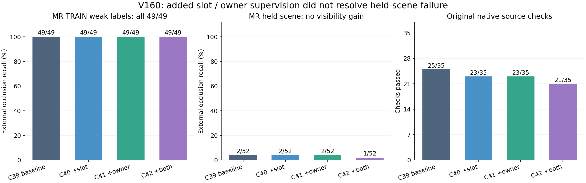
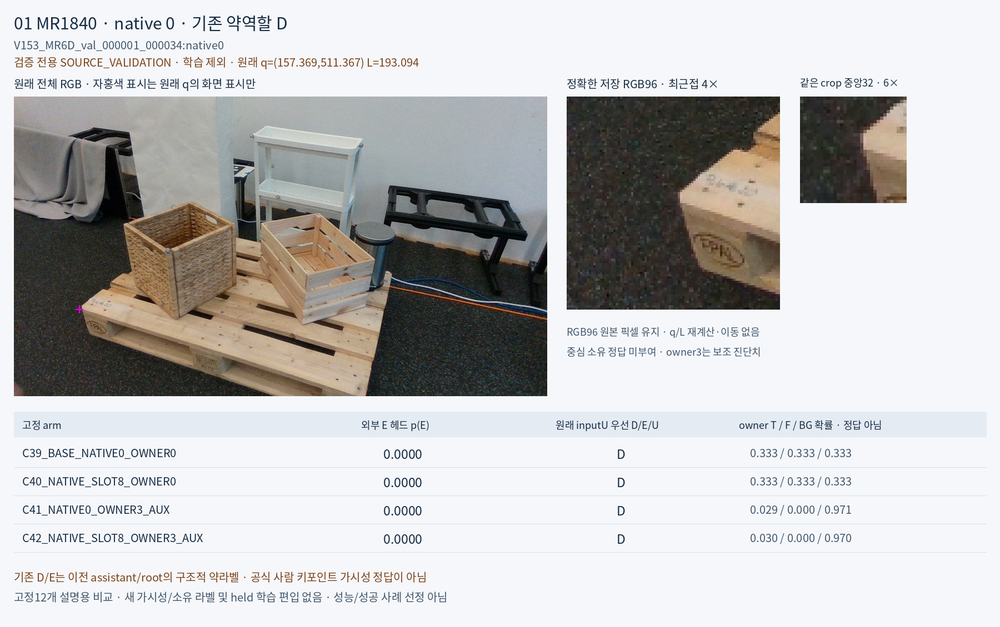
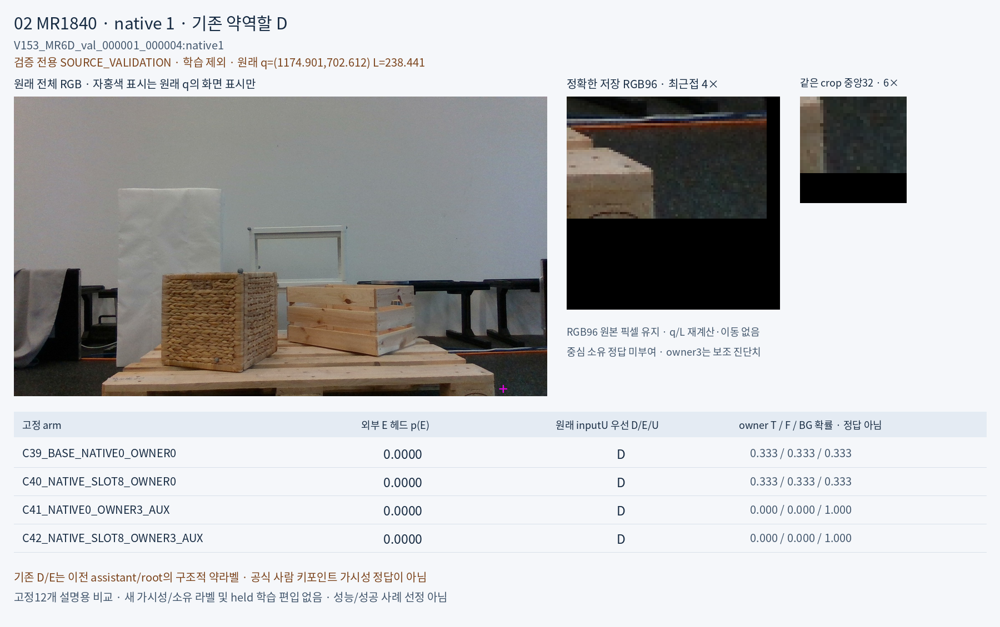
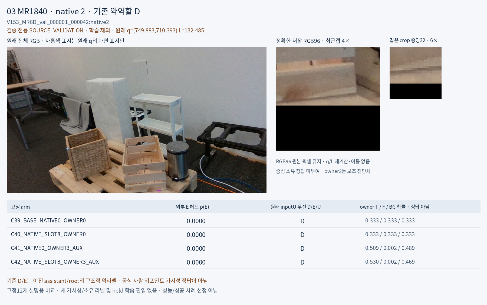

# V160 — query_visibility_native_slot_owner_factorial_20261024_v160

기존 보고서에서 추출한 게시용 파생 개요입니다. 원본 파일을 수정하거나 실험·평가를 다시 실행하지 않았습니다. 원문 해시와 링크 대응은 publication manifest로 확인합니다.

**상태:** {"completed":true,"selected_model":null,"adopted":false,"fully_solved":false,"goal_status":"active_unsolved"}

원본:

- [ROOT_PHASE_RESULT.json](ROOT_PHASE_RESULT.json) — SHA256 `6357f88931cca2c4b3a9a9821ea58e2e2783c361eb167e98c1ee5413bf340d28`
- [ROOT_READOUT_KO.html](ROOT_READOUT_KO.html) — SHA256 `df491242fb6de349b861253456333d1e71d92adcb6f12ebe1915f784d59feeae`
- [ROOT_RESULTS_KO.json](ROOT_RESULTS_KO.json) — SHA256 `c0694883e3204cc6501610f4a31cc54f1f4fd1565ac61443ab3c5fd094e0bcaf`

## 방법·목표의 원문 필드

`$.schema`

```text
V160_ROOT_FOUR_ARM_SOURCE_RESULT_UNSOLVED
```


## 입력·학습·평가 분모의 원문 필드

`$.actual_execution`

```text
{
  "path": "query_visibility_native_slot_owner_factorial_20261024_v160/ROOT_ACTUAL_SOURCE_FIT_COMPLETED.json",
  "sha256": "8b86c244145fce16bb64cdaeb26bff817d9dd2d48b378eac09b299a7295cb093"
}
```

`$.all_source_rows_each`

```text
28976
```

`$.all_inputU_each`

```text
535
```

`$.all4_actual_updates_each`

```text
8000
```

`$.all4_actual_updates_total`

```text
32000
```


## 결론·실패·한계의 원문 필드

`$.interpretation_KO`

```text
[
  "이 고정 설계·seed1550·8000회 조건에서 키포인트 번호와 owner253 약감독은 공개 MR held 외부 가림 일반화를 개선하지 못했다. 다른 구현·규제·더 다양한 데이터의 효과까지 부정하지는 않는다.",
  "TRAIN 주 가림 및 owner 보조 분류 적합은 성공했지만, 이것은 held 가림 성공 증거가 아니다.",
  "Pallox 카드보드 가림은 원래 기준도 맞혔다. MR 바구니/목재상자에 같은 개선이 전이되지 않았다.",
  "정확한 코드 대조군·draw·원래 입력과 보류 보존이 확인돼, 이 결과를 단순한 새 브랜치 초기화/평가 어댑터 오류로 설명할 근거는 없다.",
  "중심에 보이는 재료와 의도한 native 부위의 가시성은 여전히 별도다. owner를 E로 자동 변환하거나 GT 좌표 오차로 평가 표본을 빼지 않았다."
]
```

`$.limitations_KO`

```text
[
  "공개 실사 D/E는 기존 구조적 약라벨이며 공식 사람이 찍은 키포인트 가시성 gold가 아니다.",
  "한 seed의 고정 대조실험이며 효과가 모든 학습법에서 없다고 일반화하지 않는다.",
  "별도 entity 출력의 기존 한계와 실사 좌표 품질 gold 부재가 남아 있다.",
  "이번 단계는 current223를 읽거나 새 평가·학습·문턱·조건 선택에 사용하지 않았다. 최신 실제 current 평가 기준은 V156으로 유지한다."
]
```


## 코드·검증·전체 표·갤러리

아래 목록은 원 보고서가 참조한 파일의 경로를 다시 연결한 것입니다. 이 개요 작성 중 이미지 내용이나 raw 평가 데이터를 새로 검사하지 않았습니다.

- [query_visibility_native_slot_owner_factorial_20261024_v160/ROOT_ACTUAL_SOURCE_FIT_COMPLETED.json](ROOT_ACTUAL_SOURCE_FIT_COMPLETED.json)
- [query_visibility_native_slot_owner_factorial_20261024_v160/ROOT_RESULTS_KO.json](ROOT_RESULTS_KO.json)
- [query_visibility_native_slot_owner_factorial_20261024_v160/ROOT_READOUT_KO.html](ROOT_READOUT_KO.html)
- [query_visibility_native_slot_owner_factorial_20261024_v160/independent_saved_review/SAVED_SOURCE_EXECUTION_REVIEW.json](independent_saved_review/SAVED_SOURCE_EXECUTION_REVIEW.json)
- [query_visibility_native_slot_owner_factorial_20261024_v160/factorial_source_readout/EXTRACTION_COMPLETE.json](factorial_source_readout/EXTRACTION_COMPLETE.json)
- [query_visibility_native_slot_owner_factorial_20261024_v160/factorial_source_readout/READOUT_PARTITION_VERIFICATION.json](factorial_source_readout/READOUT_PARTITION_VERIFICATION.json)
- [query_visibility_native_slot_owner_factorial_20261024_v160/source_crop_readout/READOUT_COMPLETE.json](source_crop_readout/READOUT_COMPLETE.json)
- [query_visibility_native_slot_owner_factorial_20261024_v160/ROOT_ACTUAL_SOURCE_CROP_AND_FIGURE_QA.json](ROOT_ACTUAL_SOURCE_CROP_AND_FIGURE_QA.json)
- [query_visibility_native_slot_owner_factorial_20261024_v160/final_publication_review/FINAL_PUBLICATION_REVIEW.json](final_publication_review/FINAL_PUBLICATION_REVIEW.json)
- [query_visibility_native_slot_owner_factorial_20261024_v160/next_source_counterfactual_readiness/READY_METADATA_FINDINGS.json](next_source_counterfactual_readiness/READY_METADATA_FINDINGS.json)
- [query_visibility_native_slot_owner_factorial_20261024_v160/ROOT_NEXT_SOURCE_GENERATION_REQUIREMENTS.json](ROOT_NEXT_SOURCE_GENERATION_REQUIREMENTS.json)
- [query_visibility_native_slot_owner_factorial_20261024_v160/factorial_source_readout/FULL_NATIVE_MATERIAL_ASPECT_TABLES.json](factorial_source_readout/FULL_NATIVE_MATERIAL_ASPECT_TABLES.json.parts.json)
- [query_visibility_native_slot_owner_factorial_20261024_v160/factorial_source_readout/FACTORIAL_EFFECTS_DIAGNOSTIC.json](factorial_source_readout/FACTORIAL_EFFECTS_DIAGNOSTIC.json.parts.json)
- [query_visibility_native_slot_owner_factorial_20261024_v160/factorial_source_readout/ARM_DATASET_SUMMARY.json](factorial_source_readout/ARM_DATASET_SUMMARY.json)
- [query_visibility_native_slot_owner_factorial_20261024_v160/source_crop_readout/rendered_fixed12/FIXED12_RENDER_MANIFEST.json](source_crop_readout/rendered_fixed12/FIXED12_RENDER_MANIFEST.json)

## 원 보고서의 그림

원 보고서 참조 순서의 처음 최대4개를 표시합니다. 새 outcome 선택이나 전수 이미지 검증을 뜻하지 않습니다. 전체 갤러리는 위 원문 링크에서 확인합니다.

[query_visibility_native_slot_owner_factorial_20261024_v160/ROOT_SOURCE_RESULT_OVERVIEW.png](ROOT_SOURCE_RESULT_OVERVIEW.png)



[query_visibility_native_slot_owner_factorial_20261024_v160/source_crop_readout/rendered_fixed12/CASE_01_MR1840_0856/COMPARISON_CARD.png](source_crop_readout/rendered_fixed12/CASE_01_MR1840_0856/COMPARISON_CARD.png)



[query_visibility_native_slot_owner_factorial_20261024_v160/source_crop_readout/rendered_fixed12/CASE_02_MR1840_0617/COMPARISON_CARD.png](source_crop_readout/rendered_fixed12/CASE_02_MR1840_0617/COMPARISON_CARD.png)



[query_visibility_native_slot_owner_factorial_20261024_v160/source_crop_readout/rendered_fixed12/CASE_03_MR1840_0922/COMPARISON_CARD.png](source_crop_readout/rendered_fixed12/CASE_03_MR1840_0922/COMPARISON_CARD.png)




현재 사용자 목표 전체의 해결·새 모델 채택·실사 가림 원인 확정을 이 파생 개요가 추가로 주장하지 않습니다. UNKNOWN/U와 불리한 결과, 실패 실행 및 수정 provenance는 원문대로 보존해야 합니다.

큰 원문 링크는 무손실 gzip의 `.parts.json` descriptor로 연결합니다. 원문 SHA와 복원 방법은 게시 안내를 따릅니다.
