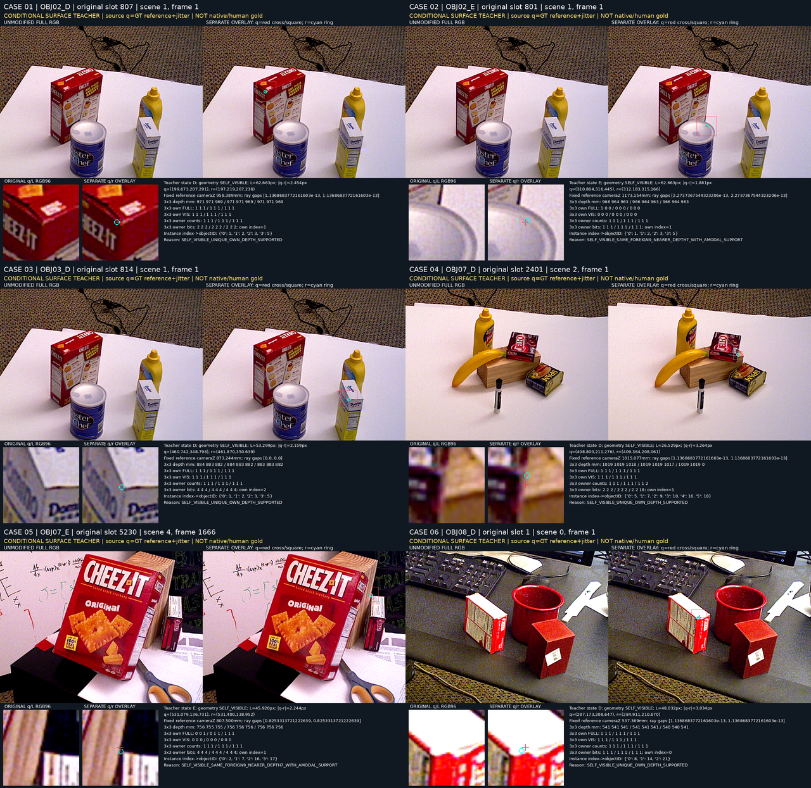
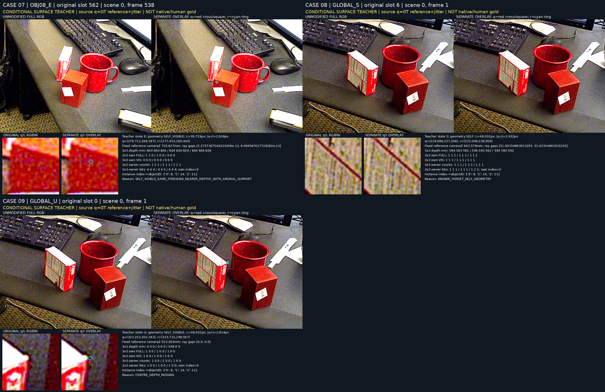

# V110 — query_visibility_natural_surface_rgb_head_20261023_v110

기존 보고서에서 추출한 게시용 파생 개요입니다. 원본 파일을 수정하거나 실험·평가를 다시 실행하지 않았습니다. 원문 해시와 링크 대응은 publication manifest로 확인합니다.

**상태:** {"completed":true}

원본:

- [ROOT_READOUT_KO.html](ROOT_READOUT_KO.html) — SHA256 `e69642769db7236e93b029c7ce94634c15bd3e9e081b4dd005a32521bbe9b447`
- [ROOT_RESULTS_KO.json](ROOT_RESULTS_KO.json) — SHA256 `965f437b473c9455d84c5cafd57a2784cb081e070ac0eb1b840e6b78178c61af`

## 방법·목표의 원문 필드

자동 추출 가능한 해당 최상위 필드가 없습니다. 원문 보고서와 phase receipt를 확인하십시오.

## 입력·학습·평가 분모의 원문 필드

`$.updates`

```text
2000
```

`$.new_YCB_all_rows`

```text
8000
```

`$.new_YCB_VAL_rows`

```text
0
```

`$.current_training_threshold_selection_or_PnP`

```text
0
```


## 결론·실패·한계의 원문 필드

`$.natural_VAL_caveat`

```text
2 points in the same after RGB and same physical before/after pair; not2 independent images. Qualitative registration only.
```

`$.limitations`

```text
[
  "Source conditional AUX and associated-surface visibility, not human/native-junction gold.",
  "New YCB has TRAIN only; its accuracy is training-set fit, not natural-real heldout performance.",
  "Additional YCB q is GT projection plus frozen radius4px jitter, not actual initializer output; no location correctness established.",
  "Old119 controlled VAL rank pairs cluster18 base queries/9 images. Repeated source-development exposure.",
  "C10 changes training data, explicit feature relations and sampler; this comparison does not isolate a single cause.",
  "Geometric S2313 and unresolved U36632 are distinct excluded labels; factual input unavailable4965 is a separate count."
]
```


## 코드·검증·전체 표·갤러리

아래 목록은 원 보고서가 참조한 파일의 경로를 다시 연결한 것입니다. 이 개요 작성 중 이미지 내용이나 raw 평가 데이터를 새로 검사하지 않았습니다.

- [query_visibility_ycb_real_surface_source_20261023_v109/fixed_state_rgb_review/ACTUAL_FIXED_CASE_OBSERVATIONS.json](../query_visibility_ycb_real_surface_source_20261023_v109/fixed_state_rgb_review/ACTUAL_FIXED_CASE_OBSERVATIONS.json)
- [query_visibility_target_relative_rgb_head_20261023_v108/natural_beforeE_visual_review/ACTUAL_VISUAL_OBSERVATIONS.json](../query_visibility_target_relative_rgb_head_20261023_v108/natural_beforeE_visual_review/ACTUAL_VISUAL_OBSERVATIONS.json)
- [query_visibility_target_relative_rgb_head_20261023_v108/ROOT_READOUT_KO.html](../query_visibility_target_relative_rgb_head_20261023_v108/ROOT_READOUT_KO.html)
- [query_visibility_natural_surface_rgb_head_20261023_v110/ROOT_RESULTS_KO.json](ROOT_RESULTS_KO.json)
- [query_visibility_natural_surface_rgb_head_20261023_v110/runs/C10_NATURAL_SURFACE_TARGET_RELATIVE_RGB/SOURCE_GATE_RESULTS.json](runs/C10_NATURAL_SURFACE_TARGET_RELATIVE_RGB/SOURCE_GATE_RESULTS.json)
- [query_visibility_frozen_rgb_head_20261023_v105/runs/C8_FROZEN_IMAGENET_RGB_TWO_SCALE/SOURCE_RESULTS.json](../query_visibility_frozen_rgb_head_20261023_v105/runs/C8_FROZEN_IMAGENET_RGB_TWO_SCALE/SOURCE_RESULTS.json)
- [query_visibility_frozen_rgb_head_20261023_v105/runs/C8_FROZEN_IMAGENET_RGB_TWO_SCALE/SOURCE_GATE_RESULTS.json](../query_visibility_frozen_rgb_head_20261023_v105/runs/C8_FROZEN_IMAGENET_RGB_TWO_SCALE/SOURCE_GATE_RESULTS.json)
- [query_visibility_frozen_rgb_head_20261023_v105/runs/C8_FROZEN_IMAGENET_RGB_TWO_SCALE/FIT_COMPLETE.json](../query_visibility_frozen_rgb_head_20261023_v105/runs/C8_FROZEN_IMAGENET_RGB_TWO_SCALE/FIT_COMPLETE.json)
- [query_visibility_target_relative_rgb_head_20261023_v108/runs/C9_TARGET_RELATIVE_FROZEN_RGB/SOURCE_RESULTS.json](../query_visibility_target_relative_rgb_head_20261023_v108/runs/C9_TARGET_RELATIVE_FROZEN_RGB/SOURCE_RESULTS.json)
- [query_visibility_target_relative_rgb_head_20261023_v108/runs/C9_TARGET_RELATIVE_FROZEN_RGB/SOURCE_GATE_RESULTS.json](../query_visibility_target_relative_rgb_head_20261023_v108/runs/C9_TARGET_RELATIVE_FROZEN_RGB/SOURCE_GATE_RESULTS.json)
- [query_visibility_target_relative_rgb_head_20261023_v108/runs/C9_TARGET_RELATIVE_FROZEN_RGB/FIT_COMPLETE.json](../query_visibility_target_relative_rgb_head_20261023_v108/runs/C9_TARGET_RELATIVE_FROZEN_RGB/FIT_COMPLETE.json)
- [query_visibility_natural_surface_rgb_head_20261023_v110/runs/C10_NATURAL_SURFACE_TARGET_RELATIVE_RGB/SOURCE_RESULTS.json](runs/C10_NATURAL_SURFACE_TARGET_RELATIVE_RGB/SOURCE_RESULTS.json)
- [query_visibility_natural_surface_rgb_head_20261023_v110/runs/C10_NATURAL_SURFACE_TARGET_RELATIVE_RGB/FIT_COMPLETE.json](runs/C10_NATURAL_SURFACE_TARGET_RELATIVE_RGB/FIT_COMPLETE.json)

## 원 보고서의 그림

원 보고서 참조 순서의 처음 최대4개를 표시합니다. 새 outcome 선택이나 전수 이미지 검증을 뜻하지 않습니다. 전체 갤러리는 위 원문 링크에서 확인합니다.

[query_visibility_ycb_real_surface_source_20261023_v109/fixed_state_rgb_review/CONTACT_01_FIXED_CASES.png](../query_visibility_ycb_real_surface_source_20261023_v109/fixed_state_rgb_review/CONTACT_01_FIXED_CASES.png)



[query_visibility_ycb_real_surface_source_20261023_v109/fixed_state_rgb_review/CONTACT_02_FIXED_CASES.png](../query_visibility_ycb_real_surface_source_20261023_v109/fixed_state_rgb_review/CONTACT_02_FIXED_CASES.png)




현재 사용자 목표 전체의 해결·새 모델 채택·실사 가림 원인 확정을 이 파생 개요가 추가로 주장하지 않습니다. UNKNOWN/U와 불리한 결과, 실패 실행 및 수정 provenance는 원문대로 보존해야 합니다.
