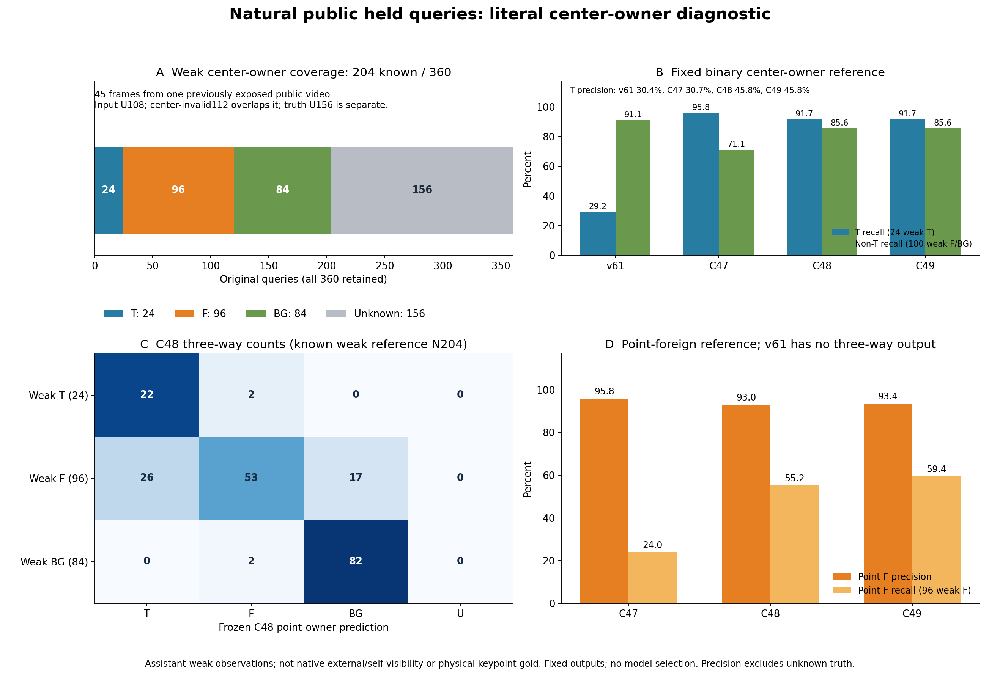
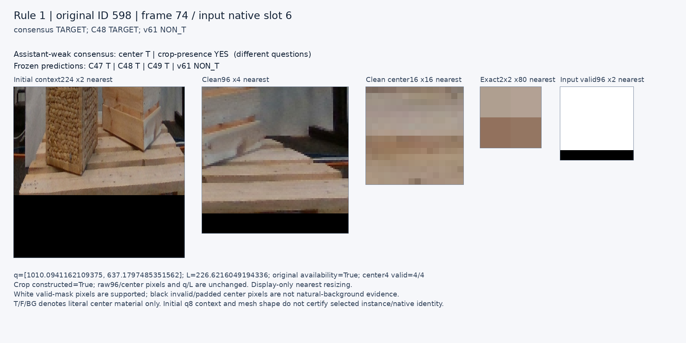
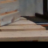
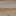

# V177 — query_visibility_public_held_blind_center_owner_review_20261024_v177

기존 보고서에서 추출한 게시용 파생 개요입니다. 원본 파일을 수정하거나 실험·평가를 다시 실행하지 않았습니다. 원문 해시와 링크 대응은 publication manifest로 확인합니다.

**상태:** {"completed":true,"phase_complete":true,"selected_model":null,"adopted":false,"fully_solved":false,"goal_status":"active_unsolved"}

원본:

- [ROOT_PHASE_RESULT.json](ROOT_PHASE_RESULT.json) — SHA256 `8f356c973ed99ce112aec517ac668db52ab8797585a75ceed21bc61f4c455efe`
- [ROOT_READOUT_KO.html](ROOT_READOUT_KO.html) — SHA256 `8cf0e762024a204b7601a0cff2cdff8a0fa446a67f954ee22139b2061784b9a2`
- [ROOT_RESULTS_KO.json](ROOT_RESULTS_KO.json) — SHA256 `15af7c2c2645a917e8fea53d16edcdf294a7afe789f996c1663575bce814e22f`

## 방법·목표의 원문 필드

`$.schema`

```text
V177_PUBLIC_HELD_CENTER_OWNER_READOUT_KO_v1
```


## 입력·학습·평가 분모의 원문 필드

`$.coverage`

```text
{
  "original_input_U": 108,
  "center4_invalid": 112,
  "input_available_center4_invalid": 4,
  "no_constructed_crop": 24,
  "consensus_center_known": 204,
  "consensus_center_unknown": 156,
  "consensus_center_unknown_beyond_forced112": 44,
  "consensus_crop_known": 268,
  "consensus_crop_unknown": 92,
  "model_prediction_U": {
    "C47": 108,
    "C48": 108,
    "C49": 108,
    "v61": 109
  },
  "all4_model_paired_available": 251
}
```

`$.native_slot_denominators`

```text
{
  "0": {
    "N": 45,
    "T": 3,
    "F": 1,
    "BG": 24,
    "U": 17
  },
  "1": {
    "N": 45,
    "T": 2,
    "F": 2,
    "BG": 12,
    "U": 29
  },
  "2": {
    "N": 45,
    "T": 0,
    "F": 1,
    "BG": 11,
    "U": 33
  },
  "3": {
    "N": 45,
    "T": 0,
    "F": 1,
    "BG": 15,
    "U": 29
  },
  "4": {
    "N": 45,
    "T": 0,
    "F": 35,
    "BG": 3,
    "U": 7
  },
  "5": {
    "N": 45,
    "T": 5,
    "F": 15,
    "BG": 13,
    "U": 12
  },
  "6": {
    "N": 45,
    "T": 9,
    "F": 16,
    "BG": 4,
    "U": 16
  },
  "7": {
    "N": 45,
    "T": 5,
    "F": 25,
    "BG": 2,
    "U": 13
  }
}
```

`$.training_admission`

```text
false
```

`$.HTML_browser_rendered`

```text
false
```


## 결론·실패·한계의 원문 필드

자동 추출 가능한 해당 최상위 필드가 없습니다. 원문 보고서와 phase receipt를 확인하십시오.

## 코드·검증·전체 표·갤러리

아래 목록은 원 보고서가 참조한 파일의 경로를 다시 연결한 것입니다. 이 개요 작성 중 이미지 내용이나 raw 평가 데이터를 새로 검사하지 않았습니다.

- [query_visibility_public_held_blind_center_owner_review_20261024_v177/reviewer_a_actual_blind_weak_v1/REVIEW_SEAL.json](reviewer_a_actual_blind_weak_v1/REVIEW_SEAL.json)
- [query_visibility_public_held_blind_center_owner_review_20261024_v177/reviewer_b_actual_blind_weak_v1/REVIEW_SEAL.json](reviewer_b_actual_blind_weak_v1/REVIEW_SEAL.json)
- [query_visibility_public_held_blind_center_owner_review_20261024_v177/v61_public_held_baseline_v1/COMPLETE.json](v61_public_held_baseline_v1/COMPLETE.json)
- [query_visibility_public_held_blind_center_owner_review_20261024_v177/saved_public_held_owner_evaluation_v1/COMPLETE.json](saved_public_held_owner_evaluation_v1/COMPLETE.json)
- [query_visibility_public_held_blind_center_owner_review_20261024_v177/ROOT_RESULTS_KO.json](ROOT_RESULTS_KO.json)
- [query_visibility_public_held_blind_center_owner_review_20261024_v177/ROOT_READOUT_KO.html](ROOT_READOUT_KO.html)
- [query_visibility_public_held_blind_center_owner_review_20261024_v177/ROOT_FINAL_SOURCE_REPORT_REVIEW.json](ROOT_FINAL_SOURCE_REPORT_REVIEW.json)
- [query_visibility_public_held_blind_center_owner_review_20261024_v177/saved_public_held_owner_evaluation_v1/FIXED_WEAK_CONFUSIONS_AND_STRATA.json](saved_public_held_owner_evaluation_v1/FIXED_WEAK_CONFUSIONS_AND_STRATA.json)
- [query_visibility_public_held_blind_center_owner_review_20261024_v177/saved_public_held_owner_evaluation_v1/ALL360_FIXED_PREDICTIONS_AND_WEAK_OBSERVATIONS.csv](saved_public_held_owner_evaluation_v1/ALL360_FIXED_PREDICTIONS_AND_WEAK_OBSERVATIONS.csv)
- [query_visibility_public_held_blind_center_owner_review_20261024_v177/independent_actual_saved_evaluation_review_b/REVIEW.json](independent_actual_saved_evaluation_review_b/REVIEW.json)
- [query_visibility_public_held_blind_center_owner_review_20261024_v177/root_public_mesh_identity_audit/ROOT_ACTUAL_GEOMETRY_VISUAL_REVIEW.json](root_public_mesh_identity_audit/ROOT_ACTUAL_GEOMETRY_VISUAL_REVIEW.json)
- [query_visibility_public_held_blind_center_owner_review_20261024_v177/blind_review_evidence_v1/index.html](blind_review_evidence_v1/index.html)
- [query_visibility_public_held_blind_center_owner_review_20261024_v177/public_owner_readout_visual_v1/ACTUAL_VISUAL_QA.json](public_owner_readout_visual_v1/ACTUAL_VISUAL_QA.json)
- [query_visibility_public_held_blind_center_owner_review_20261024_v177/saved_public_held_owner_evaluation_v1/ALL360_CENTER_OWNER_AND_CROP_CONSENSUS.jsonl](saved_public_held_owner_evaluation_v1/ALL360_CENTER_OWNER_AND_CROP_CONSENSUS.jsonl)
- [query_visibility_public_held_blind_center_owner_review_20261024_v177/ROOT_VISUAL_READOUT_RULES_BEFORE_CONSENSUS_OR_SCORES.json](ROOT_VISUAL_READOUT_RULES_BEFORE_CONSENSUS_OR_SCORES.json)
- [query_visibility_public_held_blind_center_owner_review_20261024_v177/public_owner_readout_visual_v1/SELECTED8_BUCKETS_BEFORE_IMAGE_BODIES.json](public_owner_readout_visual_v1/SELECTED8_BUCKETS_BEFORE_IMAGE_BODIES.json)
- [query_visibility_public_held_blind_center_owner_review_20261024_v177/public_owner_readout_visual_v1/ALL_CASE_IMAGE_BINDINGS_AND_PIXEL_PARITY.json](public_owner_readout_visual_v1/ALL_CASE_IMAGE_BINDINGS_AND_PIXEL_PARITY.json)

## 원 보고서의 그림

원 보고서 참조 순서의 처음 최대4개를 표시합니다. 새 outcome 선택이나 전수 이미지 검증을 뜻하지 않습니다. 전체 갤러리는 위 원문 링크에서 확인합니다.

[query_visibility_public_held_blind_center_owner_review_20261024_v177/public_owner_readout_visual_v1/PUBLIC_HELD_CENTER_OWNER_SCIENTIFIC.png](public_owner_readout_visual_v1/PUBLIC_HELD_CENTER_OWNER_SCIENTIFIC.png)



[query_visibility_public_held_blind_center_owner_review_20261024_v177/public_owner_readout_visual_v1/RULE_1_GLOBAL_0598/CARD.png](public_owner_readout_visual_v1/RULE_1_GLOBAL_0598/CARD.png)



[query_visibility_public_held_blind_center_owner_review_20261024_v177/public_owner_readout_visual_v1/RULE_1_GLOBAL_0598/raw96.png](public_owner_readout_visual_v1/RULE_1_GLOBAL_0598/raw96.png)



[query_visibility_public_held_blind_center_owner_review_20261024_v177/public_owner_readout_visual_v1/RULE_1_GLOBAL_0598/center16.png](public_owner_readout_visual_v1/RULE_1_GLOBAL_0598/center16.png)




현재 사용자 목표 전체의 해결·새 모델 채택·실사 가림 원인 확정을 이 파생 개요가 추가로 주장하지 않습니다. UNKNOWN/U와 불리한 결과, 실패 실행 및 수정 provenance는 원문대로 보존해야 합니다.
