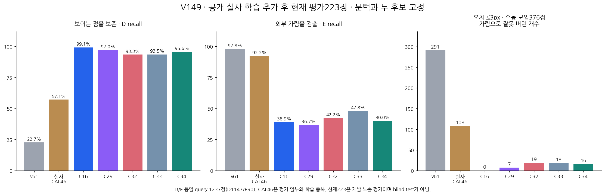

# V149 — query_visibility_public_native_frozen_current_benchmark_20261024_v149

기존 보고서에서 추출한 게시용 파생 개요입니다. 원본 파일을 수정하거나 실험·평가를 다시 실행하지 않았습니다. 원문 해시와 링크 대응은 publication manifest로 확인합니다.

**상태:** {"completed":true,"selected_model":null,"goal_status":"active"}

원본:

- [ROOT_PHASE_RESULT.json](ROOT_PHASE_RESULT.json) — SHA256 `dd3c14114fd75c1debc0163b343559a553f84b6020f6ed60835245118ac346c4`
- [ROOT_READOUT_KO.html](ROOT_READOUT_KO.html) — SHA256 `23346bcea752388f450d561fec9b162003d1d23cb4b4b646c068a37c47bf9999`
- [ROOT_RESULTS_KO.json](ROOT_RESULTS_KO.json) — SHA256 `746f3a7af41d6cbd5822b10090077f51cc566254441aeade63303c7ed99680bc`

## 방법·목표의 원문 필드

자동 추출 가능한 해당 최상위 필드가 없습니다. 원문 보고서와 phase receipt를 확인하십시오.

## 입력·학습·평가 분모의 원문 필드

`$.aggregate_primary`

```text
{
  "excerpt": "[{\"model\": \"v61\", \"CM_D_E_by_pred_D_E_U\": [[260, 887, 0], [2, 88, 0]], \"D_precision\": 0.9923664122137404, \"D_recall\": 0.22667829119442023, \"E_precision\": 0.09025641025641026, \"E_recall\": 0.9777777777777777, \"U\": 0.0, \"counts\": {\"N\": 1237, \"visible_support\": 1147, \"occluded_support\": 90, \"TP\": 260, \"FN_decided\": 887, \"FP\": 2, \"TN\": 88, \"U_visible\": 0, \"U_occluded\": 0, \"out_of_task_S_visible\": 0, \"out_of_task_S_occluded\": 0, \"other_unresolved_visible\": 0, \"other_unresolved_occluded\": 0}}, {\"model\": \"legacy\", \"CM_D_E_by_pred_D_E_U\": [[655, 319, 173], [3, 83, 4]], \"D_precision\": 0.9954407294832827, \"D_recall\": 0.5710549258936356, \"E_precision\": 0.2064676616915423, \"E_recall\": 0.9222222222222223, \"U\": 0.14308811641067098, \"counts\": {\"N\": 1237, \"visible_support\": 1147, \"occluded_support\": 90, \"TP\": 655, \"FN_decided\": 319, \"FP\": 3, \"TN\": 83, \"U_visible\": 173, \"U_occluded\": 4, \"out_of_task_S_visible\": 0, \"out_of_task_S_occluded\": 0, \"other_unresolved_visible\": 0, \"other_unresolved_occluded\": 0}}, {\"model\": \"C16\", \"CM_D_E_by_pred_D_E_U\": [[1137, 10, 0], [55, 35, 0]], \"D_precision\": 0.9538590604026845, \"D_recall\": 0.99128160418483, \"E_precision\": 0.7777777777777778, \"E_recall\": 0.3888888888888889, \"U\": 0.0, \"counts\": {\"N\": 1237, \"visible_support\": 1147, \"occluded_support\": 90, \"TP\": 1137, \"FN_decided\": 10, \"FP\": 55, \"TN\": 35, \"U_visible\": 0, \"U_occluded\": 0, \"out_of_task_S_visible\": 0, \"out_of_task_S_occluded\": 0, \"other_unresolved_visible\": 0, \"other_unresolved_occluded\": 0}}, {\"model\": \"C29\", \"CM_D_E_by_pred_D_E_U\": [[1113, 34, 0], [57, 33, 0]], \"D_precision\": 0.9512820512820512, \"",
  "truncated": true
}
```

`$.actual_execution`

```text
{
  "head_session": 98847,
  "head_exit_code": 0,
  "saved_evaluation_exit_code": 0,
  "new_training": 0,
  "new_encoder_RGB_initializer": 0,
  "PnP_or_q_L_correction": 0,
  "C16_original_byteparity": true
}
```

`$.current_used_for_training_or_threshold_checkpoint_model_choice`

```text
false
```


## 결론·실패·한계의 원문 필드

`$.outcome_KO`

```text
공개 실사 추가 효과가 보임 보존에는 일부 전이됐지만 외부 가림 검출은 악화됐다. C34: 보임 1097/1147, 외부 가림 36/90. 대조 C33: 보임 1072/1147, 외부 가림 43/90. 즉 보임25개 회복과 외부 가림7개 손상이 함께 발생했다. 이전 C16 대비 보임40개 손실·외부 가림1개 추가 검출에 그쳐 전체 개선이나 해결 근거가 아니다.
```

`$.limitations_KO`

```text
[
  "현재223은 개발 노출 자료이며 독립 blind test가 아닙니다.",
  "사람 S는 별도 응답 진단이며 binary hidden이 학습된 self/외부 원인 인증을 뜻하지 않습니다.",
  "원래 reference 오차와 manualD376은 진단이며 primary 필터·좌표 수정·모델 선택에 사용하지 않았습니다.",
  "기존5모델 저장결과와 C33/C34 source qualification/current_allowedfalse를 바꾸지 않고 두 새 모델을 모두 보고했습니다.",
  "기존 실사 CAL46은 평가 일부와 학습 중복이 있는 과거 참고다.",
  "공개 실사 HALL은 작은 개발 노출 자료이며 assistant 구조적 weak 라벨이다.",
  "공개 실사 E6은 시작부터 정답이므로 신규 효과는 D 보존이다.",
  "현재223 수치는 외부/자기 원인 분류나 query 단일 픽셀 gold를 뜻하지 않는다."
]
```


## 코드·검증·전체 표·갤러리

아래 목록은 원 보고서가 참조한 파일의 경로를 다시 연결한 것입니다. 이 개요 작성 중 이미지 내용이나 raw 평가 데이터를 새로 검사하지 않았습니다.

- [query_visibility_public_native_frozen_current_benchmark_20261024_v149/frozen_current_head_benchmark_v1/PREDICTION_SEAL.json](frozen_current_head_benchmark_v1/PREDICTION_SEAL.json)
- [query_visibility_public_native_frozen_current_benchmark_20261024_v149/saved_current_benchmark_evaluation_v1/EVALUATION_SEAL.json](saved_current_benchmark_evaluation_v1/EVALUATION_SEAL.json)
- [query_visibility_public_native_frozen_current_benchmark_20261024_v149/independent_saved_evaluation_review/REVIEW.json](independent_saved_evaluation_review/REVIEW.json)
- [query_visibility_public_native_frozen_current_benchmark_20261024_v149/ROOT_RESULTS_KO.json](ROOT_RESULTS_KO.json)
- [query_visibility_public_native_frozen_current_benchmark_20261024_v149/ROOT_READOUT_KO.html](ROOT_READOUT_KO.html)
- [query_visibility_public_native_frozen_current_benchmark_20261024_v149/ROOT_READOUT_QA.json](ROOT_READOUT_QA.json)
- [query_visibility_public_native_frozen_current_benchmark_20261024_v149/saved_current_benchmark_evaluation_v1/CURRENT_FROZEN_BENCHMARK_RESULTS.json](saved_current_benchmark_evaluation_v1/CURRENT_FROZEN_BENCHMARK_RESULTS.json)
- [query_visibility_public_native_frozen_current_benchmark_20261024_v149/saved_current_benchmark_evaluation_v1/ALL1784_NATIVE_LEDGER.csv](saved_current_benchmark_evaluation_v1/ALL1784_NATIVE_LEDGER.csv)
- [query_visibility_public_native_frozen_current_benchmark_20261024_v149/saved_current_benchmark_evaluation_v1/D_VS_EXTERNAL_E_2X3.csv](saved_current_benchmark_evaluation_v1/D_VS_EXTERNAL_E_2X3.csv)
- [query_visibility_public_native_supervision_control_20261024_v148/source_visual_diagnosis/INDEX.html](../query_visibility_public_native_supervision_control_20261024_v148/source_visual_diagnosis/INDEX.html)

## 원 보고서의 그림

원 보고서 참조 순서의 처음 최대4개를 표시합니다. 새 outcome 선택이나 전수 이미지 검증을 뜻하지 않습니다. 전체 갤러리는 위 원문 링크에서 확인합니다.

[query_visibility_public_native_frozen_current_benchmark_20261024_v149/REAL_TRANSFER_READOUT_KO.png](REAL_TRANSFER_READOUT_KO.png)




현재 사용자 목표 전체의 해결·새 모델 채택·실사 가림 원인 확정을 이 파생 개요가 추가로 주장하지 않습니다. UNKNOWN/U와 불리한 결과, 실패 실행 및 수정 provenance는 원문대로 보존해야 합니다.
