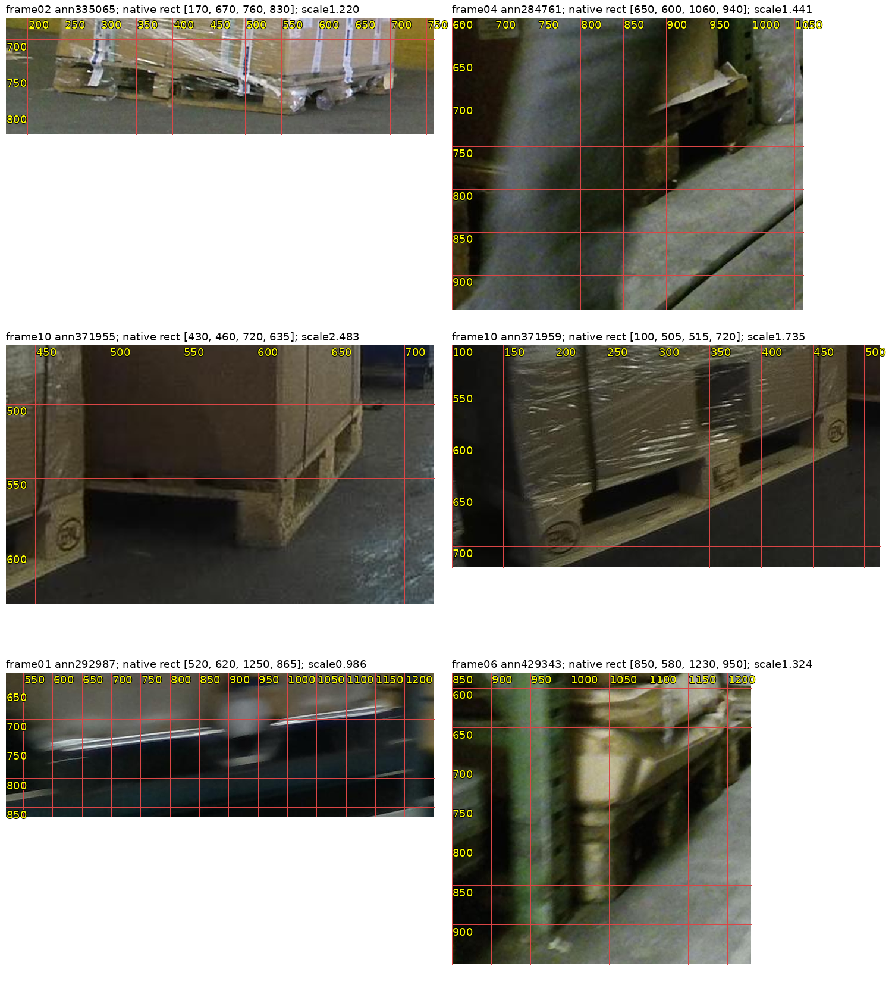
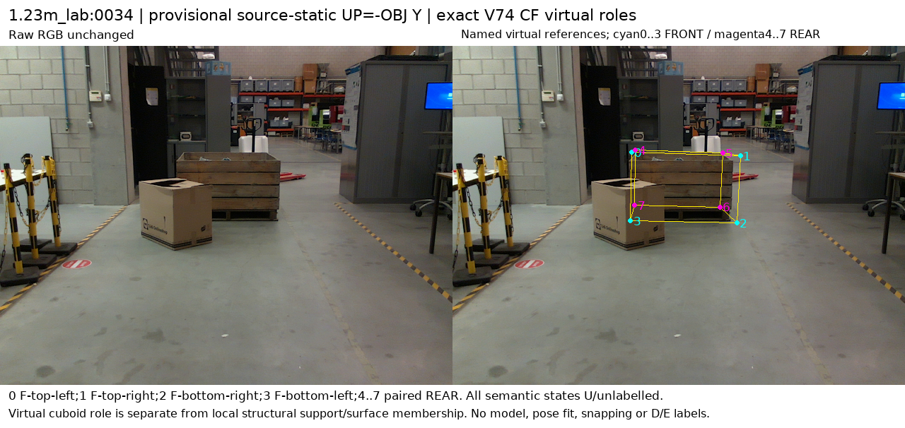
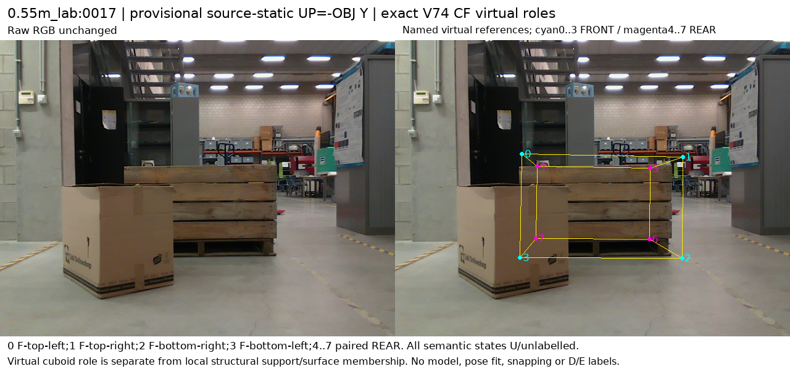

# V140 — query_visibility_public_native_reference_feasibility_20261024_v140

기존 보고서에서 추출한 게시용 파생 개요입니다. 원본 파일을 수정하거나 실험·평가를 다시 실행하지 않았습니다. 원문 해시와 링크 대응은 publication manifest로 확인합니다.

**상태:** {"completed":true,"PASS":true,"selected_model":null,"fully_solved":false,"goal_status":"active"}

원본:

- [ROOT_PHASE_RESULT.json](ROOT_PHASE_RESULT.json) — SHA256 `d87a0d3f897969a6fe9d0b2d83bd10778b926064d8694b89142fd7a5923c6456`
- [ROOT_READOUT_KO.html](ROOT_READOUT_KO.html) — SHA256 `4ef8c09e846fef86cb8d511fc624308c0333aefa17aca1d91b2cd836672c8b15`
- [ROOT_RESULTS_KO.json](ROOT_RESULTS_KO.json) — SHA256 `3e459f732314e6462f03358854fe581bde6f46d619358c745c3857f7f932790f`

## 방법·목표의 원문 필드

`$.goal_turn_classification`

```text
PROGRESS
```


## 입력·학습·평가 분모의 원문 필드

`$.denominator_scope`

```text
LOCO96 are8 review slots per selected image, not complete native annotations for all424 pallet instances. Exactlyone LOCO targetann371955 has2 sourceD proposals; all official boxes and all8slots remain. Pallox32 are4x8 fixed roles.
```


## 결론·실패·한계의 원문 필드

`$.outcome_KO`

```text
공개 원본16장과32개 제공pose 기반 가상 참조점의 실제 RGB·역할·보임/가림 제안 검토를 완료했다. source-only 조건부 제안은 D11/E4/U113이며, 초기 추론 entity/순서 연결 전이므로 아직 학습에 넣지 않는다.
```


## 코드·검증·전체 표·갤러리

아래 목록은 원 보고서가 참조한 파일의 경로를 다시 연결한 것입니다. 이 개요 작성 중 이미지 내용이나 raw 평가 데이터를 새로 검사하지 않았습니다.

- [query_visibility_public_native_reference_feasibility_20261024_v140/ROOT_RESULTS_KO.json](ROOT_RESULTS_KO.json)
- [query_visibility_public_native_reference_feasibility_20261024_v140/ROOT_READOUT_KO.html](ROOT_READOUT_KO.html)
- [query_visibility_public_native_reference_feasibility_20261024_v140/ROOT_REPORT_VISUAL_QA.json](ROOT_REPORT_VISUAL_QA.json)
- [query_visibility_public_native_reference_feasibility_20261024_v140/ROOT_PUBLIC_NATIVE_FEASIBILITY_POLICY_BEFORE_BODY_READS.json](ROOT_PUBLIC_NATIVE_FEASIBILITY_POLICY_BEFORE_BODY_READS.json)
- [query_visibility_public_native_reference_feasibility_20261024_v140/loco_fixed12_intake_v1/INTAKE_COMPLETE.json](loco_fixed12_intake_v1/INTAKE_COMPLETE.json)
- [query_visibility_public_native_reference_feasibility_20261024_v140/ROOT_LOCO_TWO_SOURCE_PROPOSALS_ADJUDICATION.json](ROOT_LOCO_TWO_SOURCE_PROPOSALS_ADJUDICATION.json)
- [query_visibility_public_native_reference_feasibility_20261024_v140/pallox_reference_diagnostics_v1/PROJECTION_COMPLETE.json](pallox_reference_diagnostics_v1/PROJECTION_COMPLETE.json)
- [query_visibility_public_native_reference_feasibility_20261024_v140/pallox_named_virtual_reference_v1/NAMED_REFERENCE_COMPLETE.json](pallox_named_virtual_reference_v1/NAMED_REFERENCE_COMPLETE.json)
- [query_visibility_public_native_reference_feasibility_20261024_v140/ROOT_PALLOX_SOURCE32_SEMANTIC_ADJUDICATION.json](ROOT_PALLOX_SOURCE32_SEMANTIC_ADJUDICATION.json)
- [query_visibility_public_native_reference_feasibility_20261024_v140/saved_initializer_readiness/EXISTING_ACTUAL_INITIALIZER_METADATA_ONLY.json](saved_initializer_readiness/EXISTING_ACTUAL_INITIALIZER_METADATA_ONLY.json)

## 원 보고서의 그림

원 보고서 참조 순서의 처음 최대4개를 표시합니다. 새 outcome 선택이나 전수 이미지 검증을 뜻하지 않습니다. 전체 갤러리는 위 원문 링크에서 확인합니다.

[query_visibility_public_native_reference_feasibility_20261024_v140/annotation_contract/actual_public_visual_review/ANNOTATION_ONLY_NATIVE_ZOOMS6.png](annotation_contract/actual_public_visual_review/ANNOTATION_ONLY_NATIVE_ZOOMS6.png)



[query_visibility_public_native_reference_feasibility_20261024_v140/pallox_reference_diagnostics_v1/RAW_OBJ_THREE_ORTHOGRAPHIC_VIEWS.png](pallox_reference_diagnostics_v1/RAW_OBJ_THREE_ORTHOGRAPHIC_VIEWS.png)


[query_visibility_public_native_reference_feasibility_20261024_v140/pallox_named_virtual_reference_v1/1.23m_lab_0034_NAMED_CF_VIRTUAL_REFERENCES.png](pallox_named_virtual_reference_v1/1.23m_lab_0034_NAMED_CF_VIRTUAL_REFERENCES.png)



[query_visibility_public_native_reference_feasibility_20261024_v140/pallox_named_virtual_reference_v1/0.55m_lab_0017_NAMED_CF_VIRTUAL_REFERENCES.png](pallox_named_virtual_reference_v1/0.55m_lab_0017_NAMED_CF_VIRTUAL_REFERENCES.png)




현재 사용자 목표 전체의 해결·새 모델 채택·실사 가림 원인 확정을 이 파생 개요가 추가로 주장하지 않습니다. UNKNOWN/U와 불리한 결과, 실패 실행 및 수정 provenance는 원문대로 보존해야 합니다.
