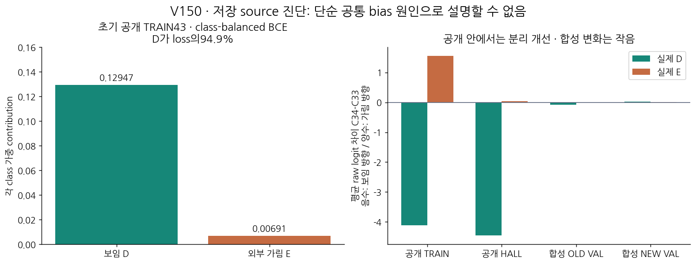

# V150 — query_visibility_public_native_saved_mechanism_20261024_v150

기존 보고서에서 추출한 게시용 파생 개요입니다. 원본 파일을 수정하거나 실험·평가를 다시 실행하지 않았습니다. 원문 해시와 링크 대응은 publication manifest로 확인합니다.

**상태:** {"completed":true,"selected_model":null,"goal_status":"active"}

원본:

- [ROOT_PHASE_RESULT.json](ROOT_PHASE_RESULT.json) — SHA256 `54d2fa2979c11969407a8ad20e88fe098850070752bf1e07978af071416b491c`
- [ROOT_READOUT_KO.html](ROOT_READOUT_KO.html) — SHA256 `3c0fd92963e0d92d3976de491a995e3d2fe857a49182344407c4922ff21c3aac`
- [ROOT_RESULTS_KO.json](ROOT_RESULTS_KO.json) — SHA256 `d18a5079a31459ea0d1be527a75cebc638cbec44b24022a954fc1f74c4b2f8e0`

## 방법·목표의 원문 필드

`$.full_goal_solved`

```text
false
```


## 입력·학습·평가 분모의 원문 필드

`$.all_source_rows`

```text
27136
```


## 결론·실패·한계의 원문 필드

`$.conclusion_KO`

```text
공개 동일 조립체 안에서는 D/E 분별이 개선됐지만 넓은 native 검증으로 이어지지 않았다. 공개 가림 종류와 역할의 범위가 좁고, 원 crop 밖의 scene 역할 보임도 같은 D 감독에 들어간다. 공통 bias만 막는 새 ranking fit보다 실제 팔레트 source의 역할·외부가림 범위를 확장하고 query 증거와 역할 상태를 분리할 근거를 확보한다.
```

`$.decisions`

```text
{
  "new_ranking_fit": false,
  "reason": "All4 initial rank margin1 violations concern far-floor D67; would not add missing E types or resolve query-vs-role target gap.",
  "next_source": "MR6D flat Euro pallet public dataset intake, native8 role/occlusion truth still to audit.",
  "no_new_current_evaluation": true
}
```

`$.limitations`

```text
[
  "Scalar derivative is not full-parameter causation.",
  "Source crop-locality reference is virtual and provisional, not exact physical gold.",
  "Public HALL is development exposed and limited to one assembly/cardboard.",
  "No new model success or source qualification pass is claimed."
]
```


## 코드·검증·전체 표·갤러리

아래 목록은 원 보고서가 참조한 파일의 경로를 다시 연결한 것입니다. 이 개요 작성 중 이미지 내용이나 raw 평가 데이터를 새로 검사하지 않았습니다.

- [query_visibility_public_native_saved_mechanism_20261024_v150/source_saved_diagnosis/DIAGNOSIS_SEAL.json](source_saved_diagnosis/DIAGNOSIS_SEAL.json)
- [query_visibility_public_native_saved_mechanism_20261024_v150/independent_saved_review/REVIEW.json](independent_saved_review/REVIEW.json)
- [query_visibility_public_native_saved_mechanism_20261024_v150/source_fidelity_review/REVIEW_COMPLETE.json](source_fidelity_review/REVIEW_COMPLETE.json)
- [query_visibility_public_native_saved_mechanism_20261024_v150/public_source_gap_review/REVIEW_COMPLETE.json](public_source_gap_review/REVIEW_COMPLETE.json)
- [query_visibility_public_native_saved_mechanism_20261024_v150/ROOT_RESULTS_KO.json](ROOT_RESULTS_KO.json)
- [query_visibility_public_native_saved_mechanism_20261024_v150/ROOT_READOUT_KO.html](ROOT_READOUT_KO.html)
- [query_visibility_public_native_saved_mechanism_20261024_v150/ROOT_READOUT_QA.json](ROOT_READOUT_QA.json)
- [query_visibility_mr6d_public_native_intake_20261024_v151/ROOT_PUBLIC_INTAKE_POLICY_BEFORE_REMOTE_SAMPLE_BODIES.json](../query_visibility_mr6d_public_native_intake_20261024_v151/ROOT_PUBLIC_INTAKE_POLICY_BEFORE_REMOTE_SAMPLE_BODIES.json)
- [query_visibility_public_native_saved_mechanism_20261024_v150/source_saved_diagnosis/RESULTS.json](source_saved_diagnosis/RESULTS.json)
- [query_visibility_public_native_saved_mechanism_20261024_v150/public_source_gap_review/PUBLIC_SOURCE_GAP_AND_ACTION_EVIDENCE.json](public_source_gap_review/PUBLIC_SOURCE_GAP_AND_ACTION_EVIDENCE.json)
- [query_visibility_public_native_saved_mechanism_20261024_v150/ROOT_PUBLIC_SCALAR_DIAGNOSIS.json](ROOT_PUBLIC_SCALAR_DIAGNOSIS.json)

## 원 보고서의 그림

원 보고서 참조 순서의 처음 최대4개를 표시합니다. 새 outcome 선택이나 전수 이미지 검증을 뜻하지 않습니다. 전체 갤러리는 위 원문 링크에서 확인합니다.

[query_visibility_public_native_saved_mechanism_20261024_v150/SOURCE_MECHANISM_KO.png](SOURCE_MECHANISM_KO.png)



[query_visibility_public_native_source_expansion_20261024_v146/saved_source64_contact_v1/FRAME_17_WHOLESCENE_AND_FIXED96.png](../query_visibility_public_native_source_expansion_20261024_v146/saved_source64_contact_v1/FRAME_17_WHOLESCENE_AND_FIXED96.png)


현재 사용자 목표 전체의 해결·새 모델 채택·실사 가림 원인 확정을 이 파생 개요가 추가로 주장하지 않습니다. UNKNOWN/U와 불리한 결과, 실패 실행 및 수정 provenance는 원문대로 보존해야 합니다.
