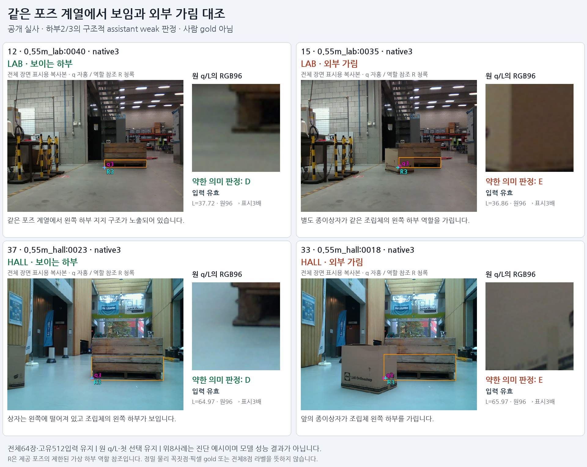
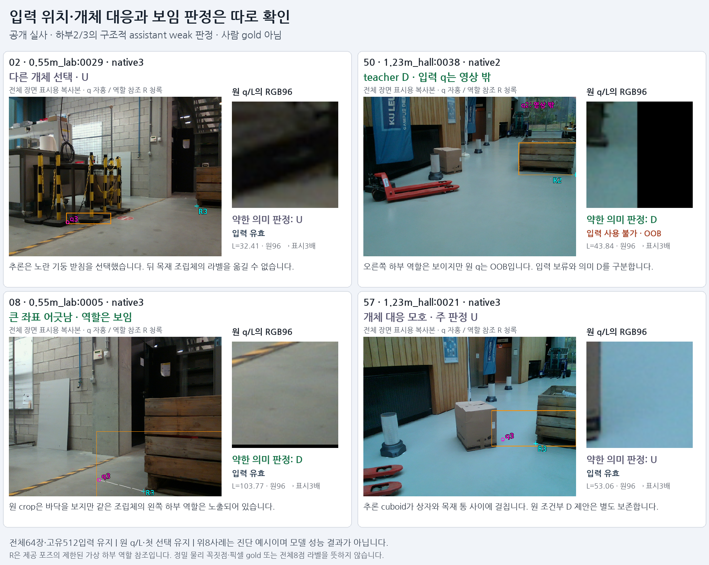

# V146 — query_visibility_public_native_source_expansion_20261024_v146

기존 보고서에서 추출한 게시용 파생 개요입니다. 원본 파일을 수정하거나 실험·평가를 다시 실행하지 않았습니다. 원문 해시와 링크 대응은 publication manifest로 확인합니다.

**상태:** {"completed":true,"fully_solved":false,"goal_status":"active"}

원본:

- [ROOT_PHASE_RESULT.json](ROOT_PHASE_RESULT.json) — SHA256 `91eed6756732bec3a1934b5ad6b0e137286c7f823ab491c056fc72b51fd3f4a0`
- [ROOT_READOUT_KO.html](ROOT_READOUT_KO.html) — SHA256 `2dd3d7ed01efcf102bc60a44ed5ad7f042d078ac6f2aabbf235dc89f1bf2d9c3`
- [ROOT_RESULTS_KO.json](ROOT_RESULTS_KO.json) — SHA256 `7281621057e7ef4bd3fce99ef9fa285d8ec82d5a369b1c8afd299f3ef00e0815`

## 방법·목표의 원문 필드

`$.previous_goal_turn_classification`

```text
PROGRESS: actual public64 initializer/GT references/factual crop rendering completed EXIT0.
```

`$.full_goal_redefined_to_lower2_3`

```text
false
```


## 입력·학습·평가 분모의 원문 필드

`$.conditional_D_but_primary_entity_U`

```text
459
```


## 결론·실패·한계의 원문 필드

`$.current_phase_outcome_KO`

```text
공개 실사 원64장/512입력을 보존한 실제 선택 개체·하부 역할의 부분 약한 라벨84개를 완성했습니다. 새 가림 분류기 학습·성능 개선 결과는 아닙니다.
```


## 코드·검증·전체 표·갤러리

아래 목록은 원 보고서가 참조한 파일의 경로를 다시 연결한 것입니다. 이 개요 작성 중 이미지 내용이나 raw 평가 데이터를 새로 검사하지 않았습니다.

- [query_visibility_public_native_source_expansion_20261024_v146/ROOT_RESULTS_KO.json](ROOT_RESULTS_KO.json)
- [query_visibility_public_native_source_expansion_20261024_v146/ROOT_READOUT_KO.html](ROOT_READOUT_KO.html)
- [query_visibility_public_native_source_expansion_20261024_v146/ROOT_READOUT_QA.json](ROOT_READOUT_QA.json)
- [query_visibility_public_native_source_expansion_20261024_v146/ROOT_SOURCE64_WEAK_LABEL_ADJUDICATION_COMPLETE.json](ROOT_SOURCE64_WEAK_LABEL_ADJUDICATION_COMPLETE.json)
- [query_visibility_public_native_source_expansion_20261024_v146/independent_adjudication_review/REVIEW.json](independent_adjudication_review/REVIEW.json)
- [query_visibility_public_native_source_expansion_20261024_v146/saved_source64_contact_v1/INDEX.html](saved_source64_contact_v1/INDEX.html)
- [query_visibility_public_native_source_expansion_20261024_v146/ROOT_ADJUDICATED_SOURCE_NATIVE512_WEAK_LABELS.jsonl](ROOT_ADJUDICATED_SOURCE_NATIVE512_WEAK_LABELS.jsonl.parts.json)
- [query_visibility_public_native_source_expansion_20261024_v146/actual_public_initializer_v1/PREDICTION_SEAL.json](actual_public_initializer_v1/PREDICTION_SEAL.json)
- [query_visibility_public_native_source_expansion_20261024_v146/provided_pose_references_v1/PROJECTION_COMPLETE.json](provided_pose_references_v1/PROJECTION_COMPLETE.json)
- [query_visibility_public_native_source_expansion_20261024_v146/saved_source64_contact_v1/CONTACT_RENDER_COMPLETE.json](saved_source64_contact_v1/CONTACT_RENDER_COMPLETE.json)
- [query_visibility_public_native_source_expansion_20261024_v146/source_report/QA_COMPLETE.json](source_report/QA_COMPLETE.json)

## 원 보고서의 그림

원 보고서 참조 순서의 처음 최대4개를 표시합니다. 새 outcome 선택이나 전수 이미지 검증을 뜻하지 않습니다. 전체 갤러리는 위 원문 링크에서 확인합니다.

[query_visibility_public_native_source_expansion_20261024_v146/source_report/BOARD_01_VISIBLE_EXTERNAL_PAIRS.png](source_report/BOARD_01_VISIBLE_EXTERNAL_PAIRS.png)



[query_visibility_public_native_source_expansion_20261024_v146/source_report/BOARD_02_ENTITY_INPUT_AND_ROLE_CASES.png](source_report/BOARD_02_ENTITY_INPUT_AND_ROLE_CASES.png)




현재 사용자 목표 전체의 해결·새 모델 채택·실사 가림 원인 확정을 이 파생 개요가 추가로 주장하지 않습니다. UNKNOWN/U와 불리한 결과, 실패 실행 및 수정 provenance는 원문대로 보존해야 합니다.

큰 원문 링크는 무손실 gzip의 `.parts.json` descriptor로 연결합니다. 원문 SHA와 복원 방법은 게시 안내를 따릅니다.
