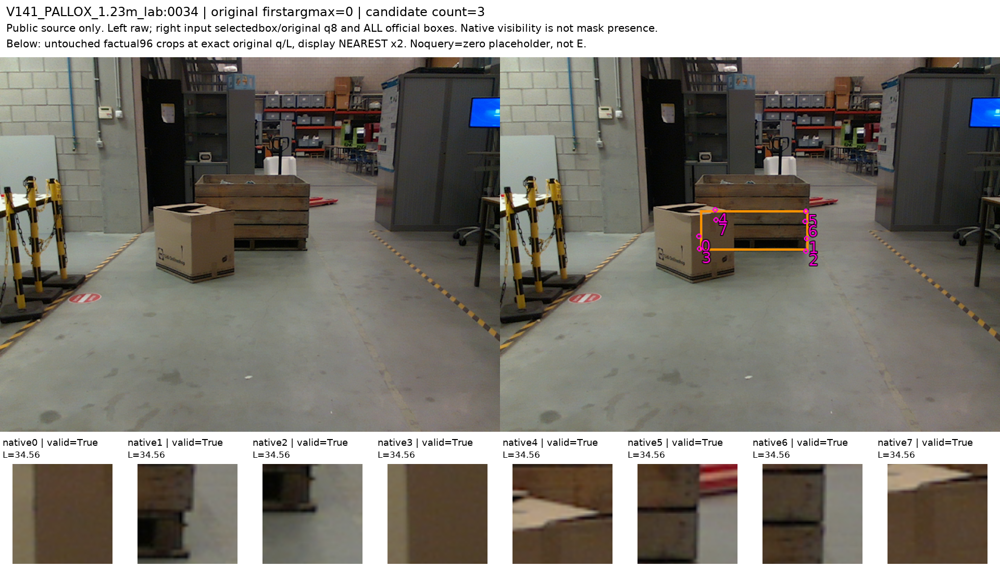
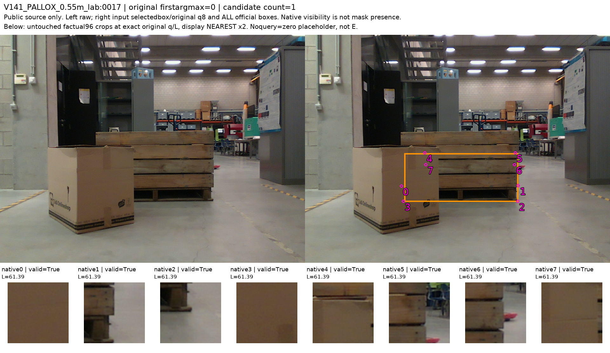
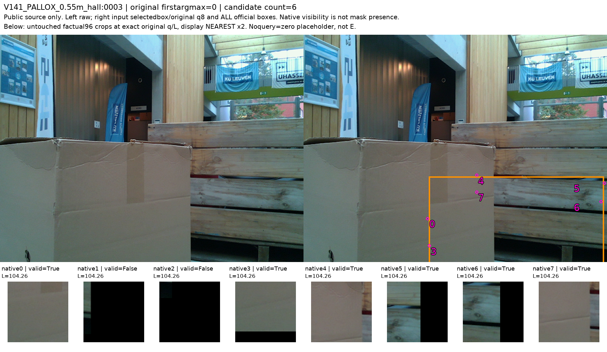
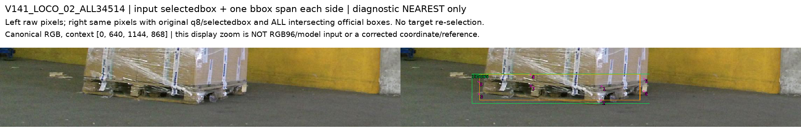

# V144 — query_visibility_public_selected_native_labels_20261024_v144

기존 보고서에서 추출한 게시용 파생 개요입니다. 원본 파일을 수정하거나 실험·평가를 다시 실행하지 않았습니다. 원문 해시와 링크 대응은 publication manifest로 확인합니다.

**상태:** {"completed":true,"selected_model":null,"fully_solved":false,"goal_status":"active"}

원본:

- [ROOT_PHASE_RESULT.json](ROOT_PHASE_RESULT.json) — SHA256 `7fdb2533ad59139eba7078887848efe72f64604d08237e1493c78480002a9db6`
- [ROOT_READOUT_KO.html](ROOT_READOUT_KO.html) — SHA256 `431dc18824fb7b7611090a22e7d2f6a1d10ce44da5ab2fd1f0c05662fea94866`
- [ROOT_RESULTS_KO.json](ROOT_RESULTS_KO.json) — SHA256 `36d09ab3d5cfa93401cfd3d0c2fbf761434e0d8f194b73076a81b922d24462da`

## 방법·목표의 원문 필드

자동 추출 가능한 해당 최상위 필드가 없습니다. 원문 보고서와 phase receipt를 확인하십시오.

## 입력·학습·평가 분모의 원문 필드

`$.conditional_E2_kept_primary_U`

```text
true
```

`$.weak_TRAIN_rows`

```text
12
```

`$.weak_holdout_rows`

```text
1
```

`$.dataset_general_visibility_training_sufficiency_proven`

```text
false
```


## 결론·실패·한계의 원문 필드

`$.limitations_KO`

```text
[
  "학습 자원은 부분 역할에 대한 보조 weak supervision이다. 사람 gold·정밀 꼭짓점·모든 객체 native8 정답이 아니다.",
  "TRAIN에는 D10/E2, VAL_HALL에는 E1뿐이다. 이 수로 실사 일반화 성능이나 균형 잡힌 독립 검증을 주장할 수 없다.",
  "v61/C16/C29/C32 가림 점수와 현재 평가셋은 이 판정에 사용하지 않았다. 공개 원본 영상·구조·제공 T/K와 원래 고정된 R0 bbox/query로 대상·역할을 연결했다.",
  "원128 제안과 과거 U128 출력은 보존했다. 의미 U와 원래 noquery/OOB 및 모델 보류는 서로 다르다."
]
```

`$.outcome_KO`

```text
공개 실사 실제 초기 선택 대상에 연결된 부분 weak nativeD/E를 구체화했다. 완전한 데이터셋/정답/모델 성능은 아직 아니다.
```


## 코드·검증·전체 표·갤러리

아래 목록은 원 보고서가 참조한 파일의 경로를 다시 연결한 것입니다. 이 개요 작성 중 이미지 내용이나 raw 평가 데이터를 새로 검사하지 않았습니다.

- [query_visibility_public_selected_native_labels_20261024_v144/ROOT_RESULTS_KO.json](ROOT_RESULTS_KO.json)
- [query_visibility_public_selected_native_labels_20261024_v144/ROOT_READOUT_KO.html](ROOT_READOUT_KO.html)
- [query_visibility_public_selected_native_labels_20261024_v144/ROOT_REPORT_VISUAL_QA.json](ROOT_REPORT_VISUAL_QA.json)
- [query_visibility_public_selected_native_labels_20261024_v144/loco_selected_native_review_agent/root_manifest_independent_review/REVIEW.json](loco_selected_native_review_agent/root_manifest_independent_review/REVIEW.json)
- [query_visibility_public_selected_native_labels_20261024_v144/ROOT_ADJUDICATED_SELECTED_SOURCE_NATIVE128_WEAK_LABELS.jsonl](ROOT_ADJUDICATED_SELECTED_SOURCE_NATIVE128_WEAK_LABELS.jsonl)
- [query_visibility_public_selected_native_labels_20261024_v144/ROOT_PUBLIC_NATIVE_WEAK_LABEL_ADJUDICATION.json](ROOT_PUBLIC_NATIVE_WEAK_LABEL_ADJUDICATION.json)
- [query_visibility_public_selected_native_labels_20261024_v144/pallox_base_role_geometry_review/LOWER_ROLE_INVARIANCE_CERTIFICATE.json](pallox_base_role_geometry_review/LOWER_ROLE_INVARIANCE_CERTIFICATE.json)
- [query_visibility_public_selected_native_labels_20261024_v144/EXTENSION_READINESS_METADATA_ONLY.json](EXTENSION_READINESS_METADATA_ONLY.json)
- [query_visibility_public_native_initializer_association_20261024_v141/actual_public_initializer_canonical_transport_v2/ORIGINAL_NATIVE_QUERY128_INPUT_ONLY.jsonl](../query_visibility_public_native_initializer_association_20261024_v141/actual_public_initializer_canonical_transport_v2/ORIGINAL_NATIVE_QUERY128_INPUT_ONLY.jsonl)
- [query_visibility_public_selected_native_labels_20261024_v144/loco_selected_native_review_agent/ALL128_SELECTED_SOURCE_NATIVE_PROPOSALS_NOT_GOLD.jsonl](loco_selected_native_review_agent/ALL128_SELECTED_SOURCE_NATIVE_PROPOSALS_NOT_GOLD.jsonl)

## 원 보고서의 그림

원 보고서 참조 순서의 처음 최대4개를 표시합니다. 새 outcome 선택이나 전수 이미지 검증을 뜻하지 않습니다. 전체 갤러리는 위 원문 링크에서 확인합니다.

[query_visibility_public_selected_native_labels_20261024_v144/loco_selected_native_review_agent/fixed_pallox32_contact_v1/FRAME_12_WHOLESCENE_AND_FIXED96.png](loco_selected_native_review_agent/fixed_pallox32_contact_v1/FRAME_12_WHOLESCENE_AND_FIXED96.png)



[query_visibility_public_selected_native_labels_20261024_v144/loco_selected_native_review_agent/fixed_pallox32_contact_v1/FRAME_13_WHOLESCENE_AND_FIXED96.png](loco_selected_native_review_agent/fixed_pallox32_contact_v1/FRAME_13_WHOLESCENE_AND_FIXED96.png)



[query_visibility_public_selected_native_labels_20261024_v144/loco_selected_native_review_agent/fixed_pallox32_contact_v1/FRAME_15_WHOLESCENE_AND_FIXED96.png](loco_selected_native_review_agent/fixed_pallox32_contact_v1/FRAME_15_WHOLESCENE_AND_FIXED96.png)



[query_visibility_public_selected_native_labels_20261024_v144/loco_selected_native_review_agent/four_selected_entity_zooms_v1/FRAME_02_INPUT_BOX_CONTEXT_RAW_AND_Q.png](loco_selected_native_review_agent/four_selected_entity_zooms_v1/FRAME_02_INPUT_BOX_CONTEXT_RAW_AND_Q.png)




현재 사용자 목표 전체의 해결·새 모델 채택·실사 가림 원인 확정을 이 파생 개요가 추가로 주장하지 않습니다. UNKNOWN/U와 불리한 결과, 실패 실행 및 수정 provenance는 원문대로 보존해야 합니다.
