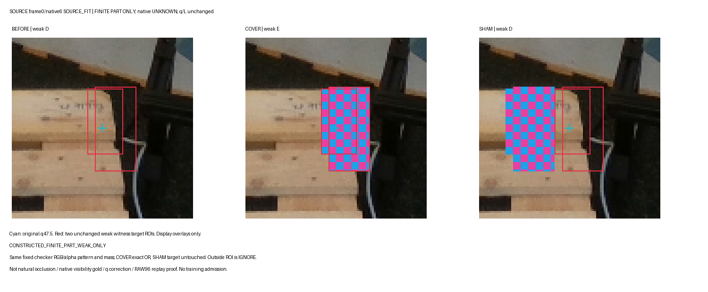
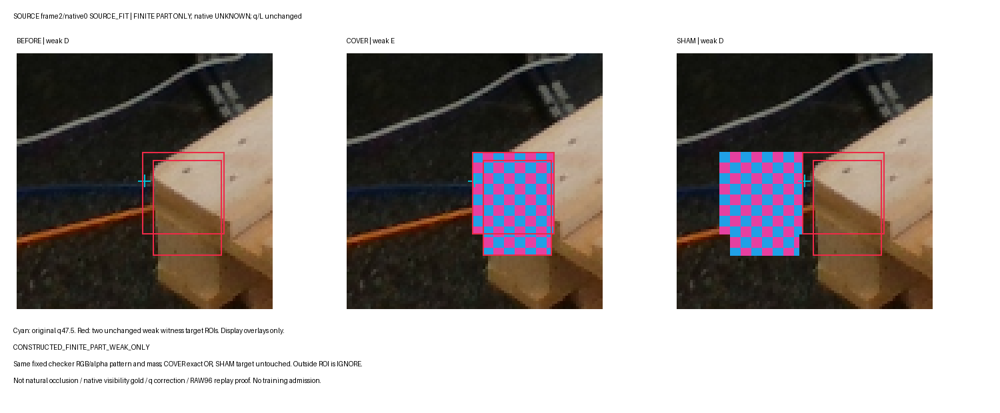
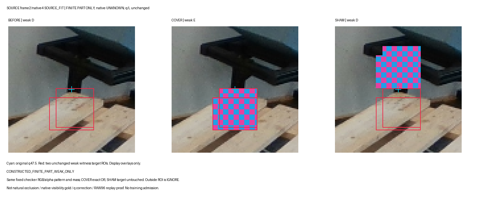
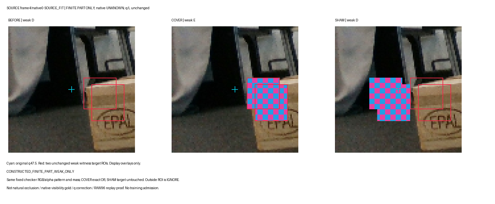
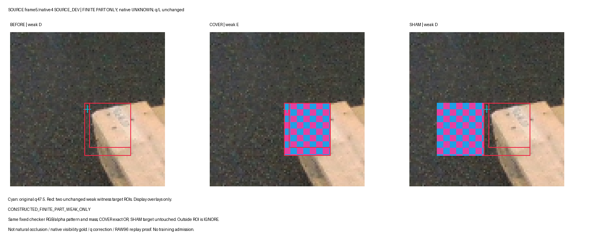
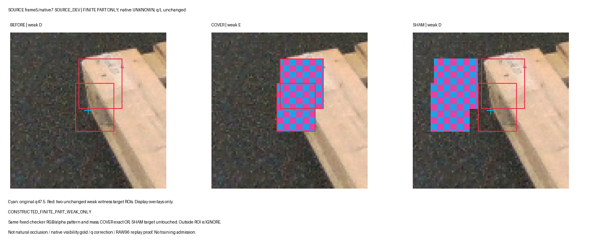
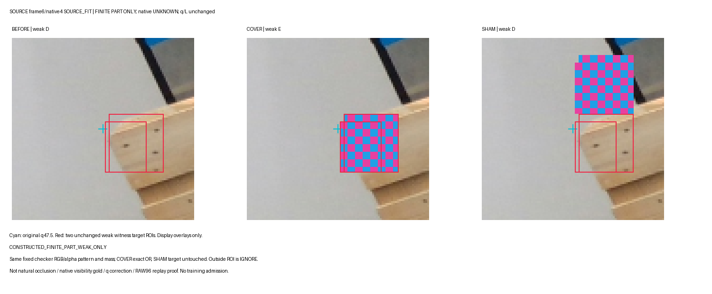
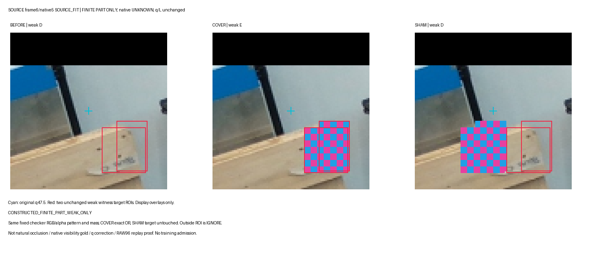
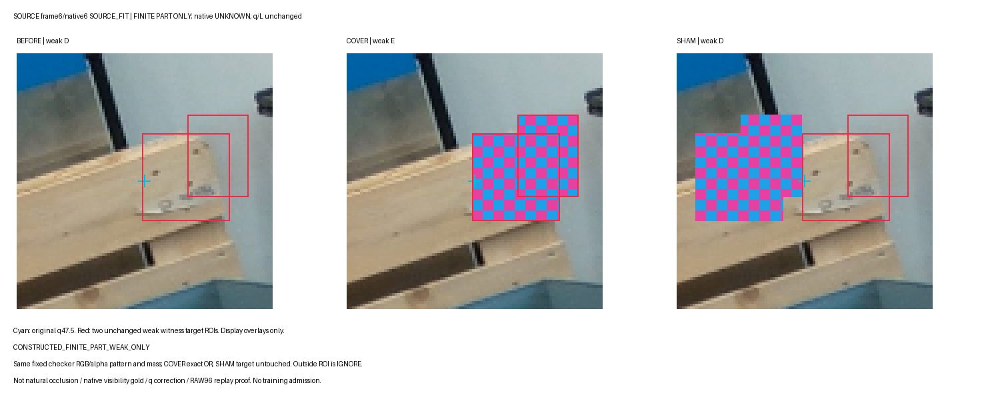

# 원RAW96의 finite local-part weak controls

원 q/L/native를 보존한 post-RAW96 counterfactual이다. D/E/D는 고정 finite witness의 bag/region 약관계이며 native visibility나 자연 가림 gold가 아니다. 사각형 OR에는 배경이 포함될 수 있으므로 모든 ROI 픽셀을 팔레트 material-positive로 학습하지 않는다. ROI는 타깃 selector 전용이고 바깥은 IGNORE다. SOURCE_DEV는 모든 fit에서 제외한다.

## frame0 / native6

## frame2 / native0

## frame2 / native4

## frame4 / native0

## frame5 / native4

## frame5 / native7

## frame6 / native4

## frame6 / native5

## frame6 / native6

