# V205 공개 TRAIN native 의미 관찰 입력6frame

사전 metadata 선택6개/48native다. 원 q/L/native/U와 원96crop을 그대로 둔다. 기존 weak owner/finite-end teacher/모델결과/GT는 화면에 보이지 않는다. fullRGB의 q8 overlay는 표시용이며 GT native 위치나 instance 증명이 아니다. unavailable/offframe q는 이동하거나E로 바꾸지 않는다.

독립 A/C source 약관찰이며 blind/human evaluation gold가 아니다. intendedpart와 targetinstance가 식별되고 실제crop에서보일때D, 해당부위를 externalforeground가 가린 증거가있을때만E, SELF·location error·UNKNOWN은분리한다. 새 학습·admission은이pilot에없다.

## val/000000:17

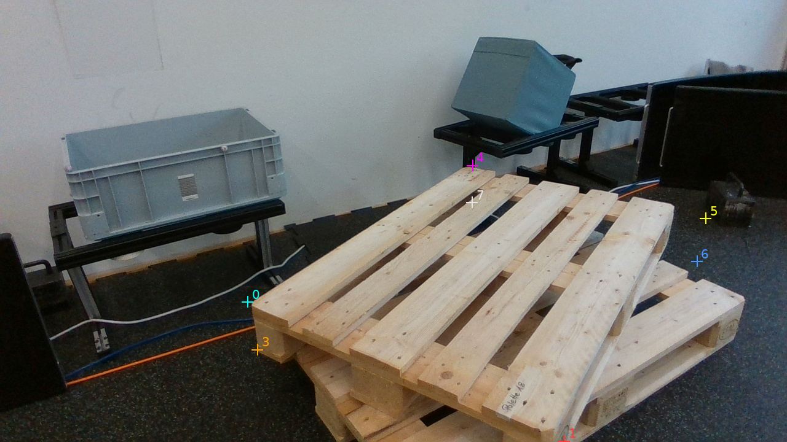

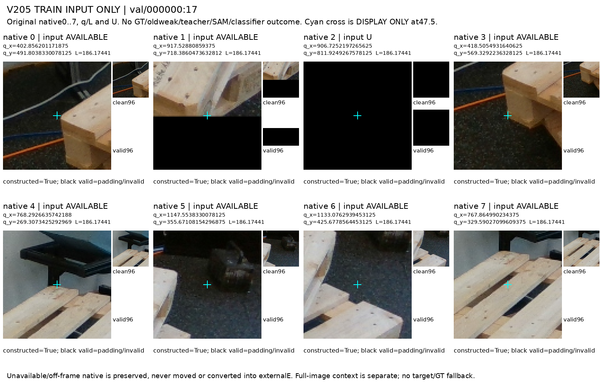

## val/000000:67

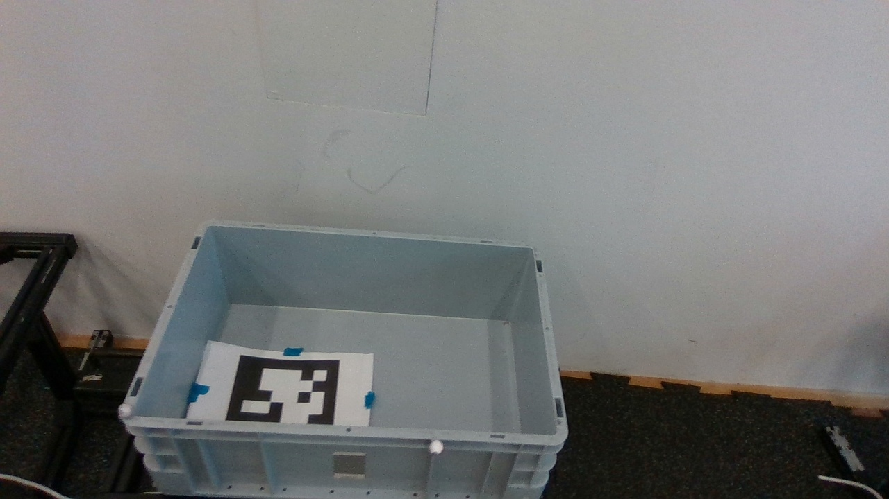

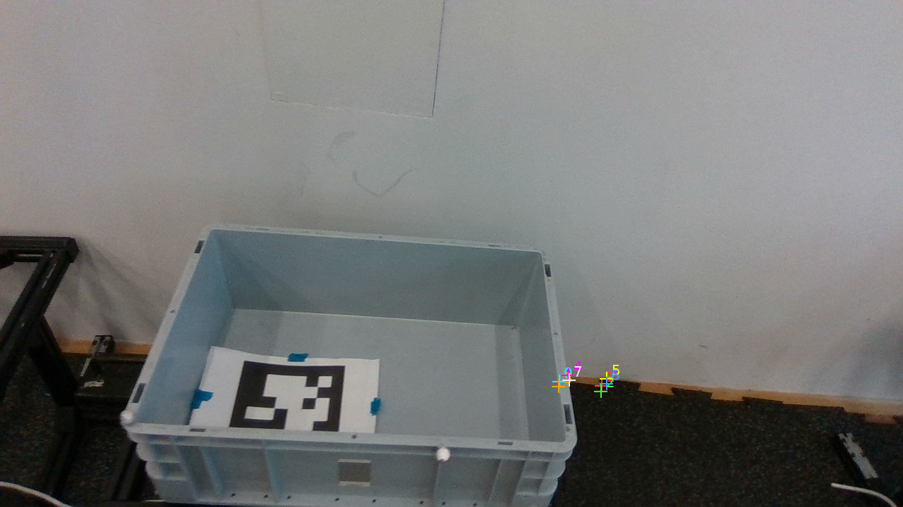

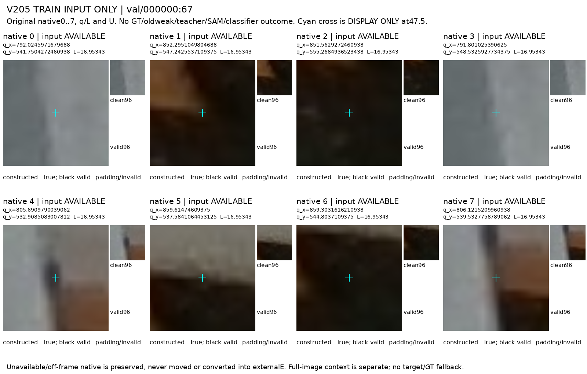

## val/000002:32

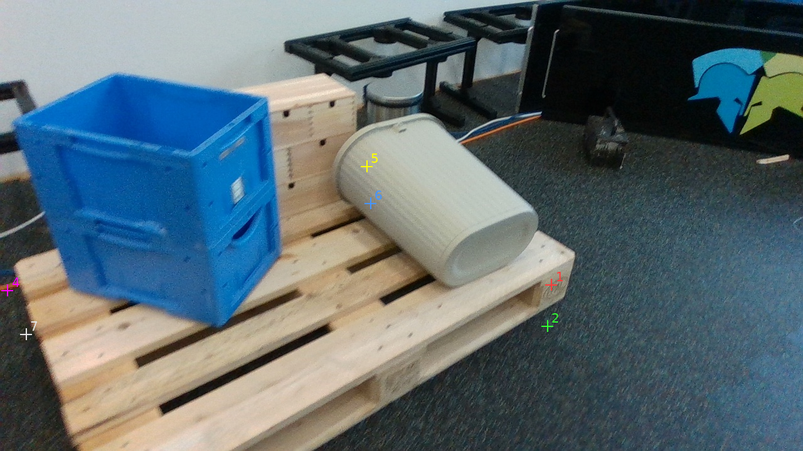

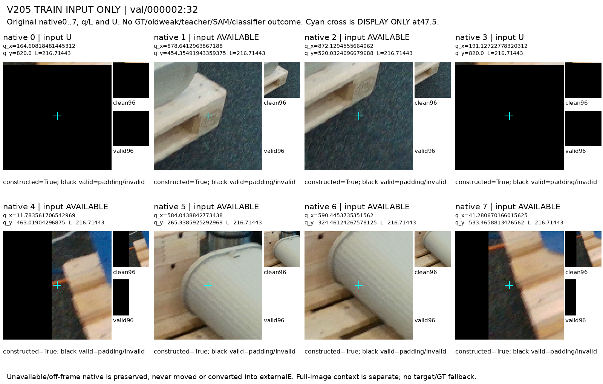

## val/000002:37

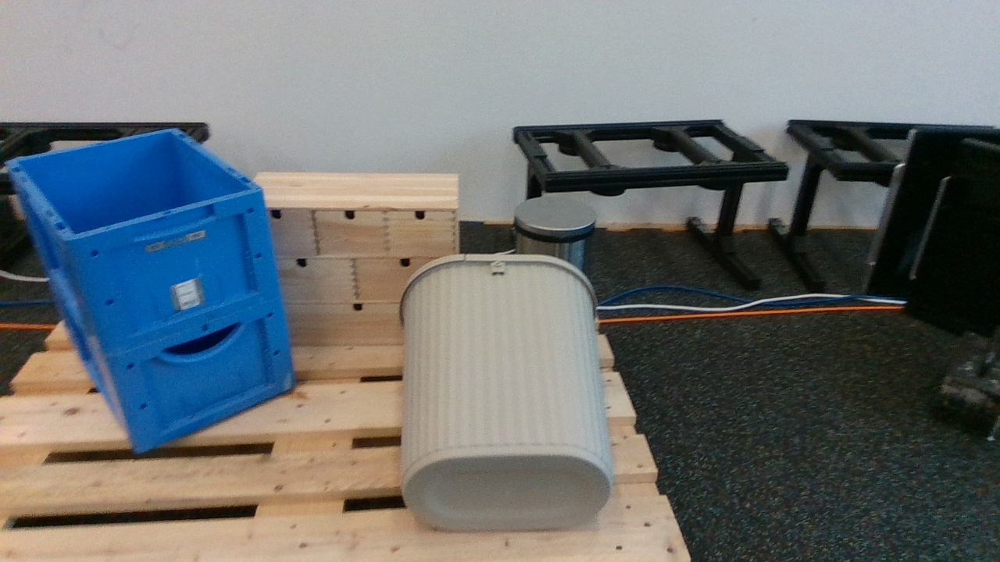

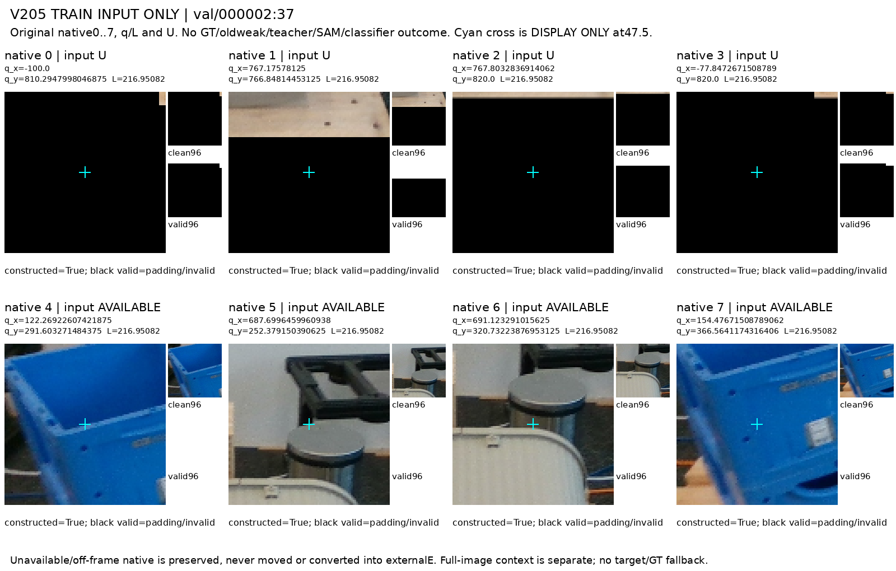

## val/000005:21

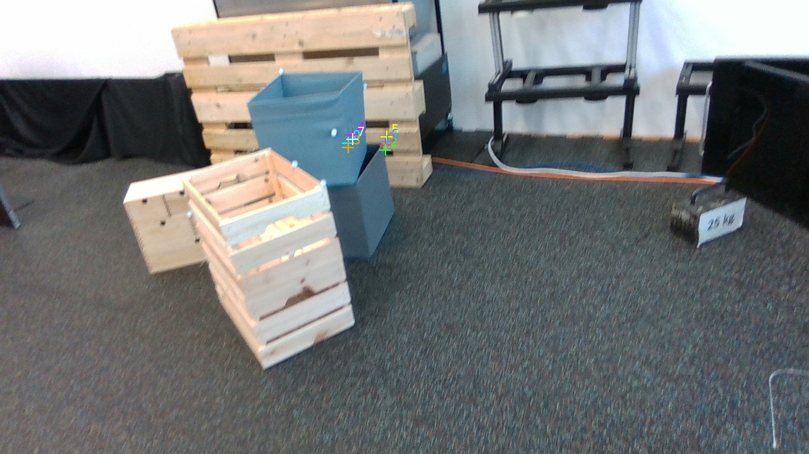

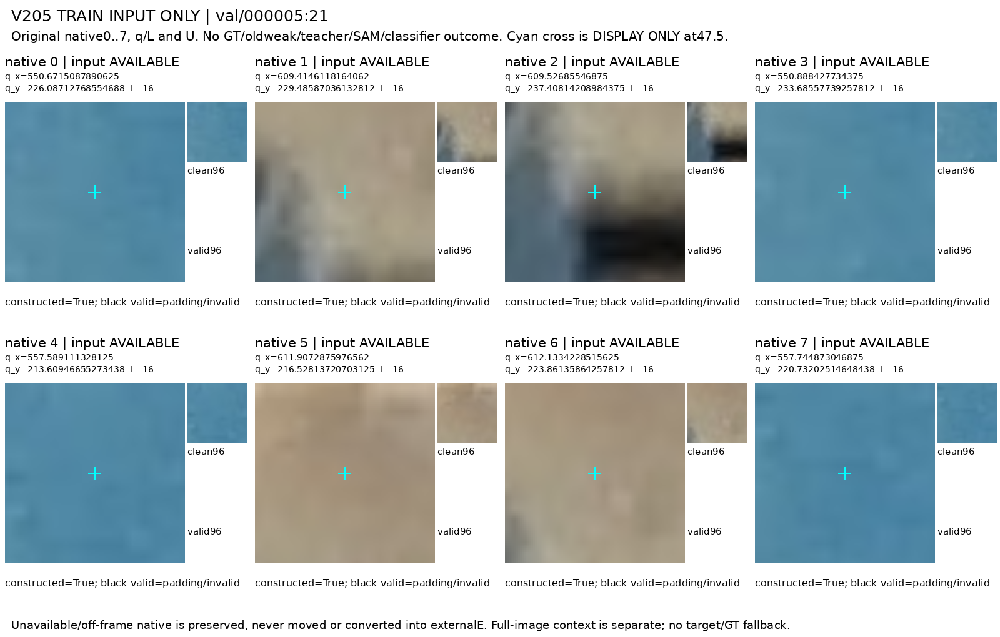

## val/000006:6

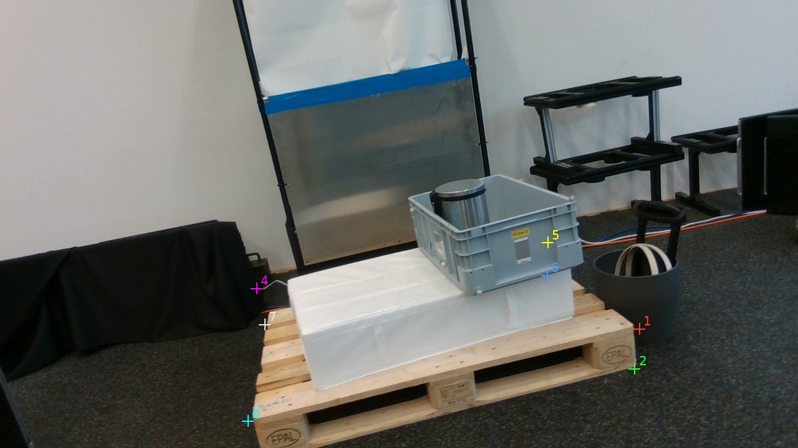

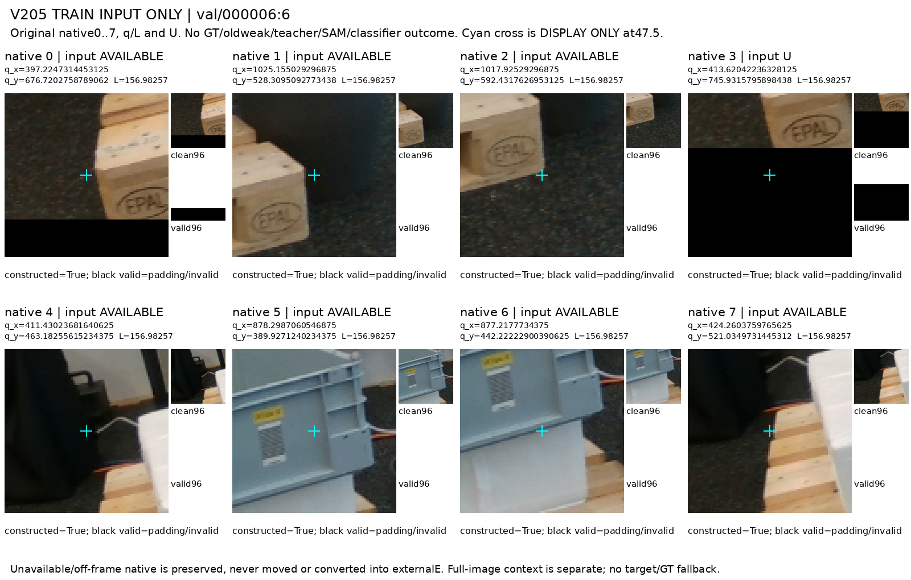
