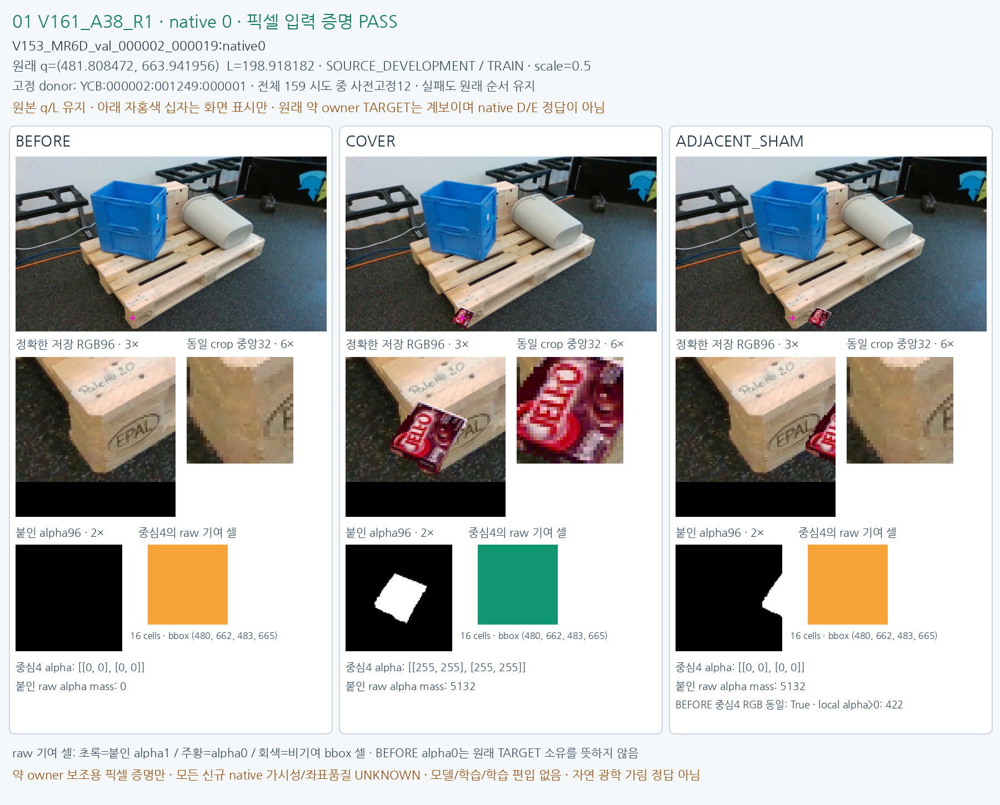

# V161 — query_visibility_public_train_owner_counterfactual_20261024_v161

기존 보고서에서 추출한 게시용 파생 개요입니다. 원본 파일을 수정하거나 실험·평가를 다시 실행하지 않았습니다. 원문 해시와 링크 대응은 publication manifest로 확인합니다.

**상태:** {"completed":true,"selected_model":null,"adopted":false,"fully_solved":false,"goal_status":"active_unsolved"}

원본:

- [ROOT_PHASE_RESULT.json](ROOT_PHASE_RESULT.json) — SHA256 `0a58315a67c5809ea871ea1686c14d58426c8aa6f464c0ed1088be3e980edf64`
- [ROOT_READOUT_KO.html](ROOT_READOUT_KO.html) — SHA256 `e8781df383421df9493565baef4c81659eb177f7aeb8c59e4052c138ddd66c20`
- [ROOT_RESULTS_KO.json](ROOT_RESULTS_KO.json) — SHA256 `1b9f62b63bd73f0d500b25139c067756092dc0055bee09a7bb861c26b609ebdf`

## 방법·목표의 원문 필드

`$.schema`

```text
V161_ROOT_PUBLIC_TRAIN_COUNTERFACTUAL_INPUT_PROOF_COMPLETE_UNSOLVED
```


## 입력·학습·평가 분모의 원문 필드

`$.execution_and_integrity_PASS`

```text
true
```

`$.all8_original_inputU`

```text
360
```

`$.model_training_updates`

```text
0
```

`$.primary_visibility_accuracy_not_measured_here`

```text
true
```

`$.new_owner_labels_or_training_admission`

```text
false
```

`$.native_coverage`

```text
{
  "0": {
    "anchors": 20,
    "attempted": 60,
    "passed": 59,
    "failed": 1
  },
  "1": {
    "anchors": 14,
    "attempted": 42,
    "passed": 42,
    "failed": 0
  },
  "2": {
    "anchors": 0,
    "attempted": 0,
    "passed": 0,
    "failed": 0
  },
  "3": {
    "anchors": 0,
    "attempted": 0,
    "passed": 0,
    "failed": 0
  },
  "4": {
    "anchors": 5,
    "attempted": 15,
    "passed": 15,
    "failed": 0
  },
  "5": {
    "anchors": 7,
    "attempted": 21,
    "passed": 21,
    "failed": 0
  },
  "6": {
    "anchors": 1,
    "attempted": 3,
    "passed": 3,
    "failed": 0
  },
  "7": {
    "anchors": 6,
    "attempted": 18,
    "passed": 17,
    "failed": 1
  }
}
```

`$.actual_donor_execution`

```text
{
  "path": "query_visibility_public_train_owner_counterfactual_20261024_v161/ROOT_ACTUAL_DONOR_PROOF_EXECUTION.json",
  "sha256": "26a967e95a4fe87348b0b50f3d73195901e216b17e3e98366235a6bd48bb1dd9"
}
```

`$.actual_pixel_execution`

```text
{
  "path": "query_visibility_public_train_owner_counterfactual_20261024_v161/ROOT_ACTUAL_SOURCE_PIXEL_COMPLETED.json",
  "sha256": "ce62bc2c795b0f6d718fd48378807cc42b4c6b0ebbca10565ac36caef2eea0e6"
}
```


## 결론·실패·한계의 원문 필드

`$.interpretation_KO`

```text
[
  "같은 q/L의 원본·직접덮기·옆배치를 실제 만들었고 변경 fullRGB와 모든 문맥/local/중앙 입력이 일관됨을 검증했다.",
  "157개가 모든 대조 조건을 통과했다. 실패2개는 옆 가림물이 selected RGB96에 들어오지 않아 대조 조건이 부족했으며, 이동/교체/재시도 없이 보존했다.",
  "주 native 가림·좌표품질 정답은 모두 UNKNOWN이다. 이 결과는 중심 표면 보조 학습의 입력 준비이며 주 가림 학습/성능 성공이 아니다.",
  "원래 전체 WOOD/SQUARE/native8 과제는 유지한다. 공개 anchor에는 native2/3이 없고 같은53 query/46frame를 재사용하므로477개를 독립 실사로 세지 않는다."
]
```


## 코드·검증·전체 표·갤러리

아래 목록은 원 보고서가 참조한 파일의 경로를 다시 연결한 것입니다. 이 개요 작성 중 이미지 내용이나 raw 평가 데이터를 새로 검사하지 않았습니다.

- [query_visibility_public_train_owner_counterfactual_20261024_v161/ROOT_SOURCE_GENERATION_DESIGN_BEFORE_PIXELS.json](ROOT_SOURCE_GENERATION_DESIGN_BEFORE_PIXELS.json)
- [query_visibility_public_train_owner_counterfactual_20261024_v161/ROOT_ACTUAL_DONOR_PROOF_EXECUTION.json](ROOT_ACTUAL_DONOR_PROOF_EXECUTION.json)
- [query_visibility_public_train_owner_counterfactual_20261024_v161/ROOT_ACTUAL_SOURCE_PIXEL_COMPLETED.json](ROOT_ACTUAL_SOURCE_PIXEL_COMPLETED.json)
- [query_visibility_public_train_owner_counterfactual_20261024_v161/source_pixels_v1/COMPLETE.json](source_pixels_v1/COMPLETE.json)
- [query_visibility_public_train_owner_counterfactual_20261024_v161/independent_pixel_review/REVIEW_COMPLETE.json](independent_pixel_review/REVIEW_COMPLETE.json)
- [query_visibility_public_train_owner_counterfactual_20261024_v161/derived_summary/SUMMARY.json](derived_summary/SUMMARY.json)
- [query_visibility_public_train_owner_counterfactual_20261024_v161/ROOT_RESULTS_KO.json](ROOT_RESULTS_KO.json)
- [query_visibility_public_train_owner_counterfactual_20261024_v161/ROOT_READOUT_KO.html](ROOT_READOUT_KO.html)
- [query_visibility_public_train_owner_counterfactual_20261024_v161/fixed12_visual_preparation/READOUT_COMPLETE.json](fixed12_visual_preparation/READOUT_COMPLETE.json)
- [query_visibility_public_train_owner_counterfactual_20261024_v161/ROOT_ACTUAL_SOURCE_VISUAL_QA.json](ROOT_ACTUAL_SOURCE_VISUAL_QA.json)
- [query_visibility_public_train_owner_counterfactual_20261024_v161/final_publication_review/FINAL_PUBLICATION_REVIEW.json](final_publication_review/FINAL_PUBLICATION_REVIEW.json)
- [query_visibility_public_train_owner_counterfactual_20261024_v161/next_feature_input_metadata/METADATA_COMPLETE.json](next_feature_input_metadata/METADATA_COMPLETE.json)
- [query_visibility_public_train_owner_counterfactual_20261024_v161/ROOT_NEXT_FEATURE_AND_CONTROL_REQUIREMENTS.json](ROOT_NEXT_FEATURE_AND_CONTROL_REQUIREMENTS.json)
- [query_visibility_public_train_owner_counterfactual_20261024_v161/ROOT_ORIGINAL_MR_AVAILABILITY_CLARIFICATION.json](ROOT_ORIGINAL_MR_AVAILABILITY_CLARIFICATION.json)
- [query_visibility_public_train_owner_counterfactual_20261024_v161/fixed12_visual_v1/index.html](fixed12_visual_v1/index.html)
- [query_visibility_public_train_owner_counterfactual_20261024_v161/all_failed2_visual_appendix_v1/index.html](all_failed2_visual_appendix_v1/index.html)

## 원 보고서의 그림

원 보고서 참조 순서의 처음 최대4개를 표시합니다. 새 outcome 선택이나 전수 이미지 검증을 뜻하지 않습니다. 전체 갤러리는 위 원문 링크에서 확인합니다.

[query_visibility_public_train_owner_counterfactual_20261024_v161/fixed12_visual_v1/CASE_01_V161_A38_R1.png](fixed12_visual_v1/CASE_01_V161_A38_R1.png)




현재 사용자 목표 전체의 해결·새 모델 채택·실사 가림 원인 확정을 이 파생 개요가 추가로 주장하지 않습니다. UNKNOWN/U와 불리한 결과, 실패 실행 및 수정 provenance는 원문대로 보존해야 합니다.
