# V216 고정12 두-reader ROI 표시

A red/C blue와 originalq cyan은 표시만 바꾼 사본이다. 원V215 PNG는 변경하거나 복제하지 않았다. 의미/admission 검토는 pending이다.

## 0 val/000000:51

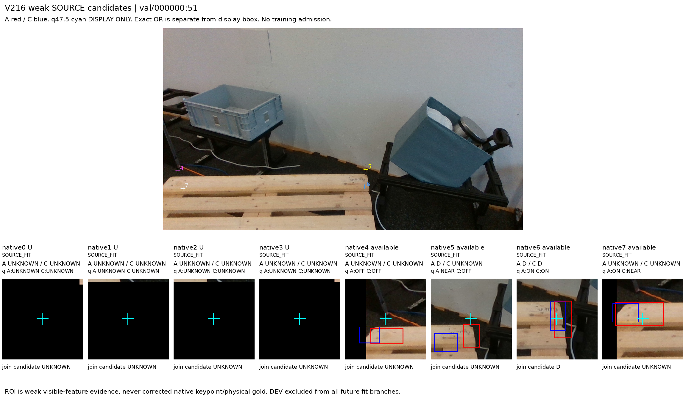

## 1 val/000000:64

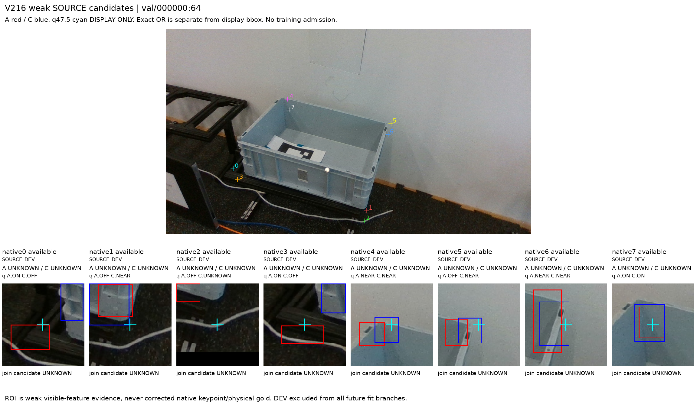

## 2 val/000000:19

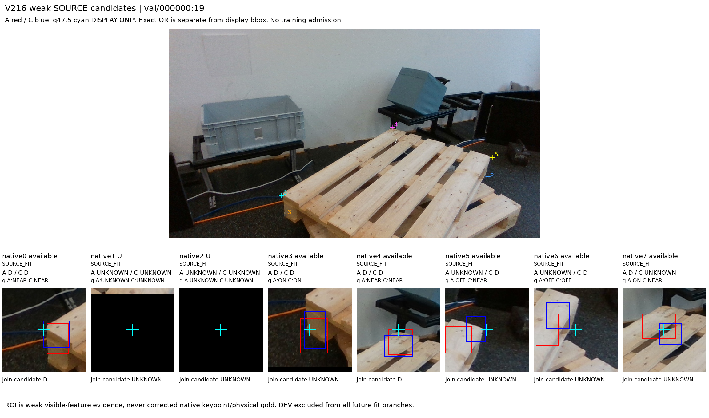

## 3 val/000002:0

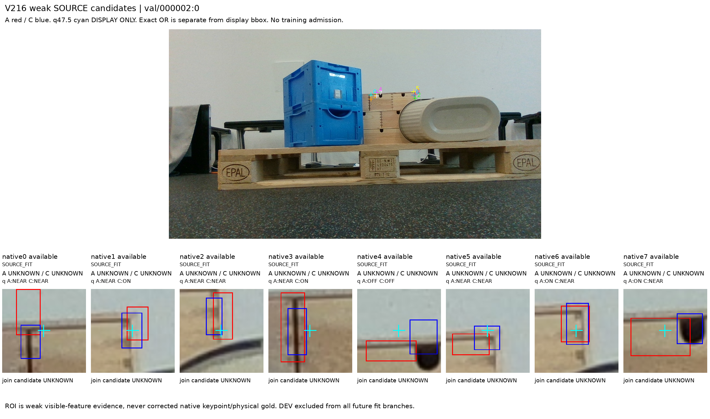

## 4 val/000002:6

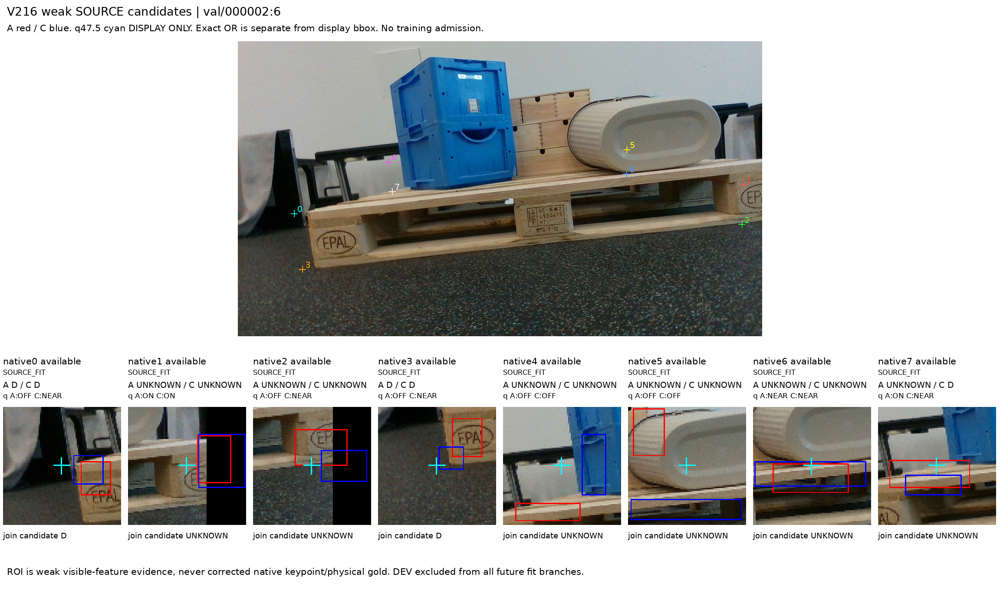

## 5 val/000002:47

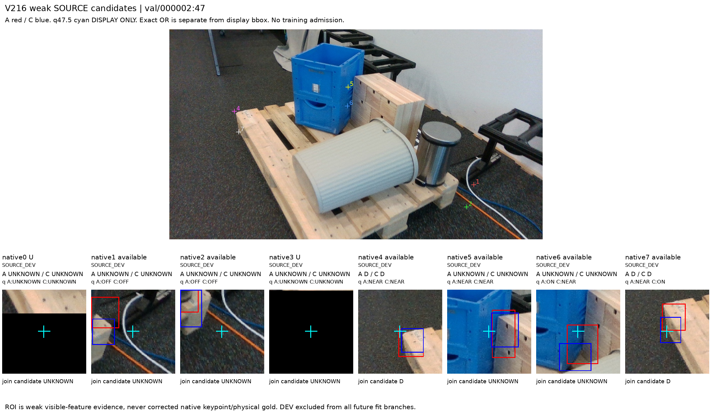

## 6 val/000005:8

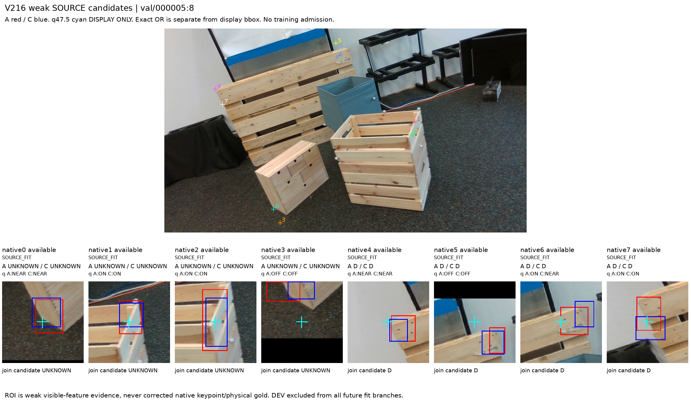

## 7 val/000005:24

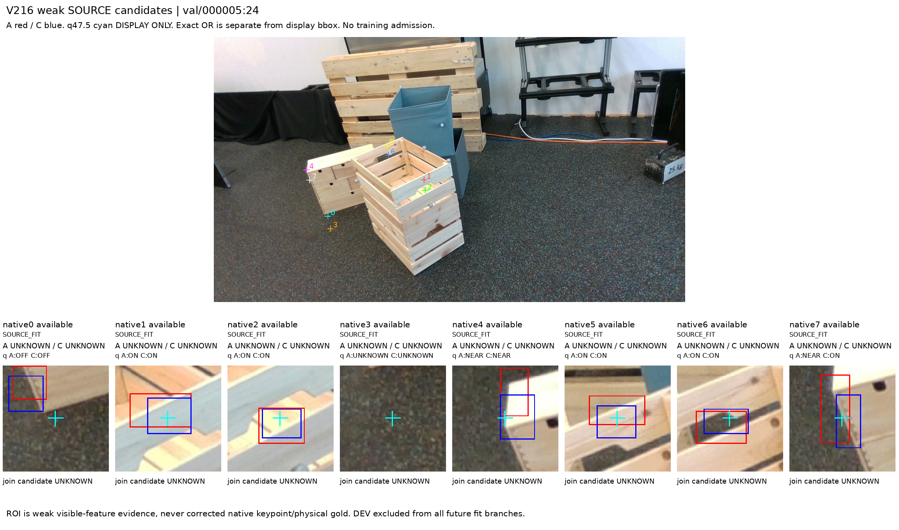

## 8 val/000005:17

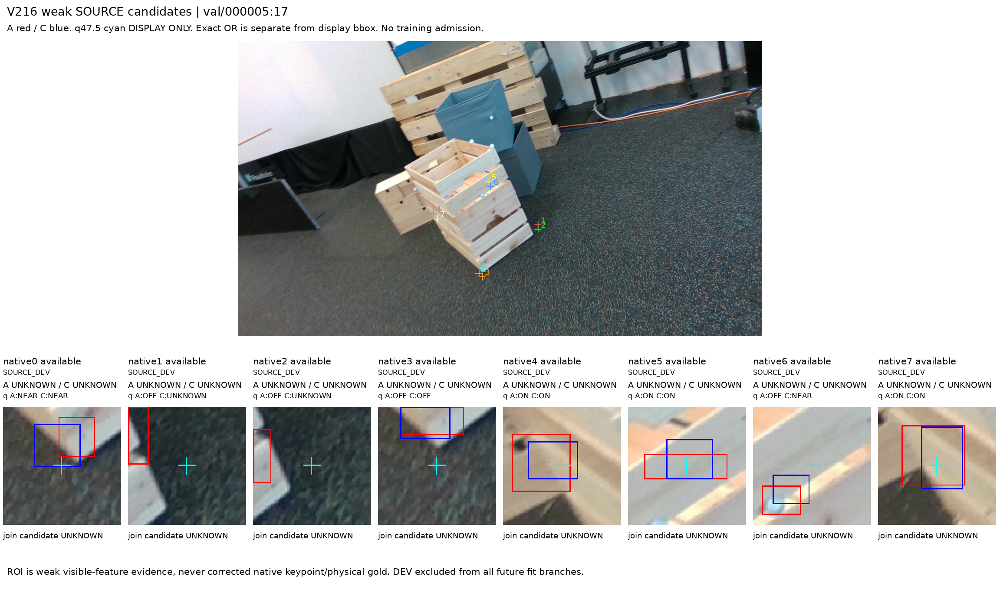

## 9 val/000006:25

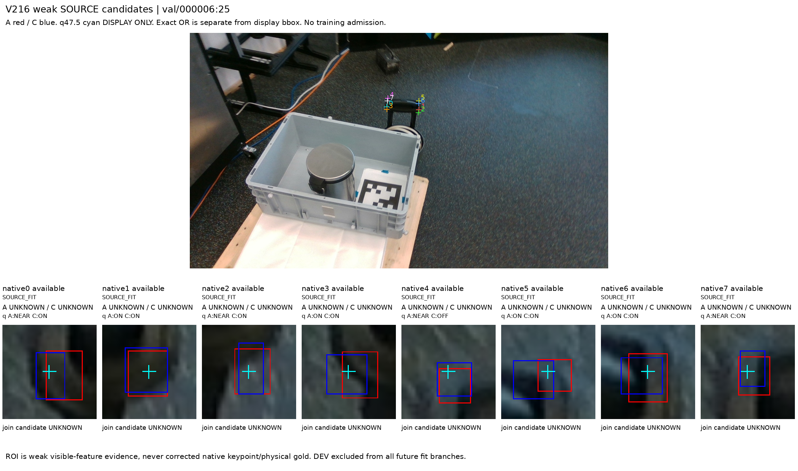

## 10 val/000006:28

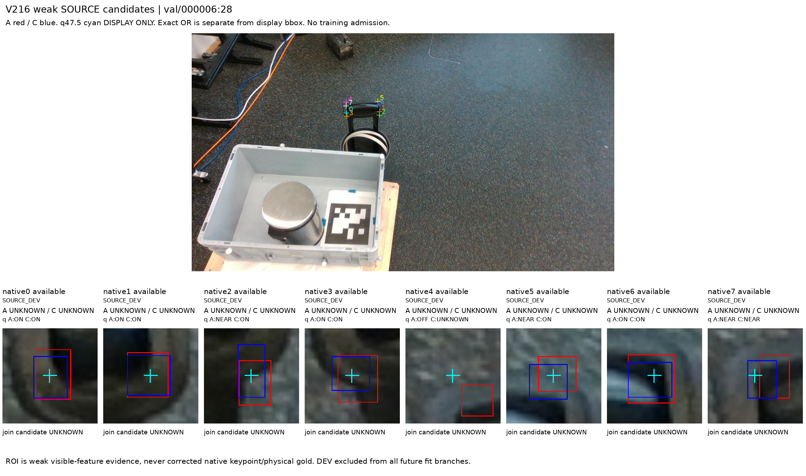

## 11 val/000006:21

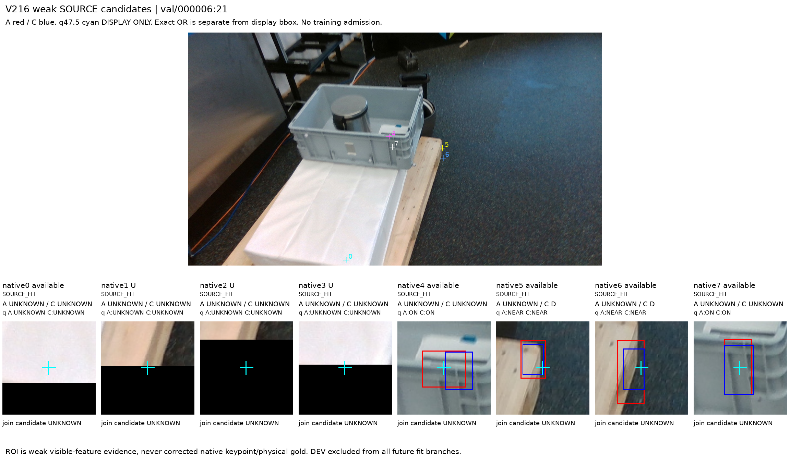
