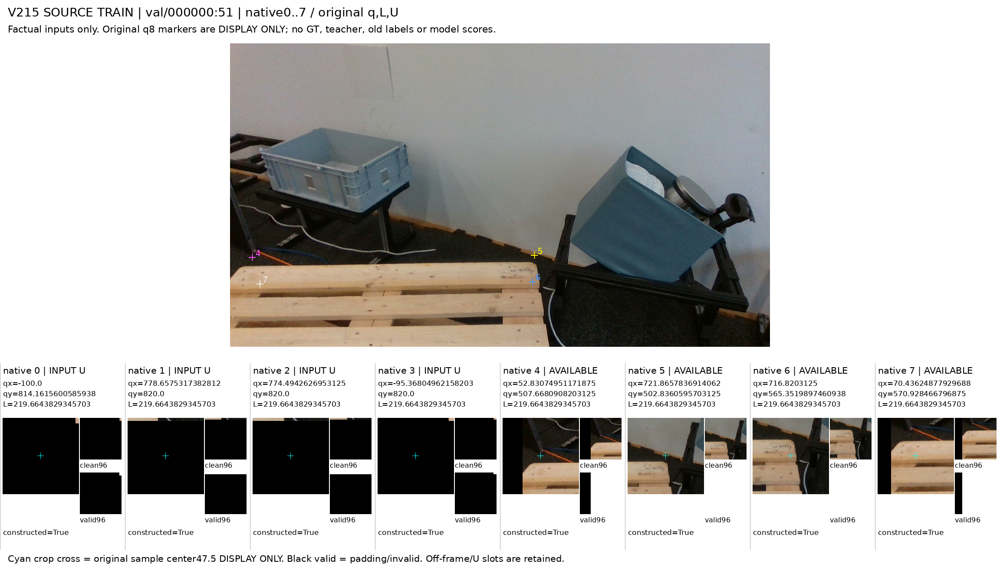
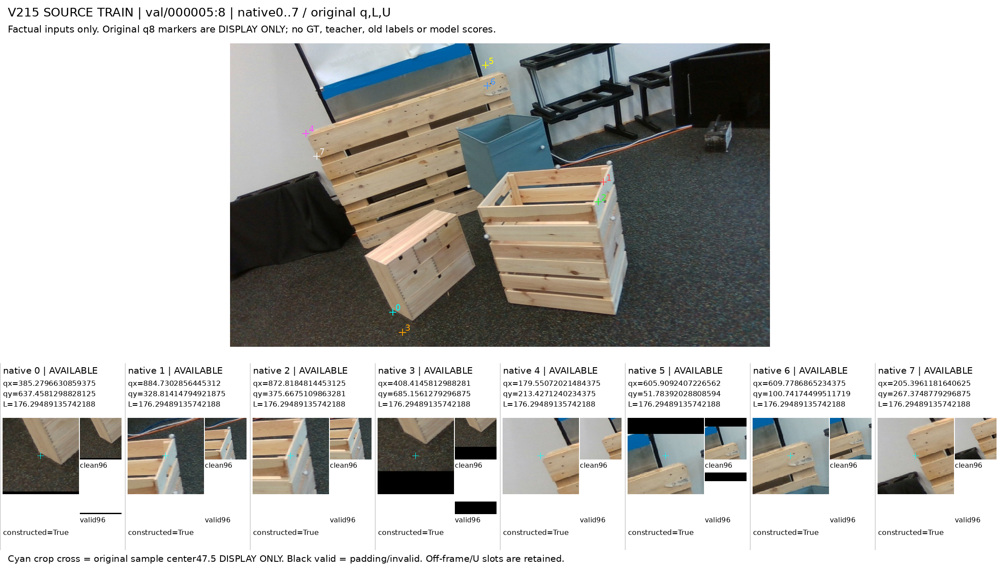
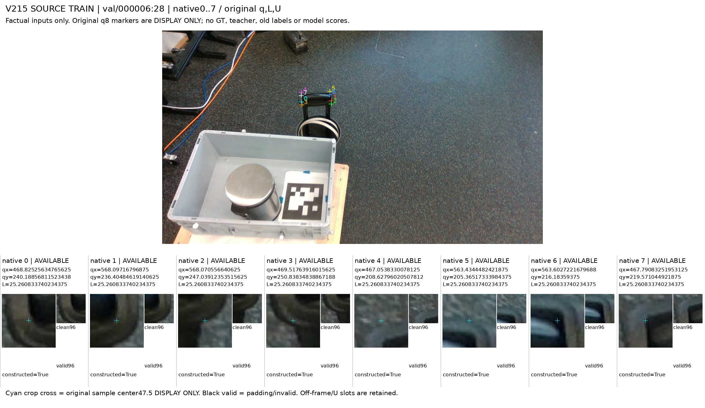

# V215 공개 SOURCE TRAIN 입력 coverage와 외관 관찰

공개 SOURCE TRAIN에서 고정한12프레임의 원입력96slot을 보존하고, root와 B가 서로 다른6장씩 실제 확인했다. 새 native D/E/S 주석과 학습 admission은 만들지 않았다. 목재나 물체 표면이 crop에 보인다는 사실은 의도한 native 부위의 가시성 정답이 아니다.

|항목|결과|
|---|---|
|선택|4prefix×3 =12frame /12component|
|원 입력|native96 /available85 /U11|
|실제 카드 관찰|root6 + B6 =12frame /96표시slot|
|새 native D/E/S|0 /0 /0;96slot 주석미확정|
|새 학습 admission /모델·평가 실행|false /0|

기존 TRAIN155프레임에서 weak3와 같은3개 원본 component에 속한55프레임을 제외하고, 원 available query가4개 이상인98후보/98component에서 고정 hash로4prefix×3개를 선택했다. 부족할 때 조건을 완화하는 fallback은 없다. 이 graph component 구분은 물리적 독립성의 인증이 아니다.

원 q/L·native0..7·role·RAW96/valid sampler와 U11은 유지했다. fullRGB·clean96·valid96의 원바이트 정합은 봉인된 preview COMPLETE가 기록한다. 이번 보고서는 생성된 JSON/CSV와 실제 관찰 receipt만 대조했으며 원 source 배열·RGB·GT·기존 라벨·모델·점수는 열지 않았다.

카드는2304px로 생성됐고 실제 도구 표시에서 헤더·q/L/U·native8·clean96/valid96·푸터가 읽혔다. root/B의12장 합집합은 전체 입력 카드 확인이며, 같은 frame에 대한 두 관찰자의 독립 합의가 아니다. HTML을 브라우저로 렌더했다는 주장은 없다.

원 U11과 새 의미주석 UNKNOWN96은 다른 축이다. available85도 intended 부위 식별85개를 뜻하지 않는다. 모든 native D/E/S는 아직 주석미확정이며 local appearance 관찰을 D/E/S로 변환하지 않았다.

## 사전 지정 설명 카드0/6/10

아래3장은 root가 보고서용으로 고정한 설명 사례다. 빈도·대표성·모델 실패율을 나타내지 않으며, 그림을 근거로 q나 native 라벨을 교정하지 않았다.

### 위치0 · val/000000:51

앞 목재 팔레트와 뒤 상자·검은 프레임이 보인다. 원native0..3은 INPUT U/대부분padding이며4..7crop에 목재·바닥·케이블·벽 경계가 섞인다.

### 위치6 · val/000005:8

q0..3은 앞 나무상자/바닥 주변, q4..7은 뒤 세워진 팔레트 주변에 걸쳐 보인다. 같은q8의 서로 다른 목재 물체 대응을 먼저 분리해야 한다. selected-instance를 인증하지 않는다.

### 위치10 · val/000006:28

q8이 작은 검은 운반카트 손잡이 주변에 모여 있다. 아래 팔레트는 fullimage에 보이지만8개의 원crop에는 손잡이·바닥이 보이고 인식 가능한 목재 팔레트 부위는 보이지 않는다. 외부가림·native오류 정답으로 확정하지 않고 unsupported/local-instance 대응 문제로 남긴다.

B가 본 val/000002:0은 전면EPAL pallet와 뒤쪽 상자들이 같은 fullimage에 있으나 q8crop은 뒤쪽 나무 상자 상단 주변을 담았다. val/000005:24는 앞 열린 나무 상자·뒤 목재 구조·바닥이 crop별로 섞였다. val/000006:25는 작은 검은 손잡이와 바닥을 담았다. 이러한 외관 관찰은 selected-instance/native 오류 또는 true 외부가림의 정답 판정이 아니다.

## 전체12프레임과 원입력

[전체12 갤러리](fixed12_public_TRAIN_input_previews_v1/PORTABLE_GALLERY_KO.md) · [원96slot ID/qL/U CSV](fixed12_public_TRAIN_input_previews_v1/ALL96_ORIGINAL_INPUT_IDENTITIES.csv) · [PNG 정합 manifest](fixed12_public_TRAIN_input_previews_v1/ANNOTATOR_INPUT_MANIFEST.json)

|위치|원 source frame|available|U|실제 관찰|
|---|---|---|---|---|
|0|val/000000:51|4/8|4|root|
|1|val/000000:64|8/8|0|B|
|2|val/000000:19|6/8|2|root|
|3|val/000002:0|8/8|0|B|
|4|val/000002:6|8/8|0|root|
|5|val/000002:47|6/8|2|B|
|6|val/000005:8|8/8|0|root|
|7|val/000005:24|8/8|0|B|
|8|val/000005:17|8/8|0|root|
|9|val/000006:25|8/8|0|B|
|10|val/000006:28|8/8|0|root|
|11|val/000006:21|5/8|3|B|

[위치0 val/000000:51 카드](fixed12_public_TRAIN_input_previews_v1/FRAME_00_0051/FULLIMAGE_AND_ALL8_INPUT_CONTACT.png)

[위치1 val/000000:64 카드](fixed12_public_TRAIN_input_previews_v1/FRAME_01_0064/FULLIMAGE_AND_ALL8_INPUT_CONTACT.png)

[위치2 val/000000:19 카드](fixed12_public_TRAIN_input_previews_v1/FRAME_02_0019/FULLIMAGE_AND_ALL8_INPUT_CONTACT.png)

[위치3 val/000002:0 카드](fixed12_public_TRAIN_input_previews_v1/FRAME_03_0118/FULLIMAGE_AND_ALL8_INPUT_CONTACT.png)

[위치4 val/000002:6 카드](fixed12_public_TRAIN_input_previews_v1/FRAME_04_0124/FULLIMAGE_AND_ALL8_INPUT_CONTACT.png)

[위치5 val/000002:47 카드](fixed12_public_TRAIN_input_previews_v1/FRAME_05_0165/FULLIMAGE_AND_ALL8_INPUT_CONTACT.png)

[위치6 val/000005:8 카드](fixed12_public_TRAIN_input_previews_v1/FRAME_06_0174/FULLIMAGE_AND_ALL8_INPUT_CONTACT.png)

[위치7 val/000005:24 카드](fixed12_public_TRAIN_input_previews_v1/FRAME_07_0190/FULLIMAGE_AND_ALL8_INPUT_CONTACT.png)

[위치8 val/000005:17 카드](fixed12_public_TRAIN_input_previews_v1/FRAME_08_0183/FULLIMAGE_AND_ALL8_INPUT_CONTACT.png)

[위치9 val/000006:25 카드](fixed12_public_TRAIN_input_previews_v1/FRAME_09_0224/FULLIMAGE_AND_ALL8_INPUT_CONTACT.png)

[위치10 val/000006:28 카드](fixed12_public_TRAIN_input_previews_v1/FRAME_10_0227/FULLIMAGE_AND_ALL8_INPUT_CONTACT.png)

[위치11 val/000006:21 카드](fixed12_public_TRAIN_input_previews_v1/FRAME_11_0220/FULLIMAGE_AND_ALL8_INPUT_CONTACT.png)

## 남은 대응 문제

다음 source 약관찰에서는 ①선택된 pallet instance 식별 ②의도한 native 부위 대응 ③국소 visible-feature witness ④query support/ON·NEAR·OFF ⑤외부·자기가림/위치 불확실성을 별도 축으로 기록한다. 판단할 수 없으면 UNKNOWN과 불일치를 보존한다. 배경·다른 목재·외부물체 표면을 native E/D로 바꾸거나, q/ROI를 이동해 통과시키지 않는다. 이는 후속 관찰의 준비이며 새 주석 규칙·학습 admission이 아니다.

완료 범위는 factual 입력 coverage와 제한된 SOURCE 외관 관찰이다. 새 native annotation, 모델 개선·채택 또는 최종 목표 해결은 완료되지 않았다.

## 근거와 재현 파일

[수치/범위 JSON](ROOT_RESULTS_KO.json)

[HTML 보고서](ROOT_READOUT_KO.html)

[전체12 갤러리](fixed12_public_TRAIN_input_previews_v1/PORTABLE_GALLERY_KO.md)

[Preview COMPLETE](fixed12_public_TRAIN_input_previews_v1/COMPLETE.json)

[사전 선택 metadata](selector_preparation_b/SELECTED12_SOURCE_TRAIN_FRAMES_BEFORE_PIXELS.json)

[Selector READY](selector_preparation_b/FINAL_READY.json)

[Preview 코드](preview_preparation_b/build_fixed12_input_previews.py)

[Preview protocol](preview_preparation_b/PROTOCOL_BEFORE_ANY_SELECTED_SOURCE_RGB_OR_FRAME8_BODIES.json)

[root 실제6 receipt](ROOT_ACTUAL_FIXED6_SOURCE_FRAME_OBSERVATIONS.json)

[B 실제6 receipt](independent_visual_observations_b/ACTUAL_FIXED6_SOURCE_FRAME_OBSERVATIONS.json)

[본 보고서 코드](report_preparation_b/build_saved_input_coverage_report.py)

[본 보고서 protocol](report_preparation_b/PROTOCOL_BEFORE_SAVED_METADATA_REPORT.json)

[Saved scalar/text QA](report_preparation_b/SAVED_REPORT_QA.json)
