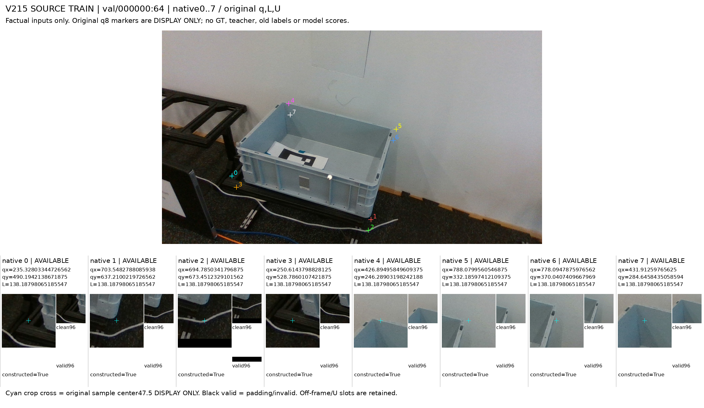
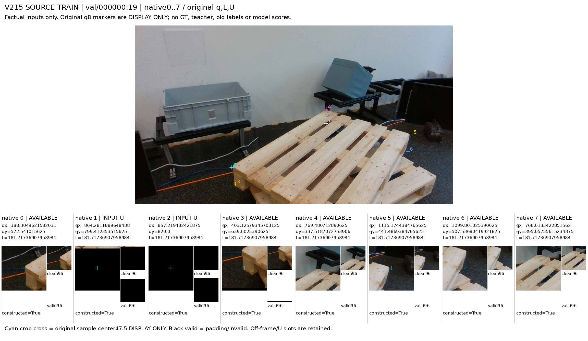
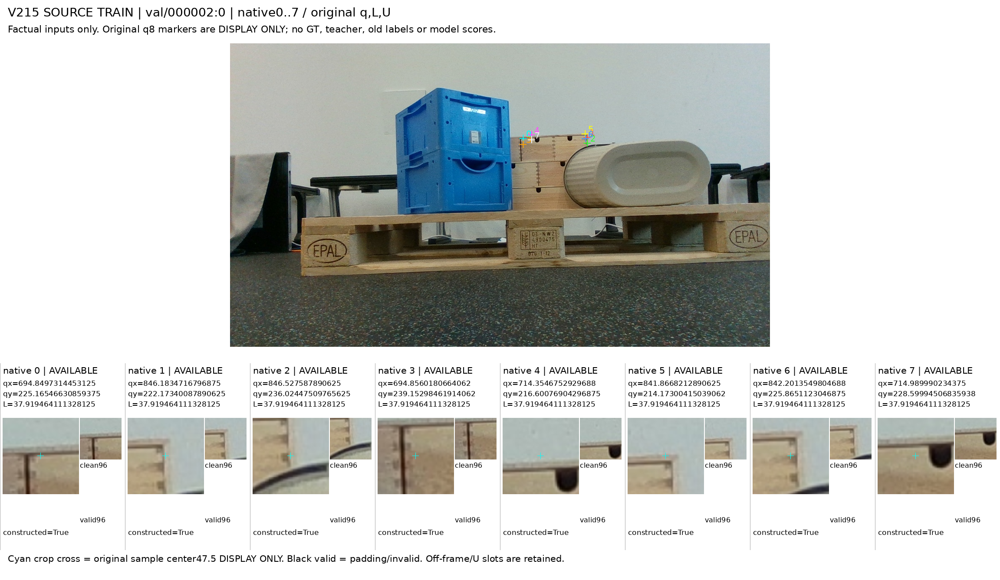
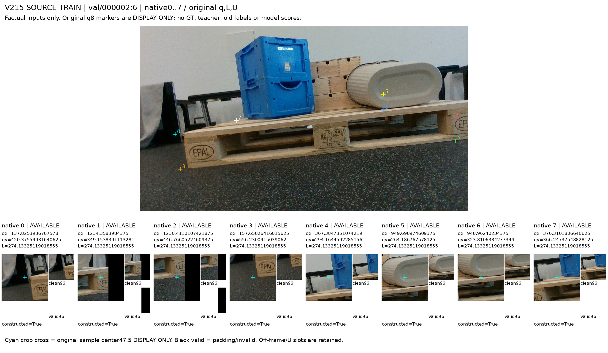
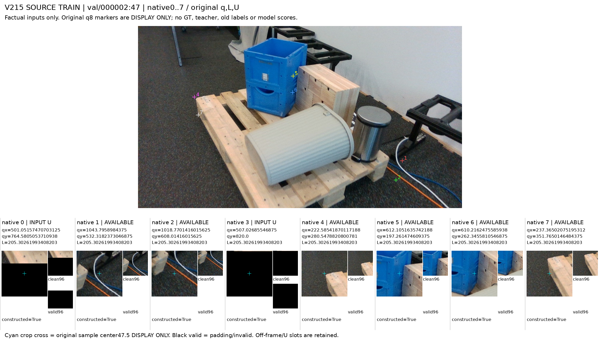
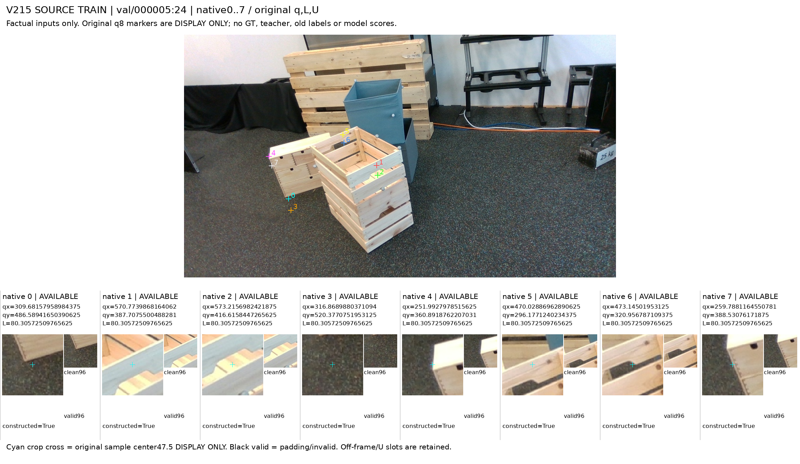
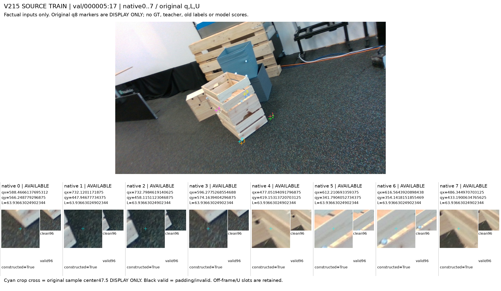
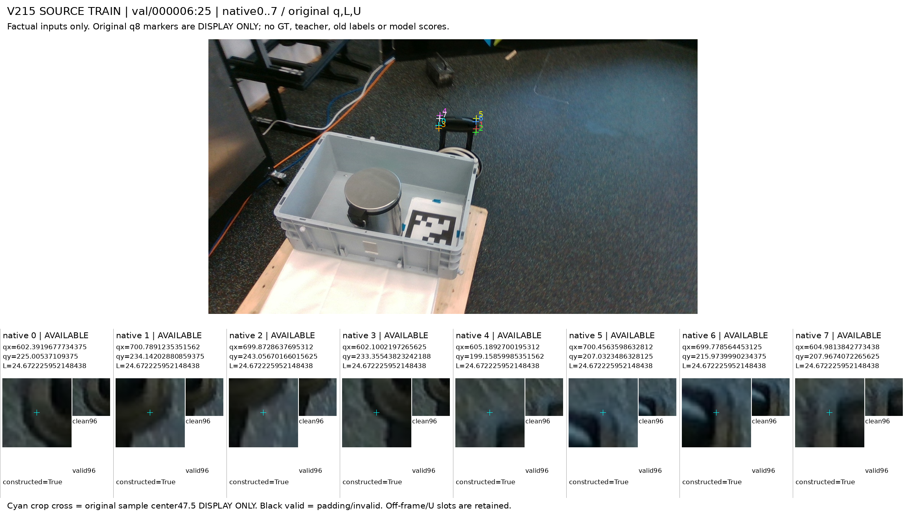
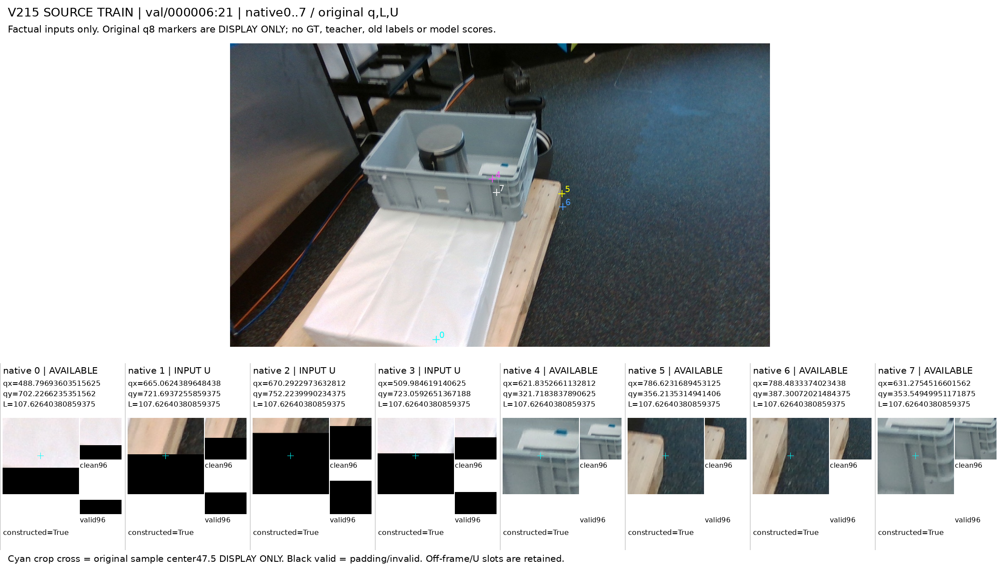

# V215 공개 SOURCE TRAIN 입력12프레임

고정4prefix×3프레임·12component의 원입력96slot이다. 원 U11도 유지했다. 이 자료는 관찰 전 factual 입력이며 GT·모델·기존 약라벨·SAM을 표시하지 않는다. q8 표식과 crop47.5 십자는 표시용이며 수정 keypoint나 native 정답위치가 아니다. fullRGB와 원96crop/valid의 별도 PNG는 원바이트와 일치한다.

[원96slot ID/qL/U CSV](ALL96_ORIGINAL_INPUT_IDENTITIES.csv) · [PNG 정합 manifest](ANNOTATOR_INPUT_MANIFEST.json)

약관찰/학습 admission은 아직 없다. 이후 intended visiblepart와 q와의 관계를 분리하고 UNKNOWN·불일치를 보존한다. component 구분은 물리적 독립성을 인증하지 않는다.

## val/000000:51

[표식 없는 원 fullRGB](FRAME_00_0051/ORIGINAL_CANONICAL_RGB.png) · [원q8 표시 사본](FRAME_00_0051/ORIGINAL_Q8_DISPLAY_ONLY.png)

## val/000000:64

[표식 없는 원 fullRGB](FRAME_01_0064/ORIGINAL_CANONICAL_RGB.png) · [원q8 표시 사본](FRAME_01_0064/ORIGINAL_Q8_DISPLAY_ONLY.png)

## val/000000:19

[표식 없는 원 fullRGB](FRAME_02_0019/ORIGINAL_CANONICAL_RGB.png) · [원q8 표시 사본](FRAME_02_0019/ORIGINAL_Q8_DISPLAY_ONLY.png)

## val/000002:0

[표식 없는 원 fullRGB](FRAME_03_0118/ORIGINAL_CANONICAL_RGB.png) · [원q8 표시 사본](FRAME_03_0118/ORIGINAL_Q8_DISPLAY_ONLY.png)

## val/000002:6

[표식 없는 원 fullRGB](FRAME_04_0124/ORIGINAL_CANONICAL_RGB.png) · [원q8 표시 사본](FRAME_04_0124/ORIGINAL_Q8_DISPLAY_ONLY.png)

## val/000002:47

[표식 없는 원 fullRGB](FRAME_05_0165/ORIGINAL_CANONICAL_RGB.png) · [원q8 표시 사본](FRAME_05_0165/ORIGINAL_Q8_DISPLAY_ONLY.png)

## val/000005:8

[표식 없는 원 fullRGB](FRAME_06_0174/ORIGINAL_CANONICAL_RGB.png) · [원q8 표시 사본](FRAME_06_0174/ORIGINAL_Q8_DISPLAY_ONLY.png)

## val/000005:24

[표식 없는 원 fullRGB](FRAME_07_0190/ORIGINAL_CANONICAL_RGB.png) · [원q8 표시 사본](FRAME_07_0190/ORIGINAL_Q8_DISPLAY_ONLY.png)

## val/000005:17

[표식 없는 원 fullRGB](FRAME_08_0183/ORIGINAL_CANONICAL_RGB.png) · [원q8 표시 사본](FRAME_08_0183/ORIGINAL_Q8_DISPLAY_ONLY.png)

## val/000006:25

[표식 없는 원 fullRGB](FRAME_09_0224/ORIGINAL_CANONICAL_RGB.png) · [원q8 표시 사본](FRAME_09_0224/ORIGINAL_Q8_DISPLAY_ONLY.png)

## val/000006:28

[표식 없는 원 fullRGB](FRAME_10_0227/ORIGINAL_CANONICAL_RGB.png) · [원q8 표시 사본](FRAME_10_0227/ORIGINAL_Q8_DISPLAY_ONLY.png)

## val/000006:21

[표식 없는 원 fullRGB](FRAME_11_0220/ORIGINAL_CANONICAL_RGB.png) · [원q8 표시 사본](FRAME_11_0220/ORIGINAL_Q8_DISPLAY_ONLY.png)
