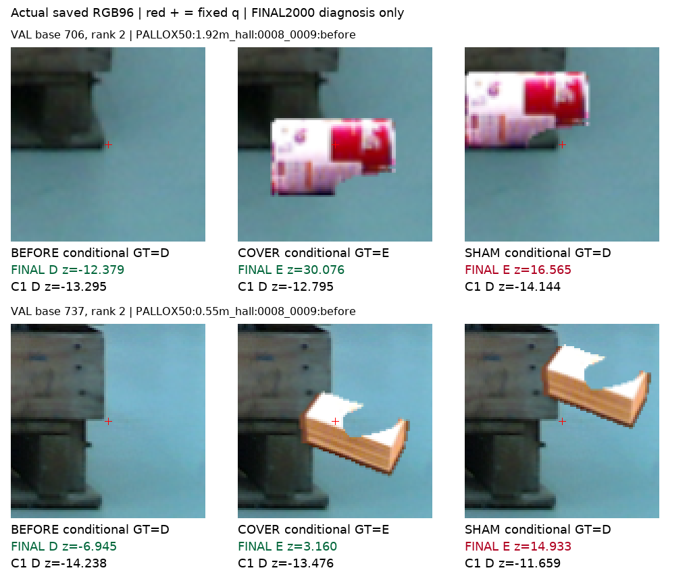
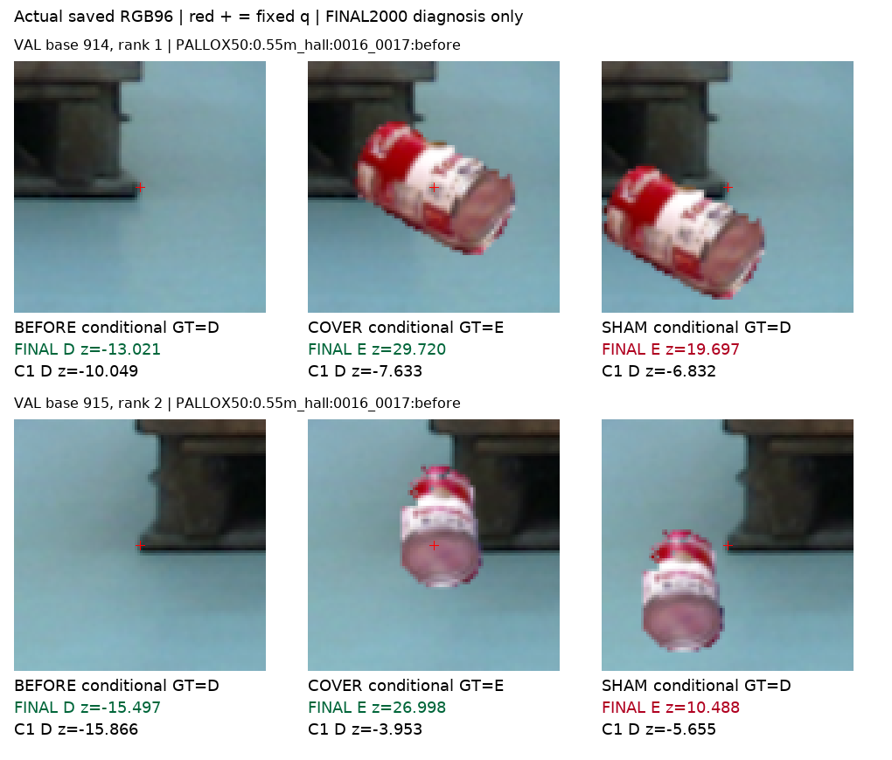
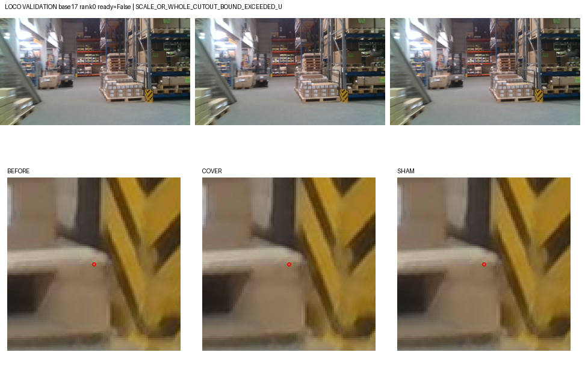
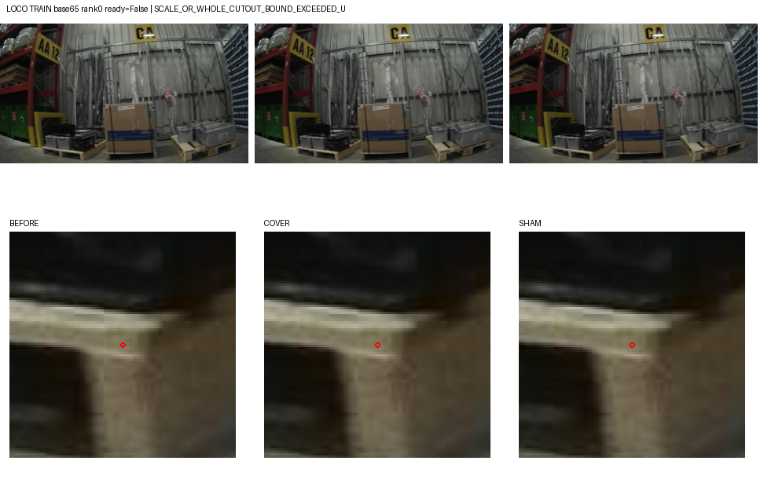

# V96 — query_visibility_query_anchored_cue_20261023_v96

기존 보고서에서 추출한 게시용 파생 개요입니다. 원본 파일을 수정하거나 실험·평가를 다시 실행하지 않았습니다. 원문 해시와 링크 대응은 publication manifest로 확인합니다.

**상태:** {"completed":true,"fully_solved":false,"goal_status":"active"}

원본:

- [ROOT_READOUT_KO.html](ROOT_READOUT_KO.html) — SHA256 `3842498849cecbb4e4687b849b7329b52230910fe2169ce4134dc09728c12608`
- [ROOT_RESULTS_KO.json](ROOT_RESULTS_KO.json) — SHA256 `f6164ed613857a0276295e94d2f5807518bacab166c31982d420ab3ed021f0a2`

## 방법·목표의 원문 필드

`$.schema`

```text
V96_KOREAN_SOURCE_READOUT
```


## 입력·학습·평가 분모의 원문 필드

`$.cohort_BCE`

```text
{
  "C1": {
    "TRAIN": {
      "LOCO_BEFORE_D": {
        "N": 3,
        "mean_BCE": 7.402889277185037
      },
      "PALLOX_BEFORE_D": {
        "N": 25,
        "mean_BCE": 1.4147814121669594e-06
      },
      "SHAM_D": {
        "N": 75,
        "mean_BCE": 0.004636322181653835
      },
      "BEFORE_E": {
        "N": 2,
        "mean_BCE": 3.080019741474871e-07
      },
      "COVER_E": {
        "N": 75,
        "mean_BCE": 12.211830190605822
      }
    },
    "VALIDATION": {
      "LOCO_BEFORE_D": {
        "N": 3,
        "mean_BCE": 0.6791478382249053
      },
      "PALLOX_BEFORE_D": {
        "N": 30,
        "mean_BCE": 0.0013030923109008273
      },
      "SHAM_D": {
        "N": 119,
        "mean_BCE": 0.3004744132594845
      },
      "BEFORE_E": {
        "N": 2,
        "mean_BCE": 1.1420202339351704e-06
      },
      "COVER_E": {
        "N": 119,
        "mean_BCE": 10.467754791754107
      }
    }
  },
  "C3": {
    "TRAIN": {
      "LOCO_BEFORE_D": {
        "N": 3,
        "mean_BCE": 0.6931471805599453
      },
      "PALLOX_BEFORE_D": {
        "N": 25,
        "mean_BCE": 0.6931471805599452
      },
      "SHAM_D": {
        "N": 75,
        "mean_BCE": 0.6931471805599454
      },
      "BEFORE_E": {
        "N": 2,
        "mean_BCE": 0.6931471805599453
      },
      "COVER_E": {
        "N": 75,
        "mean_BCE": 0.6931471805599454
      }
    },
    "VALIDATION": {
      "LOCO_BEFORE_D": {
        "N": 3,
        "mean_BCE": 0.6931471805599453
      },
      "PALLOX_BEFORE_D": {
        "N": 30,
        "mean_BCE": 0.693147180559945
      },
      "SHAM_D": {
        "N": 119,
        "mean_BCE": 0.6931471805599454
      },
      "BEFORE_E": {
        "N": 2,
        "mean_BCE": 0.6931471805599453
      },
      "COVER_E": {
        "N": 119,
        "mean_BCE": 0.6931471805599454
      }
    }
  }
}
```


## 결론·실패·한계의 원문 필드

`$.conclusion_KO`

```text
query와 단서를 연결한 제어 자료는 늘었지만 C3 학습 상태는 채택되지 않았습니다. 공개 소스 일반화와 실제 팔레트 목표 해결은 입증하지 못했습니다.
```

`$.limits_KO`

```text
[
  "194개는28개 원 query에서 여러 donor rank로 만든 쌍이며 독립적인194장면이 아닙니다.",
  "성공한 제어쌍은 모두 Pallox입니다. LOCO controlled E는 학습·검증 모두0이라 미검증입니다.",
  "원본 자연E는 TRAIN2/VAL2로 매우 작고, 대상은 조건부 AI 보조 단서입니다. Native8와 사람 D/E/S gold가 아닙니다.",
  "자료·라벨 admission·sampler·selector를 함께 바꿔 단일 요인의 효과로 해석할 수 없습니다.",
  "Pallox는 동일 물리 bin의LAB/HALL 계열이며, 다른 팔레트 구조나 자연 가림 전이를 보장하지 않습니다.",
  "절차적 목재 렌더는 별도 실행가능성 결과이며 이번 C3에 포함되지 않았습니다."
]
```

`$.fixed_final_failure_crop_review`

```text
{
  "root_receipt": {
    "path": "query_visibility_query_anchored_cue_20261023_v96/source_diagnosis/ACTUAL_CROP_FAILURE_REVIEW/ROOT_ACTUAL_CROP_VIEW.json",
    "sha256": "ec83be2289a5b3d4aa5257f855c87783d21d9155325b358764cbeccff5fd0fdd"
  },
  "selection": {
    "path": "query_visibility_query_anchored_cue_20261023_v96/source_diagnosis/ACTUAL_CROP_FAILURE_REVIEW/SELECTION_BEFORE_CROP_READS.json",
    "sha256": "e8b4b700bc816269677d2381f3faa0681a651c5f56290dd324778e461336852b"
  },
  "comparison": {
    "path": "query_visibility_query_anchored_cue_20261023_v96/source_diagnosis/ACTUAL_CROP_FAILURE_REVIEW/ACTUAL_CROP_COMPARISON.json",
    "sha256": "d84924017e56fcb355bd4c313aa51d0f9fc520ca1f80729bda48ea89e281b680"
  },
  "figures": [
    {
      "path": "query_visibility_query_anchored_cue_20261023_v96/source_diagnosis/ACTUAL_CROP_FAILURE_REVIEW/CONTACT_01.png",
      "sha256": "7649373f91d5d40e663d9e57f0b0c9c1e22eeee57d3b53a2096c1fd441f13854"
    },
    {
      "path": "query_visibility_query_anchored_cue_20261023_v96/source_diagnosis/ACTUAL_CROP_FAILURE_REVIEW/CONTACT_02.png",
      "sha256": "7e4862ffe2dfa74974ed2e3a02d5772a83226dd0b17c9ca0e0ebf14b349728cc"
    }
  ],
  "posthoc_diagnostic_only": true,
  "model_threshold_training_row_selection_used": false
}
```


## 코드·검증·전체 표·갤러리

아래 목록은 원 보고서가 참조한 파일의 경로를 다시 연결한 것입니다. 이 개요 작성 중 이미지 내용이나 raw 평가 데이터를 새로 검사하지 않았습니다.

- [query_visibility_query_anchored_cue_20261023_v96/source_diagnosis/ACTUAL_CROP_FAILURE_REVIEW/ROOT_ACTUAL_CROP_VIEW.json](source_diagnosis/ACTUAL_CROP_FAILURE_REVIEW/ROOT_ACTUAL_CROP_VIEW.json)
- [query_visibility_query_anchored_cue_20261023_v96/source_diagnosis/ACTUAL_CROP_FAILURE_REVIEW/SELECTION_BEFORE_CROP_READS.json](source_diagnosis/ACTUAL_CROP_FAILURE_REVIEW/SELECTION_BEFORE_CROP_READS.json)
- [query_visibility_query_anchored_cue_20261023_v96/independent_actual_source_fit_audit/REVIEW.json](independent_actual_source_fit_audit/REVIEW.json)
- [query_visibility_query_anchored_cue_20261023_v96/independent_actual_source_fit_audit/FINAL2000_DIAGNOSTIC_AUDIT/REVIEW.json](independent_actual_source_fit_audit/FINAL2000_DIAGNOSTIC_AUDIT/REVIEW.json)
- [query_visibility_matched_query_scalar_20261023_v94/ROOT_READOUT_KO.html](../query_visibility_matched_query_scalar_20261023_v94/ROOT_READOUT_KO.html)
- [query_visibility_query_anchored_cue_20261023_v96/ROOT_RESULTS_KO.json](ROOT_RESULTS_KO.json)
- [query_visibility_query_anchored_cue_20261023_v96/runs/C3_QUERY_ANCHORED_SOURCE_V1/SOURCE_RESULTS.json](runs/C3_QUERY_ANCHORED_SOURCE_V1/SOURCE_RESULTS.json)
- [query_visibility_query_anchored_cue_20261023_v96/source_baselines/C1_FROZEN_ON_V96/SOURCE_RESULTS.json](source_baselines/C1_FROZEN_ON_V96/SOURCE_RESULTS.json)
- [query_visibility_query_anchored_cue_20261023_v96/actual_query_anchored_image_intake/IMAGE_ONLY_INTAKE_SEAL.json](actual_query_anchored_image_intake/IMAGE_ONLY_INTAKE_SEAL.json)
- [query_visibility_query_anchored_cue_20261023_v96/actual_source_pair_input_pack/INPUT_PACK_SEAL.json](actual_source_pair_input_pack/INPUT_PACK_SEAL.json)
- [query_visibility_query_anchored_cue_20261023_v96/synthetic_appearance_feasibility/ACTUAL_ONE_PROTOTYPE_V3/PROTOTYPE_RESULT.json](synthetic_appearance_feasibility/ACTUAL_ONE_PROTOTYPE_V3/PROTOTYPE_RESULT.json)
- [query_visibility_query_anchored_cue_20261023_v96/QUERY_ANCHORED_INVENTORY_SUMMARY.json](QUERY_ANCHORED_INVENTORY_SUMMARY.json)
- [query_visibility_query_anchored_cue_20261023_v96/FINAL_METADATA_INVENTORY_SEAL.json](FINAL_METADATA_INVENTORY_SEAL.json)
- [query_visibility_query_anchored_cue_20261023_v96/actual_query_anchored_image_intake/IMAGE_ONLY_SUMMARY.json](actual_query_anchored_image_intake/IMAGE_ONLY_SUMMARY.json)
- [query_visibility_query_anchored_cue_20261023_v96/actual_source_pair_input_pack/PACK_MANIFEST.json](actual_source_pair_input_pack/PACK_MANIFEST.json)
- [query_visibility_query_anchored_cue_20261023_v96/C3_DESIGN_BEFORE_SOURCE_FIT.json](C3_DESIGN_BEFORE_SOURCE_FIT.json)
- [query_visibility_query_anchored_cue_20261023_v96/actual_query_anchored_image_intake/fixed_order_preview/PREVIEW_MANIFEST.json](actual_query_anchored_image_intake/fixed_order_preview/PREVIEW_MANIFEST.json)
- [query_visibility_query_anchored_cue_20261023_v96/synthetic_appearance_feasibility/FEASIBILITY_FINAL_SEAL.json](synthetic_appearance_feasibility/FEASIBILITY_FINAL_SEAL.json)
- [query_visibility_query_anchored_cue_20261023_v96/source_baselines/C1_FROZEN_ON_V96/BASELINE_COMPLETE.json](source_baselines/C1_FROZEN_ON_V96/BASELINE_COMPLETE.json)
- [query_visibility_query_anchored_cue_20261023_v96/runs/C3_QUERY_ANCHORED_SOURCE_V1/FIT_COMPLETE.json](runs/C3_QUERY_ANCHORED_SOURCE_V1/FIT_COMPLETE.json)
- [query_visibility_query_anchored_cue_20261023_v96/source_diagnosis/FINAL2000_FIXED_NOT_SELECTOR/DIAGNOSIS_COMPLETE.json](source_diagnosis/FINAL2000_FIXED_NOT_SELECTOR/DIAGNOSIS_COMPLETE.json)
- [query_visibility_query_anchored_cue_20261023_v96/source_diagnosis/FINAL2000_FIXED_NOT_SELECTOR/SOURCE_RESULTS.json](source_diagnosis/FINAL2000_FIXED_NOT_SELECTOR/SOURCE_RESULTS.json)
- [query_visibility_query_anchored_cue_20261023_v96/source_diagnosis/ACTUAL_CROP_FAILURE_REVIEW/ACTUAL_CROP_COMPARISON.json](source_diagnosis/ACTUAL_CROP_FAILURE_REVIEW/ACTUAL_CROP_COMPARISON.json)

## 원 보고서의 그림

원 보고서 참조 순서의 처음 최대4개를 표시합니다. 새 outcome 선택이나 전수 이미지 검증을 뜻하지 않습니다. 전체 갤러리는 위 원문 링크에서 확인합니다.

[query_visibility_query_anchored_cue_20261023_v96/source_diagnosis/ACTUAL_CROP_FAILURE_REVIEW/CONTACT_01.png](source_diagnosis/ACTUAL_CROP_FAILURE_REVIEW/CONTACT_01.png)



[query_visibility_query_anchored_cue_20261023_v96/source_diagnosis/ACTUAL_CROP_FAILURE_REVIEW/CONTACT_02.png](source_diagnosis/ACTUAL_CROP_FAILURE_REVIEW/CONTACT_02.png)



[query_visibility_query_anchored_cue_20261023_v96/actual_query_anchored_image_intake/fixed_order_preview/case_00.png](actual_query_anchored_image_intake/fixed_order_preview/case_00.png)



[query_visibility_query_anchored_cue_20261023_v96/actual_query_anchored_image_intake/fixed_order_preview/case_01.png](actual_query_anchored_image_intake/fixed_order_preview/case_01.png)




현재 사용자 목표 전체의 해결·새 모델 채택·실사 가림 원인 확정을 이 파생 개요가 추가로 주장하지 않습니다. UNKNOWN/U와 불리한 결과, 실패 실행 및 수정 provenance는 원문대로 보존해야 합니다.
