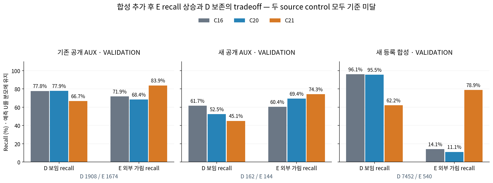
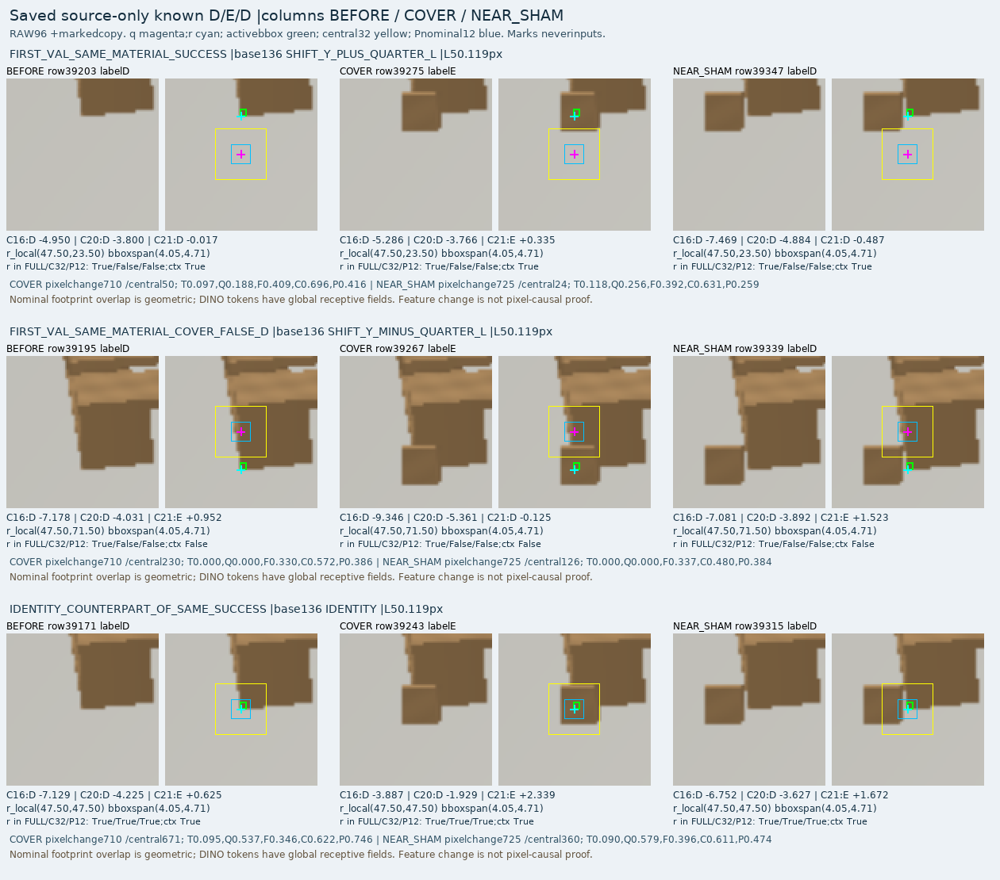
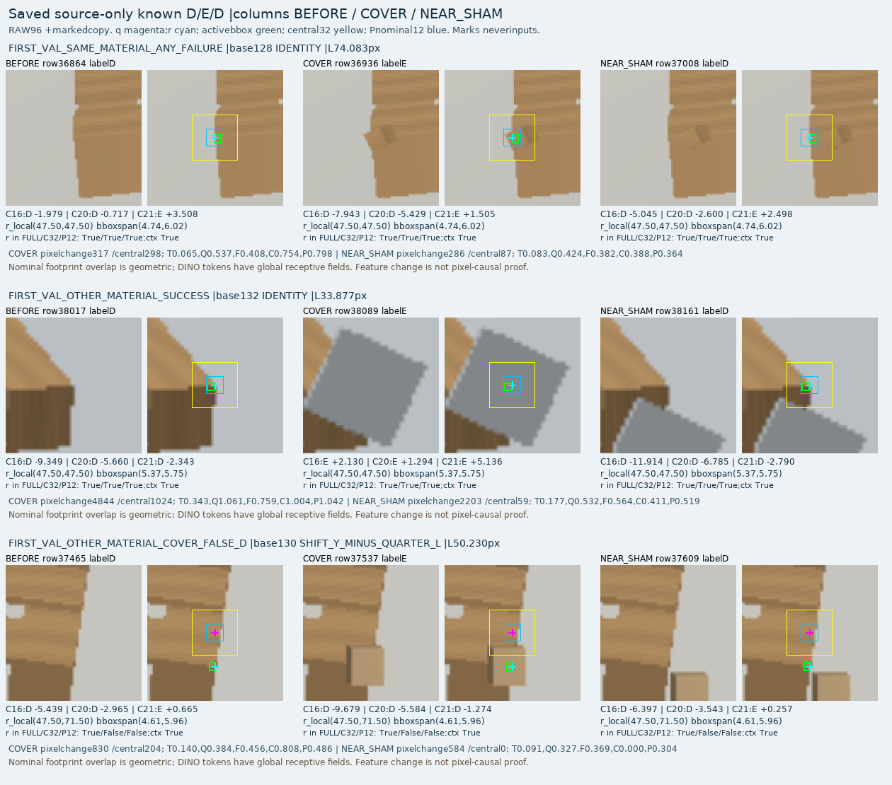

# V129 — query_visibility_registered_native_diversity_20261023_v129

기존 보고서에서 추출한 게시용 파생 개요입니다. 원본 파일을 수정하거나 실험·평가를 다시 실행하지 않았습니다. 원문 해시와 링크 대응은 publication manifest로 확인합니다.

**상태:** {"completed":true,"fully_solved":false,"goal_status":"active"}

원본:

- [ROOT_PHASE_RESULT.json](ROOT_PHASE_RESULT.json) — SHA256 `c37b4d3e85dac9874189b91d7e2c73d42e8383c654cfd4be28afcc1fff7eaa66`
- [ROOT_READOUT_KO.html](ROOT_READOUT_KO.html) — SHA256 `9b5b74fabcd652b8428ce454b462454a7f7d166d47ee1bf216b1db2605a359e7`
- [ROOT_RESULTS_KO.json](ROOT_RESULTS_KO.json) — SHA256 `50cef89816a12557dc4075b84fdf7cacaad174cb4e2b48d8fa6145b46aca7095`

## 방법·목표의 원문 필드

`$.phase`

```text
V129_ACTUAL_DIVERSE_RENDER_PUBLIC6_CROPS_TWO_BASELINES_AND_FIXED1000_SOURCE_CONTROL
```

`$.previous_goal_turn_classification`

```text
PROGRESS: actual native55296 crop generation complete; frozen C16/v61 forwards and two source fits/evaluation completed.
```


## 입력·학습·평가 분모의 원문 필드

`$.training_diagnosis`

```text
{
  "all_new_public_and_old_public_TRAIN_seen": true,
  "native_D_never_seen": 2594,
  "C21_native_D_seen_correct": [
    11603,
    14560
  ],
  "C21_native_D_unseen_correct": [
    2088,
    2594
  ],
  "exact_opposite_D_E_feature_collision_groups": 0,
  "known_available_TRAIN_occurrences_checked": 19767,
  "continued_TRAIN_loss_decrease": true,
  "duration_causal_fix_proven": false
}
```


## 결론·실패·한계의 원문 필드

`$.outcome_KO`

```text
합성 추가는 외부가림 재현율을 높였으나 보이는 점을 크게 버렸다. 두 source 후보 모두 기준 미달이며 현재 실사는 재평가하지 않았다. 새 자료의 학습부족·일반화 실패 구분을 이어간다.
```

`$.limits_KO`

```text
[
  "수만행은192합성설정 및6공개원본의query/variant 반복이다. 합성은12geometry groups/96geometry-camera groups이며 새로운 독립 실사 수만장이 아니다.",
  "공개 라벨은지정한2D구조cue를합성가림체가덮었는지에대한weak AUX이고실제native8 사람정답이아니다.",
  "작은cue·절차적appearance·시점/형상coverage·고정특징/학습정도·도메인간간섭이남는다. 이번자료를추가하는것만으로해결되지않았다.",
  "Source validation은반복개발에노출되어있다. 현재223은평가전용이며V112에접근하지않았다.",
  "old15source회귀기준통과를주장하지않는다."
]
```


## 코드·검증·전체 표·갤러리

아래 목록은 원 보고서가 참조한 파일의 경로를 다시 연결한 것입니다. 이 개요 작성 중 이미지 내용이나 raw 평가 데이터를 새로 검사하지 않았습니다.

- [query_visibility_registered_native_diversity_20261023_v129/ROOT_RESULTS_KO.json](ROOT_RESULTS_KO.json)
- [query_visibility_registered_native_diversity_20261023_v129/ROOT_READOUT_KO.html](ROOT_READOUT_KO.html)
- [query_visibility_registered_native_diversity_20261023_v129/ROOT_REPORT_VISUAL_QA.json](ROOT_REPORT_VISUAL_QA.json)
- [query_visibility_source_coverage_duration_20261024_v130/ROOT_DURATION_POLICY_BEFORE_ADDITIONAL_OPTIMIZATION.json](../query_visibility_source_coverage_duration_20261024_v130/ROOT_DURATION_POLICY_BEFORE_ADDITIONAL_OPTIMIZATION.json)
- [query_visibility_registered_native_diversity_20261023_v129/postfit_report/REPORT_DRAFT_KO.html](postfit_report/REPORT_DRAFT_KO.html)
- [query_visibility_registered_native_diversity_20261023_v129/saved_source_baseline_evaluation_v1/READOUT_KO.html](saved_source_baseline_evaluation_v1/READOUT_KO.html)
- [query_visibility_training_duration_control_20261023_v124/ROOT_READOUT_KO.html](../query_visibility_training_duration_control_20261023_v124/ROOT_READOUT_KO.html)
- [query_visibility_source_coverage_duration_20261024_v130/ROOT_DURATION_INTERPRETATION_ADDENDUM_BEFORE_FIT.json](../query_visibility_source_coverage_duration_20261024_v130/ROOT_DURATION_INTERPRETATION_ADDENDUM_BEFORE_FIT.json)
- [query_visibility_registered_native_diversity_20261023_v129/actual_corpus_v1/RENDER_COMPLETE.json](actual_corpus_v1/RENDER_COMPLETE.json)
- [query_visibility_registered_native_diversity_20261023_v129/source_crops_v1/CROP_COMPLETE.json](source_crops_v1/CROP_COMPLETE.json)
- [query_visibility_registered_native_diversity_20261023_v129/public_corpus_v1/CORPUS_COMPLETE.json](public_corpus_v1/CORPUS_COMPLETE.json)
- [query_visibility_registered_native_diversity_20261023_v129/ROOT_PUBLIC6_RUNTIME_ERRATUM.json](ROOT_PUBLIC6_RUNTIME_ERRATUM.json)
- [query_visibility_registered_native_diversity_20261023_v129/frozen_C16_source_baseline_v1/PREDICTION_SEAL.json](frozen_C16_source_baseline_v1/PREDICTION_SEAL.json)
- [query_visibility_registered_native_diversity_20261023_v129/v61_frozen_source_baseline_v1/PREDICTION_SEAL.json](v61_frozen_source_baseline_v1/PREDICTION_SEAL.json)
- [query_visibility_registered_native_diversity_20261023_v129/saved_source_baseline_evaluation_v1/EVALUATION_SEAL.json](saved_source_baseline_evaluation_v1/EVALUATION_SEAL.json)
- [query_visibility_registered_native_diversity_20261023_v129/runs/C20_C21_FIXED1000_SOURCE_CONTROL/CONTROL_COMPLETE.json](runs/C20_C21_FIXED1000_SOURCE_CONTROL/CONTROL_COMPLETE.json)
- [query_visibility_registered_native_diversity_20261023_v129/postfit_report/ARTIFACTS.json](postfit_report/ARTIFACTS.json)
- [query_visibility_registered_native_diversity_20261023_v129/saved_corpus_status_review/REVIEW.json](saved_corpus_status_review/REVIEW.json)
- [query_visibility_registered_native_diversity_20261023_v129/postfit_source_diagnosis/DRAW_COVERAGE.json](postfit_source_diagnosis/DRAW_COVERAGE.json)
- [query_visibility_registered_native_diversity_20261023_v129/postfit_source_visual_review/RESULT.json](postfit_source_visual_review/RESULT.json)
- [query_visibility_registered_native_diversity_20261023_v129/postfit_source_diagnosis/RESULT.json](postfit_source_diagnosis/RESULT.json)
- [query_visibility_registered_native_diversity_20261023_v129/postfit_source_diagnosis/SAVED_FEATURE_COLLISION_CHECK.json](postfit_source_diagnosis/SAVED_FEATURE_COLLISION_CHECK.json)

## 원 보고서의 그림

원 보고서 참조 순서의 처음 최대4개를 표시합니다. 새 outcome 선택이나 전수 이미지 검증을 뜻하지 않습니다. 전체 갤러리는 위 원문 링크에서 확인합니다.

[query_visibility_registered_native_diversity_20261023_v129/postfit_report/VAL_RECALL_COMPARISON.png](postfit_report/VAL_RECALL_COMPARISON.png)



[query_visibility_registered_native_diversity_20261023_v129/postfit_report/VAL_CONFUSION_MATRICES.png](postfit_report/VAL_CONFUSION_MATRICES.png)


[query_visibility_registered_native_diversity_20261023_v129/postfit_source_visual_review/FIXED6_TRIPLETS_01.png](postfit_source_visual_review/FIXED6_TRIPLETS_01.png)



[query_visibility_registered_native_diversity_20261023_v129/postfit_source_visual_review/FIXED6_TRIPLETS_02.png](postfit_source_visual_review/FIXED6_TRIPLETS_02.png)




현재 사용자 목표 전체의 해결·새 모델 채택·실사 가림 원인 확정을 이 파생 개요가 추가로 주장하지 않습니다. UNKNOWN/U와 불리한 결과, 실패 실행 및 수정 provenance는 원문대로 보존해야 합니다.
