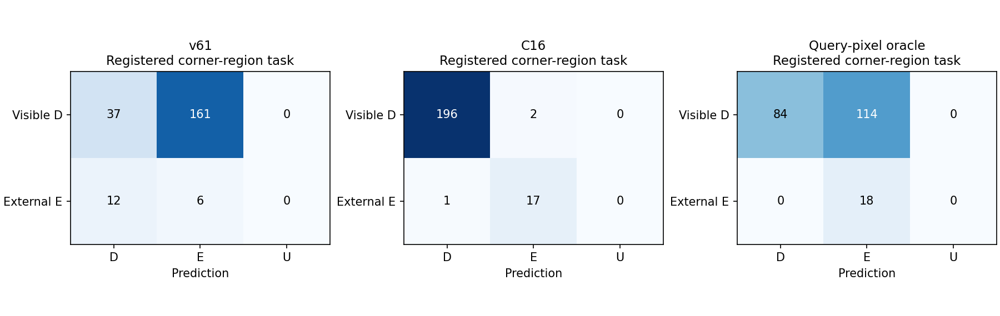
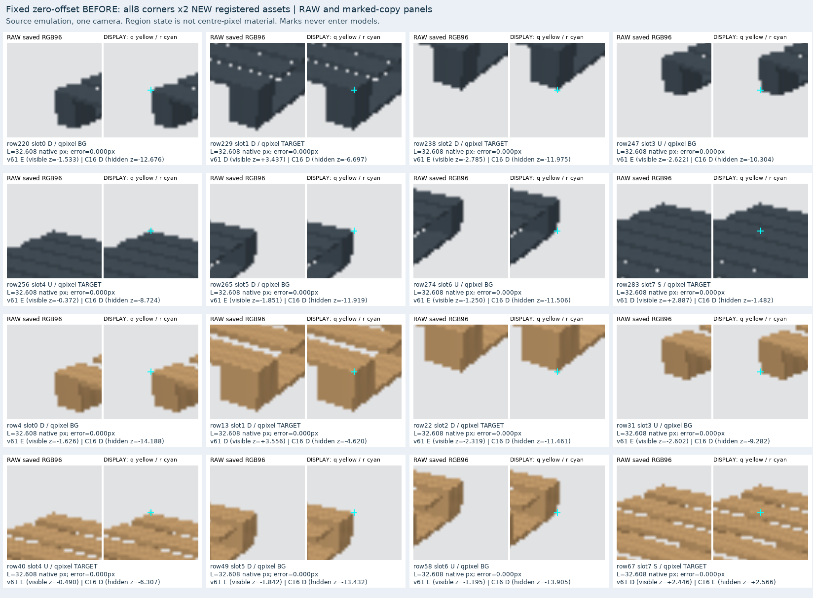
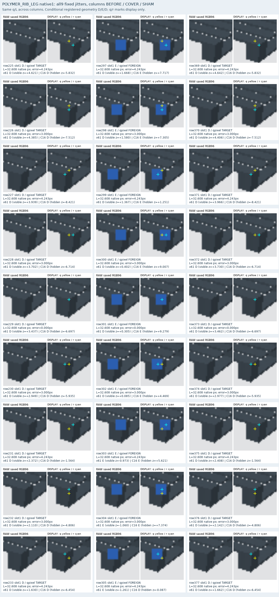
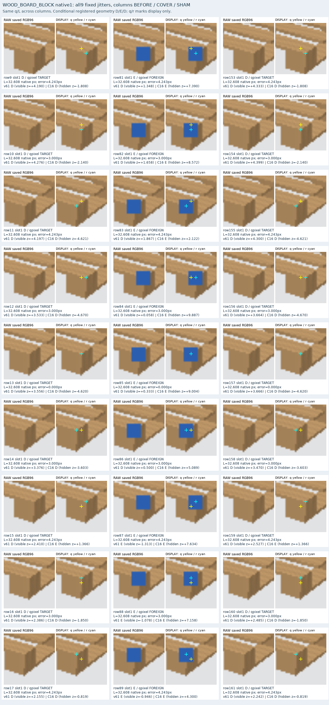

# V128 — query_visibility_registered_native_render_20261023_v128

기존 보고서에서 추출한 게시용 파생 개요입니다. 원본 파일을 수정하거나 실험·평가를 다시 실행하지 않았습니다. 원문 해시와 링크 대응은 publication manifest로 확인합니다.

**상태:** {"completed":true,"fully_solved":false,"goal_status":"active"}

원본:

- [ROOT_PHASE_RESULT.json](ROOT_PHASE_RESULT.json) — SHA256 `b4a8fc8fb919a48e655af49e9730943eb0e8b67a649af8a4ebdd50d4ca4111e3`
- [ROOT_READOUT_KO.html](ROOT_READOUT_KO.html) — SHA256 `d6c26a02faec69beda967611fe86b5ee70a778b5828977eba2e0a3cefbdf4f19`
- [ROOT_RESULTS_KO.json](ROOT_RESULTS_KO.json) — SHA256 `151ab0dd2fb734d290b93ca94e267ad2936c14a8abbf7219811e10799273192e`

## 방법·목표의 원문 필드

`$.phase`

```text
V128_REGISTERED_NATIVE_SOURCE_FROZEN_COMPARISON
```

`$.previous_goal_turn_classification`

```text
progress
```

`$.pixel_goal_difference`

```text
{
  "v61": {
    "all_semantic_D_predicted_E": 161,
    "q_background": 114,
    "q_target": 47,
    "q_foreign": 0,
    "external_E_predicted_D": 12
  },
  "C16": {
    "all_semantic_D_predicted_E": 2,
    "q_background": 0,
    "q_target": 2,
    "q_foreign": 0,
    "external_E_predicted_D": 1
  }
}
```


## 입력·학습·평가 분모의 원문 필드

`$.actual_execution`

```text
{
  "path": "query_visibility_registered_native_render_20261023_v128/ROOT_ACTUAL_BASELINE_PROGRESS_KO.json",
  "sha256": "e58a906d9354b6ffe5ad54fa3bf41c9219cf7d87d31bdb6305def972c849f5ad"
}
```

`$.rows`

```text
432
```

`$.not_new_training_result`

```text
true
```


## 결론·실패·한계의 원문 필드

`$.source_limits`

```text
[
  "one camera",
  "2new proceduralassets; same1.2aspect so NOT wood/square realcategories",
  "oneblueforeigncuboid",
  "reference-derived queryemulation, not actualinitializer",
  "correlatedvariants,198D18E only;S54U162 separately",
  "syntheticfeasibility,notrealtransfer"
]
```


## 코드·검증·전체 표·갤러리

아래 목록은 원 보고서가 참조한 파일의 경로를 다시 연결한 것입니다. 이 개요 작성 중 이미지 내용이나 raw 평가 데이터를 새로 검사하지 않았습니다.

- [query_visibility_registered_native_render_20261023_v128/ROOT_READOUT_KO.html](ROOT_READOUT_KO.html)
- [query_visibility_registered_native_render_20261023_v128/ROOT_RESULTS_KO.json](ROOT_RESULTS_KO.json)
- [query_visibility_registered_native_render_20261023_v128/ROOT_REPORT_VISUAL_QA.json](ROOT_REPORT_VISUAL_QA.json)
- [query_visibility_registered_native_render_20261023_v128/saved_source_evaluation_v2/RESULTS.json](saved_source_evaluation_v2/RESULTS.json)
- [query_visibility_registered_native_render_20261023_v128/saved_source_evaluation_v2/ALL432_SCORES.csv](saved_source_evaluation_v2/ALL432_SCORES.csv)
- [query_visibility_registered_native_render_20261023_v128/saved_source_evaluation_v2/ALL_FAILURE_IDS.json](saved_source_evaluation_v2/ALL_FAILURE_IDS.json)
- [query_visibility_registered_native_render_20261023_v128/source_crops_v1/INPUT_ROWS.json](source_crops_v1/INPUT_ROWS.json.parts.json)
- [query_visibility_registered_native_render_20261023_v128/source_crops_v1/GT_ROWS.json](source_crops_v1/GT_ROWS.json.parts.json)
- [query_visibility_registered_native_render_20261023_v128/source_crops_v1/CROP_COMPLETE.json](source_crops_v1/CROP_COMPLETE.json)
- [query_visibility_registered_native_render_20261023_v128/v61_frozen_registered_baseline/PREDICTION_SEAL.json](v61_frozen_registered_baseline/PREDICTION_SEAL.json)
- [query_visibility_registered_native_render_20261023_v128/frozen_C16_registered_baseline/PREDICTION_SEAL.json](frozen_C16_registered_baseline/PREDICTION_SEAL.json)
- [query_visibility_registered_native_render_20261023_v128/saved_source_evaluation_v2/EVALUATION_SEAL.json](saved_source_evaluation_v2/EVALUATION_SEAL.json)
- [query_visibility_registered_native_render_20261023_v128/ROOT_ACTUAL_BASELINE_PROGRESS_KO.json](ROOT_ACTUAL_BASELINE_PROGRESS_KO.json)
- [query_visibility_registered_native_render_20261023_v128/saved_raw6_review/REVIEW.json](saved_raw6_review/REVIEW.json)
- [query_visibility_registered_native_render_20261023_v128/ROOT_PUBLIC9_SOURCE_CUE_REVIEW_KO.json](ROOT_PUBLIC9_SOURCE_CUE_REVIEW_KO.json)
- [query_visibility_registered_native_render_20261023_v128/next_corpus_preparation/CANDIDATE_DESIGN.json](next_corpus_preparation/CANDIDATE_DESIGN.json)
- [query_visibility_registered_native_render_20261023_v128/evaluation_preparation/FAILURE_DIAGNOSIS_V1.json](evaluation_preparation/FAILURE_DIAGNOSIS_V1.json)

## 원 보고서의 그림

원 보고서 참조 순서의 처음 최대4개를 표시합니다. 새 outcome 선택이나 전수 이미지 검증을 뜻하지 않습니다. 전체 갤러리는 위 원문 링크에서 확인합니다.

[query_visibility_registered_native_render_20261023_v128/visual_followup/SEMANTIC_DE_CONFUSION_CLEAR.png](visual_followup/SEMANTIC_DE_CONFUSION_CLEAR.png)



[query_visibility_registered_native_render_20261023_v128/saved_source_evaluation_v2/figures/ZERO_OFFSET_BEFORE_ALL16.png](saved_source_evaluation_v2/figures/ZERO_OFFSET_BEFORE_ALL16.png)



[query_visibility_registered_native_render_20261023_v128/saved_source_evaluation_v2/figures/POLYMER_RIB_LEG_NATIVE1_ALL9_TRIPLETS.png](saved_source_evaluation_v2/figures/POLYMER_RIB_LEG_NATIVE1_ALL9_TRIPLETS.png)



[query_visibility_registered_native_render_20261023_v128/saved_source_evaluation_v2/figures/WOOD_BOARD_BLOCK_NATIVE1_ALL9_TRIPLETS.png](saved_source_evaluation_v2/figures/WOOD_BOARD_BLOCK_NATIVE1_ALL9_TRIPLETS.png)




현재 사용자 목표 전체의 해결·새 모델 채택·실사 가림 원인 확정을 이 파생 개요가 추가로 주장하지 않습니다. UNKNOWN/U와 불리한 결과, 실패 실행 및 수정 provenance는 원문대로 보존해야 합니다.

큰 원문 링크는 무손실 gzip의 `.parts.json` descriptor로 연결합니다. 원문 SHA와 복원 방법은 게시 안내를 따릅니다.
