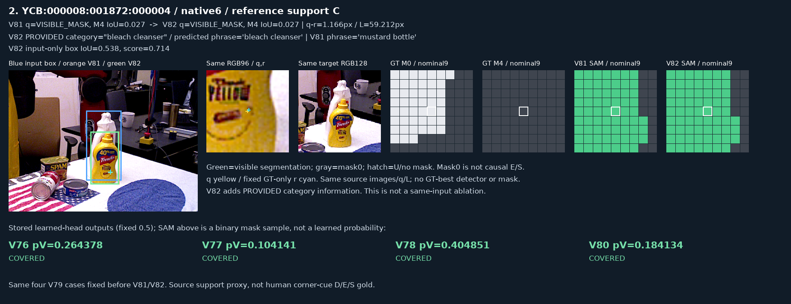

# V82 — query_visibility_requested_category_20261023_v82

기존 보고서에서 추출한 게시용 파생 개요입니다. 원본 파일을 수정하거나 실험·평가를 다시 실행하지 않았습니다. 원문 해시와 링크 대응은 publication manifest로 확인합니다.

**상태:** 명시된 완료 receipt 없음 — 완료 단정하지 않음

원본:

- [ROOT_READOUT_KO.html](ROOT_READOUT_KO.html) — SHA256 `121e83ea06a7afcab6e4f85f2e6dde6b4fbe9270de33d2119e5e39b405d8417a`

## 방법·목표의 원문 필드

자동 추출 가능한 해당 최상위 필드가 없습니다. 원문 보고서와 phase receipt를 확인하십시오.

## 입력·학습·평가 분모의 원문 필드

자동 추출 가능한 해당 최상위 필드가 없습니다. 원문 보고서와 phase receipt를 확인하십시오.

## 결론·실패·한계의 원문 필드

자동 추출 가능한 해당 최상위 필드가 없습니다. 원문 보고서와 phase receipt를 확인하십시오.

## 코드·검증·전체 표·갤러리

아래 목록은 원 보고서가 참조한 파일의 경로를 다시 연결한 것입니다. 이 개요 작성 중 이미지 내용이나 raw 평가 데이터를 새로 검사하지 않았습니다.

- [query_visibility_requested_category_20261023_v82/RESULTS_KO.html](RESULTS_KO.html)
- [query_visibility_requested_category_20261023_v82/RESULTS_INTERPRETATION_ADDENDUM_KO.html](RESULTS_INTERPRETATION_ADDENDUM_KO.html)
- [query_visibility_requested_category_20261023_v82/ROOT_RESULT_AND_NEXT_DECISION.json](ROOT_RESULT_AND_NEXT_DECISION.json)

## 원 보고서의 그림

원 보고서 참조 순서의 처음 최대4개를 표시합니다. 새 outcome 선택이나 전수 이미지 검증을 뜻하지 않습니다. 전체 갤러리는 위 원문 링크에서 확인합니다.

[query_visibility_requested_category_20261023_v82/fixed_natural_gallery/2_FIXED_REQUESTED_MASK.png](fixed_natural_gallery/2_FIXED_REQUESTED_MASK.png)

현재 사용자 목표 전체의 해결·새 모델 채택·실사 가림 원인 확정을 이 파생 개요가 추가로 주장하지 않습니다. UNKNOWN/U와 불리한 결과, 실패 실행 및 수정 provenance는 원문대로 보존해야 합니다.
