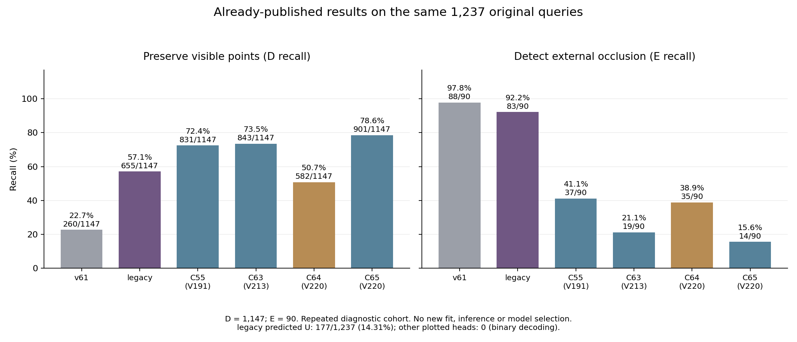

# V193 검토 문서를 V220 현재 상태와 대조한 결과

**보이는 점을 보존하는 성능은 개선됐지만, 외부 가림 검출은 함께 개선되지 않았다. 현재 모델을 기존 실사 학습 모델보다 우수하다고 말할 수 없다.** 이번 V221은 첨부 조언과 기존 코드·SOURCE 메타데이터를 대조한 진단이다. 새 학습·모델 추론·실사 평가·PnP는 모두 0이며, 최신 실제 학습은 V219, 최신 실제 비교는 V220이다. goal은 active이며 채택 모델은 없다.

검토 대상은 사용자가 제공한 `PALLET_VISIBILITY_REVIEW_AND_NEXT_STEPS_V193_KO.md`이다. 이 문서는 2026-10-24의 main `d2fe21c6861bde8e148cec991345dedfaa2b2865`와 V189–V193을 검토한 조언이다. 문서 안의 제안은 참고 자료로 다뤘으며 새로운 사용자 지시나 실행 승인으로 취급하지 않았다. 아래 현재 결과는 V220 main `59cf1e512fc8084c66f1eedc5195b4434ab9e28d`까지 이미 공개한 집계다.

## 1. 이전보다 얼마나 나아졌는가

같은 원 초기 query **1,237개(D 1,147 / 외부 E 90)**의 저장 집계를 옮겼다. 서로 다른 학습 출처·감독·판정 규칙을 가진 모델의 응답 비교이며 등조건 학습 실험 전체를 뜻하지 않는다.

| 모델 | 보이는 D 정답 / 재현율 | 외부 E 정답 / 재현율 | E 정밀도 | 예측 보류율 |
|---|---:|---:|---:|---:|
| v61 | 260 / 22.67% | 88 / 97.78% | 9.03% | 0% |
| 이전 자체 실사 학습 legacy | 655 / 57.11% | 83 / 92.22% | 20.65% | 14.31% |
| 문서가 검토한 C55 | 831 / 72.45% | 37 / 41.11% | 10.48% | 0% |
| C63 | 843 / 73.50% | 19 / 21.11% | 5.88% | 0% |
| C64 대조 팔 | 582 / 50.74% | 35 / 38.89% | 5.83% | 0% |
| 최신 C65 | 901 / 78.55% | 14 / 15.56% | 5.38% | 0% |

- 문서의 **C55→C65**: D 정답 **70개 증가(+6.10%p)**, E 정답 **23개 감소(−25.56%p)**.
- 직전 **C63→C65**: D 정답 **58개 증가(+5.06%p)**, E 정답 **5개 감소(−5.56%p)**.
- C65는 실제 E 90개 중 **76개를 D로 통과**시키고, 실제 D 1,147개 중 **246개를 E로 잘못 지운다**. 좌표 참조 오차가 3px 이하인 D 461개에서도 **93개가 E 오판**이다.
- C55→C65 총 정답은 868→915개지만 D가 많은 분모의 영향이 크다. 이것을 외부 가림 판별 해결로 해석하지 않는다.

v61의 비가시 응답은 presence proxy이며 외부 가림 원인을 직접 학습한 출력이 아니다. legacy는 과거 자체 실사 CAL 학습 이력이 있다. 새 head의 U0은 유효 입력을 D/E로 강제 판정하는 규칙의 결과다. 전체 원입력 U45, SELF136, OOF/UNKNOWN은 이 D/E 분모와 별도로 남는다. 이 평가셋은 반복 노출된 진단 자료이며 새 blind test가 아니다.

[6개 모델 원 집계와 재계산 지표](ALREADY_PUBLISHED_COUNTS_AND_METRICS.csv) · [최신 목재/정사각형·SELF·좌표 오차별 전체 결과](../query_visibility_expected_part_weak_frozen_real_benchmark_20261025_v220/PORTABLE_REPORT_KO.md) · [V220 실제 성공·실패 crop](../query_visibility_expected_part_weak_frozen_real_benchmark_20261025_v220/actual_saved_crop_gallery_a/PORTABLE_GALLERY_KO.md)

## 2. 첨부 문서에서 현재도 맞는 지적과 달라진 점

| V193 문서의 지적·제안 | V220까지의 현재 상태 | 판단 |
|---|---|---|
| 넓은 재료 support와 특정 native/end의 가림은 다른 목표다 | point 감독과 expected-part 약감독을 구분했지만 실사 native D/E와의 동일성은 미완성 | 핵심 지적 유지 |
| native ID·주변 초기 점 관계가 head에 없다 | 이후 native ID, 8점 가용성, q8 상대 좌표를 전달하는 조건 입력을 구현·학습했다 | 입력 부재 자체는 해소. 올바른 물리 부위를 식별한다는 증명은 아님 |
| 공개 실사 팔레트도 task fit에 쓰면 안 된다 | 이후 사용자는 합성뿐 아니라 공개 실사와 GT 사용을 허용했다. 직접 촬영한 평가223장은 계속 제외한다 | 문서의 엄격 합성 전용 전제는 현재 계약과 다름 |
| direct source holdout이 없다 | V219에서는 연결 component 단위 FIT/DEV를 두고 DEV 파생형을 모든 loss·정규화에서 뺐다 | 일부 절차 개선. 작은 상관 표본·과거 노출 때문에 독립 실사 일반화 증명은 아님 |
| TRAIN을 거의 맞혀도 전이가 안 될 수 있다 | V219 weak FIT45를 맞히고 SOURCE DEV D 보존은 늘었지만 V220 외부 E는 악화했다 | 계속 유효 |
| U0으로 불확실성이 해결됐다고 하면 안 된다 | 여전히 이진 판정이며 calibrated U 규칙은 없다 | 미해결 |
| 물리 GT 부재 때문에 모든 학습을 막으면 안 된다 | 유한 부위의 명시적인 weak supervision은 사용하되 native point gold와 분리했다 | 유지할 원칙 |

현재 학습을 합성 전용이라고 부르지 않는다. 공개 실사는 학습할 수 있지만 현재 평가의 RGB·라벨·특징을 fit/normalizer/threshold/model·architecture/data/checkpoint 선택에 쓰는 것은 허용되지 않는다. 지금 읽은 것은 SOURCE 코드·메타데이터와 이미 공개한 상태 집계이며 평가 원영상·라벨·저장 예측을 새로 읽거나 재추론하지 않았다. 과거 평가 노출 이력은 없어지지 않는다.

## 3. 이미 시도한 것을 다시 새 방법으로 제안하지 않기

이번에는 성능표를 보고 다음 모델을 고르는 대신, SOURCE 코드와 실행 메타데이터에서 실제 수행 여부를 확인했다.

| 이력 | 실제로 수행한 것 | 그대로 반복해도 새로 검증되지 않는 것 |
|---|---|---|
| V95 | 원 q/L 고정 COVER/SHAM, cue-set D/E/D, 실제 2,000 update | 같은 위치 대조 학습이라는 발상 자체 |
| V119–V121 | 공식 frozen DINOv2, query/context 특징, COVER–SHAM 24쌍, BCE + 0.25 hinge | DINO 추가, query token, pair margin 자체 |
| V163 | 공개 88프레임·390 query 부위 관찰, coarse ROI 22개 중 17 supported. 새 native target은 −1이고 학습 0 | 관찰 행을 학습 정답 수로 세는 것 |
| V218 | 원 query finite-part weak9의 BEFORE/COVER/SHAM 27장, 별도 GT-query family 360장 | 제작한 대조쌍을 이미 학습했다고 하는 것 |
| V219 | 같은 초기화·공통 표본 순서의 C64/C65 각 4,000 update. treatment에 natural public weak FIT45 추가 | V218 원 query 대조27장은 **이 학습에 쓰지 않았다** |

V95의 기록된 cue-set, V121의 carrier slot0, V163의 가시 부위, 현재 native query는 같은 권위의 정답이 아니다. 옛 레이블을 native 정답으로 이름만 바꿔 재사용할 수 없다. 기존 대조 생성의 픽셀·alpha·SHAM 보존 검사는 재사용할 수 있다.

[V95/V163 코드·메타 감사](source_history_a/PORTABLE_KO.md) · [DINO·paired loss 이력 감사](source_history_b/KO.md)

## 4. 현재 데이터에서 해결된 것과 남은 간극

V219의 공개 약감독 **57행은 FIT45(D39/E6), DEV12(D9/E3)**이다. 360개 후보 전체를 D/E로 학습한 것이 아니다. 같은 nominal target의 이동 변형이 포함되며 독립 57장면도 아니다. 실제 E FIT6은 native4/5에만 있고 native2/6/7에는 이 GT-family weak D/E가 없다. SOURCE에서 이미 드러난 감독 범위의 편중이다.

또한 다음 두 query 계열을 구분해야 한다.

| 계열 | 실제 의미·분할 | 현재 한계 |
|---|---|---|
| GT 유래 training query family | 15 GT후보×8 native×3상태=360. 지원 확인 weak57만 V219에 사용 | GT 유래 q8과 실제 initializer q8의 분포·대응이 다르다. GT pose/ROI/mask를 별도 배포 채널로 넣지는 않았지만 이 차이는 남는다 |
| 원 initializer query의 finite-part weak9 | FIT7/DEV2의 동일 q/L/valid 대조27장. V219 미사용 | 작은 유한 부위가 보임/덮임을 뜻하며 정확한 native point gold는 아니다. deck/runner·세운 팔레트의 부위 역할 불확실성을 보존해야 한다 |

원 query9의 기존 `native_DE_target`은 모두 −1이다. 부위 역할 재검토4, deck/runner 미해결2, f6 local-board 비native-addressable3으로 한계를 구체화했다. 이9개를 그대로 native D/E로 복사해 학습하는 것은 허용하지 않는다. GT-family D48(FIT39/DEV9)의 실제 유효영역·ROI 합집합·원 q와 생성 q, 원 query9의 제어쌍 출처, V219 E6의 별도 계보는 [SOURCE 메타데이터 감사와 행별 표](source_readiness_c/KO.md)에 있다. 해당 감사 원문의 후속계약에 있던 ‘근거 부족5개’라는 넓은 표현은 [별도 정정](source_readiness_c/ADDENDUM_NATIVE_AUTHORITY.json)으로 한정했다. 이는 새 픽셀 검증이나 추가 정답 채택은 아니다.

**확인한 사실:** 작은 좌표 오차에서도 오판이 남는다. 초기 8점 정보를 입력해도 전체 문제가 풀리지 않았다. 현재 공개 weak E의 수와 부위 범위가 좁다. 원 query 대조 데이터와 GT 유래 weak 데이터는 별도이다.

**아직 분리하지 못한 원인:** 학습 질문과 native 평가 질문의 차이, 실제 crop에서 필요한 부위 식별 문맥 부족, 외관/가림 물체의 전이 실패, 작은 데이터에서 재질·붙여넣기 특징을 이용하는 현상이 각각 얼마나 기여하는가. SOURCE TRAIN 적합이나 몇 개 실패 crop만으로 단독 원인을 확정하지 않는다.

## 5. 다음 실험에서 실제로 달라져야 할 한 가지

다음 후보는 **같은 원 q/q8/L/native 조건에서 질문한 유한 부위가 보존되거나 덮였다는 근거를 직접 연결하는 SOURCE 대조 감독**이다. COVER/SHAM·DINO·새 loss 이름 자체를 해결책으로 세지 않는다. 현재 평가의 실패 물체를 골라 학습 자료로 가져오지도 않는다.

1. 기존 SOURCE의 instance → native 역할 → 의도한 finite part → 원 q96 안의 실제 근거를 한 행으로 연결한다. 주소가 불명확한 부위는 지역 AUX/UNKNOWN으로 남긴다. 임의 목재·배경·부위 부재를 E로 바꾸지 않는다.
2. 같은 q/L/native/q8/valid에서 해당 부위를 덮은 COVER와 같은 occluder를 옮겨 부위를 보존한 SHAM을 대비한다. 모든 sibling/연결 component는 같은 split에 두고 DEV를 모든 학습·정규화에서 제외한다. weak 감독을 쓰기 위해 완벽한 물리 mesh gold를 일괄 요구하지는 않는다.
3. 기존 SOURCE 감독·head·초기 상태·공통 draw·학습량을 맞춘 두 팔에서 이 부위 대응 감독만 비교한다. SOURCE에서 단순 D 증가뿐 아니라 E·SHAM 반응·부위/장면별 손상도 본다. 데이터의 수량·독립성은 실제 제작 후에 보고한다.
4. 모든 설정과 두 모델을 SOURCE 근거로 동결한 뒤 동일 원 query에서 평가한다. 현재223 반복 비교와 별개로 독립 촬영 세션 없이는 새 실사 일반화 성공을 주장하지 않는다.

이는 아직 실행하지 않은 비교 후보이며 이번 첨부만으로 새 학습을 시작하지 않았다. native 조건을 넣는 것만으로 해결된다거나, 이 자료 추가로 반드시 성능이 오른다는 주장은 하지 않는다. 자기 가림은 사용자가 정한 초기 기하 처리와 분리하고 위치 추정·PnP를 새 목표에 합치지 않는다.

## 6. 이번 확인 범위

- 첨부 문서와 V220 현재 상태를 대조했다. 집계 표는 기존 공개 분모·혼동행렬에서 산술 계산했고 새로운 benchmark로 세지 않았다.
- 세 분담 감사가 V95/V163, V119–V121, V218의 SOURCE 코드·텍스트·ROI 메타데이터를 한정해 읽었다. 감사 원문·입력 SHA·수량·실제 범위는 함께 보존한다.
- 새 chart를 직접 열어 숫자·레이블·가독성을 확인했다. 원 평가 crop을 이번에 다시 시각 판독한 것은 아니다. 실제 crop은 기존 V220 갤러리를 연결한다.
- 원 모델·과거 과학 산출물은 수정하지 않았다. 원시 데이터 은행, 모델/feature 캐시, 첨부 문서 원본은 이 새 게시 묶음에 복사하지 않는다. 금지 경로는 접근하지 않는다.
- 검산·게시 성공과 ML 목표 해결을 구분한다. 학습 0, 모델 forward 0, PnP 0, 모델 채택 0이며 연구 목표는 미해결이다.
