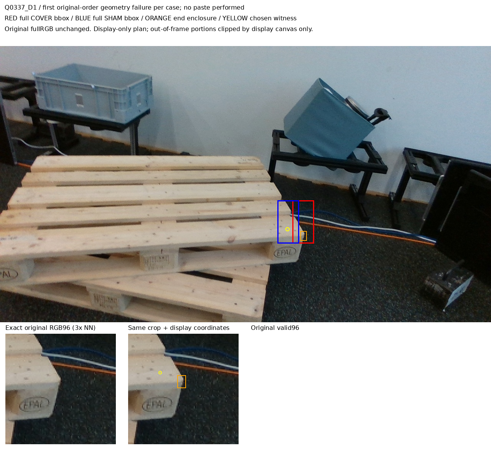

# V189: 입력 샘플링 규칙 수정과 직접 가림 학습 연결

실사에서 더 좋아진 새 모델은 아직 검증되지 않았습니다. 이 단계는 source 대조 데이터·독립 검산·별도 직접 가림 라벨과 실행 가능한 학습 코드까지 완료한 기록입니다. 실제 SAM 입력 계산과 새 학습은 V190에서 별도로 진행합니다.

| source | 전체 시도 | 직접 가림 대조쌍 | 실패 또는 판단 불명 | V188 대비 대조쌍 증가 |
|---|---:|---:|---:|---:|
| 합성 TRAIN | 1024 | 97 | 927 | 0 |
| 공개 실사 | 66 | 5 | 61 | 0 |

전체 3270 variant·26160 native 상태행을 보존했습니다. 실제 저장된 것은 349영상 그룹·2792입력행이며 나머지 2921 variant는 없는 영상으로 명시합니다. 직접 라벨은 보임0 204개·외부 가림1 102개·UNKNOWN 2486개입니다. 원래 native/위치품질/중심소유자/주변재질 라벨과 별개입니다.

## 수정한 것과 여전히 막힌 것

원본 영상의 모든 픽셀이 96×96 입력의 보간에 참여해야 한다는 조건을 실제 샘플 좌표 범위와 양의 보간 기여 여부로 수정했습니다. 후보 영역 전체를 가리는 조건, SHAM이 그 영역을 건드리지 않는 조건, 같은 부위의 주변 근거를 보존하는 조건은 유지했습니다. 원 q/L·native 순서·초기 추론 출력은 바꾸지 않았습니다.

이에 따라 공개 실사 33시도가 추가 검토 가능해졌지만 모두 고정 SHAM bbox가 기존 주변 witness와 겹쳤습니다. 이 중 12건은 witness가 원래96 샘플에도 참여하지 않았고, 5건은 COVER bbox와도 겹쳤으며, 3건은 프레임 경계 조건도 실패했습니다. 중복 집계입니다. 결과적으로 지원되는 쌍은 5개 그대로입니다. 이것은 대조 데이터 구성 실패이며 모델의 가림 오답으로 세지 않습니다.

위 실패계획은 표시용 bbox와 원본 crop입니다. 실제 paste는 수행하지 않았습니다. clean 입력에는 표시용 점·박스를 그리지 않았습니다.

## 직접 가림과 주변 재질 존재를 분리

같은 팔레트 부위가 주변에 남아 있어도 특정 끝부분은 외부 물체에 가려질 수 있습니다. 그래서 broad V/F=[1,1]인 COVER를 해당 끝부분의 보임으로 바꾸지 않습니다. 알려진 대조쌍만 별도 direct0/1/0으로 사용하며 다른7점은 UNKNOWN을 유지합니다.

합성 일부의 전후 변화는 매우 작고 일부는 파란 평면 단서가 뚜렷합니다. 이것을 자연 가림 학습이나 실사 전이 성공으로 해석하지 않습니다. 합성 known native 분포는 [29,24,17,23,2,2,0,0], 각 분모는128입니다. 공개 실사 known은 Q1088/Q1624 두 장의 native0에만 있습니다. 전체 목재·정사각형·native 범위를 해결한 상태가 아닙니다.

## 다음 학습을 실행할 코드

기존 115157개 파라미터에 별도 직접 가림 출력65개를 추가했습니다. 이전 시험용 후보의 pooling 연결 누락은 새 코드에서 수정했고, 가상 CPU forward/gradient 및3단계 λ=0 비교를 통과했습니다. 이전 시험용 후보로 실제 학습한 적은 없으므로 이 결함은 C52/C53 실사 성능의 원인 설명이 아닙니다.

RGB와 RGB+고정 SAM을 같은 초기값·8000단계로 학습합니다. 기존5손실 평균과192개 draw는 유지하고, 직접 보임/외부 가림 각16개를 별도 RNG로 뽑아 가중치1의 직접 손실을 더합니다. 두 최종 모델을 먼저 고정한 후 모두 평가합니다. 현재223·publicheld45·합성VAL·V182 COMMON은 학습·정규화·문턱·모델·데이터·checkpoint 선택에 쓰지 않습니다. PnP와 좌표 보정도 하지 않습니다.

- [전체 수치와 증거 연결](ROOT_RESULTS_KO.json)
- [단계 완료 범위](ROOT_PHASE_RESULT.json)
- [합성 전체1024·97대조쌍 갤러리](synthetic_end_review_visuals_b/PORTABLE_GALLERY_KO.md)
- [공개 실사 전체66·실패계획 갤러리](independent_actual_real_review_a/actual_saved_real_review_v1/PORTABLE_GALLERY_KO.md)
- [합성 재질·종횡비·형상별 전체 분모](root_source_tables/SYNTHETIC_FULL_FACTOR_DENOMINATORS.csv)
- [합성 native8 전체 분모](root_source_tables/SYNTHETIC_FULL_NATIVE8_DENOMINATORS.csv)
- [공개 실사22사례·66시도 전체 분모](root_source_tables/REAL_ALL22_FULL66_DENOMINATORS.csv)
- [라벨 구성 코드](root_direct_end_admission_preparation/compose_source_admission.py)
- [직접 라벨 구성 독립 검토](independent_semantic_preflight_a/ROOT_ADMISSION_COMPOSER_STATIC_REVIEW.json)
- [실제 가림 라벨 metadata 검증](paired_direct_end_fit_preparation_c/ACTUAL_ADMISSION_METADATA_SCHEMA_CHECK.json)
- [고정 SAM 입력 생성 코드](paired_direct_end_fit_preparation_c/build_direct_control_cache.py)
- [두 head 학습 코드](paired_direct_end_fit_preparation_c/train_paired_direct_end.py)
- [데이터·손실·학습 횟수의 사전 규약](paired_direct_end_fit_preparation_c/PROTOCOL_BEFORE_DIRECT_CONTROL_CACHE_OR_FIT.json)
- [학습 코드 독립 검토](independent_practical_fit_review_b/REVIEW.json)
- [다음 V190의 사전 정의 사본 목록](provenance/V190_PROSPECTIVE_SOURCE_FIT_LAUNCH_CONTEXT/INDEX.json)

큰 JSON/JSONL의 원문은 게시 manifest와 복원 도구로 확인할 수 있습니다. 원본 배열·외부 모델 가중치는 게시 제외 사유와 경로를 보존합니다. 정답이 없거나 실패한 시도도 전체 표·원문 기록에 포함됩니다.
