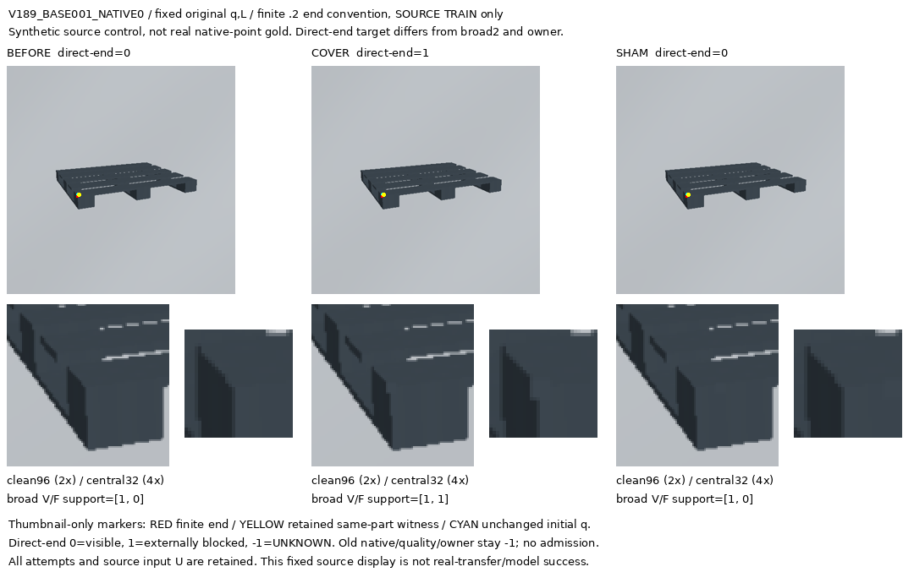
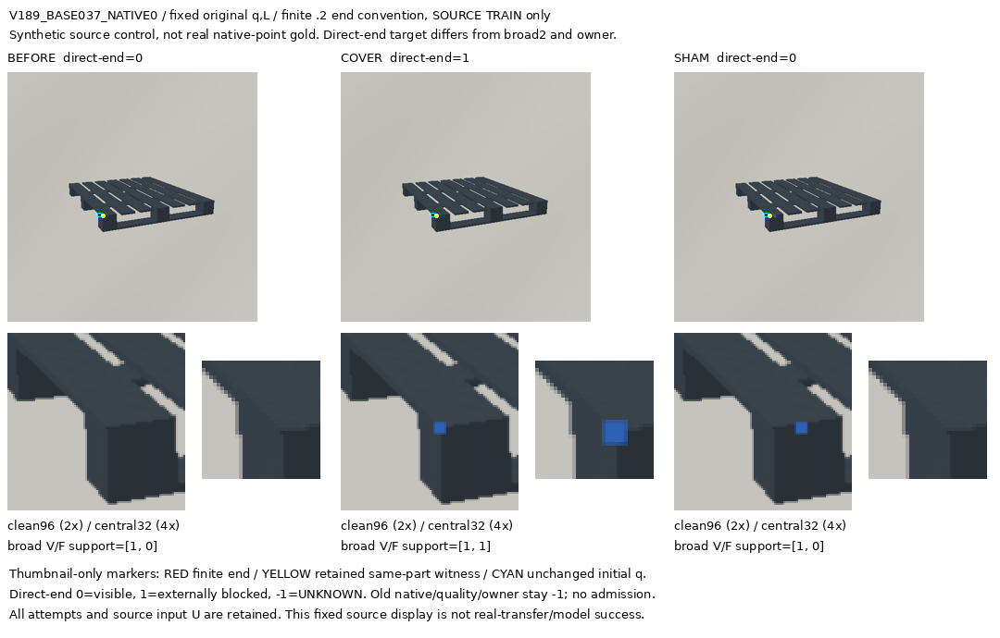
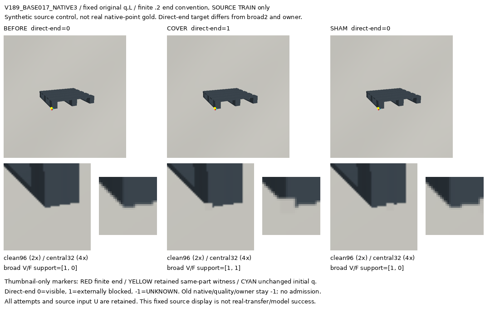
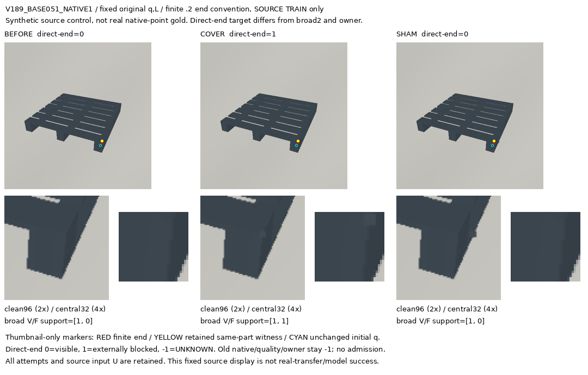
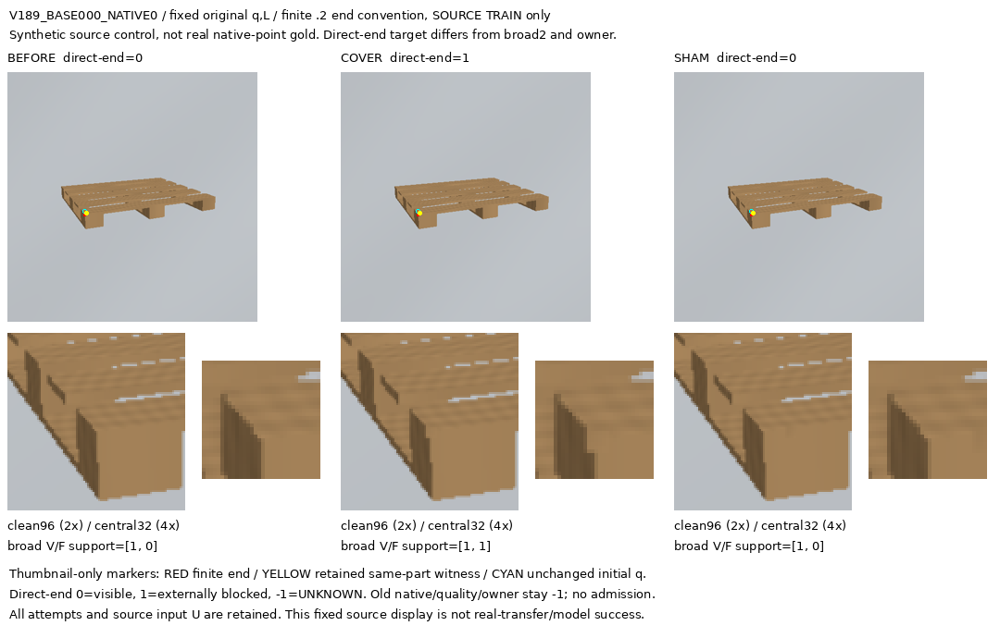
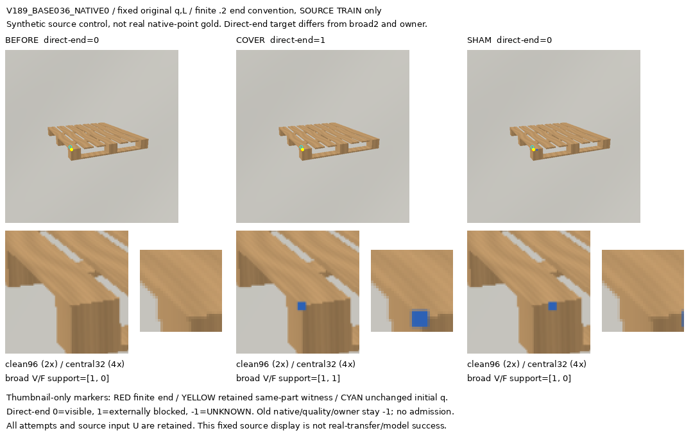
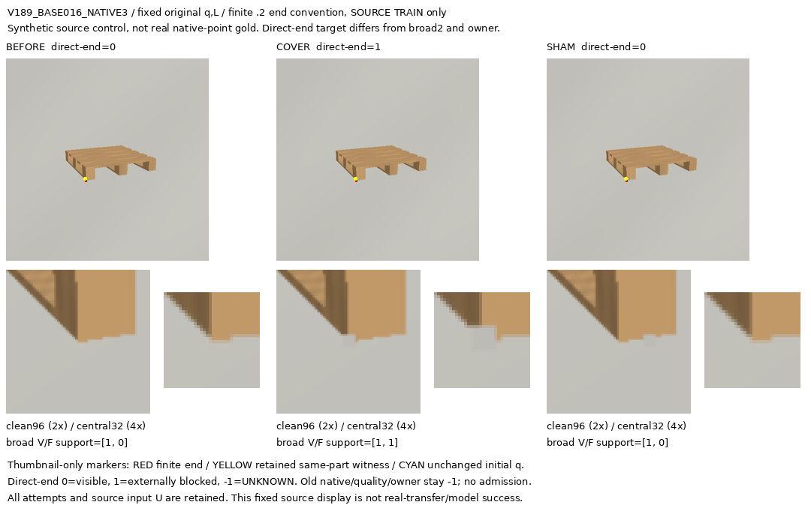
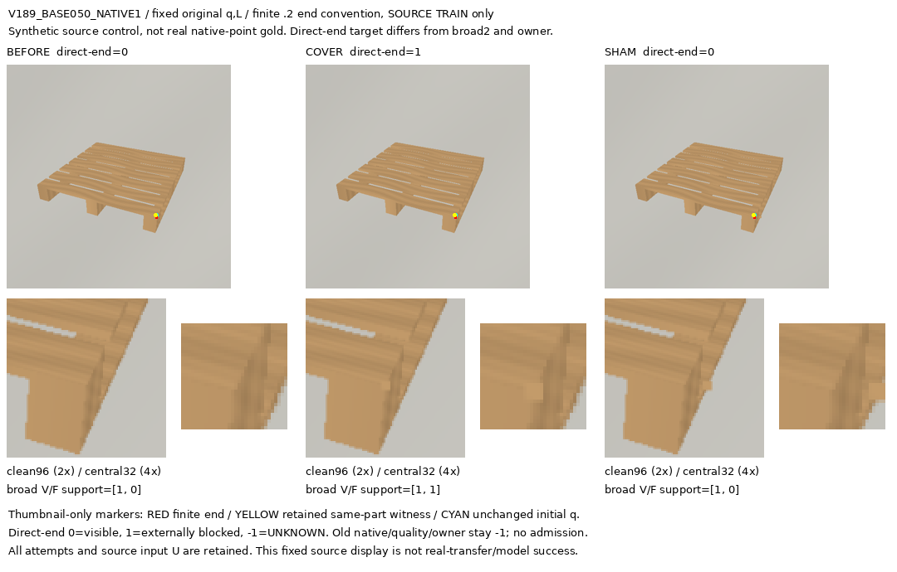

# V189 합성 sampled-domain 끝점 제어 전체 그림

고정 원q/L의 SOURCE TRAIN 제어입니다. 직접 끝점 weak target, broad support2, owner/native visibility는 서로 다른 정의입니다. 새 학습·실사 성능·물리 native gold 또는 전체 목표 해결을 뜻하지 않습니다. UNKNOWN/실패를 모두 보존합니다.

[전체1024 상태 CSV](ALL1024_STATUS.csv) · [HTML source gallery](index.html) · [고정 factor 첫 사례](FIRST_CONSTRUCTED_PER8_FACTOR_CELL.json)

## 고정 8개 factor의 첫 구성 사례

### DARK_POLYMER / RECTANGULAR / BOARD_BLOCK_RUNNER

### DARK_POLYMER / RECTANGULAR / RIB_LEG_RUNNER

### DARK_POLYMER / SQUARE / BOARD_BLOCK_RUNNER

### DARK_POLYMER / SQUARE / RIB_LEG_RUNNER

### PROCEDURAL_WOOD / RECTANGULAR / BOARD_BLOCK_RUNNER

### PROCEDURAL_WOOD / RECTANGULAR / RIB_LEG_RUNNER

### PROCEDURAL_WOOD / SQUARE / BOARD_BLOCK_RUNNER

### PROCEDURAL_WOOD / SQUARE / RIB_LEG_RUNNER

## 모든 구성 pair

- [V189_BASE000_NATIVE0 CONTACT](V189_BASE000_NATIVE0/CONTACT.png) · [BEFORE clean96](V189_BASE000_NATIVE0/BEFORE_CLEAN96.png) · [COVER clean96](V189_BASE000_NATIVE0/COVER_CLEAN96.png) · [SHAM clean96](V189_BASE000_NATIVE0/SHAM_CLEAN96.png)
- [V189_BASE000_NATIVE3 CONTACT](V189_BASE000_NATIVE3/CONTACT.png) · [BEFORE clean96](V189_BASE000_NATIVE3/BEFORE_CLEAN96.png) · [COVER clean96](V189_BASE000_NATIVE3/COVER_CLEAN96.png) · [SHAM clean96](V189_BASE000_NATIVE3/SHAM_CLEAN96.png)
- [V189_BASE001_NATIVE0 CONTACT](V189_BASE001_NATIVE0/CONTACT.png) · [BEFORE clean96](V189_BASE001_NATIVE0/BEFORE_CLEAN96.png) · [COVER clean96](V189_BASE001_NATIVE0/COVER_CLEAN96.png) · [SHAM clean96](V189_BASE001_NATIVE0/SHAM_CLEAN96.png)
- [V189_BASE001_NATIVE3 CONTACT](V189_BASE001_NATIVE3/CONTACT.png) · [BEFORE clean96](V189_BASE001_NATIVE3/BEFORE_CLEAN96.png) · [COVER clean96](V189_BASE001_NATIVE3/COVER_CLEAN96.png) · [SHAM clean96](V189_BASE001_NATIVE3/SHAM_CLEAN96.png)
- [V189_BASE006_NATIVE1 CONTACT](V189_BASE006_NATIVE1/CONTACT.png) · [BEFORE clean96](V189_BASE006_NATIVE1/BEFORE_CLEAN96.png) · [COVER clean96](V189_BASE006_NATIVE1/COVER_CLEAN96.png) · [SHAM clean96](V189_BASE006_NATIVE1/SHAM_CLEAN96.png)
- [V189_BASE006_NATIVE2 CONTACT](V189_BASE006_NATIVE2/CONTACT.png) · [BEFORE clean96](V189_BASE006_NATIVE2/BEFORE_CLEAN96.png) · [COVER clean96](V189_BASE006_NATIVE2/COVER_CLEAN96.png) · [SHAM clean96](V189_BASE006_NATIVE2/SHAM_CLEAN96.png)
- [V189_BASE007_NATIVE1 CONTACT](V189_BASE007_NATIVE1/CONTACT.png) · [BEFORE clean96](V189_BASE007_NATIVE1/BEFORE_CLEAN96.png) · [COVER clean96](V189_BASE007_NATIVE1/COVER_CLEAN96.png) · [SHAM clean96](V189_BASE007_NATIVE1/SHAM_CLEAN96.png)
- [V189_BASE007_NATIVE2 CONTACT](V189_BASE007_NATIVE2/CONTACT.png) · [BEFORE clean96](V189_BASE007_NATIVE2/BEFORE_CLEAN96.png) · [COVER clean96](V189_BASE007_NATIVE2/COVER_CLEAN96.png) · [SHAM clean96](V189_BASE007_NATIVE2/SHAM_CLEAN96.png)
- [V189_BASE012_NATIVE0 CONTACT](V189_BASE012_NATIVE0/CONTACT.png) · [BEFORE clean96](V189_BASE012_NATIVE0/BEFORE_CLEAN96.png) · [COVER clean96](V189_BASE012_NATIVE0/COVER_CLEAN96.png) · [SHAM clean96](V189_BASE012_NATIVE0/SHAM_CLEAN96.png)
- [V189_BASE013_NATIVE0 CONTACT](V189_BASE013_NATIVE0/CONTACT.png) · [BEFORE clean96](V189_BASE013_NATIVE0/BEFORE_CLEAN96.png) · [COVER clean96](V189_BASE013_NATIVE0/COVER_CLEAN96.png) · [SHAM clean96](V189_BASE013_NATIVE0/SHAM_CLEAN96.png)
- [V189_BASE016_NATIVE3 CONTACT](V189_BASE016_NATIVE3/CONTACT.png) · [BEFORE clean96](V189_BASE016_NATIVE3/BEFORE_CLEAN96.png) · [COVER clean96](V189_BASE016_NATIVE3/COVER_CLEAN96.png) · [SHAM clean96](V189_BASE016_NATIVE3/SHAM_CLEAN96.png)
- [V189_BASE017_NATIVE3 CONTACT](V189_BASE017_NATIVE3/CONTACT.png) · [BEFORE clean96](V189_BASE017_NATIVE3/BEFORE_CLEAN96.png) · [COVER clean96](V189_BASE017_NATIVE3/COVER_CLEAN96.png) · [SHAM clean96](V189_BASE017_NATIVE3/SHAM_CLEAN96.png)
- [V189_BASE020_NATIVE0 CONTACT](V189_BASE020_NATIVE0/CONTACT.png) · [BEFORE clean96](V189_BASE020_NATIVE0/BEFORE_CLEAN96.png) · [COVER clean96](V189_BASE020_NATIVE0/COVER_CLEAN96.png) · [SHAM clean96](V189_BASE020_NATIVE0/SHAM_CLEAN96.png)
- [V189_BASE020_NATIVE3 CONTACT](V189_BASE020_NATIVE3/CONTACT.png) · [BEFORE clean96](V189_BASE020_NATIVE3/BEFORE_CLEAN96.png) · [COVER clean96](V189_BASE020_NATIVE3/COVER_CLEAN96.png) · [SHAM clean96](V189_BASE020_NATIVE3/SHAM_CLEAN96.png)
- [V189_BASE020_NATIVE4 CONTACT](V189_BASE020_NATIVE4/CONTACT.png) · [BEFORE clean96](V189_BASE020_NATIVE4/BEFORE_CLEAN96.png) · [COVER clean96](V189_BASE020_NATIVE4/COVER_CLEAN96.png) · [SHAM clean96](V189_BASE020_NATIVE4/SHAM_CLEAN96.png)
- [V189_BASE021_NATIVE0 CONTACT](V189_BASE021_NATIVE0/CONTACT.png) · [BEFORE clean96](V189_BASE021_NATIVE0/BEFORE_CLEAN96.png) · [COVER clean96](V189_BASE021_NATIVE0/COVER_CLEAN96.png) · [SHAM clean96](V189_BASE021_NATIVE0/SHAM_CLEAN96.png)
- [V189_BASE021_NATIVE3 CONTACT](V189_BASE021_NATIVE3/CONTACT.png) · [BEFORE clean96](V189_BASE021_NATIVE3/BEFORE_CLEAN96.png) · [COVER clean96](V189_BASE021_NATIVE3/COVER_CLEAN96.png) · [SHAM clean96](V189_BASE021_NATIVE3/SHAM_CLEAN96.png)
- [V189_BASE021_NATIVE4 CONTACT](V189_BASE021_NATIVE4/CONTACT.png) · [BEFORE clean96](V189_BASE021_NATIVE4/BEFORE_CLEAN96.png) · [COVER clean96](V189_BASE021_NATIVE4/COVER_CLEAN96.png) · [SHAM clean96](V189_BASE021_NATIVE4/SHAM_CLEAN96.png)
- [V189_BASE026_NATIVE0 CONTACT](V189_BASE026_NATIVE0/CONTACT.png) · [BEFORE clean96](V189_BASE026_NATIVE0/BEFORE_CLEAN96.png) · [COVER clean96](V189_BASE026_NATIVE0/COVER_CLEAN96.png) · [SHAM clean96](V189_BASE026_NATIVE0/SHAM_CLEAN96.png)
- [V189_BASE026_NATIVE1 CONTACT](V189_BASE026_NATIVE1/CONTACT.png) · [BEFORE clean96](V189_BASE026_NATIVE1/BEFORE_CLEAN96.png) · [COVER clean96](V189_BASE026_NATIVE1/COVER_CLEAN96.png) · [SHAM clean96](V189_BASE026_NATIVE1/SHAM_CLEAN96.png)
- [V189_BASE027_NATIVE0 CONTACT](V189_BASE027_NATIVE0/CONTACT.png) · [BEFORE clean96](V189_BASE027_NATIVE0/BEFORE_CLEAN96.png) · [COVER clean96](V189_BASE027_NATIVE0/COVER_CLEAN96.png) · [SHAM clean96](V189_BASE027_NATIVE0/SHAM_CLEAN96.png)
- [V189_BASE027_NATIVE1 CONTACT](V189_BASE027_NATIVE1/CONTACT.png) · [BEFORE clean96](V189_BASE027_NATIVE1/BEFORE_CLEAN96.png) · [COVER clean96](V189_BASE027_NATIVE1/COVER_CLEAN96.png) · [SHAM clean96](V189_BASE027_NATIVE1/SHAM_CLEAN96.png)
- [V189_BASE028_NATIVE3 CONTACT](V189_BASE028_NATIVE3/CONTACT.png) · [BEFORE clean96](V189_BASE028_NATIVE3/BEFORE_CLEAN96.png) · [COVER clean96](V189_BASE028_NATIVE3/COVER_CLEAN96.png) · [SHAM clean96](V189_BASE028_NATIVE3/SHAM_CLEAN96.png)
- [V189_BASE029_NATIVE3 CONTACT](V189_BASE029_NATIVE3/CONTACT.png) · [BEFORE clean96](V189_BASE029_NATIVE3/BEFORE_CLEAN96.png) · [COVER clean96](V189_BASE029_NATIVE3/COVER_CLEAN96.png) · [SHAM clean96](V189_BASE029_NATIVE3/SHAM_CLEAN96.png)
- [V189_BASE036_NATIVE0 CONTACT](V189_BASE036_NATIVE0/CONTACT.png) · [BEFORE clean96](V189_BASE036_NATIVE0/BEFORE_CLEAN96.png) · [COVER clean96](V189_BASE036_NATIVE0/COVER_CLEAN96.png) · [SHAM clean96](V189_BASE036_NATIVE0/SHAM_CLEAN96.png)
- [V189_BASE036_NATIVE3 CONTACT](V189_BASE036_NATIVE3/CONTACT.png) · [BEFORE clean96](V189_BASE036_NATIVE3/BEFORE_CLEAN96.png) · [COVER clean96](V189_BASE036_NATIVE3/COVER_CLEAN96.png) · [SHAM clean96](V189_BASE036_NATIVE3/SHAM_CLEAN96.png)
- [V189_BASE037_NATIVE0 CONTACT](V189_BASE037_NATIVE0/CONTACT.png) · [BEFORE clean96](V189_BASE037_NATIVE0/BEFORE_CLEAN96.png) · [COVER clean96](V189_BASE037_NATIVE0/COVER_CLEAN96.png) · [SHAM clean96](V189_BASE037_NATIVE0/SHAM_CLEAN96.png)
- [V189_BASE037_NATIVE3 CONTACT](V189_BASE037_NATIVE3/CONTACT.png) · [BEFORE clean96](V189_BASE037_NATIVE3/BEFORE_CLEAN96.png) · [COVER clean96](V189_BASE037_NATIVE3/COVER_CLEAN96.png) · [SHAM clean96](V189_BASE037_NATIVE3/SHAM_CLEAN96.png)
- [V189_BASE042_NATIVE1 CONTACT](V189_BASE042_NATIVE1/CONTACT.png) · [BEFORE clean96](V189_BASE042_NATIVE1/BEFORE_CLEAN96.png) · [COVER clean96](V189_BASE042_NATIVE1/COVER_CLEAN96.png) · [SHAM clean96](V189_BASE042_NATIVE1/SHAM_CLEAN96.png)
- [V189_BASE043_NATIVE1 CONTACT](V189_BASE043_NATIVE1/CONTACT.png) · [BEFORE clean96](V189_BASE043_NATIVE1/BEFORE_CLEAN96.png) · [COVER clean96](V189_BASE043_NATIVE1/COVER_CLEAN96.png) · [SHAM clean96](V189_BASE043_NATIVE1/SHAM_CLEAN96.png)
- [V189_BASE050_NATIVE1 CONTACT](V189_BASE050_NATIVE1/CONTACT.png) · [BEFORE clean96](V189_BASE050_NATIVE1/BEFORE_CLEAN96.png) · [COVER clean96](V189_BASE050_NATIVE1/COVER_CLEAN96.png) · [SHAM clean96](V189_BASE050_NATIVE1/SHAM_CLEAN96.png)
- [V189_BASE050_NATIVE2 CONTACT](V189_BASE050_NATIVE2/CONTACT.png) · [BEFORE clean96](V189_BASE050_NATIVE2/BEFORE_CLEAN96.png) · [COVER clean96](V189_BASE050_NATIVE2/COVER_CLEAN96.png) · [SHAM clean96](V189_BASE050_NATIVE2/SHAM_CLEAN96.png)
- [V189_BASE051_NATIVE1 CONTACT](V189_BASE051_NATIVE1/CONTACT.png) · [BEFORE clean96](V189_BASE051_NATIVE1/BEFORE_CLEAN96.png) · [COVER clean96](V189_BASE051_NATIVE1/COVER_CLEAN96.png) · [SHAM clean96](V189_BASE051_NATIVE1/SHAM_CLEAN96.png)
- [V189_BASE051_NATIVE2 CONTACT](V189_BASE051_NATIVE2/CONTACT.png) · [BEFORE clean96](V189_BASE051_NATIVE2/BEFORE_CLEAN96.png) · [COVER clean96](V189_BASE051_NATIVE2/COVER_CLEAN96.png) · [SHAM clean96](V189_BASE051_NATIVE2/SHAM_CLEAN96.png)
- [V189_BASE056_NATIVE0 CONTACT](V189_BASE056_NATIVE0/CONTACT.png) · [BEFORE clean96](V189_BASE056_NATIVE0/BEFORE_CLEAN96.png) · [COVER clean96](V189_BASE056_NATIVE0/COVER_CLEAN96.png) · [SHAM clean96](V189_BASE056_NATIVE0/SHAM_CLEAN96.png)
- [V189_BASE056_NATIVE3 CONTACT](V189_BASE056_NATIVE3/CONTACT.png) · [BEFORE clean96](V189_BASE056_NATIVE3/BEFORE_CLEAN96.png) · [COVER clean96](V189_BASE056_NATIVE3/COVER_CLEAN96.png) · [SHAM clean96](V189_BASE056_NATIVE3/SHAM_CLEAN96.png)
- [V189_BASE057_NATIVE0 CONTACT](V189_BASE057_NATIVE0/CONTACT.png) · [BEFORE clean96](V189_BASE057_NATIVE0/BEFORE_CLEAN96.png) · [COVER clean96](V189_BASE057_NATIVE0/COVER_CLEAN96.png) · [SHAM clean96](V189_BASE057_NATIVE0/SHAM_CLEAN96.png)
- [V189_BASE057_NATIVE3 CONTACT](V189_BASE057_NATIVE3/CONTACT.png) · [BEFORE clean96](V189_BASE057_NATIVE3/BEFORE_CLEAN96.png) · [COVER clean96](V189_BASE057_NATIVE3/COVER_CLEAN96.png) · [SHAM clean96](V189_BASE057_NATIVE3/SHAM_CLEAN96.png)
- [V189_BASE062_NATIVE1 CONTACT](V189_BASE062_NATIVE1/CONTACT.png) · [BEFORE clean96](V189_BASE062_NATIVE1/BEFORE_CLEAN96.png) · [COVER clean96](V189_BASE062_NATIVE1/COVER_CLEAN96.png) · [SHAM clean96](V189_BASE062_NATIVE1/SHAM_CLEAN96.png)
- [V189_BASE062_NATIVE2 CONTACT](V189_BASE062_NATIVE2/CONTACT.png) · [BEFORE clean96](V189_BASE062_NATIVE2/BEFORE_CLEAN96.png) · [COVER clean96](V189_BASE062_NATIVE2/COVER_CLEAN96.png) · [SHAM clean96](V189_BASE062_NATIVE2/SHAM_CLEAN96.png)
- [V189_BASE063_NATIVE1 CONTACT](V189_BASE063_NATIVE1/CONTACT.png) · [BEFORE clean96](V189_BASE063_NATIVE1/BEFORE_CLEAN96.png) · [COVER clean96](V189_BASE063_NATIVE1/COVER_CLEAN96.png) · [SHAM clean96](V189_BASE063_NATIVE1/SHAM_CLEAN96.png)
- [V189_BASE063_NATIVE2 CONTACT](V189_BASE063_NATIVE2/CONTACT.png) · [BEFORE clean96](V189_BASE063_NATIVE2/BEFORE_CLEAN96.png) · [COVER clean96](V189_BASE063_NATIVE2/COVER_CLEAN96.png) · [SHAM clean96](V189_BASE063_NATIVE2/SHAM_CLEAN96.png)
- [V189_BASE068_NATIVE0 CONTACT](V189_BASE068_NATIVE0/CONTACT.png) · [BEFORE clean96](V189_BASE068_NATIVE0/BEFORE_CLEAN96.png) · [COVER clean96](V189_BASE068_NATIVE0/COVER_CLEAN96.png) · [SHAM clean96](V189_BASE068_NATIVE0/SHAM_CLEAN96.png)
- [V189_BASE068_NATIVE1 CONTACT](V189_BASE068_NATIVE1/CONTACT.png) · [BEFORE clean96](V189_BASE068_NATIVE1/BEFORE_CLEAN96.png) · [COVER clean96](V189_BASE068_NATIVE1/COVER_CLEAN96.png) · [SHAM clean96](V189_BASE068_NATIVE1/SHAM_CLEAN96.png)
- [V189_BASE068_NATIVE3 CONTACT](V189_BASE068_NATIVE3/CONTACT.png) · [BEFORE clean96](V189_BASE068_NATIVE3/BEFORE_CLEAN96.png) · [COVER clean96](V189_BASE068_NATIVE3/COVER_CLEAN96.png) · [SHAM clean96](V189_BASE068_NATIVE3/SHAM_CLEAN96.png)
- [V189_BASE069_NATIVE0 CONTACT](V189_BASE069_NATIVE0/CONTACT.png) · [BEFORE clean96](V189_BASE069_NATIVE0/BEFORE_CLEAN96.png) · [COVER clean96](V189_BASE069_NATIVE0/COVER_CLEAN96.png) · [SHAM clean96](V189_BASE069_NATIVE0/SHAM_CLEAN96.png)
- [V189_BASE069_NATIVE1 CONTACT](V189_BASE069_NATIVE1/CONTACT.png) · [BEFORE clean96](V189_BASE069_NATIVE1/BEFORE_CLEAN96.png) · [COVER clean96](V189_BASE069_NATIVE1/COVER_CLEAN96.png) · [SHAM clean96](V189_BASE069_NATIVE1/SHAM_CLEAN96.png)
- [V189_BASE069_NATIVE3 CONTACT](V189_BASE069_NATIVE3/CONTACT.png) · [BEFORE clean96](V189_BASE069_NATIVE3/BEFORE_CLEAN96.png) · [COVER clean96](V189_BASE069_NATIVE3/COVER_CLEAN96.png) · [SHAM clean96](V189_BASE069_NATIVE3/SHAM_CLEAN96.png)
- [V189_BASE074_NATIVE0 CONTACT](V189_BASE074_NATIVE0/CONTACT.png) · [BEFORE clean96](V189_BASE074_NATIVE0/BEFORE_CLEAN96.png) · [COVER clean96](V189_BASE074_NATIVE0/COVER_CLEAN96.png) · [SHAM clean96](V189_BASE074_NATIVE0/SHAM_CLEAN96.png)
- [V189_BASE074_NATIVE1 CONTACT](V189_BASE074_NATIVE1/CONTACT.png) · [BEFORE clean96](V189_BASE074_NATIVE1/BEFORE_CLEAN96.png) · [COVER clean96](V189_BASE074_NATIVE1/COVER_CLEAN96.png) · [SHAM clean96](V189_BASE074_NATIVE1/SHAM_CLEAN96.png)
- [V189_BASE074_NATIVE2 CONTACT](V189_BASE074_NATIVE2/CONTACT.png) · [BEFORE clean96](V189_BASE074_NATIVE2/BEFORE_CLEAN96.png) · [COVER clean96](V189_BASE074_NATIVE2/COVER_CLEAN96.png) · [SHAM clean96](V189_BASE074_NATIVE2/SHAM_CLEAN96.png)
- [V189_BASE074_NATIVE5 CONTACT](V189_BASE074_NATIVE5/CONTACT.png) · [BEFORE clean96](V189_BASE074_NATIVE5/BEFORE_CLEAN96.png) · [COVER clean96](V189_BASE074_NATIVE5/COVER_CLEAN96.png) · [SHAM clean96](V189_BASE074_NATIVE5/SHAM_CLEAN96.png)
- [V189_BASE075_NATIVE0 CONTACT](V189_BASE075_NATIVE0/CONTACT.png) · [BEFORE clean96](V189_BASE075_NATIVE0/BEFORE_CLEAN96.png) · [COVER clean96](V189_BASE075_NATIVE0/COVER_CLEAN96.png) · [SHAM clean96](V189_BASE075_NATIVE0/SHAM_CLEAN96.png)
- [V189_BASE075_NATIVE1 CONTACT](V189_BASE075_NATIVE1/CONTACT.png) · [BEFORE clean96](V189_BASE075_NATIVE1/BEFORE_CLEAN96.png) · [COVER clean96](V189_BASE075_NATIVE1/COVER_CLEAN96.png) · [SHAM clean96](V189_BASE075_NATIVE1/SHAM_CLEAN96.png)
- [V189_BASE075_NATIVE2 CONTACT](V189_BASE075_NATIVE2/CONTACT.png) · [BEFORE clean96](V189_BASE075_NATIVE2/BEFORE_CLEAN96.png) · [COVER clean96](V189_BASE075_NATIVE2/COVER_CLEAN96.png) · [SHAM clean96](V189_BASE075_NATIVE2/SHAM_CLEAN96.png)
- [V189_BASE075_NATIVE5 CONTACT](V189_BASE075_NATIVE5/CONTACT.png) · [BEFORE clean96](V189_BASE075_NATIVE5/BEFORE_CLEAN96.png) · [COVER clean96](V189_BASE075_NATIVE5/COVER_CLEAN96.png) · [SHAM clean96](V189_BASE075_NATIVE5/SHAM_CLEAN96.png)
- [V189_BASE082_NATIVE0 CONTACT](V189_BASE082_NATIVE0/CONTACT.png) · [BEFORE clean96](V189_BASE082_NATIVE0/BEFORE_CLEAN96.png) · [COVER clean96](V189_BASE082_NATIVE0/COVER_CLEAN96.png) · [SHAM clean96](V189_BASE082_NATIVE0/SHAM_CLEAN96.png)
- [V189_BASE082_NATIVE1 CONTACT](V189_BASE082_NATIVE1/CONTACT.png) · [BEFORE clean96](V189_BASE082_NATIVE1/BEFORE_CLEAN96.png) · [COVER clean96](V189_BASE082_NATIVE1/COVER_CLEAN96.png) · [SHAM clean96](V189_BASE082_NATIVE1/SHAM_CLEAN96.png)
- [V189_BASE082_NATIVE2 CONTACT](V189_BASE082_NATIVE2/CONTACT.png) · [BEFORE clean96](V189_BASE082_NATIVE2/BEFORE_CLEAN96.png) · [COVER clean96](V189_BASE082_NATIVE2/COVER_CLEAN96.png) · [SHAM clean96](V189_BASE082_NATIVE2/SHAM_CLEAN96.png)
- [V189_BASE083_NATIVE0 CONTACT](V189_BASE083_NATIVE0/CONTACT.png) · [BEFORE clean96](V189_BASE083_NATIVE0/BEFORE_CLEAN96.png) · [COVER clean96](V189_BASE083_NATIVE0/COVER_CLEAN96.png) · [SHAM clean96](V189_BASE083_NATIVE0/SHAM_CLEAN96.png)
- [V189_BASE083_NATIVE1 CONTACT](V189_BASE083_NATIVE1/CONTACT.png) · [BEFORE clean96](V189_BASE083_NATIVE1/BEFORE_CLEAN96.png) · [COVER clean96](V189_BASE083_NATIVE1/COVER_CLEAN96.png) · [SHAM clean96](V189_BASE083_NATIVE1/SHAM_CLEAN96.png)
- [V189_BASE083_NATIVE2 CONTACT](V189_BASE083_NATIVE2/CONTACT.png) · [BEFORE clean96](V189_BASE083_NATIVE2/BEFORE_CLEAN96.png) · [COVER clean96](V189_BASE083_NATIVE2/COVER_CLEAN96.png) · [SHAM clean96](V189_BASE083_NATIVE2/SHAM_CLEAN96.png)
- [V189_BASE084_NATIVE0 CONTACT](V189_BASE084_NATIVE0/CONTACT.png) · [BEFORE clean96](V189_BASE084_NATIVE0/BEFORE_CLEAN96.png) · [COVER clean96](V189_BASE084_NATIVE0/COVER_CLEAN96.png) · [SHAM clean96](V189_BASE084_NATIVE0/SHAM_CLEAN96.png)
- [V189_BASE084_NATIVE3 CONTACT](V189_BASE084_NATIVE3/CONTACT.png) · [BEFORE clean96](V189_BASE084_NATIVE3/BEFORE_CLEAN96.png) · [COVER clean96](V189_BASE084_NATIVE3/COVER_CLEAN96.png) · [SHAM clean96](V189_BASE084_NATIVE3/SHAM_CLEAN96.png)
- [V189_BASE085_NATIVE0 CONTACT](V189_BASE085_NATIVE0/CONTACT.png) · [BEFORE clean96](V189_BASE085_NATIVE0/BEFORE_CLEAN96.png) · [COVER clean96](V189_BASE085_NATIVE0/COVER_CLEAN96.png) · [SHAM clean96](V189_BASE085_NATIVE0/SHAM_CLEAN96.png)
- [V189_BASE085_NATIVE3 CONTACT](V189_BASE085_NATIVE3/CONTACT.png) · [BEFORE clean96](V189_BASE085_NATIVE3/BEFORE_CLEAN96.png) · [COVER clean96](V189_BASE085_NATIVE3/COVER_CLEAN96.png) · [SHAM clean96](V189_BASE085_NATIVE3/SHAM_CLEAN96.png)
- [V189_BASE088_NATIVE0 CONTACT](V189_BASE088_NATIVE0/CONTACT.png) · [BEFORE clean96](V189_BASE088_NATIVE0/BEFORE_CLEAN96.png) · [COVER clean96](V189_BASE088_NATIVE0/COVER_CLEAN96.png) · [SHAM clean96](V189_BASE088_NATIVE0/SHAM_CLEAN96.png)
- [V189_BASE088_NATIVE3 CONTACT](V189_BASE088_NATIVE3/CONTACT.png) · [BEFORE clean96](V189_BASE088_NATIVE3/BEFORE_CLEAN96.png) · [COVER clean96](V189_BASE088_NATIVE3/COVER_CLEAN96.png) · [SHAM clean96](V189_BASE088_NATIVE3/SHAM_CLEAN96.png)
- [V189_BASE089_NATIVE0 CONTACT](V189_BASE089_NATIVE0/CONTACT.png) · [BEFORE clean96](V189_BASE089_NATIVE0/BEFORE_CLEAN96.png) · [COVER clean96](V189_BASE089_NATIVE0/COVER_CLEAN96.png) · [SHAM clean96](V189_BASE089_NATIVE0/SHAM_CLEAN96.png)
- [V189_BASE089_NATIVE3 CONTACT](V189_BASE089_NATIVE3/CONTACT.png) · [BEFORE clean96](V189_BASE089_NATIVE3/BEFORE_CLEAN96.png) · [COVER clean96](V189_BASE089_NATIVE3/COVER_CLEAN96.png) · [SHAM clean96](V189_BASE089_NATIVE3/SHAM_CLEAN96.png)
- [V189_BASE094_NATIVE0 CONTACT](V189_BASE094_NATIVE0/CONTACT.png) · [BEFORE clean96](V189_BASE094_NATIVE0/BEFORE_CLEAN96.png) · [COVER clean96](V189_BASE094_NATIVE0/COVER_CLEAN96.png) · [SHAM clean96](V189_BASE094_NATIVE0/SHAM_CLEAN96.png)
- [V189_BASE094_NATIVE1 CONTACT](V189_BASE094_NATIVE1/CONTACT.png) · [BEFORE clean96](V189_BASE094_NATIVE1/BEFORE_CLEAN96.png) · [COVER clean96](V189_BASE094_NATIVE1/COVER_CLEAN96.png) · [SHAM clean96](V189_BASE094_NATIVE1/SHAM_CLEAN96.png)
- [V189_BASE094_NATIVE2 CONTACT](V189_BASE094_NATIVE2/CONTACT.png) · [BEFORE clean96](V189_BASE094_NATIVE2/BEFORE_CLEAN96.png) · [COVER clean96](V189_BASE094_NATIVE2/COVER_CLEAN96.png) · [SHAM clean96](V189_BASE094_NATIVE2/SHAM_CLEAN96.png)
- [V189_BASE095_NATIVE0 CONTACT](V189_BASE095_NATIVE0/CONTACT.png) · [BEFORE clean96](V189_BASE095_NATIVE0/BEFORE_CLEAN96.png) · [COVER clean96](V189_BASE095_NATIVE0/COVER_CLEAN96.png) · [SHAM clean96](V189_BASE095_NATIVE0/SHAM_CLEAN96.png)
- [V189_BASE095_NATIVE1 CONTACT](V189_BASE095_NATIVE1/CONTACT.png) · [BEFORE clean96](V189_BASE095_NATIVE1/BEFORE_CLEAN96.png) · [COVER clean96](V189_BASE095_NATIVE1/COVER_CLEAN96.png) · [SHAM clean96](V189_BASE095_NATIVE1/SHAM_CLEAN96.png)
- [V189_BASE095_NATIVE2 CONTACT](V189_BASE095_NATIVE2/CONTACT.png) · [BEFORE clean96](V189_BASE095_NATIVE2/BEFORE_CLEAN96.png) · [COVER clean96](V189_BASE095_NATIVE2/COVER_CLEAN96.png) · [SHAM clean96](V189_BASE095_NATIVE2/SHAM_CLEAN96.png)
- [V189_BASE098_NATIVE1 CONTACT](V189_BASE098_NATIVE1/CONTACT.png) · [BEFORE clean96](V189_BASE098_NATIVE1/BEFORE_CLEAN96.png) · [COVER clean96](V189_BASE098_NATIVE1/COVER_CLEAN96.png) · [SHAM clean96](V189_BASE098_NATIVE1/SHAM_CLEAN96.png)
- [V189_BASE099_NATIVE1 CONTACT](V189_BASE099_NATIVE1/CONTACT.png) · [BEFORE clean96](V189_BASE099_NATIVE1/BEFORE_CLEAN96.png) · [COVER clean96](V189_BASE099_NATIVE1/COVER_CLEAN96.png) · [SHAM clean96](V189_BASE099_NATIVE1/SHAM_CLEAN96.png)
- [V189_BASE104_NATIVE3 CONTACT](V189_BASE104_NATIVE3/CONTACT.png) · [BEFORE clean96](V189_BASE104_NATIVE3/BEFORE_CLEAN96.png) · [COVER clean96](V189_BASE104_NATIVE3/COVER_CLEAN96.png) · [SHAM clean96](V189_BASE104_NATIVE3/SHAM_CLEAN96.png)
- [V189_BASE105_NATIVE3 CONTACT](V189_BASE105_NATIVE3/CONTACT.png) · [BEFORE clean96](V189_BASE105_NATIVE3/BEFORE_CLEAN96.png) · [COVER clean96](V189_BASE105_NATIVE3/COVER_CLEAN96.png) · [SHAM clean96](V189_BASE105_NATIVE3/SHAM_CLEAN96.png)
- [V189_BASE110_NATIVE0 CONTACT](V189_BASE110_NATIVE0/CONTACT.png) · [BEFORE clean96](V189_BASE110_NATIVE0/BEFORE_CLEAN96.png) · [COVER clean96](V189_BASE110_NATIVE0/COVER_CLEAN96.png) · [SHAM clean96](V189_BASE110_NATIVE0/SHAM_CLEAN96.png)
- [V189_BASE110_NATIVE1 CONTACT](V189_BASE110_NATIVE1/CONTACT.png) · [BEFORE clean96](V189_BASE110_NATIVE1/BEFORE_CLEAN96.png) · [COVER clean96](V189_BASE110_NATIVE1/COVER_CLEAN96.png) · [SHAM clean96](V189_BASE110_NATIVE1/SHAM_CLEAN96.png)
- [V189_BASE111_NATIVE0 CONTACT](V189_BASE111_NATIVE0/CONTACT.png) · [BEFORE clean96](V189_BASE111_NATIVE0/BEFORE_CLEAN96.png) · [COVER clean96](V189_BASE111_NATIVE0/COVER_CLEAN96.png) · [SHAM clean96](V189_BASE111_NATIVE0/SHAM_CLEAN96.png)
- [V189_BASE111_NATIVE1 CONTACT](V189_BASE111_NATIVE1/CONTACT.png) · [BEFORE clean96](V189_BASE111_NATIVE1/BEFORE_CLEAN96.png) · [COVER clean96](V189_BASE111_NATIVE1/COVER_CLEAN96.png) · [SHAM clean96](V189_BASE111_NATIVE1/SHAM_CLEAN96.png)
- [V189_BASE112_NATIVE0 CONTACT](V189_BASE112_NATIVE0/CONTACT.png) · [BEFORE clean96](V189_BASE112_NATIVE0/BEFORE_CLEAN96.png) · [COVER clean96](V189_BASE112_NATIVE0/COVER_CLEAN96.png) · [SHAM clean96](V189_BASE112_NATIVE0/SHAM_CLEAN96.png)
- [V189_BASE112_NATIVE2 CONTACT](V189_BASE112_NATIVE2/CONTACT.png) · [BEFORE clean96](V189_BASE112_NATIVE2/BEFORE_CLEAN96.png) · [COVER clean96](V189_BASE112_NATIVE2/COVER_CLEAN96.png) · [SHAM clean96](V189_BASE112_NATIVE2/SHAM_CLEAN96.png)
- [V189_BASE112_NATIVE3 CONTACT](V189_BASE112_NATIVE3/CONTACT.png) · [BEFORE clean96](V189_BASE112_NATIVE3/BEFORE_CLEAN96.png) · [COVER clean96](V189_BASE112_NATIVE3/COVER_CLEAN96.png) · [SHAM clean96](V189_BASE112_NATIVE3/SHAM_CLEAN96.png)
- [V189_BASE118_NATIVE1 CONTACT](V189_BASE118_NATIVE1/CONTACT.png) · [BEFORE clean96](V189_BASE118_NATIVE1/BEFORE_CLEAN96.png) · [COVER clean96](V189_BASE118_NATIVE1/COVER_CLEAN96.png) · [SHAM clean96](V189_BASE118_NATIVE1/SHAM_CLEAN96.png)
- [V189_BASE118_NATIVE2 CONTACT](V189_BASE118_NATIVE2/CONTACT.png) · [BEFORE clean96](V189_BASE118_NATIVE2/BEFORE_CLEAN96.png) · [COVER clean96](V189_BASE118_NATIVE2/COVER_CLEAN96.png) · [SHAM clean96](V189_BASE118_NATIVE2/SHAM_CLEAN96.png)
- [V189_BASE119_NATIVE1 CONTACT](V189_BASE119_NATIVE1/CONTACT.png) · [BEFORE clean96](V189_BASE119_NATIVE1/BEFORE_CLEAN96.png) · [COVER clean96](V189_BASE119_NATIVE1/COVER_CLEAN96.png) · [SHAM clean96](V189_BASE119_NATIVE1/SHAM_CLEAN96.png)
- [V189_BASE119_NATIVE2 CONTACT](V189_BASE119_NATIVE2/CONTACT.png) · [BEFORE clean96](V189_BASE119_NATIVE2/BEFORE_CLEAN96.png) · [COVER clean96](V189_BASE119_NATIVE2/COVER_CLEAN96.png) · [SHAM clean96](V189_BASE119_NATIVE2/SHAM_CLEAN96.png)
- [V189_BASE124_NATIVE0 CONTACT](V189_BASE124_NATIVE0/CONTACT.png) · [BEFORE clean96](V189_BASE124_NATIVE0/BEFORE_CLEAN96.png) · [COVER clean96](V189_BASE124_NATIVE0/COVER_CLEAN96.png) · [SHAM clean96](V189_BASE124_NATIVE0/SHAM_CLEAN96.png)
- [V189_BASE124_NATIVE2 CONTACT](V189_BASE124_NATIVE2/CONTACT.png) · [BEFORE clean96](V189_BASE124_NATIVE2/BEFORE_CLEAN96.png) · [COVER clean96](V189_BASE124_NATIVE2/COVER_CLEAN96.png) · [SHAM clean96](V189_BASE124_NATIVE2/SHAM_CLEAN96.png)
- [V189_BASE124_NATIVE3 CONTACT](V189_BASE124_NATIVE3/CONTACT.png) · [BEFORE clean96](V189_BASE124_NATIVE3/BEFORE_CLEAN96.png) · [COVER clean96](V189_BASE124_NATIVE3/COVER_CLEAN96.png) · [SHAM clean96](V189_BASE124_NATIVE3/SHAM_CLEAN96.png)
- [V189_BASE125_NATIVE0 CONTACT](V189_BASE125_NATIVE0/CONTACT.png) · [BEFORE clean96](V189_BASE125_NATIVE0/BEFORE_CLEAN96.png) · [COVER clean96](V189_BASE125_NATIVE0/COVER_CLEAN96.png) · [SHAM clean96](V189_BASE125_NATIVE0/SHAM_CLEAN96.png)
- [V189_BASE125_NATIVE2 CONTACT](V189_BASE125_NATIVE2/CONTACT.png) · [BEFORE clean96](V189_BASE125_NATIVE2/BEFORE_CLEAN96.png) · [COVER clean96](V189_BASE125_NATIVE2/COVER_CLEAN96.png) · [SHAM clean96](V189_BASE125_NATIVE2/SHAM_CLEAN96.png)
- [V189_BASE125_NATIVE3 CONTACT](V189_BASE125_NATIVE3/CONTACT.png) · [BEFORE clean96](V189_BASE125_NATIVE3/BEFORE_CLEAN96.png) · [COVER clean96](V189_BASE125_NATIVE3/COVER_CLEAN96.png) · [SHAM clean96](V189_BASE125_NATIVE3/SHAM_CLEAN96.png)
