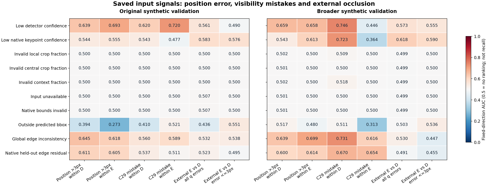

# V138 — query_visibility_saved_query_reliability_20261024_v138

기존 보고서에서 추출한 게시용 파생 개요입니다. 원본 파일을 수정하거나 실험·평가를 다시 실행하지 않았습니다. 원문 해시와 링크 대응은 publication manifest로 확인합니다.

**상태:** {"completed":true,"PASS":true,"fully_solved":false,"goal_status":"active"}

원본:

- [ROOT_PHASE_RESULT.json](ROOT_PHASE_RESULT.json) — SHA256 `c587d65af7c3c8a38f490128f19bbacba66f23a6b0e5beeecc5d509f488fb02d`
- [ROOT_READOUT_KO.html](ROOT_READOUT_KO.html) — SHA256 `100e6f0e2c3a4a849a3c9e4e4355c6d8134632461b2c06a040037e81ff8f9cc2`
- [ROOT_RESULTS_KO.json](ROOT_RESULTS_KO.json) — SHA256 `ce90f913a5bc1c67c7f71f9f675d1b9c3a38a566ab6aab1c2248b985fd9c585f`

## 방법·목표의 원문 필드

`$.phase`

```text
V138_SAVED_SOURCE_INPUT_OBSERVABILITY_DIAGNOSIS
```


## 입력·학습·평가 분모의 원문 필드

`$.new_training_updates`

```text
0
```

`$.rows`

```text
26624
```

`$.NO_QUERY_rows`

```text
112
```


## 결론·실패·한계의 원문 필드

`$.outcome_KO`

```text
자료 범위 확장의 합성 개선은 확인했다. 이번 고정 입력 신호는 위치 오류·보임 오판과 일부 연관되지만, 외부 가림을 단독으로 충분히 구별한다는 근거는 없다.
```

`$.decisions`

```text
{
  "confidence_only_occlusion_rule_adopted": false,
  "geometry_only_coordinate_certificate": false,
  "new_threshold_or_abstention_rule": null,
  "new_selected_model": null,
  "next_step": "Source-only controlled conditioning of frozen visual evidence with query input, separating position reliability from external-visibility target. Predeclare actual experiment before fitting; no private-guided model choice."
}
```

`$.limitations_KO`

```text
[
  "AUC는 위험 신호의 순위 연관성이다. 모델 recall/precision이나 실사 성능이 아니다.",
  "10개 위험 신호의 방향을 결과에 맞춰 뒤집지 않았다. G42 등 58개 원시 변수는 방향 없는 별도 설명 자료다.",
  "AUC는 정의된 입력·알려진 타깃에서 계산하며 누락·정답 S/U·예측 보류를 전체 집계에 남겼다.",
  "입력 없음/경계 오류가 예측 보류를 정의하는 부분은 새로운 실패 발견으로 해석하지 않는다.",
  "TRAIN 입력 분포로만 다섯 구간을 먼저 고정했다. GT 좌표 오차는 진단 타깃이며 입력·배포 필터가 아니다.",
  "같은 기본 장면과 네 변형은 서로 상관된다. 단변량 AUC가 낮아도 영상·다변량 정보의 부재를 증명하지 않는다.",
  "이번 결과는 원래 두 합성 형상에 대한 진단이다. 실사 전이 개선이나 배포 성공은 아직 입증되지 않았다.",
  "2D 모서리 일관성은 공통 이동·투영 변형·일부 대응 오류를 놓친다. 카메라/PnP/좌표 최적화를 하지 않았다."
]
```


## 코드·검증·전체 표·갤러리

아래 목록은 원 보고서가 참조한 파일의 경로를 다시 연결한 것입니다. 이 개요 작성 중 이미지 내용이나 raw 평가 데이터를 새로 검사하지 않았습니다.

- [query_visibility_saved_query_reliability_20261024_v138/input_only_reliability_v1/INPUT_SEAL.json](input_only_reliability_v1/INPUT_SEAL.json)
- [query_visibility_saved_query_reliability_20261024_v138/saved_observability_diagnosis_v1/BINNING_SEAL_BEFORE_GT.json](saved_observability_diagnosis_v1/BINNING_SEAL_BEFORE_GT.json)
- [query_visibility_saved_query_reliability_20261024_v138/saved_observability_diagnosis_v1/DIAGNOSIS_SEAL.json](saved_observability_diagnosis_v1/DIAGNOSIS_SEAL.json)
- [query_visibility_saved_query_reliability_20261024_v138/independent_design_review/SAVED_INPUT_TABLE_REVIEW.json](independent_design_review/SAVED_INPUT_TABLE_REVIEW.json)
- [query_visibility_saved_query_reliability_20261024_v138/independent_design_review/SAVED_DIAGNOSIS_REVIEW.json](independent_design_review/SAVED_DIAGNOSIS_REVIEW.json)
- [query_visibility_saved_query_reliability_20261024_v138/ROOT_RESULTS_KO.json](ROOT_RESULTS_KO.json)
- [query_visibility_saved_query_reliability_20261024_v138/ROOT_READOUT_KO.html](ROOT_READOUT_KO.html)
- [query_visibility_saved_query_reliability_20261024_v138/ROOT_REPORT_VISUAL_QA.json](ROOT_REPORT_VISUAL_QA.json)
- [query_visibility_saved_query_reliability_20261024_v138/ROOT_NEXT_SOURCE_SCOPE.json](ROOT_NEXT_SOURCE_SCOPE.json)
- [query_visibility_continuous_source_coverage_control_20261024_v137/ROOT_READOUT_KO.html](../query_visibility_continuous_source_coverage_control_20261024_v137/ROOT_READOUT_KO.html)
- [query_visibility_saved_query_reliability_20261024_v138/saved_risk_interpretation_v1/NEXT_STEP_ASSESSMENT.json](saved_risk_interpretation_v1/NEXT_STEP_ASSESSMENT.json)
- [query_visibility_continuous_source_coverage_control_20261024_v137/ROOT_RESULTS_KO.json](../query_visibility_continuous_source_coverage_control_20261024_v137/ROOT_RESULTS_KO.json)
- [query_visibility_saved_query_reliability_20261024_v138/saved_observability_diagnosis_v1/ALL_FIXED_SIGN_AUC_AND_TRAIN_BIN_COUNTS.jsonl](saved_observability_diagnosis_v1/ALL_FIXED_SIGN_AUC_AND_TRAIN_BIN_COUNTS.jsonl.parts.json)

## 원 보고서의 그림

원 보고서 참조 순서의 처음 최대4개를 표시합니다. 새 outcome 선택이나 전수 이미지 검증을 뜻하지 않습니다. 전체 갤러리는 위 원문 링크에서 확인합니다.

[query_visibility_saved_query_reliability_20261024_v138/FIXED_SIGNAL_VAL_AUC.png](FIXED_SIGNAL_VAL_AUC.png)




현재 사용자 목표 전체의 해결·새 모델 채택·실사 가림 원인 확정을 이 파생 개요가 추가로 주장하지 않습니다. UNKNOWN/U와 불리한 결과, 실패 실행 및 수정 provenance는 원문대로 보존해야 합니다.

큰 원문 링크는 무손실 gzip의 `.parts.json` descriptor로 연결합니다. 원문 SHA와 복원 방법은 게시 안내를 따릅니다.
