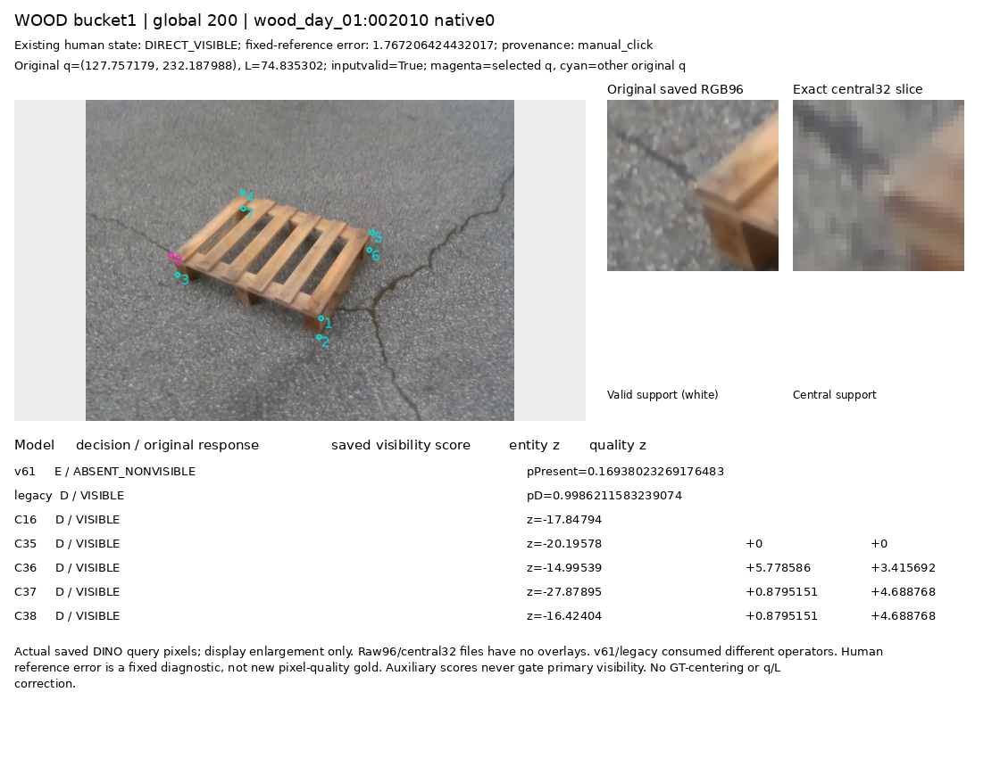

# V156 — query_visibility_separated_frozen_current_benchmark_20261024_v156

기존 보고서에서 추출한 게시용 파생 개요입니다. 원본 파일을 수정하거나 실험·평가를 다시 실행하지 않았습니다. 원문 해시와 링크 대응은 publication manifest로 확인합니다.

**상태:** {"completed":true,"selected_model":null,"fully_solved":false,"goal_status":"active_unsolved"}

원본:

- [ROOT_PHASE_RESULT.json](ROOT_PHASE_RESULT.json) — SHA256 `76d156491e7c9667ed66a8054ec768c47c0fa0a4efadb382300480e101335d69`
- [ROOT_READOUT_KO.html](ROOT_READOUT_KO.html) — SHA256 `93b581b0377da449902eb6fbd673ab09576d501b5fdbef8ebdb37004acdc58e8`
- [ROOT_RESULTS_KO.json](ROOT_RESULTS_KO.json) — SHA256 `a54badb3e7ba74a642fb78eef009c2bfe8f067fdfbd90e06a5918e3ec943b181`

## 방법·목표의 원문 필드

`$.schema`

```text
V156_FROZEN_SEVEN_CURRENT_BENCHMARK_COMPLETE_GOAL_UNSOLVED
```

`$.objective_KO`

```text
초기 팔레트 추론이 낸 원래 키포인트와 crop을 고정하고, 그 native 역할이 외부 물체에 가려졌는지를 판단합니다. 자기 가림은 상위 기하 단계에서 우선 처리한다는 목표를 유지합니다. 이번 비교는 좌표 보정·PnP·자세 개선을 하지 않았습니다.
```

`$.goal_solved`

```text
false
```


## 입력·학습·평가 분모의 원문 필드

`$.primary`

```text
{
  "excerpt": "{\"cohort\": {\"name\": \"paired_same_query_RGB\", \"N\": 1237, \"D\": 1147, \"E\": 90, \"WOOD_N\": 645, \"SQUARE_N\": 592}, \"all7_global_and_material\": {\"ALL\": {\"v61\": {\"CM_rows_D_E_columns_D_E_U\": [[260, 887, 0], [2, 88, 0]], \"N\": 1237, \"D_N\": 1147, \"E_N\": 90, \"D_precision\": 0.9923664122137404, \"D_recall\": 0.22667829119442023, \"E_precision\": 0.09025641025641026, \"E_recall\": 0.9777777777777777, \"U\": 0, \"U_rate\": 0.0, \"decided_coverage\": 1.0, \"U_breakdown\": {\"U_visible\": 0, \"U_occluded\": 0, \"out_of_task_S_visible\": 0, \"out_of_task_S_occluded\": 0, \"other_unresolved_visible\": 0, \"other_unresolved_occluded\": 0}}, \"legacy\": {\"CM_rows_D_E_columns_D_E_U\": [[655, 319, 173], [3, 83, 4]], \"N\": 1237, \"D_N\": 1147, \"E_N\": 90, \"D_precision\": 0.9954407294832827, \"D_recall\": 0.5710549258936356, \"E_precision\": 0.2064676616915423, \"E_recall\": 0.9222222222222223, \"U\": 177, \"U_rate\": 0.14308811641067098, \"decided_coverage\": 0.856911883589329, \"U_breakdown\": {\"U_visible\": 173, \"U_occluded\": 4, \"out_of_task_S_visible\": 0, \"out_of_task_S_occluded\": 0, \"other_unresolved_visible\": 0, \"other_unresolved_occluded\": 0}}, \"C16\": {\"CM_rows_D_E_columns_D_E_U\": [[1137, 10, 0], [55, 35, 0]], \"N\": 1237, \"D_N\": 1147, \"E_N\": 90, \"D_precision\": 0.9538590604026845, \"D_recall\": 0.99128160418483, \"E_precision\": 0.7777777777777778, \"E_recall\": 0.3888888888888889, \"U\": 0, \"U_rate\": 0.0, \"decided_coverage\": 1.0, \"U_breakdown\": {\"U_visible\": 0, \"U_occluded\": 0, \"out_of_task_S_visible\": 0, \"out_of_task_S_occluded\": 0, \"other_unresolved_visible\": 0, \"other_unresolved_occluded\": 0}}, \"C35\": {\"CM_rows_D_E_columns_D_E_U\": [[1036, 111, 0]",
  "truncated": true
}
```

`$.actual_executions`

```text
{
  "head_inference": {
    "path": "query_visibility_separated_frozen_current_benchmark_20261024_v156/ROOT_ACTUAL_FROZEN_FOUR_HEAD_EXECUTION_RECEIPT.json",
    "sha256": "13f95854e8fbaf1d978e8ab839b3223b6f2f1cef857b6fbe8027646406c4f6dd"
  },
  "saved_evaluation": {
    "path": "query_visibility_separated_frozen_current_benchmark_20261024_v156/ROOT_ACTUAL_SAVED_SEVEN_EVALUATION_EXECUTION_RECEIPT.json",
    "sha256": "82a1ccdc0ed41b931c77a309d05ef489ba23c3d419d0385b125f8fc497f7d267"
  },
  "fixed_crop_render_terminal_exit_code": 0,
  "new_candidate_head_calls_including_repeat": 8,
  "original_C16_parity_head_calls": 2,
  "new_training_encoder_initializer_PnP_or_q_L_correction_calls": 0,
  "all_jobs_terminal": true
}
```


## 결론·실패·한계의 원문 필드

`$.mechanism_limits_KO`

```text
[
  "공유 보조 손실을 더한 C36에서 보임 손상이 커졌지만, 이것만으로 라벨 충돌이나 gradient 간섭이 유일 원인이라고 단정할 수 없습니다.",
  "보조 경로를 분리한 C37/C38도 실사에서 보임 손상과 외부가림 누락을 함께 해결하지 못했습니다. 경로 분리 자체가 해결책이라는 주장도 성립하지 않습니다.",
  "이번 수치로 모든 모델의 실패를 좌표 오차 하나에 돌리지 않습니다. near376에서도 새 모델의 false E가 남습니다. 이 집계는 고정 reference 기반 진단이며 새3px gold를 선언한 결과는 아닙니다."
]
```

`$.interpretation_limits_KO`

```text
[
  "현재223장은 평가 전용으로 유지했지만 이전 반복 평가로 개발에 노출되었습니다. 독립적인 blind test나 최종 일반화 성능으로 해석하지 않습니다.",
  "legacy는 과거 private 실사 학습·CAL 개발과 평가 계보가 겹치는 모델입니다. 새 모델과 독립된 공개자료 전용 기준선이라고 주장하지 않습니다.",
  "C35/C36은2000회·seed1540의 shared-hidden 계열이고 C37/C38은8000회·seed1550의 독립 보조 경로입니다. 이 둘 사이의 차이를 보조 경로 분리만의 인과효과로 해석할 수 없습니다.",
  "C37 warm/C38 fresh는 같은8000회 설정의 대조이지만 양쪽 모두 source 기준을 통과하지 못했습니다. 초기화 비교만으로 표현력 한계나 성공 가능성이 증명된 것은 아닙니다.",
  "보조 entity 출력에 대한 현재 실사의 독립 정답이 없습니다. 음수 반응과 조건부 gate 진단을 entity 정확도·오거부율로 부르지 않습니다.",
  "새 실사 위치 품질 gold는0개입니다. 원 reference와의 정확한 byte 연결은 실제 click 이력과 물리 native 대응의 권위를 모두 증명하지 않습니다.",
  "공개실사의 구조적 약한 라벨은 개체·역할·가림 범위에 한계가 있으며 human gold가 아닙니다. source 성능이 현재 실사 전이 성공을 대신하지 않습니다."
]
```

`$.visual_interpretation_limits_KO`

```text
[
  "8개는 사전에 정한 조건부 사례이며 전체 오류 유형의 빈도를 추정하는 표본이 아니다.",
  "모서리 재질·명암·가림물 차이의 구분이 불안정한 사례를 확인했으나 하나의 인과적 실패 원인을 입증하지 않는다.",
  "야간 암부 사례의 실제 물리 가림 여부를 RGB만으로 새로 확정하거나 원 주석을 변경하지 않았다.",
  "근접 오차는 기존 참조값과의 거리 진단이며 새 독립 3px 위치 정답이 아니다."
]
```


## 코드·검증·전체 표·갤러리

아래 목록은 원 보고서가 참조한 파일의 경로를 다시 연결한 것입니다. 이 개요 작성 중 이미지 내용이나 raw 평가 데이터를 새로 검사하지 않았습니다.

- [query_visibility_separated_frozen_current_benchmark_20261024_v156/ROOT_RESULTS_KO.json](ROOT_RESULTS_KO.json)
- [query_visibility_separated_frozen_current_benchmark_20261024_v156/ROOT_READOUT_KO.html](ROOT_READOUT_KO.html)
- [query_visibility_separated_frozen_current_benchmark_20261024_v156/ROOT_REPORT_VISUAL_QA.json](ROOT_REPORT_VISUAL_QA.json)
- [query_visibility_separated_frozen_current_benchmark_20261024_v156/frozen_four_head_current_benchmark_v1/PREDICTION_SEAL.json](frozen_four_head_current_benchmark_v1/PREDICTION_SEAL.json)
- [query_visibility_separated_frozen_current_benchmark_20261024_v156/saved_seven_current_evaluation_v1/EVALUATION_SEAL.json](saved_seven_current_evaluation_v1/EVALUATION_SEAL.json)
- [query_visibility_separated_frozen_current_benchmark_20261024_v156/fixed_current_crop_review_v2_alias_preserving/CROP_RENDER_COMPLETE.json](fixed_current_crop_review_v2_alias_preserving/CROP_RENDER_COMPLETE.json)
- [query_visibility_separated_frozen_current_benchmark_20261024_v156/ROOT_ACTUAL_FIXED_CROP_VISUAL_QA.json](ROOT_ACTUAL_FIXED_CROP_VISUAL_QA.json)
- [query_visibility_independent_auxiliary_source_control_20261024_v155/ROOT_NEXT_ACTION_COMMITMENT_BEFORE_ANY_NEW_PRIVATE_READS.json](../query_visibility_independent_auxiliary_source_control_20261024_v155/ROOT_NEXT_ACTION_COMMITMENT_BEFORE_ANY_NEW_PRIVATE_READS.json)
- [query_visibility_separated_frozen_current_benchmark_20261024_v156/fixed_current_crop_review_v2_alias_preserving/index.html](fixed_current_crop_review_v2_alias_preserving/index.html)
- [query_visibility_separated_frozen_current_benchmark_20261024_v156/current_result_summary_agent/CURRENT_RESULTS_SUMMARY_KO.json](current_result_summary_agent/CURRENT_RESULTS_SUMMARY_KO.json)
- [query_visibility_separated_frozen_current_benchmark_20261024_v156/independent_saved_evaluation_review/REVIEW.json](independent_saved_evaluation_review/REVIEW.json)
- [query_visibility_separated_frozen_current_benchmark_20261024_v156/current_result_summary_agent/FINAL_SUMMARY_QA.json](current_result_summary_agent/FINAL_SUMMARY_QA.json)
- [query_visibility_separated_frozen_current_benchmark_20261024_v156/fixed_current_crop_review_v1/FAILED_EXECUTION.json](fixed_current_crop_review_v1/FAILED_EXECUTION.json)
- [query_visibility_separated_frozen_current_benchmark_20261024_v156/report_draft_agent/ROOT_RESULTS_DRAFT.json](report_draft_agent/ROOT_RESULTS_DRAFT.json)
- [query_visibility_separated_frozen_current_benchmark_20261024_v156/ROOT_ACTUAL_FROZEN_FOUR_HEAD_EXECUTION_RECEIPT.json](ROOT_ACTUAL_FROZEN_FOUR_HEAD_EXECUTION_RECEIPT.json)
- [query_visibility_separated_frozen_current_benchmark_20261024_v156/ROOT_ACTUAL_SAVED_SEVEN_EVALUATION_EXECUTION_RECEIPT.json](ROOT_ACTUAL_SAVED_SEVEN_EVALUATION_EXECUTION_RECEIPT.json)
- [query_visibility_separated_frozen_current_benchmark_20261024_v156/independent_saved_prediction_review/REVIEW.json](independent_saved_prediction_review/REVIEW.json)
- [query_visibility_separated_frozen_current_benchmark_20261024_v156/independent_saved_evaluation_review/SUMMARY_AND_FIGURE_REVIEW.json](independent_saved_evaluation_review/SUMMARY_AND_FIGURE_REVIEW.json)
- [query_visibility_separated_frozen_current_benchmark_20261024_v156/independent_preexecution_review/CROP_ALIAS_REPAIR_CODE_REVIEW.json](independent_preexecution_review/CROP_ALIAS_REPAIR_CODE_REVIEW.json)
- [query_visibility_separated_frozen_current_benchmark_20261024_v156/independent_saved_evaluation_review/LEGACY_COMPARISON_SCOPE_APPENDIX.json](independent_saved_evaluation_review/LEGACY_COMPARISON_SCOPE_APPENDIX.json)
- [query_visibility_separated_frozen_current_benchmark_20261024_v156/source_only_next_data_availability/REVIEW.json](source_only_next_data_availability/REVIEW.json)

## 원 보고서의 그림

원 보고서 참조 순서의 처음 최대4개를 표시합니다. 새 outcome 선택이나 전수 이미지 검증을 뜻하지 않습니다. 전체 갤러리는 위 원문 링크에서 확인합니다.

[query_visibility_separated_frozen_current_benchmark_20261024_v156/current_result_summary_agent/CURRENT_ALL1237_CONFUSIONS_KO.png](current_result_summary_agent/CURRENT_ALL1237_CONFUSIONS_KO.png)


[query_visibility_separated_frozen_current_benchmark_20261024_v156/current_result_summary_agent/CURRENT_MATERIAL_AND_NEAR_DIAGNOSTICS_KO.png](current_result_summary_agent/CURRENT_MATERIAL_AND_NEAR_DIAGNOSTICS_KO.png)


[query_visibility_separated_frozen_current_benchmark_20261024_v156/current_result_summary_agent/CURRENT_AUXILIARY_AUTHORITY_DIAGNOSTICS_KO.png](current_result_summary_agent/CURRENT_AUXILIARY_AUTHORITY_DIAGNOSTICS_KO.png)


[query_visibility_separated_frozen_current_benchmark_20261024_v156/fixed_current_crop_review_v2_alias_preserving/CASE_0200_PANEL.png](fixed_current_crop_review_v2_alias_preserving/CASE_0200_PANEL.png)




현재 사용자 목표 전체의 해결·새 모델 채택·실사 가림 원인 확정을 이 파생 개요가 추가로 주장하지 않습니다. UNKNOWN/U와 불리한 결과, 실패 실행 및 수정 provenance는 원문대로 보존해야 합니다.
