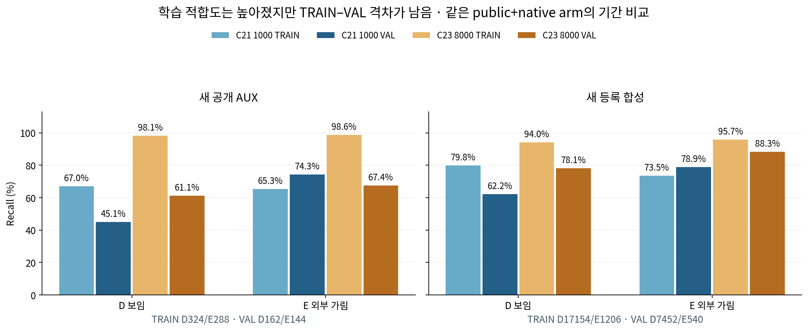
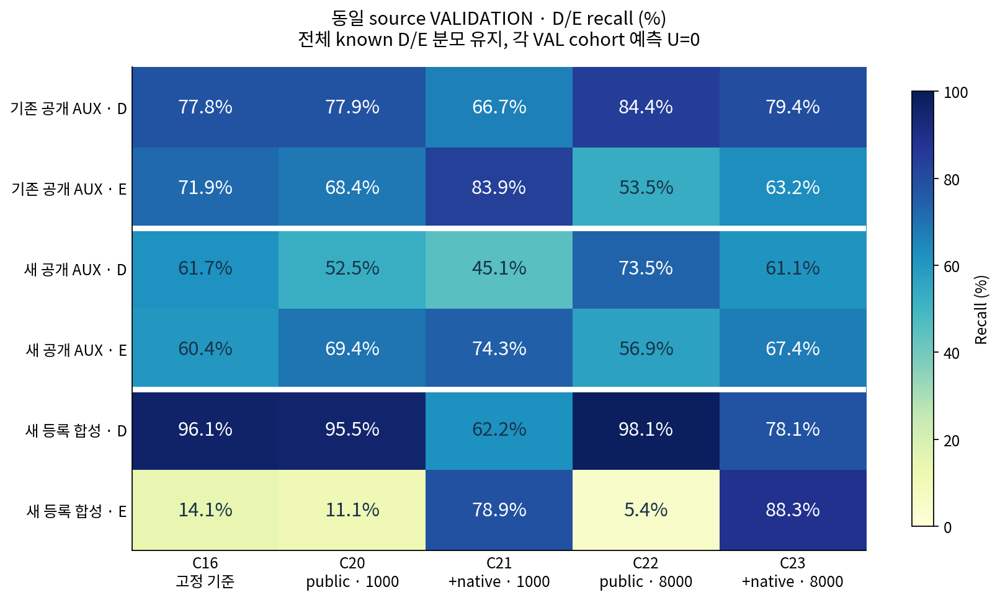

# V130 — query_visibility_source_coverage_duration_20261024_v130

기존 보고서에서 추출한 게시용 파생 개요입니다. 원본 파일을 수정하거나 실험·평가를 다시 실행하지 않았습니다. 원문 해시와 링크 대응은 publication manifest로 확인합니다.

**상태:** {"completed":true,"fully_solved":false,"goal_status":"active"}

원본:

- [ROOT_PHASE_RESULT.json](ROOT_PHASE_RESULT.json) — SHA256 `4728b11f0f26ad3987b9b98967815add1924d2b877877c6f1ca9e9c98753dec8`
- [ROOT_READOUT_KO.html](ROOT_READOUT_KO.html) — SHA256 `2e94ae956a04c89a3e12d3536b587b1e3fa797c3d4339965fe9baa61ae67a219`
- [ROOT_RESULTS_KO.json](ROOT_RESULTS_KO.json) — SHA256 `f9a8f26f789adcc09953762cbb27bd5852039f3d39c194d99fc480d9421d7c78`

## 방법·목표의 원문 필드

`$.phase`

```text
V130_FIXED8000_SAME_SOURCE_HEAD_DURATION_CONTROL_COMPLETE_NOT_ADMITTED
```

`$.goal_turn_classification`

```text
PROGRESS
```


## 입력·학습·평가 분모의 원문 필드

`$.actual_optimizer_updates_each`

```text
8000
```

`$.V129_replayed_prefix_updates_each`

```text
1000
```


## 결론·실패·한계의 원문 필드

`$.outcome_KO`

```text
같은자료·head·문턱의8000회대조에서TRAIN적합도는높아졌지만두후보모두source기준미달이다. 전체공개검증에는큰q오차반응과전이문제가섞여있어작은좌표변화를동결모델로추가분리한다.
```

`$.interpretation_KO`

```text
[
  "8000회에서새publicTRAIN보임98.1%·가림98.6%이므로1000회결과만으로정보가완전히없거나학습이불가능하다고판단할수없다.",
  "같은source공개검증전체는보임61.1%·가림67.4%이며단일문턱을사후최적화해도두recall의최소값은62.96%이하다. 현재문턱0은변경하지않았다.",
  "단,공개검증중기준cue와q가일치하는condition4는보임18/18·가림16/16이다. 큰q이동조건과중심조건을섞어순수appearance전이실패하나로해석하지않는다. 두cue의상관34행이며새실사native사람gold가아니다.",
  "합성identity에서도보임648/828·가림56/60이므로초기좌표오차가모든문제의원인은아니다.",
  "현재실사성능은V124 C16 보임1137/1147·외부가림35/90 그대로다. 평가223장을학습·문턱·checkpoint·arm선택에쓰지않았다."
]
```


## 코드·검증·전체 표·갤러리

아래 목록은 원 보고서가 참조한 파일의 경로를 다시 연결한 것입니다. 이 개요 작성 중 이미지 내용이나 raw 평가 데이터를 새로 검사하지 않았습니다.

- [query_visibility_source_coverage_duration_20261024_v130/runs/C22_C23_FIXED8000_SOURCE_CONTROL/CONTROL_COMPLETE.json](runs/C22_C23_FIXED8000_SOURCE_CONTROL/CONTROL_COMPLETE.json)
- [query_visibility_source_coverage_duration_20261024_v130/ROOT_RESULTS_KO.json](ROOT_RESULTS_KO.json)
- [query_visibility_source_coverage_duration_20261024_v130/ROOT_READOUT_KO.html](ROOT_READOUT_KO.html)
- [query_visibility_source_coverage_duration_20261024_v130/ROOT_REPORT_VISUAL_QA.json](ROOT_REPORT_VISUAL_QA.json)
- [query_visibility_source_coverage_duration_20261024_v130/saved_postfit_review/REVIEW.json](saved_postfit_review/REVIEW.json)
- [query_visibility_public_small_query_jitter_20261024_v131/ROOT_SMALL_QUERY_DIAGNOSIS_POLICY_BEFORE_INPUTS.json](../query_visibility_public_small_query_jitter_20261024_v131/ROOT_SMALL_QUERY_DIAGNOSIS_POLICY_BEFORE_INPUTS.json)
- [query_visibility_source_coverage_duration_20261024_v130/postfit_report/REPORT_DRAFT_KO.html](postfit_report/REPORT_DRAFT_KO.html)
- [query_visibility_source_coverage_duration_20261024_v130/saved_score_diagnosis/SOURCE_THRESHOLD_LIMIT_DIAGNOSTIC.json](saved_score_diagnosis/SOURCE_THRESHOLD_LIMIT_DIAGNOSTIC.json)
- [query_visibility_source_coverage_duration_20261024_v130/postfit_report/ARTIFACTS.json](postfit_report/ARTIFACTS.json)
- [query_visibility_source_coverage_duration_20261024_v130/saved_score_diagnosis/SOURCE_QUERY_OFFSET_DIAGNOSIS.json](saved_score_diagnosis/SOURCE_QUERY_OFFSET_DIAGNOSIS.json)

## 원 보고서의 그림

원 보고서 참조 순서의 처음 최대4개를 표시합니다. 새 outcome 선택이나 전수 이미지 검증을 뜻하지 않습니다. 전체 갤러리는 위 원문 링크에서 확인합니다.

[query_visibility_source_coverage_duration_20261024_v130/postfit_report/TRAIN_VS_VAL_RECALL.png](postfit_report/TRAIN_VS_VAL_RECALL.png)



[query_visibility_source_coverage_duration_20261024_v130/postfit_report/VAL_RECALL_HISTORY.png](postfit_report/VAL_RECALL_HISTORY.png)




현재 사용자 목표 전체의 해결·새 모델 채택·실사 가림 원인 확정을 이 파생 개요가 추가로 주장하지 않습니다. UNKNOWN/U와 불리한 결과, 실패 실행 및 수정 provenance는 원문대로 보존해야 합니다.
