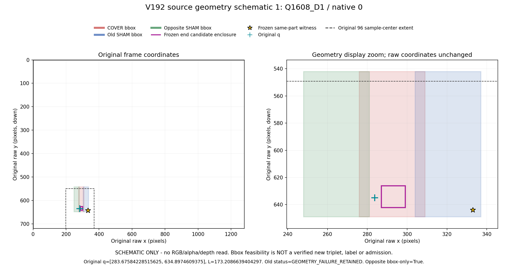
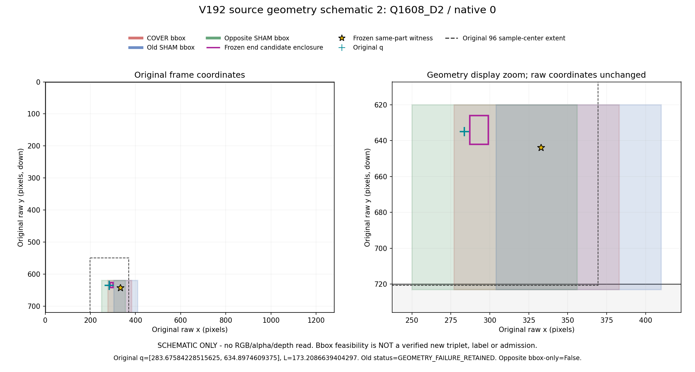
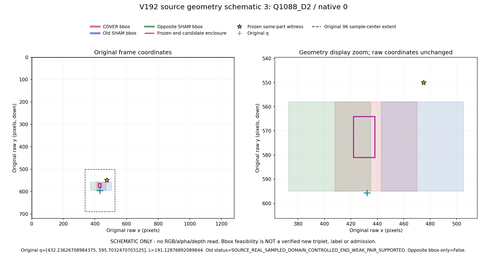
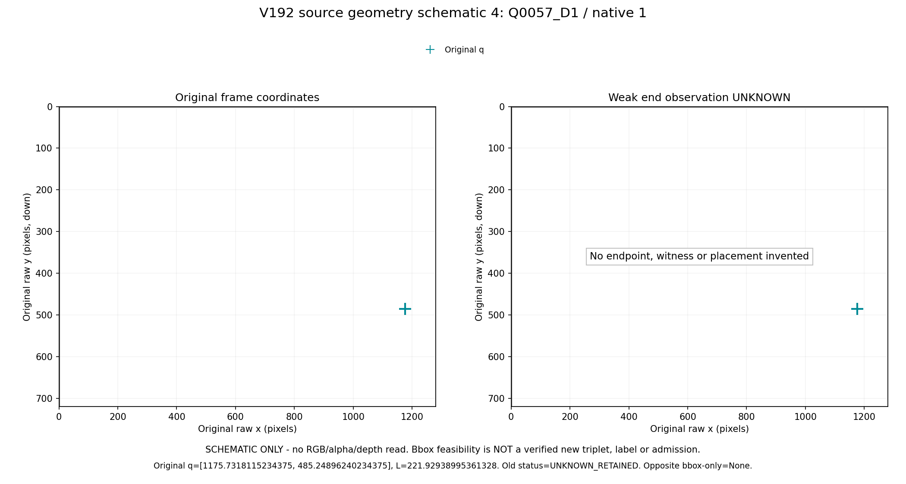

# V192: 실제 사진이 아닌 source geometry 도식

기존 source 결과를 본 후 지정한4집단의 첫 행이다. 원 raw좌표/frame/q/L/native는 유지하며 표시 확대는 입력 변경이 아니다. UNKNOWN에는 end/placement를 만들지 않는다. bbox-only 가능은 실제 alpha/RGB proof나 새 라벨/학습 승인이 아니다.

## OLD_GEOMETRY_FAIL_OPPOSITE_TRUE

기존 geometry 실패 중 반대 SHAM bbox 가능인 첫 사례. 실제 alpha·RGB·유효 학습쌍은 검증하지 않았다.

[SVG](GEOMETRY_01.svg)

## OLD_GEOMETRY_FAIL_OPPOSITE_FALSE

기존 geometry 실패 중 반대 SHAM bbox도 불가능한 첫 사례. 다른 배치를 탐색하거나 witness를 바꾸지 않았다.

[SVG](GEOMETRY_02.svg)

## OLD_SUPPORTED_OPPOSITE_FALSE

기존 지원 쌍이지만 반대 SHAM bbox는 불가능한 첫 사례. 원래 지원 판정은 그대로다.

[SVG](GEOMETRY_03.svg)

## FROZEN_WEAK_UNKNOWN

기존 weak UNKNOWN의 첫 사례. q와 원 frame만 표시하며 후보 끝·witness·대체 배치를 만들지 않았다.

[SVG](GEOMETRY_04.svg)

[그림 전 선택표](SELECTION_BEFORE_DRAW.json)
