# V193 공개 source 끝부위 대조 자료 전체66시도

원22사례·21개 고유 source프레임·66donor시도와 native8/입력U/UNKNOWN/실패를 모두 포함한다. 새 독립 holdout이나 모델 개선 증거가 아니다. 사진 없는 경우 이유만 표시한다. clean96은 저장 배열 그대로이며 표시용 q marker와 분리했다. 원 q, 관찰한 finite end, central32의 재료 존재는 서로 다른 명제다. COVER/SHAM 모두 central32에 donor가 보여도 특정 끝의 실제 보간·차폐 proof를 대체하지 않는다.

전체 저장 상태: {"completed": true, "PASS": true, "source_only": true, "attempts66": 66, "cases22": 22, "unique_source_frames21": 21, "native_variant_status_rows1584": 1584, "saved_native_input_rows": 816, "supported_weak_pairs": 27, "old_supported_pairs": 5, "new_supported_pairs": 22, "all_status_counts": {"SOURCE_REAL_SAMPLED_DOMAIN_CONTROLLED_END_WEAK_PAIR_SUPPORTED": 27, "GEOMETRY_FAILURE_RETAINED": 21, "UNKNOWN_RETAINED": 18}, "all_case_frame_source_records": [{"case_id": "Q1608", "frame_index": 201, "source_id": "val/000006:2", "selected_native": 0, "original_query_id": "V153_MR6D_val_000006_000002:native0", "source_role": "SOURCE_DEVELOPMENT"}, {"case_id": "Q1088", "frame_index": 136, "source_id": "val/000002:18", "selected_native": 0, "original_query_id": "V153_MR6D_val_000002_000018:native0", "source_role": "SOURCE_DEVELOPMENT"}, {"case_id": "Q1624", "frame_index": 203, "source_id": "val/000006:4", "selected_native": 0, "original_query_id": "V153_MR6D_val_000006_000004:native0", "source_role": "SOURCE_DEVELOPMENT"}, {"case_id": "Q0024", "frame_index": 3, "source_id": "val/000000:3", "selected_native": 0, "original_query_id": "V153_MR6D_val_000000_000003:native0", "source_role": "SOURCE_DEVELOPMENT"}, {"case_id": "Q1728", "frame_index": 216, "source_id": "val/000006:17", "selected_native": 0, "original_query_id": "V153_MR6D_val_000006_000017:native0", "source_role": "SOURCE_DEVELOPMENT"}, {"case_id": "Q0337", "frame_index": 42, "source_id": "val/000000:42", "selected_native": 1, "original_query_id": "V153_MR6D_val_000000_000042:native1", "source_role": "SOURCE_DEVELOPMENT"}, {"case_id": "Q0033", "frame_index": 4, "source_id": "val/000000:4", "selected_native": 1, "original_query_id": "V153_MR6D_val_000000_000004:native1", "source_role": "SOURCE_DEVELOPMENT"}, {"case_id": "Q0041", "frame_index": 5, "source_id": "val/000000:5", "selected_native": 1, "original_query_id": "V153_MR6D_val_000000_000005:native1", "source_role": "SOURCE_DEVELOPMENT"}, {"case_id": "Q0281", "frame_index": 35, "source_id": "val/000000:35", "selected_native": 1, "original_query_id": "V153_MR6D_val_000000_000035:native1", "source_role": "SOURCE_DEVELOPMENT"}, {"case_id": "Q0057", "frame_index": 7, "source_id": "val/000000:7", "selected_native": 1, "original_query_id": "V153_MR6D_val_000000_000007:native1", "source_role": "SOURCE_DEVELOPMENT"}, {"case_id": "Q0314", "frame_index": 39, "source_id": "val/000000:39", "selected_native": 2, "original_query_id": "V153_MR6D_val_000000_000039:native2", "source_role": "SOURCE_DEVELOPMENT"}, {"case_id": "Q0266", "frame_index": 33, "source_id": "val/000000:33", "selected_native": 2, "original_query_id": "V153_MR6D_val_000000_000033:native2", "source_role": "SOURCE_DEVELOPMENT"}, {"case_id": "Q0315", "frame_index": 39, "source_id": "val/000000:39", "selected_native": 3, "original_query_id": "V153_MR6D_val_000000_000039:native3", "source_role": "SOURCE_DEVELOPMENT"}, {"case_id": "Q0052", "frame_index": 6, "source_id": "val/000000:6", "selected_native": 4, "original_query_id": "V153_MR6D_val_000000_000006:native4", "source_role": "SOURCE_DEVELOPMENT"}, {"case_id": "Q0300", "frame_index": 37, "source_id": "val/000000:37", "selected_native": 4, "original_query_id": "V153_MR6D_val_000000_000037:native4", "source_role": "SOURCE_DEVELOPMENT"}, {"case_id": "Q0277", "frame_index": 34, "source_id": "val/000000:34", "selected_native": 5, "original_query_id": "V153_MR6D_val_000000_000034:native5", "source_role": "SOURCE_DEVELOPMENT"}, {"case_id": "Q0381", "frame_index": 47, "source_id": "val/000000:47", "selected_native": 5, "original_query_id": "V153_MR6D_val_000000_000047:native5", "source_role": "SOURCE_DEVELOPMENT"}, {"case_id": "Q1709", "frame_index": 213, "source_id": "val/000006:14", "selected_native": 5, "original_query_id": "V153_MR6D_val_000006_000014:native5", "source_role": "SOURCE_DEVELOPMENT"}, {"case_id": "Q0094", "frame_index": 11, "source_id": "val/000000:11", "selected_native": 6, "original_query_id": "V153_MR6D_val_000000_000011:native6", "source_role": "SOURCE_DEVELOPMENT"}, {"case_id": "Q0102", "frame_index": 12, "source_id": "val/000000:12", "selected_native": 6, "original_query_id": "V153_MR6D_val_000000_000012:native6", "source_role": "SOURCE_DEVELOPMENT"}, {"case_id": "Q0389", "frame_index": 48, "source_id": "val/000000:48", "selected_native": 5, "original_query_id": "V153_MR6D_val_000000_000048:native5", "source_role": "SOURCE_DEVELOPMENT"}, {"case_id": "Q0245", "frame_index": 30, "source_id": "val/000000:30", "selected_native": 5, "original_query_id": "V153_MR6D_val_000000_000030:native5", "source_role": "SOURCE_DEVELOPMENT"}], "all_native_slots": [0, 1, 2, 3, 4, 5, 6, 7], "missing_saved_variants": 96, "original_inputU_native_variant_rows": 207, "saved_inputU_rows": 112, "training_admission": false, "native_quality_owner_all_minus1": true, "query_endpoint_and_central32_presence_are_distinct": true, "classification_or_transfer_improvement": false, "selected_model": null, "adopted": false, "fully_solved": false}

[전체66 표](ALL66_SOURCE_STATUS.csv) · [원22사례 목록](ALL22_SOURCE_CASES.csv) · [native/variant1584 상태행](ALL1584_NATIVE_VARIANT_CENSUS.csv) · [정확 coverage JSON](SOURCE_COVERAGE_KO.json)

## Q1608_D1

{'pair_id': 'Q1608_D1', 'case_id': 'Q1608', 'frame_index': 201, 'source_id': 'val/000006:2', 'selected_native': 0, 'status': 'SOURCE_REAL_SAMPLED_DOMAIN_CONTROLLED_END_WEAK_PAIR_SUPPORTED', 'supported_weak_pair': True, 'old_supported_pair': False, 'new_supported_pair': True, 'stored_closed14_PASS': True, 'old5_parity': 'NOT_OLD_SUPPORTED', 'saved_variants': 'BEFORE|COVER|ADJACENT_SHAM', 'original_all8_inputU': 0, 'policy': 'OPPOSITE_ONE_ATTEMPT_READY', 'reason': '"SOURCE_REAL_SAMPLED_DOMAIN_CONTROLLED_END_WEAK_PAIR_SUPPORTED"', 'training_admission': False}

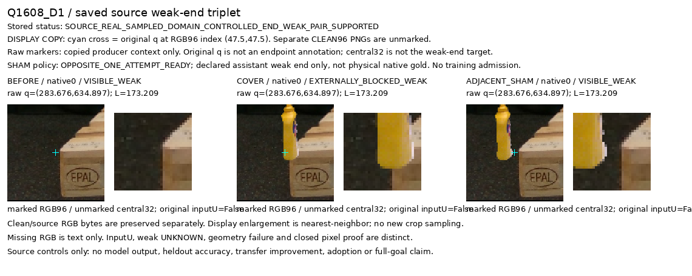

[모든 native8 저장96 보기](Q1608_D1/CONTACT_ALL8.png) · [입력 byte·상태 연결](Q1608_D1/SAVED_DISPLAY_PROVENANCE.json)

[원 생성기의 raw-coordinate context](Q1608_D1/PRODUCER_RAW_CONTEXT_CONTACT.png)

## Q1608_D2

{'pair_id': 'Q1608_D2', 'case_id': 'Q1608', 'frame_index': 201, 'source_id': 'val/000006:2', 'selected_native': 0, 'status': 'GEOMETRY_FAILURE_RETAINED', 'supported_weak_pair': False, 'old_supported_pair': False, 'new_supported_pair': False, 'stored_closed14_PASS': False, 'old5_parity': 'NOT_OLD_SUPPORTED', 'saved_variants': 'BEFORE', 'original_all8_inputU': 0, 'policy': 'OPPOSITE_ONE_ATTEMPT_FAILED_RETAINED', 'reason': '["sham_bbox_disjoint_all_end_support", "cover_and_sham_in_frame", "certified_surrounding_part_retained_by_both_bbox_transforms"]', 'training_admission': False}

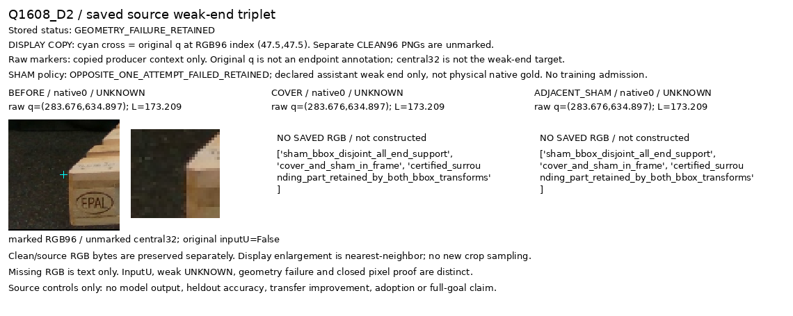

[모든 native8 저장96 보기](Q1608_D2/CONTACT_ALL8.png) · [입력 byte·상태 연결](Q1608_D2/SAVED_DISPLAY_PROVENANCE.json)

## Q1608_D3

{'pair_id': 'Q1608_D3', 'case_id': 'Q1608', 'frame_index': 201, 'source_id': 'val/000006:2', 'selected_native': 0, 'status': 'SOURCE_REAL_SAMPLED_DOMAIN_CONTROLLED_END_WEAK_PAIR_SUPPORTED', 'supported_weak_pair': True, 'old_supported_pair': False, 'new_supported_pair': True, 'stored_closed14_PASS': True, 'old5_parity': 'NOT_OLD_SUPPORTED', 'saved_variants': 'BEFORE|COVER|ADJACENT_SHAM', 'original_all8_inputU': 0, 'policy': 'OPPOSITE_ONE_ATTEMPT_READY', 'reason': '"SOURCE_REAL_SAMPLED_DOMAIN_CONTROLLED_END_WEAK_PAIR_SUPPORTED"', 'training_admission': False}

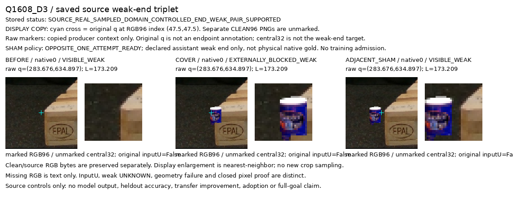

[모든 native8 저장96 보기](Q1608_D3/CONTACT_ALL8.png) · [입력 byte·상태 연결](Q1608_D3/SAVED_DISPLAY_PROVENANCE.json)

[원 생성기의 raw-coordinate context](Q1608_D3/PRODUCER_RAW_CONTEXT_CONTACT.png)

## Q1088_D1

{'pair_id': 'Q1088_D1', 'case_id': 'Q1088', 'frame_index': 136, 'source_id': 'val/000002:18', 'selected_native': 0, 'status': 'GEOMETRY_FAILURE_RETAINED', 'supported_weak_pair': False, 'old_supported_pair': False, 'new_supported_pair': False, 'stored_closed14_PASS': False, 'old5_parity': 'NOT_OLD_SUPPORTED', 'saved_variants': 'BEFORE', 'original_all8_inputU': 0, 'policy': 'OPPOSITE_ONE_ATTEMPT_FAILED_RETAINED', 'reason': '["sham_bbox_disjoint_all_end_support", "certified_surrounding_part_retained_by_both_bbox_transforms"]', 'training_admission': False}

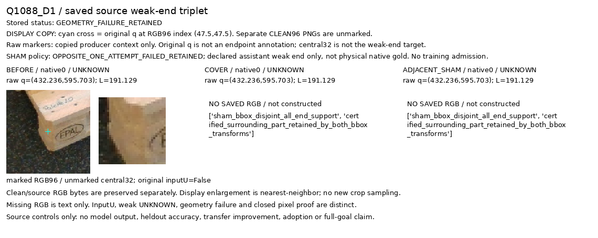

[모든 native8 저장96 보기](Q1088_D1/CONTACT_ALL8.png) · [입력 byte·상태 연결](Q1088_D1/SAVED_DISPLAY_PROVENANCE.json)

## Q1088_D2

{'pair_id': 'Q1088_D2', 'case_id': 'Q1088', 'frame_index': 136, 'source_id': 'val/000002:18', 'selected_native': 0, 'status': 'SOURCE_REAL_SAMPLED_DOMAIN_CONTROLLED_END_WEAK_PAIR_SUPPORTED', 'supported_weak_pair': True, 'old_supported_pair': True, 'new_supported_pair': False, 'stored_closed14_PASS': True, 'old5_parity': 'PASS', 'saved_variants': 'BEFORE|COVER|ADJACENT_SHAM', 'original_all8_inputU': 0, 'policy': 'ORIGINAL_RETAINED', 'reason': '"SOURCE_REAL_SAMPLED_DOMAIN_CONTROLLED_END_WEAK_PAIR_SUPPORTED"', 'training_admission': False}

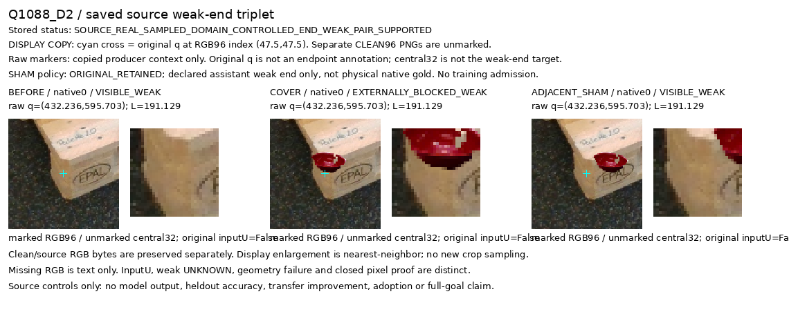

[모든 native8 저장96 보기](Q1088_D2/CONTACT_ALL8.png) · [입력 byte·상태 연결](Q1088_D2/SAVED_DISPLAY_PROVENANCE.json)

[원 생성기의 raw-coordinate context](Q1088_D2/PRODUCER_RAW_CONTEXT_CONTACT.png)

## Q1088_D3

{'pair_id': 'Q1088_D3', 'case_id': 'Q1088', 'frame_index': 136, 'source_id': 'val/000002:18', 'selected_native': 0, 'status': 'SOURCE_REAL_SAMPLED_DOMAIN_CONTROLLED_END_WEAK_PAIR_SUPPORTED', 'supported_weak_pair': True, 'old_supported_pair': True, 'new_supported_pair': False, 'stored_closed14_PASS': True, 'old5_parity': 'PASS', 'saved_variants': 'BEFORE|COVER|ADJACENT_SHAM', 'original_all8_inputU': 0, 'policy': 'ORIGINAL_RETAINED', 'reason': '"SOURCE_REAL_SAMPLED_DOMAIN_CONTROLLED_END_WEAK_PAIR_SUPPORTED"', 'training_admission': False}

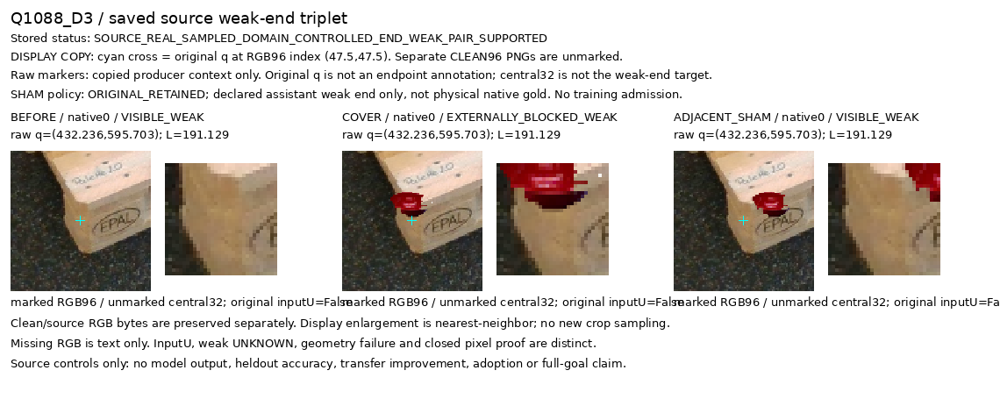

[모든 native8 저장96 보기](Q1088_D3/CONTACT_ALL8.png) · [입력 byte·상태 연결](Q1088_D3/SAVED_DISPLAY_PROVENANCE.json)

[원 생성기의 raw-coordinate context](Q1088_D3/PRODUCER_RAW_CONTEXT_CONTACT.png)

## Q1624_D1

{'pair_id': 'Q1624_D1', 'case_id': 'Q1624', 'frame_index': 203, 'source_id': 'val/000006:4', 'selected_native': 0, 'status': 'SOURCE_REAL_SAMPLED_DOMAIN_CONTROLLED_END_WEAK_PAIR_SUPPORTED', 'supported_weak_pair': True, 'old_supported_pair': True, 'new_supported_pair': False, 'stored_closed14_PASS': True, 'old5_parity': 'PASS', 'saved_variants': 'BEFORE|COVER|ADJACENT_SHAM', 'original_all8_inputU': 0, 'policy': 'ORIGINAL_RETAINED', 'reason': '"SOURCE_REAL_SAMPLED_DOMAIN_CONTROLLED_END_WEAK_PAIR_SUPPORTED"', 'training_admission': False}

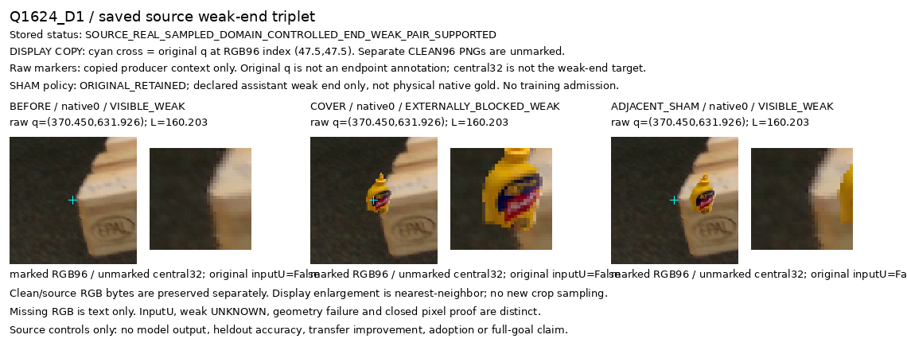

[모든 native8 저장96 보기](Q1624_D1/CONTACT_ALL8.png) · [입력 byte·상태 연결](Q1624_D1/SAVED_DISPLAY_PROVENANCE.json)

[원 생성기의 raw-coordinate context](Q1624_D1/PRODUCER_RAW_CONTEXT_CONTACT.png)

## Q1624_D2

{'pair_id': 'Q1624_D2', 'case_id': 'Q1624', 'frame_index': 203, 'source_id': 'val/000006:4', 'selected_native': 0, 'status': 'SOURCE_REAL_SAMPLED_DOMAIN_CONTROLLED_END_WEAK_PAIR_SUPPORTED', 'supported_weak_pair': True, 'old_supported_pair': True, 'new_supported_pair': False, 'stored_closed14_PASS': True, 'old5_parity': 'PASS', 'saved_variants': 'BEFORE|COVER|ADJACENT_SHAM', 'original_all8_inputU': 0, 'policy': 'ORIGINAL_RETAINED', 'reason': '"SOURCE_REAL_SAMPLED_DOMAIN_CONTROLLED_END_WEAK_PAIR_SUPPORTED"', 'training_admission': False}

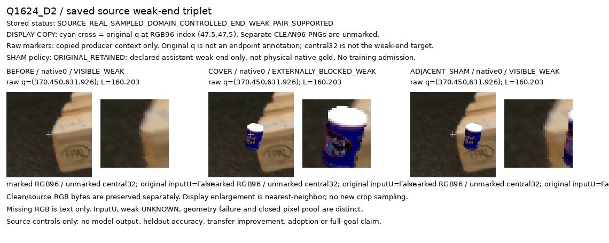

[모든 native8 저장96 보기](Q1624_D2/CONTACT_ALL8.png) · [입력 byte·상태 연결](Q1624_D2/SAVED_DISPLAY_PROVENANCE.json)

[원 생성기의 raw-coordinate context](Q1624_D2/PRODUCER_RAW_CONTEXT_CONTACT.png)

## Q1624_D3

{'pair_id': 'Q1624_D3', 'case_id': 'Q1624', 'frame_index': 203, 'source_id': 'val/000006:4', 'selected_native': 0, 'status': 'SOURCE_REAL_SAMPLED_DOMAIN_CONTROLLED_END_WEAK_PAIR_SUPPORTED', 'supported_weak_pair': True, 'old_supported_pair': True, 'new_supported_pair': False, 'stored_closed14_PASS': True, 'old5_parity': 'PASS', 'saved_variants': 'BEFORE|COVER|ADJACENT_SHAM', 'original_all8_inputU': 0, 'policy': 'ORIGINAL_RETAINED', 'reason': '"SOURCE_REAL_SAMPLED_DOMAIN_CONTROLLED_END_WEAK_PAIR_SUPPORTED"', 'training_admission': False}

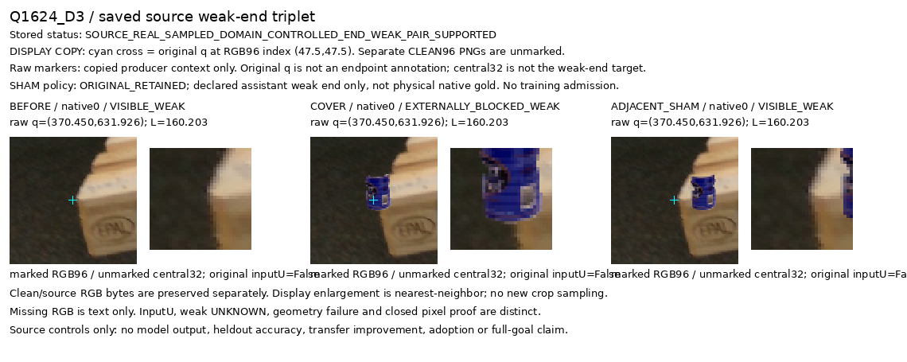

[모든 native8 저장96 보기](Q1624_D3/CONTACT_ALL8.png) · [입력 byte·상태 연결](Q1624_D3/SAVED_DISPLAY_PROVENANCE.json)

[원 생성기의 raw-coordinate context](Q1624_D3/PRODUCER_RAW_CONTEXT_CONTACT.png)

## Q0024_D1

{'pair_id': 'Q0024_D1', 'case_id': 'Q0024', 'frame_index': 3, 'source_id': 'val/000000:3', 'selected_native': 0, 'status': 'GEOMETRY_FAILURE_RETAINED', 'supported_weak_pair': False, 'old_supported_pair': False, 'new_supported_pair': False, 'stored_closed14_PASS': False, 'old5_parity': 'NOT_OLD_SUPPORTED', 'saved_variants': 'BEFORE', 'original_all8_inputU': 1, 'policy': 'OPPOSITE_ONE_ATTEMPT_FAILED_RETAINED', 'reason': '["cover_and_sham_in_frame", "certified_surrounding_part_retained_by_both_bbox_transforms"]', 'training_admission': False}

[모든 native8 저장96 보기](Q0024_D1/CONTACT_ALL8.png) · [입력 byte·상태 연결](Q0024_D1/SAVED_DISPLAY_PROVENANCE.json)

## Q0024_D2

{'pair_id': 'Q0024_D2', 'case_id': 'Q0024', 'frame_index': 3, 'source_id': 'val/000000:3', 'selected_native': 0, 'status': 'GEOMETRY_FAILURE_RETAINED', 'supported_weak_pair': False, 'old_supported_pair': False, 'new_supported_pair': False, 'stored_closed14_PASS': False, 'old5_parity': 'NOT_OLD_SUPPORTED', 'saved_variants': 'BEFORE', 'original_all8_inputU': 1, 'policy': 'OPPOSITE_ONE_ATTEMPT_FAILED_RETAINED', 'reason': '["cover_and_sham_in_frame", "certified_surrounding_part_retained_by_both_bbox_transforms"]', 'training_admission': False}

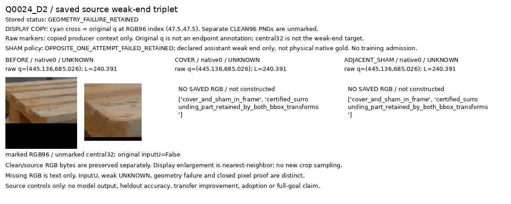

[모든 native8 저장96 보기](Q0024_D2/CONTACT_ALL8.png) · [입력 byte·상태 연결](Q0024_D2/SAVED_DISPLAY_PROVENANCE.json)

## Q0024_D3

{'pair_id': 'Q0024_D3', 'case_id': 'Q0024', 'frame_index': 3, 'source_id': 'val/000000:3', 'selected_native': 0, 'status': 'GEOMETRY_FAILURE_RETAINED', 'supported_weak_pair': False, 'old_supported_pair': False, 'new_supported_pair': False, 'stored_closed14_PASS': False, 'old5_parity': 'NOT_OLD_SUPPORTED', 'saved_variants': 'BEFORE', 'original_all8_inputU': 1, 'policy': 'OPPOSITE_ONE_ATTEMPT_FAILED_RETAINED', 'reason': '["certified_surrounding_part_retained_by_both_bbox_transforms"]', 'training_admission': False}

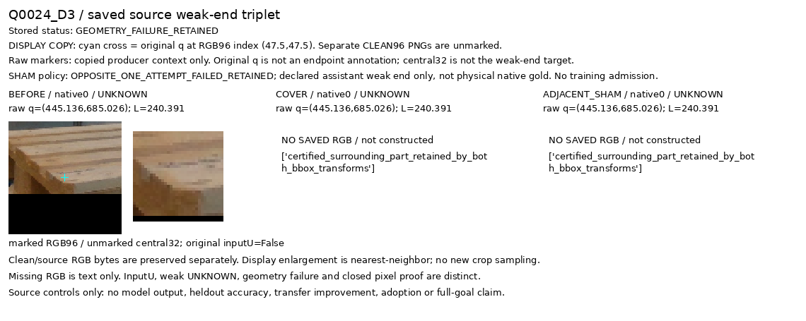

[모든 native8 저장96 보기](Q0024_D3/CONTACT_ALL8.png) · [입력 byte·상태 연결](Q0024_D3/SAVED_DISPLAY_PROVENANCE.json)

## Q1728_D1

{'pair_id': 'Q1728_D1', 'case_id': 'Q1728', 'frame_index': 216, 'source_id': 'val/000006:17', 'selected_native': 0, 'status': 'GEOMETRY_FAILURE_RETAINED', 'supported_weak_pair': False, 'old_supported_pair': False, 'new_supported_pair': False, 'stored_closed14_PASS': False, 'old5_parity': 'NOT_OLD_SUPPORTED', 'saved_variants': 'BEFORE', 'original_all8_inputU': 2, 'policy': 'OPPOSITE_ONE_ATTEMPT_FAILED_RETAINED', 'reason': '["sham_bbox_disjoint_all_end_support", "certified_surrounding_part_retained_by_both_bbox_transforms"]', 'training_admission': False}

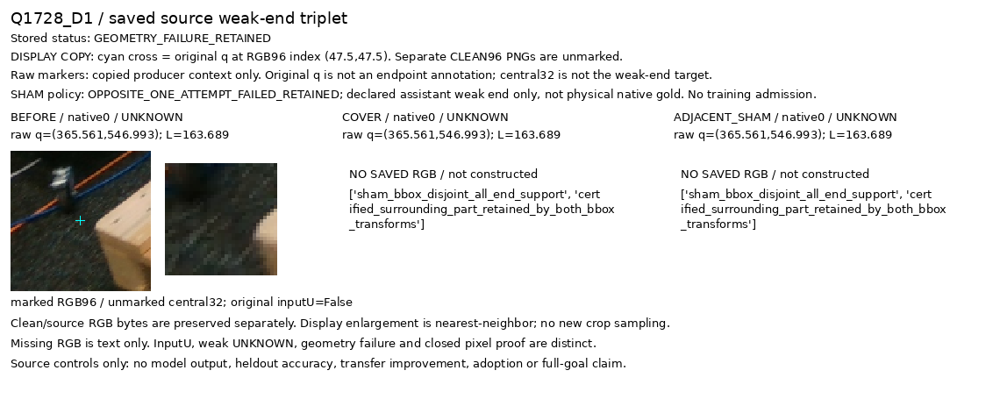

[모든 native8 저장96 보기](Q1728_D1/CONTACT_ALL8.png) · [입력 byte·상태 연결](Q1728_D1/SAVED_DISPLAY_PROVENANCE.json)

## Q1728_D2

{'pair_id': 'Q1728_D2', 'case_id': 'Q1728', 'frame_index': 216, 'source_id': 'val/000006:17', 'selected_native': 0, 'status': 'SOURCE_REAL_SAMPLED_DOMAIN_CONTROLLED_END_WEAK_PAIR_SUPPORTED', 'supported_weak_pair': True, 'old_supported_pair': False, 'new_supported_pair': True, 'stored_closed14_PASS': True, 'old5_parity': 'NOT_OLD_SUPPORTED', 'saved_variants': 'BEFORE|COVER|ADJACENT_SHAM', 'original_all8_inputU': 2, 'policy': 'OPPOSITE_ONE_ATTEMPT_READY', 'reason': '"SOURCE_REAL_SAMPLED_DOMAIN_CONTROLLED_END_WEAK_PAIR_SUPPORTED"', 'training_admission': False}

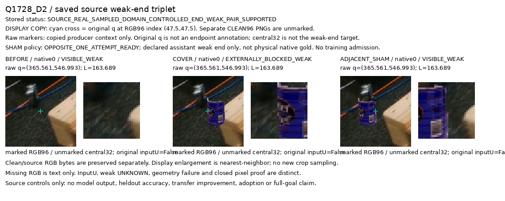

[모든 native8 저장96 보기](Q1728_D2/CONTACT_ALL8.png) · [입력 byte·상태 연결](Q1728_D2/SAVED_DISPLAY_PROVENANCE.json)

[원 생성기의 raw-coordinate context](Q1728_D2/PRODUCER_RAW_CONTEXT_CONTACT.png)

## Q1728_D3

{'pair_id': 'Q1728_D3', 'case_id': 'Q1728', 'frame_index': 216, 'source_id': 'val/000006:17', 'selected_native': 0, 'status': 'SOURCE_REAL_SAMPLED_DOMAIN_CONTROLLED_END_WEAK_PAIR_SUPPORTED', 'supported_weak_pair': True, 'old_supported_pair': False, 'new_supported_pair': True, 'stored_closed14_PASS': True, 'old5_parity': 'NOT_OLD_SUPPORTED', 'saved_variants': 'BEFORE|COVER|ADJACENT_SHAM', 'original_all8_inputU': 2, 'policy': 'OPPOSITE_ONE_ATTEMPT_READY', 'reason': '"SOURCE_REAL_SAMPLED_DOMAIN_CONTROLLED_END_WEAK_PAIR_SUPPORTED"', 'training_admission': False}

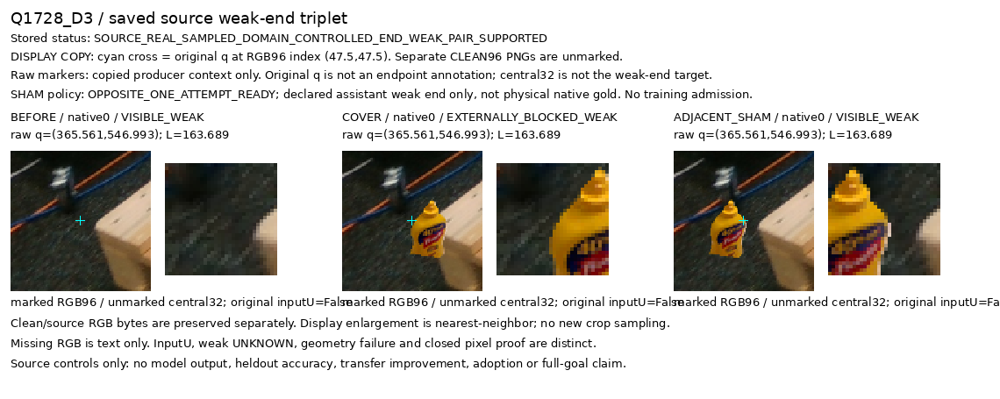

[모든 native8 저장96 보기](Q1728_D3/CONTACT_ALL8.png) · [입력 byte·상태 연결](Q1728_D3/SAVED_DISPLAY_PROVENANCE.json)

[원 생성기의 raw-coordinate context](Q1728_D3/PRODUCER_RAW_CONTEXT_CONTACT.png)

## Q0337_D1

{'pair_id': 'Q0337_D1', 'case_id': 'Q0337', 'frame_index': 42, 'source_id': 'val/000000:42', 'selected_native': 1, 'status': 'SOURCE_REAL_SAMPLED_DOMAIN_CONTROLLED_END_WEAK_PAIR_SUPPORTED', 'supported_weak_pair': True, 'old_supported_pair': False, 'new_supported_pair': True, 'stored_closed14_PASS': True, 'old5_parity': 'NOT_OLD_SUPPORTED', 'saved_variants': 'BEFORE|COVER|ADJACENT_SHAM', 'original_all8_inputU': 2, 'policy': 'OPPOSITE_ONE_ATTEMPT_READY', 'reason': '"SOURCE_REAL_SAMPLED_DOMAIN_CONTROLLED_END_WEAK_PAIR_SUPPORTED"', 'training_admission': False}

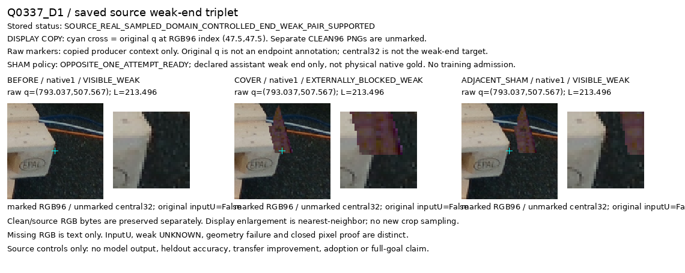

[모든 native8 저장96 보기](Q0337_D1/CONTACT_ALL8.png) · [입력 byte·상태 연결](Q0337_D1/SAVED_DISPLAY_PROVENANCE.json)

[원 생성기의 raw-coordinate context](Q0337_D1/PRODUCER_RAW_CONTEXT_CONTACT.png)

## Q0337_D2

{'pair_id': 'Q0337_D2', 'case_id': 'Q0337', 'frame_index': 42, 'source_id': 'val/000000:42', 'selected_native': 1, 'status': 'SOURCE_REAL_SAMPLED_DOMAIN_CONTROLLED_END_WEAK_PAIR_SUPPORTED', 'supported_weak_pair': True, 'old_supported_pair': False, 'new_supported_pair': True, 'stored_closed14_PASS': True, 'old5_parity': 'NOT_OLD_SUPPORTED', 'saved_variants': 'BEFORE|COVER|ADJACENT_SHAM', 'original_all8_inputU': 2, 'policy': 'OPPOSITE_ONE_ATTEMPT_READY', 'reason': '"SOURCE_REAL_SAMPLED_DOMAIN_CONTROLLED_END_WEAK_PAIR_SUPPORTED"', 'training_admission': False}

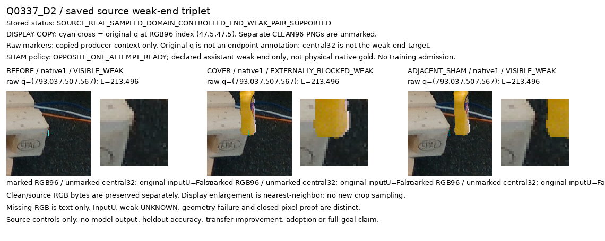

[모든 native8 저장96 보기](Q0337_D2/CONTACT_ALL8.png) · [입력 byte·상태 연결](Q0337_D2/SAVED_DISPLAY_PROVENANCE.json)

[원 생성기의 raw-coordinate context](Q0337_D2/PRODUCER_RAW_CONTEXT_CONTACT.png)

## Q0337_D3

{'pair_id': 'Q0337_D3', 'case_id': 'Q0337', 'frame_index': 42, 'source_id': 'val/000000:42', 'selected_native': 1, 'status': 'SOURCE_REAL_SAMPLED_DOMAIN_CONTROLLED_END_WEAK_PAIR_SUPPORTED', 'supported_weak_pair': True, 'old_supported_pair': False, 'new_supported_pair': True, 'stored_closed14_PASS': True, 'old5_parity': 'NOT_OLD_SUPPORTED', 'saved_variants': 'BEFORE|COVER|ADJACENT_SHAM', 'original_all8_inputU': 2, 'policy': 'OPPOSITE_ONE_ATTEMPT_READY', 'reason': '"SOURCE_REAL_SAMPLED_DOMAIN_CONTROLLED_END_WEAK_PAIR_SUPPORTED"', 'training_admission': False}

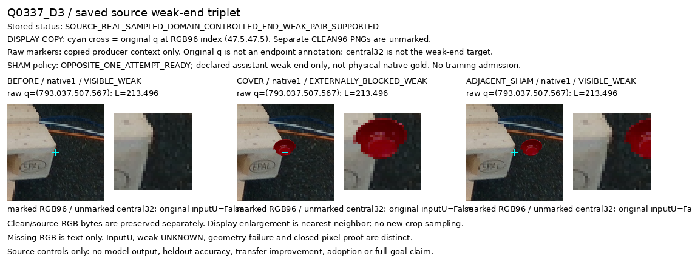

[모든 native8 저장96 보기](Q0337_D3/CONTACT_ALL8.png) · [입력 byte·상태 연결](Q0337_D3/SAVED_DISPLAY_PROVENANCE.json)

[원 생성기의 raw-coordinate context](Q0337_D3/PRODUCER_RAW_CONTEXT_CONTACT.png)

## Q0033_D1

{'pair_id': 'Q0033_D1', 'case_id': 'Q0033', 'frame_index': 4, 'source_id': 'val/000000:4', 'selected_native': 1, 'status': 'GEOMETRY_FAILURE_RETAINED', 'supported_weak_pair': False, 'old_supported_pair': False, 'new_supported_pair': False, 'stored_closed14_PASS': False, 'old5_parity': 'NOT_OLD_SUPPORTED', 'saved_variants': 'BEFORE', 'original_all8_inputU': 1, 'policy': 'OPPOSITE_ONE_ATTEMPT_FAILED_RETAINED', 'reason': '["cover_and_sham_in_frame", "certified_surrounding_part_retained_by_both_bbox_transforms"]', 'training_admission': False}

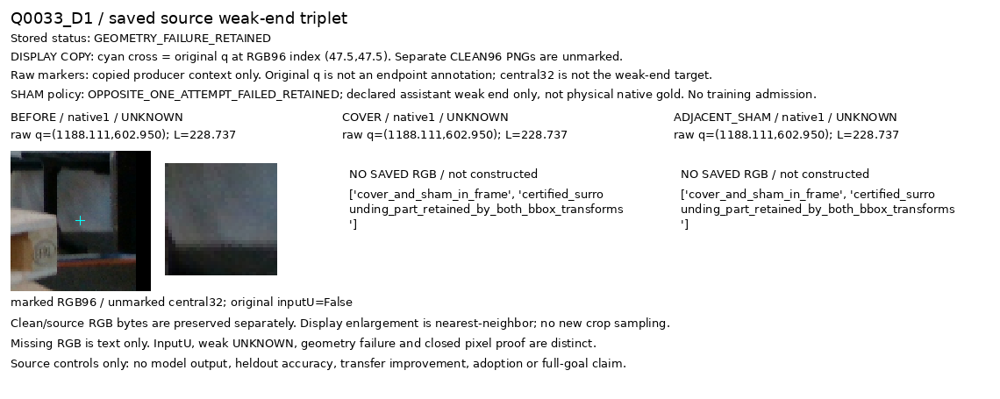

[모든 native8 저장96 보기](Q0033_D1/CONTACT_ALL8.png) · [입력 byte·상태 연결](Q0033_D1/SAVED_DISPLAY_PROVENANCE.json)

## Q0033_D2

{'pair_id': 'Q0033_D2', 'case_id': 'Q0033', 'frame_index': 4, 'source_id': 'val/000000:4', 'selected_native': 1, 'status': 'SOURCE_REAL_SAMPLED_DOMAIN_CONTROLLED_END_WEAK_PAIR_SUPPORTED', 'supported_weak_pair': True, 'old_supported_pair': False, 'new_supported_pair': True, 'stored_closed14_PASS': True, 'old5_parity': 'NOT_OLD_SUPPORTED', 'saved_variants': 'BEFORE|COVER|ADJACENT_SHAM', 'original_all8_inputU': 1, 'policy': 'OPPOSITE_ONE_ATTEMPT_READY', 'reason': '"SOURCE_REAL_SAMPLED_DOMAIN_CONTROLLED_END_WEAK_PAIR_SUPPORTED"', 'training_admission': False}

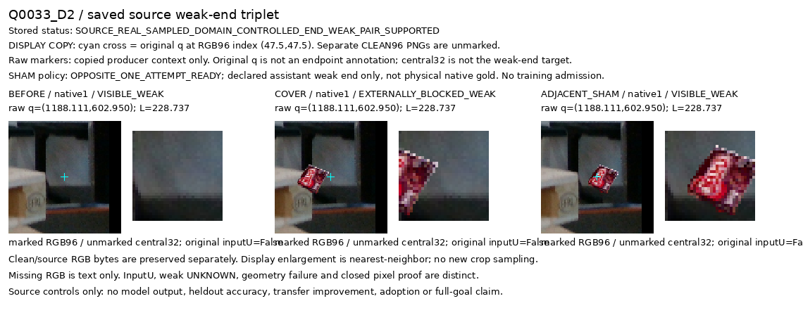

[모든 native8 저장96 보기](Q0033_D2/CONTACT_ALL8.png) · [입력 byte·상태 연결](Q0033_D2/SAVED_DISPLAY_PROVENANCE.json)

[원 생성기의 raw-coordinate context](Q0033_D2/PRODUCER_RAW_CONTEXT_CONTACT.png)

## Q0033_D3

{'pair_id': 'Q0033_D3', 'case_id': 'Q0033', 'frame_index': 4, 'source_id': 'val/000000:4', 'selected_native': 1, 'status': 'SOURCE_REAL_SAMPLED_DOMAIN_CONTROLLED_END_WEAK_PAIR_SUPPORTED', 'supported_weak_pair': True, 'old_supported_pair': False, 'new_supported_pair': True, 'stored_closed14_PASS': True, 'old5_parity': 'NOT_OLD_SUPPORTED', 'saved_variants': 'BEFORE|COVER|ADJACENT_SHAM', 'original_all8_inputU': 1, 'policy': 'OPPOSITE_ONE_ATTEMPT_READY', 'reason': '"SOURCE_REAL_SAMPLED_DOMAIN_CONTROLLED_END_WEAK_PAIR_SUPPORTED"', 'training_admission': False}

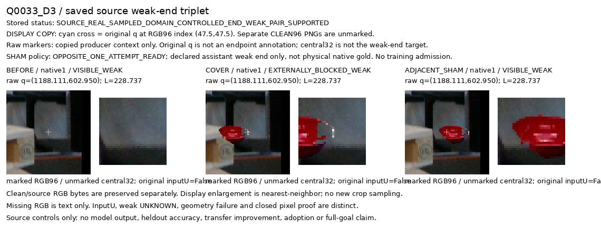

[모든 native8 저장96 보기](Q0033_D3/CONTACT_ALL8.png) · [입력 byte·상태 연결](Q0033_D3/SAVED_DISPLAY_PROVENANCE.json)

[원 생성기의 raw-coordinate context](Q0033_D3/PRODUCER_RAW_CONTEXT_CONTACT.png)

## Q0041_D1

{'pair_id': 'Q0041_D1', 'case_id': 'Q0041', 'frame_index': 5, 'source_id': 'val/000000:5', 'selected_native': 1, 'status': 'GEOMETRY_FAILURE_RETAINED', 'supported_weak_pair': False, 'old_supported_pair': False, 'new_supported_pair': False, 'stored_closed14_PASS': False, 'old5_parity': 'NOT_OLD_SUPPORTED', 'saved_variants': 'BEFORE', 'original_all8_inputU': 1, 'policy': 'OPPOSITE_ONE_ATTEMPT_FAILED_RETAINED', 'reason': '["cover_and_sham_in_frame", "certified_surrounding_part_retained_by_both_bbox_transforms"]', 'training_admission': False}

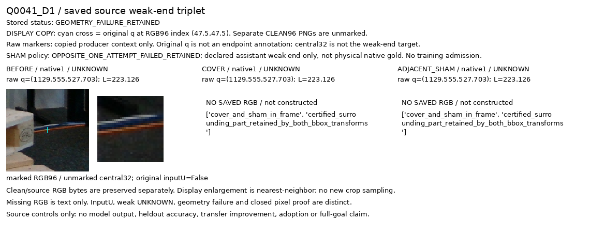

[모든 native8 저장96 보기](Q0041_D1/CONTACT_ALL8.png) · [입력 byte·상태 연결](Q0041_D1/SAVED_DISPLAY_PROVENANCE.json)

## Q0041_D2

{'pair_id': 'Q0041_D2', 'case_id': 'Q0041', 'frame_index': 5, 'source_id': 'val/000000:5', 'selected_native': 1, 'status': 'SOURCE_REAL_SAMPLED_DOMAIN_CONTROLLED_END_WEAK_PAIR_SUPPORTED', 'supported_weak_pair': True, 'old_supported_pair': False, 'new_supported_pair': True, 'stored_closed14_PASS': True, 'old5_parity': 'NOT_OLD_SUPPORTED', 'saved_variants': 'BEFORE|COVER|ADJACENT_SHAM', 'original_all8_inputU': 1, 'policy': 'OPPOSITE_ONE_ATTEMPT_READY', 'reason': '"SOURCE_REAL_SAMPLED_DOMAIN_CONTROLLED_END_WEAK_PAIR_SUPPORTED"', 'training_admission': False}

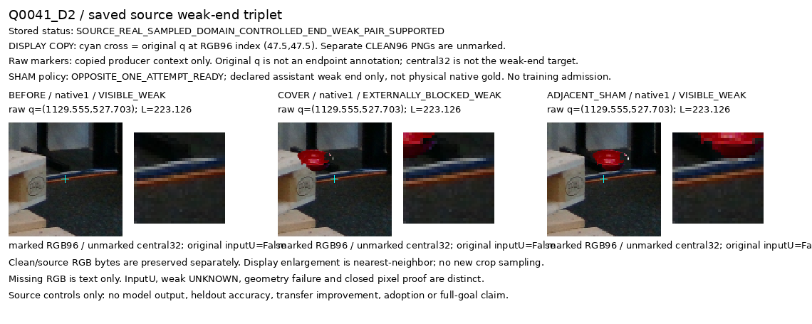

[모든 native8 저장96 보기](Q0041_D2/CONTACT_ALL8.png) · [입력 byte·상태 연결](Q0041_D2/SAVED_DISPLAY_PROVENANCE.json)

[원 생성기의 raw-coordinate context](Q0041_D2/PRODUCER_RAW_CONTEXT_CONTACT.png)

## Q0041_D3

{'pair_id': 'Q0041_D3', 'case_id': 'Q0041', 'frame_index': 5, 'source_id': 'val/000000:5', 'selected_native': 1, 'status': 'SOURCE_REAL_SAMPLED_DOMAIN_CONTROLLED_END_WEAK_PAIR_SUPPORTED', 'supported_weak_pair': True, 'old_supported_pair': False, 'new_supported_pair': True, 'stored_closed14_PASS': True, 'old5_parity': 'NOT_OLD_SUPPORTED', 'saved_variants': 'BEFORE|COVER|ADJACENT_SHAM', 'original_all8_inputU': 1, 'policy': 'OPPOSITE_ONE_ATTEMPT_READY', 'reason': '"SOURCE_REAL_SAMPLED_DOMAIN_CONTROLLED_END_WEAK_PAIR_SUPPORTED"', 'training_admission': False}

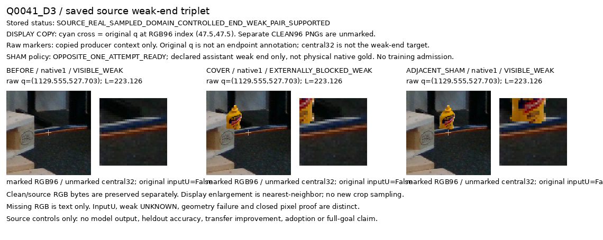

[모든 native8 저장96 보기](Q0041_D3/CONTACT_ALL8.png) · [입력 byte·상태 연결](Q0041_D3/SAVED_DISPLAY_PROVENANCE.json)

[원 생성기의 raw-coordinate context](Q0041_D3/PRODUCER_RAW_CONTEXT_CONTACT.png)

## Q0281_D1

{'pair_id': 'Q0281_D1', 'case_id': 'Q0281', 'frame_index': 35, 'source_id': 'val/000000:35', 'selected_native': 1, 'status': 'GEOMETRY_FAILURE_RETAINED', 'supported_weak_pair': False, 'old_supported_pair': False, 'new_supported_pair': False, 'stored_closed14_PASS': False, 'old5_parity': 'NOT_OLD_SUPPORTED', 'saved_variants': 'BEFORE', 'original_all8_inputU': 1, 'policy': 'OPPOSITE_ONE_ATTEMPT_FAILED_RETAINED', 'reason': '["certified_surrounding_part_retained_by_both_bbox_transforms"]', 'training_admission': False}

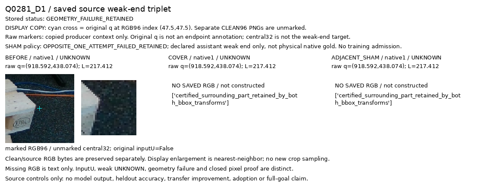

[모든 native8 저장96 보기](Q0281_D1/CONTACT_ALL8.png) · [입력 byte·상태 연결](Q0281_D1/SAVED_DISPLAY_PROVENANCE.json)

## Q0281_D2

{'pair_id': 'Q0281_D2', 'case_id': 'Q0281', 'frame_index': 35, 'source_id': 'val/000000:35', 'selected_native': 1, 'status': 'GEOMETRY_FAILURE_RETAINED', 'supported_weak_pair': False, 'old_supported_pair': False, 'new_supported_pair': False, 'stored_closed14_PASS': False, 'old5_parity': 'NOT_OLD_SUPPORTED', 'saved_variants': 'BEFORE', 'original_all8_inputU': 1, 'policy': 'OPPOSITE_ONE_ATTEMPT_FAILED_RETAINED', 'reason': '["certified_surrounding_part_retained_by_both_bbox_transforms"]', 'training_admission': False}

[모든 native8 저장96 보기](Q0281_D2/CONTACT_ALL8.png) · [입력 byte·상태 연결](Q0281_D2/SAVED_DISPLAY_PROVENANCE.json)

## Q0281_D3

{'pair_id': 'Q0281_D3', 'case_id': 'Q0281', 'frame_index': 35, 'source_id': 'val/000000:35', 'selected_native': 1, 'status': 'GEOMETRY_FAILURE_RETAINED', 'supported_weak_pair': False, 'old_supported_pair': False, 'new_supported_pair': False, 'stored_closed14_PASS': False, 'old5_parity': 'NOT_OLD_SUPPORTED', 'saved_variants': 'BEFORE', 'original_all8_inputU': 1, 'policy': 'OPPOSITE_ONE_ATTEMPT_FAILED_RETAINED', 'reason': '["certified_surrounding_part_retained_by_both_bbox_transforms"]', 'training_admission': False}

[모든 native8 저장96 보기](Q0281_D3/CONTACT_ALL8.png) · [입력 byte·상태 연결](Q0281_D3/SAVED_DISPLAY_PROVENANCE.json)

## Q0057_D1

{'pair_id': 'Q0057_D1', 'case_id': 'Q0057', 'frame_index': 7, 'source_id': 'val/000000:7', 'selected_native': 1, 'status': 'UNKNOWN_RETAINED', 'supported_weak_pair': False, 'old_supported_pair': False, 'new_supported_pair': False, 'stored_closed14_PASS': False, 'old5_parity': 'NOT_OLD_SUPPORTED', 'saved_variants': '', 'original_all8_inputU': 2, 'policy': 'NO_GEOMETRY_PLAN', 'reason': '"DIRECT_END_WEAK_OBSERVATION_UNKNOWN"', 'training_admission': False}

[모든 native8 저장96 보기](Q0057_D1/CONTACT_ALL8.png) · [입력 byte·상태 연결](Q0057_D1/SAVED_DISPLAY_PROVENANCE.json)

## Q0057_D2

{'pair_id': 'Q0057_D2', 'case_id': 'Q0057', 'frame_index': 7, 'source_id': 'val/000000:7', 'selected_native': 1, 'status': 'UNKNOWN_RETAINED', 'supported_weak_pair': False, 'old_supported_pair': False, 'new_supported_pair': False, 'stored_closed14_PASS': False, 'old5_parity': 'NOT_OLD_SUPPORTED', 'saved_variants': '', 'original_all8_inputU': 2, 'policy': 'NO_GEOMETRY_PLAN', 'reason': '"DIRECT_END_WEAK_OBSERVATION_UNKNOWN"', 'training_admission': False}

[모든 native8 저장96 보기](Q0057_D2/CONTACT_ALL8.png) · [입력 byte·상태 연결](Q0057_D2/SAVED_DISPLAY_PROVENANCE.json)

## Q0057_D3

{'pair_id': 'Q0057_D3', 'case_id': 'Q0057', 'frame_index': 7, 'source_id': 'val/000000:7', 'selected_native': 1, 'status': 'UNKNOWN_RETAINED', 'supported_weak_pair': False, 'old_supported_pair': False, 'new_supported_pair': False, 'stored_closed14_PASS': False, 'old5_parity': 'NOT_OLD_SUPPORTED', 'saved_variants': '', 'original_all8_inputU': 2, 'policy': 'NO_GEOMETRY_PLAN', 'reason': '"DIRECT_END_WEAK_OBSERVATION_UNKNOWN"', 'training_admission': False}

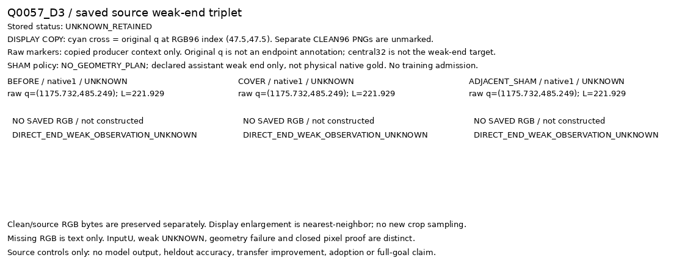

[모든 native8 저장96 보기](Q0057_D3/CONTACT_ALL8.png) · [입력 byte·상태 연결](Q0057_D3/SAVED_DISPLAY_PROVENANCE.json)

## Q0314_D1

{'pair_id': 'Q0314_D1', 'case_id': 'Q0314', 'frame_index': 39, 'source_id': 'val/000000:39', 'selected_native': 2, 'status': 'UNKNOWN_RETAINED', 'supported_weak_pair': False, 'old_supported_pair': False, 'new_supported_pair': False, 'stored_closed14_PASS': False, 'old5_parity': 'NOT_OLD_SUPPORTED', 'saved_variants': '', 'original_all8_inputU': 0, 'policy': 'NO_GEOMETRY_PLAN', 'reason': '"DIRECT_END_WEAK_OBSERVATION_UNKNOWN"', 'training_admission': False}

[모든 native8 저장96 보기](Q0314_D1/CONTACT_ALL8.png) · [입력 byte·상태 연결](Q0314_D1/SAVED_DISPLAY_PROVENANCE.json)

## Q0314_D2

{'pair_id': 'Q0314_D2', 'case_id': 'Q0314', 'frame_index': 39, 'source_id': 'val/000000:39', 'selected_native': 2, 'status': 'UNKNOWN_RETAINED', 'supported_weak_pair': False, 'old_supported_pair': False, 'new_supported_pair': False, 'stored_closed14_PASS': False, 'old5_parity': 'NOT_OLD_SUPPORTED', 'saved_variants': '', 'original_all8_inputU': 0, 'policy': 'NO_GEOMETRY_PLAN', 'reason': '"DIRECT_END_WEAK_OBSERVATION_UNKNOWN"', 'training_admission': False}

[모든 native8 저장96 보기](Q0314_D2/CONTACT_ALL8.png) · [입력 byte·상태 연결](Q0314_D2/SAVED_DISPLAY_PROVENANCE.json)

## Q0314_D3

{'pair_id': 'Q0314_D3', 'case_id': 'Q0314', 'frame_index': 39, 'source_id': 'val/000000:39', 'selected_native': 2, 'status': 'UNKNOWN_RETAINED', 'supported_weak_pair': False, 'old_supported_pair': False, 'new_supported_pair': False, 'stored_closed14_PASS': False, 'old5_parity': 'NOT_OLD_SUPPORTED', 'saved_variants': '', 'original_all8_inputU': 0, 'policy': 'NO_GEOMETRY_PLAN', 'reason': '"DIRECT_END_WEAK_OBSERVATION_UNKNOWN"', 'training_admission': False}

[모든 native8 저장96 보기](Q0314_D3/CONTACT_ALL8.png) · [입력 byte·상태 연결](Q0314_D3/SAVED_DISPLAY_PROVENANCE.json)

## Q0266_D1

{'pair_id': 'Q0266_D1', 'case_id': 'Q0266', 'frame_index': 33, 'source_id': 'val/000000:33', 'selected_native': 2, 'status': 'UNKNOWN_RETAINED', 'supported_weak_pair': False, 'old_supported_pair': False, 'new_supported_pair': False, 'stored_closed14_PASS': False, 'old5_parity': 'NOT_OLD_SUPPORTED', 'saved_variants': '', 'original_all8_inputU': 0, 'policy': 'NO_GEOMETRY_PLAN', 'reason': '"DIRECT_END_WEAK_OBSERVATION_UNKNOWN"', 'training_admission': False}

[모든 native8 저장96 보기](Q0266_D1/CONTACT_ALL8.png) · [입력 byte·상태 연결](Q0266_D1/SAVED_DISPLAY_PROVENANCE.json)

## Q0266_D2

{'pair_id': 'Q0266_D2', 'case_id': 'Q0266', 'frame_index': 33, 'source_id': 'val/000000:33', 'selected_native': 2, 'status': 'UNKNOWN_RETAINED', 'supported_weak_pair': False, 'old_supported_pair': False, 'new_supported_pair': False, 'stored_closed14_PASS': False, 'old5_parity': 'NOT_OLD_SUPPORTED', 'saved_variants': '', 'original_all8_inputU': 0, 'policy': 'NO_GEOMETRY_PLAN', 'reason': '"DIRECT_END_WEAK_OBSERVATION_UNKNOWN"', 'training_admission': False}

[모든 native8 저장96 보기](Q0266_D2/CONTACT_ALL8.png) · [입력 byte·상태 연결](Q0266_D2/SAVED_DISPLAY_PROVENANCE.json)

## Q0266_D3

{'pair_id': 'Q0266_D3', 'case_id': 'Q0266', 'frame_index': 33, 'source_id': 'val/000000:33', 'selected_native': 2, 'status': 'UNKNOWN_RETAINED', 'supported_weak_pair': False, 'old_supported_pair': False, 'new_supported_pair': False, 'stored_closed14_PASS': False, 'old5_parity': 'NOT_OLD_SUPPORTED', 'saved_variants': '', 'original_all8_inputU': 0, 'policy': 'NO_GEOMETRY_PLAN', 'reason': '"DIRECT_END_WEAK_OBSERVATION_UNKNOWN"', 'training_admission': False}

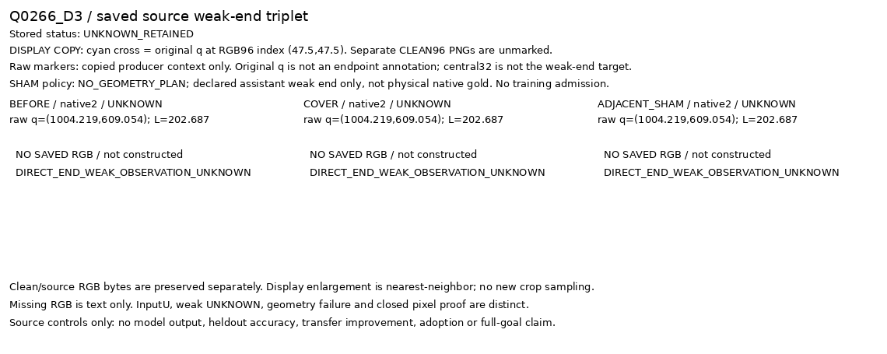

[모든 native8 저장96 보기](Q0266_D3/CONTACT_ALL8.png) · [입력 byte·상태 연결](Q0266_D3/SAVED_DISPLAY_PROVENANCE.json)

## Q0315_D1

{'pair_id': 'Q0315_D1', 'case_id': 'Q0315', 'frame_index': 39, 'source_id': 'val/000000:39', 'selected_native': 3, 'status': 'UNKNOWN_RETAINED', 'supported_weak_pair': False, 'old_supported_pair': False, 'new_supported_pair': False, 'stored_closed14_PASS': False, 'old5_parity': 'NOT_OLD_SUPPORTED', 'saved_variants': '', 'original_all8_inputU': 0, 'policy': 'NO_GEOMETRY_PLAN', 'reason': '"DIRECT_END_WEAK_OBSERVATION_UNKNOWN"', 'training_admission': False}

[모든 native8 저장96 보기](Q0315_D1/CONTACT_ALL8.png) · [입력 byte·상태 연결](Q0315_D1/SAVED_DISPLAY_PROVENANCE.json)

## Q0315_D2

{'pair_id': 'Q0315_D2', 'case_id': 'Q0315', 'frame_index': 39, 'source_id': 'val/000000:39', 'selected_native': 3, 'status': 'UNKNOWN_RETAINED', 'supported_weak_pair': False, 'old_supported_pair': False, 'new_supported_pair': False, 'stored_closed14_PASS': False, 'old5_parity': 'NOT_OLD_SUPPORTED', 'saved_variants': '', 'original_all8_inputU': 0, 'policy': 'NO_GEOMETRY_PLAN', 'reason': '"DIRECT_END_WEAK_OBSERVATION_UNKNOWN"', 'training_admission': False}

[모든 native8 저장96 보기](Q0315_D2/CONTACT_ALL8.png) · [입력 byte·상태 연결](Q0315_D2/SAVED_DISPLAY_PROVENANCE.json)

## Q0315_D3

{'pair_id': 'Q0315_D3', 'case_id': 'Q0315', 'frame_index': 39, 'source_id': 'val/000000:39', 'selected_native': 3, 'status': 'UNKNOWN_RETAINED', 'supported_weak_pair': False, 'old_supported_pair': False, 'new_supported_pair': False, 'stored_closed14_PASS': False, 'old5_parity': 'NOT_OLD_SUPPORTED', 'saved_variants': '', 'original_all8_inputU': 0, 'policy': 'NO_GEOMETRY_PLAN', 'reason': '"DIRECT_END_WEAK_OBSERVATION_UNKNOWN"', 'training_admission': False}

[모든 native8 저장96 보기](Q0315_D3/CONTACT_ALL8.png) · [입력 byte·상태 연결](Q0315_D3/SAVED_DISPLAY_PROVENANCE.json)

## Q0052_D1

{'pair_id': 'Q0052_D1', 'case_id': 'Q0052', 'frame_index': 6, 'source_id': 'val/000000:6', 'selected_native': 4, 'status': 'SOURCE_REAL_SAMPLED_DOMAIN_CONTROLLED_END_WEAK_PAIR_SUPPORTED', 'supported_weak_pair': True, 'old_supported_pair': False, 'new_supported_pair': True, 'stored_closed14_PASS': True, 'old5_parity': 'NOT_OLD_SUPPORTED', 'saved_variants': 'BEFORE|COVER|ADJACENT_SHAM', 'original_all8_inputU': 2, 'policy': 'OPPOSITE_ONE_ATTEMPT_READY', 'reason': '"SOURCE_REAL_SAMPLED_DOMAIN_CONTROLLED_END_WEAK_PAIR_SUPPORTED"', 'training_admission': False}

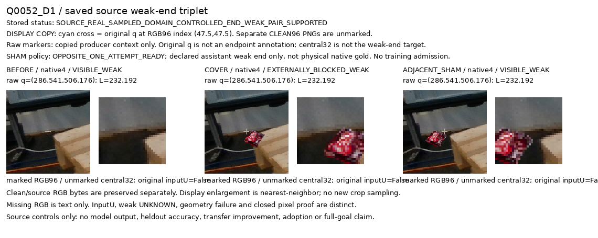

[모든 native8 저장96 보기](Q0052_D1/CONTACT_ALL8.png) · [입력 byte·상태 연결](Q0052_D1/SAVED_DISPLAY_PROVENANCE.json)

[원 생성기의 raw-coordinate context](Q0052_D1/PRODUCER_RAW_CONTEXT_CONTACT.png)

## Q0052_D2

{'pair_id': 'Q0052_D2', 'case_id': 'Q0052', 'frame_index': 6, 'source_id': 'val/000000:6', 'selected_native': 4, 'status': 'GEOMETRY_FAILURE_RETAINED', 'supported_weak_pair': False, 'old_supported_pair': False, 'new_supported_pair': False, 'stored_closed14_PASS': False, 'old5_parity': 'NOT_OLD_SUPPORTED', 'saved_variants': 'BEFORE', 'original_all8_inputU': 2, 'policy': 'OPPOSITE_ONE_ATTEMPT_FAILED_RETAINED', 'reason': '["sham_bbox_disjoint_all_end_support", "certified_surrounding_part_retained_by_both_bbox_transforms"]', 'training_admission': False}

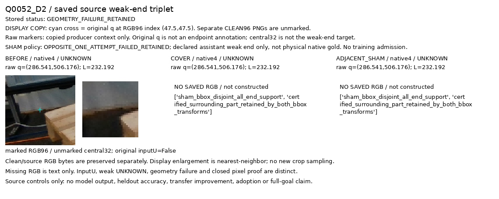

[모든 native8 저장96 보기](Q0052_D2/CONTACT_ALL8.png) · [입력 byte·상태 연결](Q0052_D2/SAVED_DISPLAY_PROVENANCE.json)

## Q0052_D3

{'pair_id': 'Q0052_D3', 'case_id': 'Q0052', 'frame_index': 6, 'source_id': 'val/000000:6', 'selected_native': 4, 'status': 'SOURCE_REAL_SAMPLED_DOMAIN_CONTROLLED_END_WEAK_PAIR_SUPPORTED', 'supported_weak_pair': True, 'old_supported_pair': False, 'new_supported_pair': True, 'stored_closed14_PASS': True, 'old5_parity': 'NOT_OLD_SUPPORTED', 'saved_variants': 'BEFORE|COVER|ADJACENT_SHAM', 'original_all8_inputU': 2, 'policy': 'OPPOSITE_ONE_ATTEMPT_READY', 'reason': '"SOURCE_REAL_SAMPLED_DOMAIN_CONTROLLED_END_WEAK_PAIR_SUPPORTED"', 'training_admission': False}

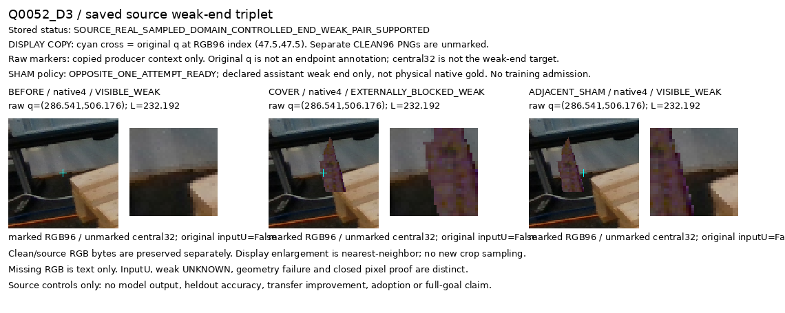

[모든 native8 저장96 보기](Q0052_D3/CONTACT_ALL8.png) · [입력 byte·상태 연결](Q0052_D3/SAVED_DISPLAY_PROVENANCE.json)

[원 생성기의 raw-coordinate context](Q0052_D3/PRODUCER_RAW_CONTEXT_CONTACT.png)

## Q0300_D1

{'pair_id': 'Q0300_D1', 'case_id': 'Q0300', 'frame_index': 37, 'source_id': 'val/000000:37', 'selected_native': 4, 'status': 'GEOMETRY_FAILURE_RETAINED', 'supported_weak_pair': False, 'old_supported_pair': False, 'new_supported_pair': False, 'stored_closed14_PASS': False, 'old5_parity': 'NOT_OLD_SUPPORTED', 'saved_variants': 'BEFORE', 'original_all8_inputU': 0, 'policy': 'OPPOSITE_ONE_ATTEMPT_FAILED_RETAINED', 'reason': '["sham_bbox_disjoint_all_end_support"]', 'training_admission': False}

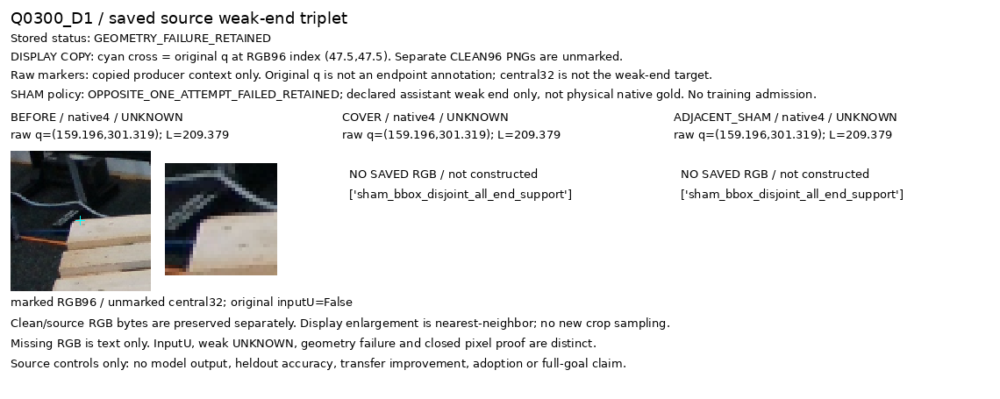

[모든 native8 저장96 보기](Q0300_D1/CONTACT_ALL8.png) · [입력 byte·상태 연결](Q0300_D1/SAVED_DISPLAY_PROVENANCE.json)

## Q0300_D2

{'pair_id': 'Q0300_D2', 'case_id': 'Q0300', 'frame_index': 37, 'source_id': 'val/000000:37', 'selected_native': 4, 'status': 'SOURCE_REAL_SAMPLED_DOMAIN_CONTROLLED_END_WEAK_PAIR_SUPPORTED', 'supported_weak_pair': True, 'old_supported_pair': False, 'new_supported_pair': True, 'stored_closed14_PASS': True, 'old5_parity': 'NOT_OLD_SUPPORTED', 'saved_variants': 'BEFORE|COVER|ADJACENT_SHAM', 'original_all8_inputU': 0, 'policy': 'OPPOSITE_ONE_ATTEMPT_READY', 'reason': '"SOURCE_REAL_SAMPLED_DOMAIN_CONTROLLED_END_WEAK_PAIR_SUPPORTED"', 'training_admission': False}

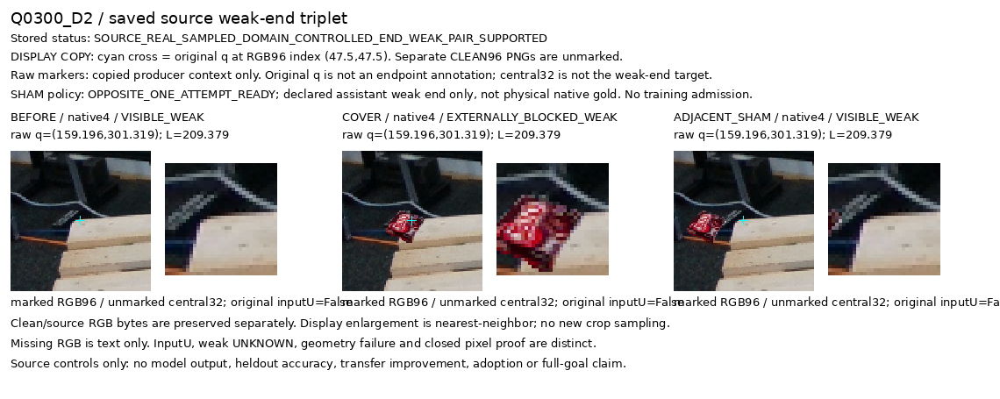

[모든 native8 저장96 보기](Q0300_D2/CONTACT_ALL8.png) · [입력 byte·상태 연결](Q0300_D2/SAVED_DISPLAY_PROVENANCE.json)

[원 생성기의 raw-coordinate context](Q0300_D2/PRODUCER_RAW_CONTEXT_CONTACT.png)

## Q0300_D3

{'pair_id': 'Q0300_D3', 'case_id': 'Q0300', 'frame_index': 37, 'source_id': 'val/000000:37', 'selected_native': 4, 'status': 'SOURCE_REAL_SAMPLED_DOMAIN_CONTROLLED_END_WEAK_PAIR_SUPPORTED', 'supported_weak_pair': True, 'old_supported_pair': False, 'new_supported_pair': True, 'stored_closed14_PASS': True, 'old5_parity': 'NOT_OLD_SUPPORTED', 'saved_variants': 'BEFORE|COVER|ADJACENT_SHAM', 'original_all8_inputU': 0, 'policy': 'OPPOSITE_ONE_ATTEMPT_READY', 'reason': '"SOURCE_REAL_SAMPLED_DOMAIN_CONTROLLED_END_WEAK_PAIR_SUPPORTED"', 'training_admission': False}

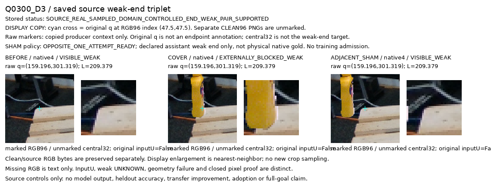

[모든 native8 저장96 보기](Q0300_D3/CONTACT_ALL8.png) · [입력 byte·상태 연결](Q0300_D3/SAVED_DISPLAY_PROVENANCE.json)

[원 생성기의 raw-coordinate context](Q0300_D3/PRODUCER_RAW_CONTEXT_CONTACT.png)

## Q0277_D1

{'pair_id': 'Q0277_D1', 'case_id': 'Q0277', 'frame_index': 34, 'source_id': 'val/000000:34', 'selected_native': 5, 'status': 'GEOMETRY_FAILURE_RETAINED', 'supported_weak_pair': False, 'old_supported_pair': False, 'new_supported_pair': False, 'stored_closed14_PASS': False, 'old5_parity': 'NOT_OLD_SUPPORTED', 'saved_variants': 'BEFORE', 'original_all8_inputU': 0, 'policy': 'OPPOSITE_ONE_ATTEMPT_FAILED_RETAINED', 'reason': '["sham_bbox_disjoint_all_end_support"]', 'training_admission': False}

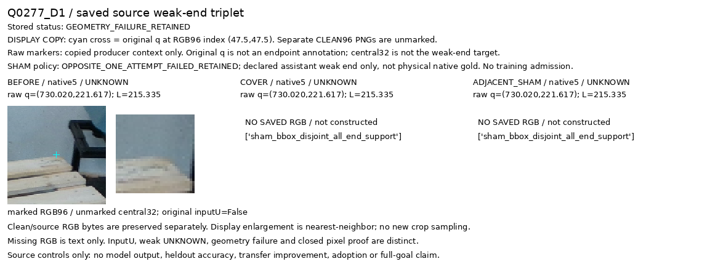

[모든 native8 저장96 보기](Q0277_D1/CONTACT_ALL8.png) · [입력 byte·상태 연결](Q0277_D1/SAVED_DISPLAY_PROVENANCE.json)

## Q0277_D2

{'pair_id': 'Q0277_D2', 'case_id': 'Q0277', 'frame_index': 34, 'source_id': 'val/000000:34', 'selected_native': 5, 'status': 'SOURCE_REAL_SAMPLED_DOMAIN_CONTROLLED_END_WEAK_PAIR_SUPPORTED', 'supported_weak_pair': True, 'old_supported_pair': False, 'new_supported_pair': True, 'stored_closed14_PASS': True, 'old5_parity': 'NOT_OLD_SUPPORTED', 'saved_variants': 'BEFORE|COVER|ADJACENT_SHAM', 'original_all8_inputU': 0, 'policy': 'OPPOSITE_ONE_ATTEMPT_READY', 'reason': '"SOURCE_REAL_SAMPLED_DOMAIN_CONTROLLED_END_WEAK_PAIR_SUPPORTED"', 'training_admission': False}

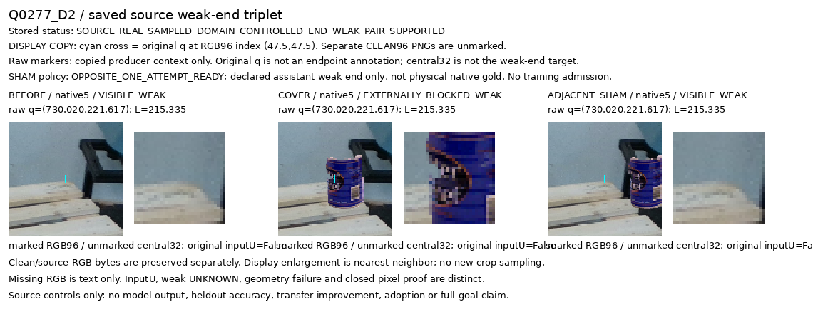

[모든 native8 저장96 보기](Q0277_D2/CONTACT_ALL8.png) · [입력 byte·상태 연결](Q0277_D2/SAVED_DISPLAY_PROVENANCE.json)

[원 생성기의 raw-coordinate context](Q0277_D2/PRODUCER_RAW_CONTEXT_CONTACT.png)

## Q0277_D3

{'pair_id': 'Q0277_D3', 'case_id': 'Q0277', 'frame_index': 34, 'source_id': 'val/000000:34', 'selected_native': 5, 'status': 'SOURCE_REAL_SAMPLED_DOMAIN_CONTROLLED_END_WEAK_PAIR_SUPPORTED', 'supported_weak_pair': True, 'old_supported_pair': False, 'new_supported_pair': True, 'stored_closed14_PASS': True, 'old5_parity': 'NOT_OLD_SUPPORTED', 'saved_variants': 'BEFORE|COVER|ADJACENT_SHAM', 'original_all8_inputU': 0, 'policy': 'OPPOSITE_ONE_ATTEMPT_READY', 'reason': '"SOURCE_REAL_SAMPLED_DOMAIN_CONTROLLED_END_WEAK_PAIR_SUPPORTED"', 'training_admission': False}

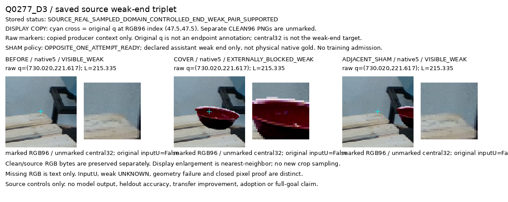

[모든 native8 저장96 보기](Q0277_D3/CONTACT_ALL8.png) · [입력 byte·상태 연결](Q0277_D3/SAVED_DISPLAY_PROVENANCE.json)

[원 생성기의 raw-coordinate context](Q0277_D3/PRODUCER_RAW_CONTEXT_CONTACT.png)

## Q0381_D1

{'pair_id': 'Q0381_D1', 'case_id': 'Q0381', 'frame_index': 47, 'source_id': 'val/000000:47', 'selected_native': 5, 'status': 'GEOMETRY_FAILURE_RETAINED', 'supported_weak_pair': False, 'old_supported_pair': False, 'new_supported_pair': False, 'stored_closed14_PASS': False, 'old5_parity': 'NOT_OLD_SUPPORTED', 'saved_variants': 'BEFORE', 'original_all8_inputU': 4, 'policy': 'OPPOSITE_ONE_ATTEMPT_FAILED_RETAINED', 'reason': '["sham_bbox_disjoint_all_end_support", "certified_surrounding_part_retained_by_both_bbox_transforms"]', 'training_admission': False}

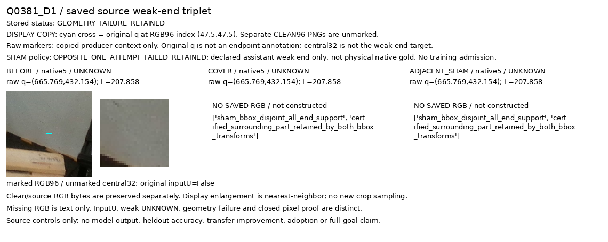

[모든 native8 저장96 보기](Q0381_D1/CONTACT_ALL8.png) · [입력 byte·상태 연결](Q0381_D1/SAVED_DISPLAY_PROVENANCE.json)

## Q0381_D2

{'pair_id': 'Q0381_D2', 'case_id': 'Q0381', 'frame_index': 47, 'source_id': 'val/000000:47', 'selected_native': 5, 'status': 'SOURCE_REAL_SAMPLED_DOMAIN_CONTROLLED_END_WEAK_PAIR_SUPPORTED', 'supported_weak_pair': True, 'old_supported_pair': False, 'new_supported_pair': True, 'stored_closed14_PASS': True, 'old5_parity': 'NOT_OLD_SUPPORTED', 'saved_variants': 'BEFORE|COVER|ADJACENT_SHAM', 'original_all8_inputU': 4, 'policy': 'OPPOSITE_ONE_ATTEMPT_READY', 'reason': '"SOURCE_REAL_SAMPLED_DOMAIN_CONTROLLED_END_WEAK_PAIR_SUPPORTED"', 'training_admission': False}

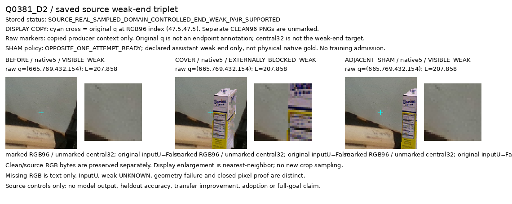

[모든 native8 저장96 보기](Q0381_D2/CONTACT_ALL8.png) · [입력 byte·상태 연결](Q0381_D2/SAVED_DISPLAY_PROVENANCE.json)

[원 생성기의 raw-coordinate context](Q0381_D2/PRODUCER_RAW_CONTEXT_CONTACT.png)

## Q0381_D3

{'pair_id': 'Q0381_D3', 'case_id': 'Q0381', 'frame_index': 47, 'source_id': 'val/000000:47', 'selected_native': 5, 'status': 'SOURCE_REAL_SAMPLED_DOMAIN_CONTROLLED_END_WEAK_PAIR_SUPPORTED', 'supported_weak_pair': True, 'old_supported_pair': False, 'new_supported_pair': True, 'stored_closed14_PASS': True, 'old5_parity': 'NOT_OLD_SUPPORTED', 'saved_variants': 'BEFORE|COVER|ADJACENT_SHAM', 'original_all8_inputU': 4, 'policy': 'OPPOSITE_ONE_ATTEMPT_READY', 'reason': '"SOURCE_REAL_SAMPLED_DOMAIN_CONTROLLED_END_WEAK_PAIR_SUPPORTED"', 'training_admission': False}

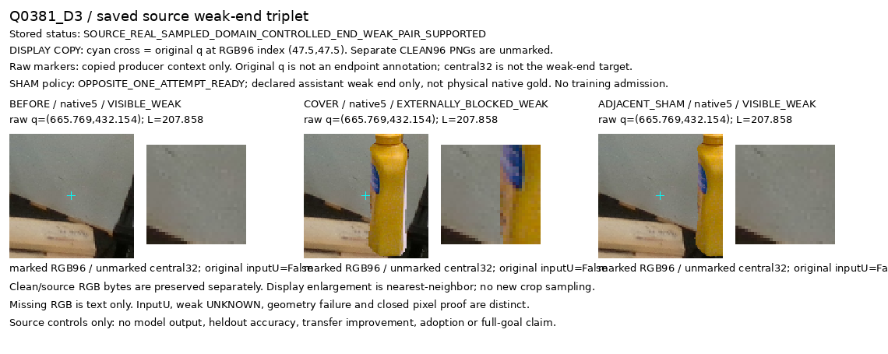

[모든 native8 저장96 보기](Q0381_D3/CONTACT_ALL8.png) · [입력 byte·상태 연결](Q0381_D3/SAVED_DISPLAY_PROVENANCE.json)

[원 생성기의 raw-coordinate context](Q0381_D3/PRODUCER_RAW_CONTEXT_CONTACT.png)

## Q1709_D1

{'pair_id': 'Q1709_D1', 'case_id': 'Q1709', 'frame_index': 213, 'source_id': 'val/000006:14', 'selected_native': 5, 'status': 'SOURCE_REAL_SAMPLED_DOMAIN_CONTROLLED_END_WEAK_PAIR_SUPPORTED', 'supported_weak_pair': True, 'old_supported_pair': False, 'new_supported_pair': True, 'stored_closed14_PASS': True, 'old5_parity': 'NOT_OLD_SUPPORTED', 'saved_variants': 'BEFORE|COVER|ADJACENT_SHAM', 'original_all8_inputU': 0, 'policy': 'OPPOSITE_ONE_ATTEMPT_READY', 'reason': '"SOURCE_REAL_SAMPLED_DOMAIN_CONTROLLED_END_WEAK_PAIR_SUPPORTED"', 'training_admission': False}

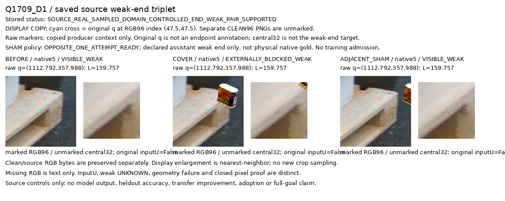

[모든 native8 저장96 보기](Q1709_D1/CONTACT_ALL8.png) · [입력 byte·상태 연결](Q1709_D1/SAVED_DISPLAY_PROVENANCE.json)

[원 생성기의 raw-coordinate context](Q1709_D1/PRODUCER_RAW_CONTEXT_CONTACT.png)

## Q1709_D2

{'pair_id': 'Q1709_D2', 'case_id': 'Q1709', 'frame_index': 213, 'source_id': 'val/000006:14', 'selected_native': 5, 'status': 'SOURCE_REAL_SAMPLED_DOMAIN_CONTROLLED_END_WEAK_PAIR_SUPPORTED', 'supported_weak_pair': True, 'old_supported_pair': False, 'new_supported_pair': True, 'stored_closed14_PASS': True, 'old5_parity': 'NOT_OLD_SUPPORTED', 'saved_variants': 'BEFORE|COVER|ADJACENT_SHAM', 'original_all8_inputU': 0, 'policy': 'OPPOSITE_ONE_ATTEMPT_READY', 'reason': '"SOURCE_REAL_SAMPLED_DOMAIN_CONTROLLED_END_WEAK_PAIR_SUPPORTED"', 'training_admission': False}

[모든 native8 저장96 보기](Q1709_D2/CONTACT_ALL8.png) · [입력 byte·상태 연결](Q1709_D2/SAVED_DISPLAY_PROVENANCE.json)

[원 생성기의 raw-coordinate context](Q1709_D2/PRODUCER_RAW_CONTEXT_CONTACT.png)

## Q1709_D3

{'pair_id': 'Q1709_D3', 'case_id': 'Q1709', 'frame_index': 213, 'source_id': 'val/000006:14', 'selected_native': 5, 'status': 'SOURCE_REAL_SAMPLED_DOMAIN_CONTROLLED_END_WEAK_PAIR_SUPPORTED', 'supported_weak_pair': True, 'old_supported_pair': False, 'new_supported_pair': True, 'stored_closed14_PASS': True, 'old5_parity': 'NOT_OLD_SUPPORTED', 'saved_variants': 'BEFORE|COVER|ADJACENT_SHAM', 'original_all8_inputU': 0, 'policy': 'OPPOSITE_ONE_ATTEMPT_READY', 'reason': '"SOURCE_REAL_SAMPLED_DOMAIN_CONTROLLED_END_WEAK_PAIR_SUPPORTED"', 'training_admission': False}

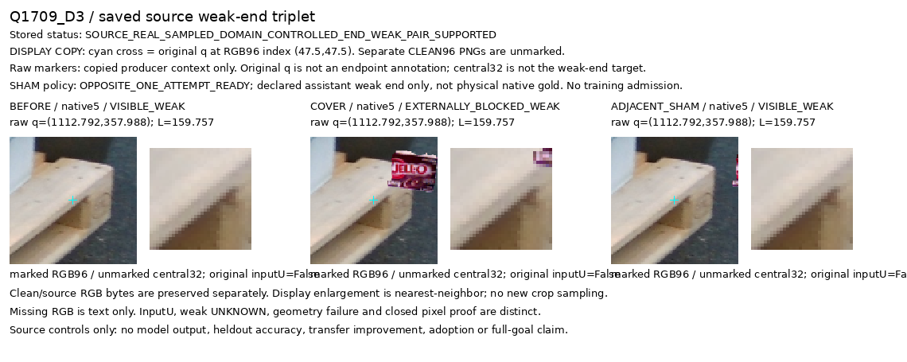

[모든 native8 저장96 보기](Q1709_D3/CONTACT_ALL8.png) · [입력 byte·상태 연결](Q1709_D3/SAVED_DISPLAY_PROVENANCE.json)

[원 생성기의 raw-coordinate context](Q1709_D3/PRODUCER_RAW_CONTEXT_CONTACT.png)

## Q0094_D1

{'pair_id': 'Q0094_D1', 'case_id': 'Q0094', 'frame_index': 11, 'source_id': 'val/000000:11', 'selected_native': 6, 'status': 'UNKNOWN_RETAINED', 'supported_weak_pair': False, 'old_supported_pair': False, 'new_supported_pair': False, 'stored_closed14_PASS': False, 'old5_parity': 'NOT_OLD_SUPPORTED', 'saved_variants': '', 'original_all8_inputU': 0, 'policy': 'NO_GEOMETRY_PLAN', 'reason': '"DIRECT_END_WEAK_OBSERVATION_UNKNOWN"', 'training_admission': False}

[모든 native8 저장96 보기](Q0094_D1/CONTACT_ALL8.png) · [입력 byte·상태 연결](Q0094_D1/SAVED_DISPLAY_PROVENANCE.json)

## Q0094_D2

{'pair_id': 'Q0094_D2', 'case_id': 'Q0094', 'frame_index': 11, 'source_id': 'val/000000:11', 'selected_native': 6, 'status': 'UNKNOWN_RETAINED', 'supported_weak_pair': False, 'old_supported_pair': False, 'new_supported_pair': False, 'stored_closed14_PASS': False, 'old5_parity': 'NOT_OLD_SUPPORTED', 'saved_variants': '', 'original_all8_inputU': 0, 'policy': 'NO_GEOMETRY_PLAN', 'reason': '"DIRECT_END_WEAK_OBSERVATION_UNKNOWN"', 'training_admission': False}

[모든 native8 저장96 보기](Q0094_D2/CONTACT_ALL8.png) · [입력 byte·상태 연결](Q0094_D2/SAVED_DISPLAY_PROVENANCE.json)

## Q0094_D3

{'pair_id': 'Q0094_D3', 'case_id': 'Q0094', 'frame_index': 11, 'source_id': 'val/000000:11', 'selected_native': 6, 'status': 'UNKNOWN_RETAINED', 'supported_weak_pair': False, 'old_supported_pair': False, 'new_supported_pair': False, 'stored_closed14_PASS': False, 'old5_parity': 'NOT_OLD_SUPPORTED', 'saved_variants': '', 'original_all8_inputU': 0, 'policy': 'NO_GEOMETRY_PLAN', 'reason': '"DIRECT_END_WEAK_OBSERVATION_UNKNOWN"', 'training_admission': False}

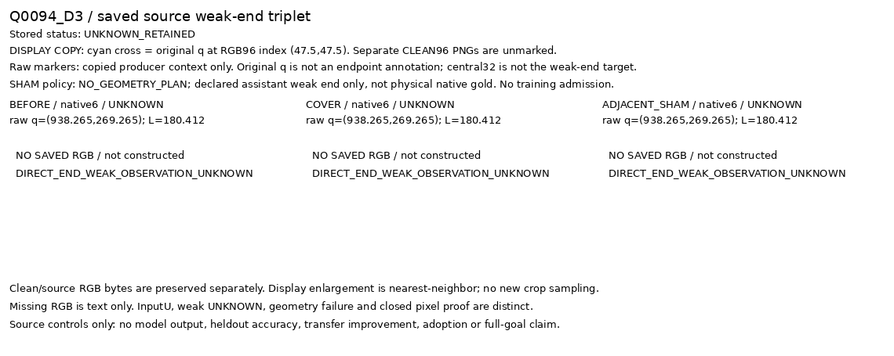

[모든 native8 저장96 보기](Q0094_D3/CONTACT_ALL8.png) · [입력 byte·상태 연결](Q0094_D3/SAVED_DISPLAY_PROVENANCE.json)

## Q0102_D1

{'pair_id': 'Q0102_D1', 'case_id': 'Q0102', 'frame_index': 12, 'source_id': 'val/000000:12', 'selected_native': 6, 'status': 'UNKNOWN_RETAINED', 'supported_weak_pair': False, 'old_supported_pair': False, 'new_supported_pair': False, 'stored_closed14_PASS': False, 'old5_parity': 'NOT_OLD_SUPPORTED', 'saved_variants': '', 'original_all8_inputU': 1, 'policy': 'NO_GEOMETRY_PLAN', 'reason': '"DIRECT_END_WEAK_OBSERVATION_UNKNOWN"', 'training_admission': False}

[모든 native8 저장96 보기](Q0102_D1/CONTACT_ALL8.png) · [입력 byte·상태 연결](Q0102_D1/SAVED_DISPLAY_PROVENANCE.json)

## Q0102_D2

{'pair_id': 'Q0102_D2', 'case_id': 'Q0102', 'frame_index': 12, 'source_id': 'val/000000:12', 'selected_native': 6, 'status': 'UNKNOWN_RETAINED', 'supported_weak_pair': False, 'old_supported_pair': False, 'new_supported_pair': False, 'stored_closed14_PASS': False, 'old5_parity': 'NOT_OLD_SUPPORTED', 'saved_variants': '', 'original_all8_inputU': 1, 'policy': 'NO_GEOMETRY_PLAN', 'reason': '"DIRECT_END_WEAK_OBSERVATION_UNKNOWN"', 'training_admission': False}

[모든 native8 저장96 보기](Q0102_D2/CONTACT_ALL8.png) · [입력 byte·상태 연결](Q0102_D2/SAVED_DISPLAY_PROVENANCE.json)

## Q0102_D3

{'pair_id': 'Q0102_D3', 'case_id': 'Q0102', 'frame_index': 12, 'source_id': 'val/000000:12', 'selected_native': 6, 'status': 'UNKNOWN_RETAINED', 'supported_weak_pair': False, 'old_supported_pair': False, 'new_supported_pair': False, 'stored_closed14_PASS': False, 'old5_parity': 'NOT_OLD_SUPPORTED', 'saved_variants': '', 'original_all8_inputU': 1, 'policy': 'NO_GEOMETRY_PLAN', 'reason': '"DIRECT_END_WEAK_OBSERVATION_UNKNOWN"', 'training_admission': False}

[모든 native8 저장96 보기](Q0102_D3/CONTACT_ALL8.png) · [입력 byte·상태 연결](Q0102_D3/SAVED_DISPLAY_PROVENANCE.json)

## Q0389_D1

{'pair_id': 'Q0389_D1', 'case_id': 'Q0389', 'frame_index': 48, 'source_id': 'val/000000:48', 'selected_native': 5, 'status': 'GEOMETRY_FAILURE_RETAINED', 'supported_weak_pair': False, 'old_supported_pair': False, 'new_supported_pair': False, 'stored_closed14_PASS': False, 'old5_parity': 'NOT_OLD_SUPPORTED', 'saved_variants': 'BEFORE', 'original_all8_inputU': 4, 'policy': 'OPPOSITE_ONE_ATTEMPT_FAILED_RETAINED', 'reason': '["certified_surrounding_part_retained_by_both_bbox_transforms"]', 'training_admission': False}

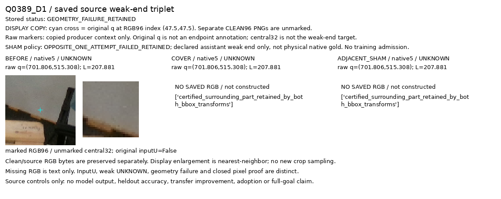

[모든 native8 저장96 보기](Q0389_D1/CONTACT_ALL8.png) · [입력 byte·상태 연결](Q0389_D1/SAVED_DISPLAY_PROVENANCE.json)

## Q0389_D2

{'pair_id': 'Q0389_D2', 'case_id': 'Q0389', 'frame_index': 48, 'source_id': 'val/000000:48', 'selected_native': 5, 'status': 'GEOMETRY_FAILURE_RETAINED', 'supported_weak_pair': False, 'old_supported_pair': False, 'new_supported_pair': False, 'stored_closed14_PASS': False, 'old5_parity': 'NOT_OLD_SUPPORTED', 'saved_variants': 'BEFORE', 'original_all8_inputU': 4, 'policy': 'OPPOSITE_ONE_ATTEMPT_FAILED_RETAINED', 'reason': '["certified_surrounding_part_retained_by_both_bbox_transforms"]', 'training_admission': False}

[모든 native8 저장96 보기](Q0389_D2/CONTACT_ALL8.png) · [입력 byte·상태 연결](Q0389_D2/SAVED_DISPLAY_PROVENANCE.json)

## Q0389_D3

{'pair_id': 'Q0389_D3', 'case_id': 'Q0389', 'frame_index': 48, 'source_id': 'val/000000:48', 'selected_native': 5, 'status': 'GEOMETRY_FAILURE_RETAINED', 'supported_weak_pair': False, 'old_supported_pair': False, 'new_supported_pair': False, 'stored_closed14_PASS': False, 'old5_parity': 'NOT_OLD_SUPPORTED', 'saved_variants': 'BEFORE', 'original_all8_inputU': 4, 'policy': 'OPPOSITE_ONE_ATTEMPT_FAILED_RETAINED', 'reason': '["certified_surrounding_part_retained_by_both_bbox_transforms"]', 'training_admission': False}

[모든 native8 저장96 보기](Q0389_D3/CONTACT_ALL8.png) · [입력 byte·상태 연결](Q0389_D3/SAVED_DISPLAY_PROVENANCE.json)

## Q0245_D1

{'pair_id': 'Q0245_D1', 'case_id': 'Q0245', 'frame_index': 30, 'source_id': 'val/000000:30', 'selected_native': 5, 'status': 'GEOMETRY_FAILURE_RETAINED', 'supported_weak_pair': False, 'old_supported_pair': False, 'new_supported_pair': False, 'stored_closed14_PASS': False, 'old5_parity': 'NOT_OLD_SUPPORTED', 'saved_variants': 'BEFORE', 'original_all8_inputU': 2, 'policy': 'OPPOSITE_ONE_ATTEMPT_FAILED_RETAINED', 'reason': '["cover_and_sham_in_frame", "sham_has_some_original_rgb96_support", "certified_surrounding_part_retained_by_both_bbox_transforms"]', 'training_admission': False}

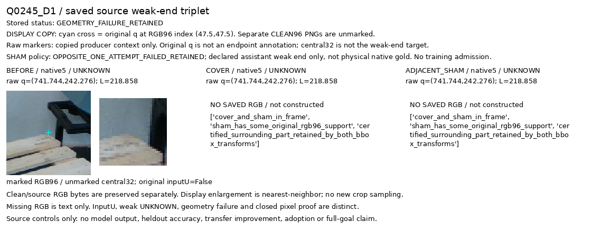

[모든 native8 저장96 보기](Q0245_D1/CONTACT_ALL8.png) · [입력 byte·상태 연결](Q0245_D1/SAVED_DISPLAY_PROVENANCE.json)

## Q0245_D2

{'pair_id': 'Q0245_D2', 'case_id': 'Q0245', 'frame_index': 30, 'source_id': 'val/000000:30', 'selected_native': 5, 'status': 'GEOMETRY_FAILURE_RETAINED', 'supported_weak_pair': False, 'old_supported_pair': False, 'new_supported_pair': False, 'stored_closed14_PASS': False, 'old5_parity': 'NOT_OLD_SUPPORTED', 'saved_variants': 'BEFORE', 'original_all8_inputU': 2, 'policy': 'OPPOSITE_ONE_ATTEMPT_FAILED_RETAINED', 'reason': '["certified_surrounding_part_retained_by_both_bbox_transforms"]', 'training_admission': False}

[모든 native8 저장96 보기](Q0245_D2/CONTACT_ALL8.png) · [입력 byte·상태 연결](Q0245_D2/SAVED_DISPLAY_PROVENANCE.json)

## Q0245_D3

{'pair_id': 'Q0245_D3', 'case_id': 'Q0245', 'frame_index': 30, 'source_id': 'val/000000:30', 'selected_native': 5, 'status': 'GEOMETRY_FAILURE_RETAINED', 'supported_weak_pair': False, 'old_supported_pair': False, 'new_supported_pair': False, 'stored_closed14_PASS': False, 'old5_parity': 'NOT_OLD_SUPPORTED', 'saved_variants': 'BEFORE', 'original_all8_inputU': 2, 'policy': 'OPPOSITE_ONE_ATTEMPT_FAILED_RETAINED', 'reason': '["certified_surrounding_part_retained_by_both_bbox_transforms"]', 'training_admission': False}

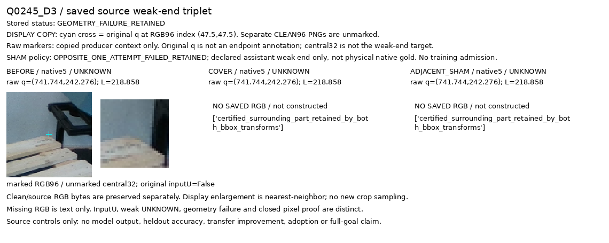

[모든 native8 저장96 보기](Q0245_D3/CONTACT_ALL8.png) · [입력 byte·상태 연결](Q0245_D3/SAVED_DISPLAY_PROVENANCE.json)

