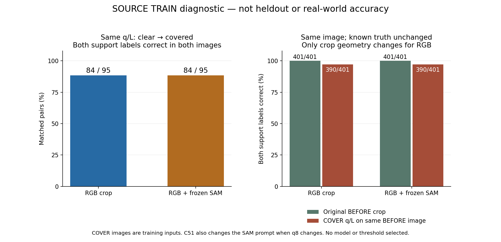

# V182 — query_visibility_source_same_query_causal_diagnosis_20261024_v182

기존 보고서에서 추출한 게시용 파생 개요입니다. 원본 파일을 수정하거나 실험·평가를 다시 실행하지 않았습니다. 원문 해시와 링크 대응은 publication manifest로 확인합니다.

**상태:** {"phase_complete":true,"selected_model":null,"adopted":false,"fully_solved":false,"goal_status":"active_unsolved"}

원본:

- [ROOT_PHASE_RESULT.json](ROOT_PHASE_RESULT.json) — SHA256 `68abc12bf6997e8d14c52ffceda64dfb0e416b690e818065a6675f2b9a78b533`
- [ROOT_READOUT_KO.html](ROOT_READOUT_KO.html) — SHA256 `5ca5a0c84a646127c32eefe177a7b479df79e36842c1c0c287a63f915d9ebb0c`
- [ROOT_RESULTS_KO.json](ROOT_RESULTS_KO.json) — SHA256 `c0d74519fd79c976e5d699ecc77241bc4cf58853637abb43a377faaebeeb1ded`

## 방법·목표의 원문 필드

자동 추출 가능한 해당 최상위 필드가 없습니다. 원문 보고서와 phase receipt를 확인하십시오.

## 입력·학습·평가 분모의 원문 필드

`$.new_training_updates`

```text
0
```


## 결론·실패·한계의 원문 필드

자동 추출 가능한 해당 최상위 필드가 없습니다. 원문 보고서와 phase receipt를 확인하십시오.

## 코드·검증·전체 표·갤러리

아래 목록은 원 보고서가 참조한 파일의 경로를 다시 연결한 것입니다. 이 개요 작성 중 이미지 내용이나 raw 평가 데이터를 새로 검사하지 않았습니다.

- [query_visibility_source_same_query_causal_diagnosis_20261024_v182/common_query_diagnostic_v1/COMPLETE.json](common_query_diagnostic_v1/COMPLETE.json)
- [query_visibility_source_same_query_causal_diagnosis_20261024_v182/frozen_common_query_sam_v1/COMPLETE.json](frozen_common_query_sam_v1/COMPLETE.json.parts.json)
- [query_visibility_source_same_query_causal_diagnosis_20261024_v182/frozen_common_query_heads_v1/COMPLETE.json](frozen_common_query_heads_v1/COMPLETE.json)
- [query_visibility_source_same_query_causal_diagnosis_20261024_v182/saved_common_query_evaluation_v1/COMPLETE.json](saved_common_query_evaluation_v1/COMPLETE.json)
- [query_visibility_source_same_query_causal_diagnosis_20261024_v182/saved_raw_cue_audit_v1/COMPLETE.json](saved_raw_cue_audit_v1/COMPLETE.json)
- [query_visibility_source_same_query_causal_diagnosis_20261024_v182/saved_crop_geometry_sensitivity_v1/COMPLETE.json](saved_crop_geometry_sensitivity_v1/COMPLETE.json)
- [query_visibility_source_same_query_causal_diagnosis_20261024_v182/public_pallox_rgb_mask_pilot_v1/COMPLETE.json](public_pallox_rgb_mask_pilot_v1/COMPLETE.json)
- [query_visibility_source_same_query_causal_diagnosis_20261024_v182/independent_actual_common_query_review_a/REVIEW.json](independent_actual_common_query_review_a/REVIEW.json)
- [query_visibility_source_same_query_causal_diagnosis_20261024_v182/independent_actual_common_query_sam_review_b/REVIEW.json](independent_actual_common_query_sam_review_b/REVIEW.json)
- [query_visibility_source_same_query_causal_diagnosis_20261024_v182/independent_frozen_head_saved_review_a/REVIEW.json](independent_frozen_head_saved_review_a/REVIEW.json)
- [query_visibility_source_same_query_causal_diagnosis_20261024_v182/independent_saved_common_query_evaluation_review_b/REVIEW.json](independent_saved_common_query_evaluation_review_b/REVIEW.json)
- [query_visibility_source_same_query_causal_diagnosis_20261024_v182/independent_source_supplemental_review_b/REVIEW.json](independent_source_supplemental_review_b/REVIEW.json)
- [query_visibility_source_same_query_causal_diagnosis_20261024_v182/independent_actual_public_pallox_review_c/REVIEW.json](independent_actual_public_pallox_review_c/REVIEW.json)
- [query_visibility_source_same_query_causal_diagnosis_20261024_v182/crop_geometry_visual_v1/COMPLETE.json](crop_geometry_visual_v1/COMPLETE.json)
- [query_visibility_source_same_query_causal_diagnosis_20261024_v182/ROOT_DISPLAY_PREPARATION_RECOVERY_AFTER_RENDER.json](ROOT_DISPLAY_PREPARATION_RECOVERY_AFTER_RENDER.json)
- [query_visibility_source_same_query_causal_diagnosis_20261024_v182/report_review_a/FINAL_REPORT_REVIEW.json](report_review_a/FINAL_REPORT_REVIEW.json)
- [query_visibility_source_same_query_causal_diagnosis_20261024_v182/ROOT_ACTUAL_VISUAL_AND_LINK_QA.json](ROOT_ACTUAL_VISUAL_AND_LINK_QA.json)
- [query_visibility_source_same_query_causal_diagnosis_20261024_v182/ROOT_ACTUAL_PALLOX_VISUAL_QA.json](ROOT_ACTUAL_PALLOX_VISUAL_QA.json)
- [query_visibility_source_same_query_causal_diagnosis_20261024_v182/common_query_gallery_visual_review_a/ACTUAL_VISUAL_QA_A.json](common_query_gallery_visual_review_a/ACTUAL_VISUAL_QA_A.json)
- [query_visibility_source_same_query_causal_diagnosis_20261024_v182/fixed_common_query_gallery_v1/COMPLETE.json](fixed_common_query_gallery_v1/COMPLETE.json)
- [query_visibility_source_same_query_causal_diagnosis_20261024_v182/ROOT_READOUT_KO.html](ROOT_READOUT_KO.html)
- [query_visibility_source_same_query_causal_diagnosis_20261024_v182/ROOT_RESULTS_KO.json](ROOT_RESULTS_KO.json)
- [query_visibility_source_same_query_causal_diagnosis_20261024_v182/ARTIFACT_INDEX.json](ARTIFACT_INDEX.json)
- [query_visibility_source_same_query_causal_diagnosis_20261024_v182/ROOT_EXECUTION_LEDGER.json](ROOT_EXECUTION_LEDGER.json)

## 원 보고서의 그림

원 보고서 참조 순서의 처음 최대4개를 표시합니다. 새 outcome 선택이나 전수 이미지 검증을 뜻하지 않습니다. 전체 갤러리는 위 원문 링크에서 확인합니다.

[query_visibility_source_same_query_causal_diagnosis_20261024_v182/scientific_readout_v1/SAME_QUERY_RESPONSE_AND_CROP_SENSITIVITY.png](scientific_readout_v1/SAME_QUERY_RESPONSE_AND_CROP_SENSITIVITY.png)



[query_visibility_source_same_query_causal_diagnosis_20261024_v182/crop_geometry_visual_v1/CARD.png](crop_geometry_visual_v1/CARD.png)


현재 사용자 목표 전체의 해결·새 모델 채택·실사 가림 원인 확정을 이 파생 개요가 추가로 주장하지 않습니다. UNKNOWN/U와 불리한 결과, 실패 실행 및 수정 provenance는 원문대로 보존해야 합니다.

큰 원문 링크는 무손실 gzip의 `.parts.json` descriptor로 연결합니다. 원문 SHA와 복원 방법은 게시 안내를 따릅니다.
