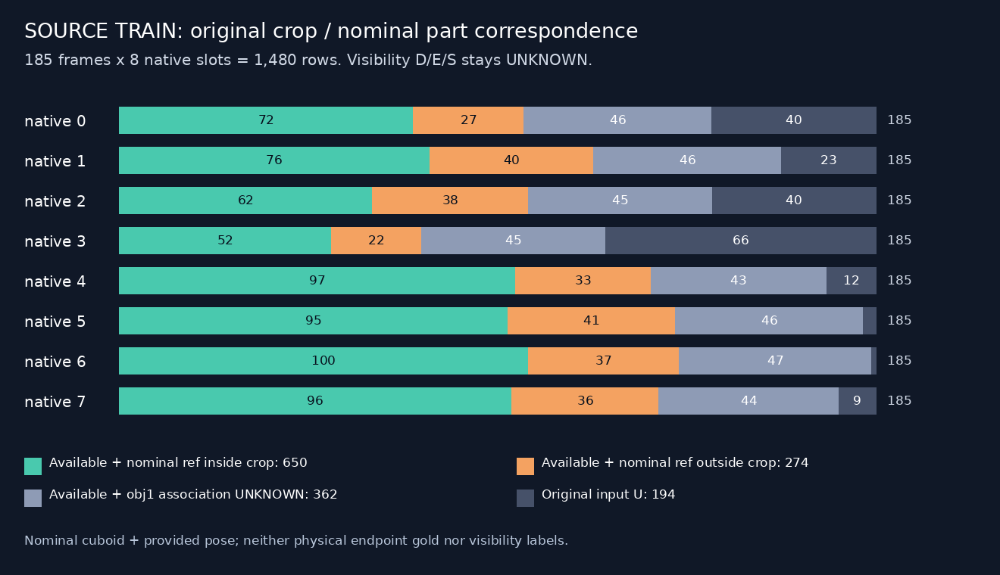
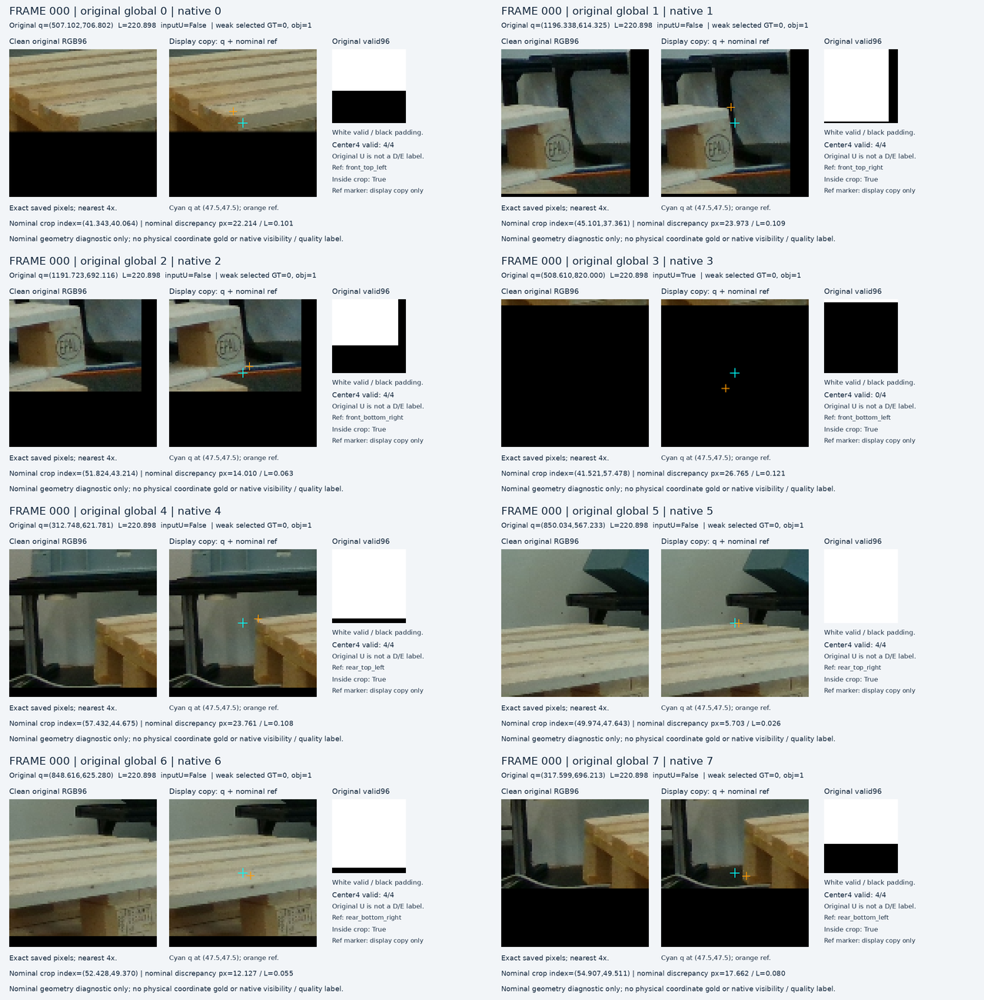
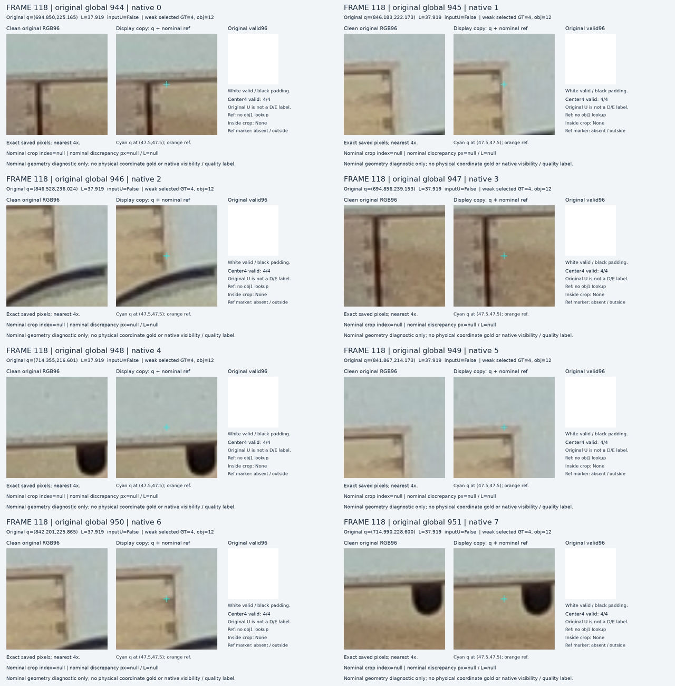
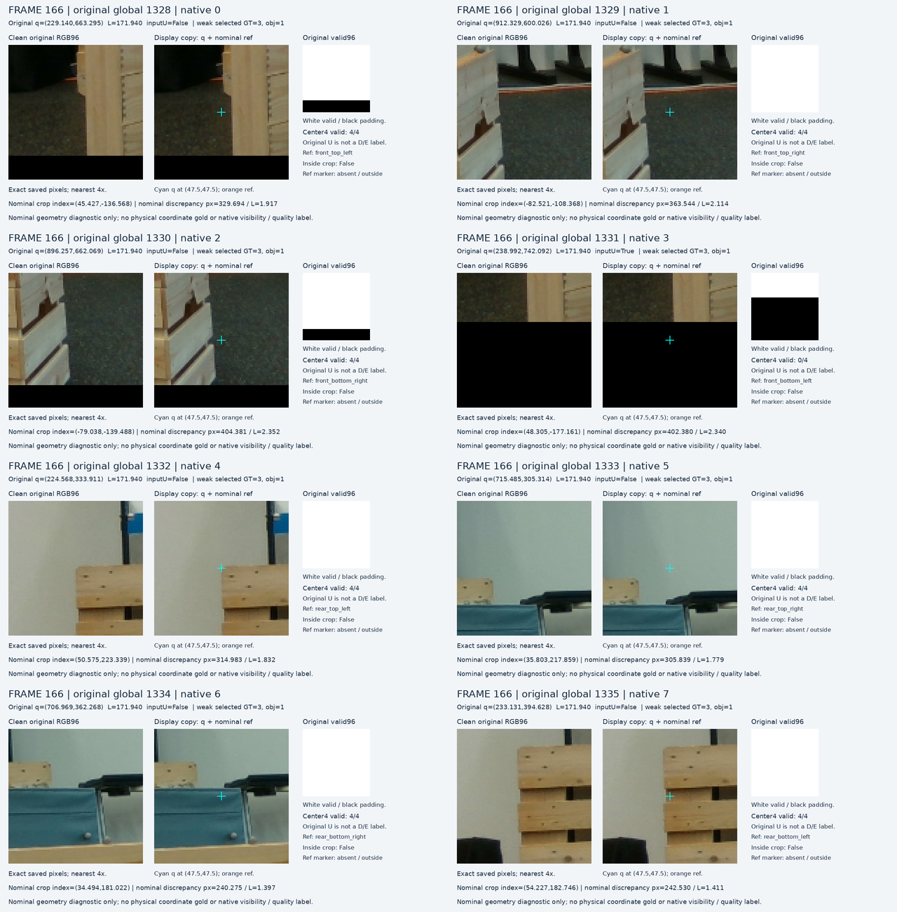
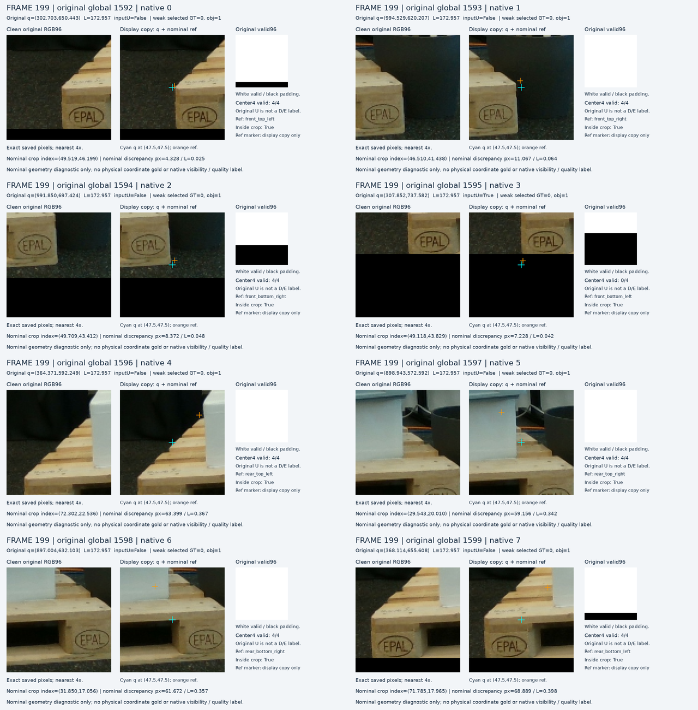

# V187 — 공개 TRAIN의 선택 물체·native 부위·원 query crop 대응

공개 TRAIN 자료에서 원래 검출 후보를 모든 GT 물체와 대조하고, 고정된 native 순서의 명목 reference를 원래 query crop에 연결했다. 185프레임·1,480 query·194 inputU를 유지했다. 새 학습·키포인트 재추론·PnP·가림 라벨 생성은 0이다. 이번 단계는 감독 신호를 잘못 연결하지 않기 위한 진단이며 모델 성능 개선 결과가 아니다.

## 무엇을 계산했나

검출 후보 번호는 GT instance 번호가 아니다. 원 검출 box와 모든 GT bbox_obj의 IoU를 계산해 양수 최대값이 유일한 경우만 약한 대응으로 남겼다. 177장은 유일한 최대값(팔레트 obj1 137장·다른 물체 40장), 8장은 겹침이 없었다. 다른 물체의 승자를 팔레트로 강제 연결하거나, query와 가까운 GT를 다시 고르지 않았다. 이 수치는 identity 정확도가 아니다.

|SOURCE 장면|전체 프레임|최대 IoU 대상 obj1|다른 obj|대응 UNKNOWN|
|---|---:|---:|---:|---:|
|000000|73|60|13|0|
|000002|48|38|9|1|
|000005|33|20|12|1|
|000006|31|19|6|6|

## 전체 query와 원 crop 범위

팔레트와 약하게 대응되고 원 입력이 가능한 924 query 중 명목 reference가 원 crop 안에 650개, 밖에 274개였다. 나머지는 입력 가능·obj1 대응 UNKNOWN 362개와 원 inputU 194개이며 모두 표에 남겼다. 명목 cuboid·제공 pose·카메라 기준 역할과 실제 물질 끝점은 다를 수 있으므로 274개를 실제 좌표 오류나 가림 정답으로 해석할 수 없다.

|native|전체|입력 가능|원 inputU|명목점 crop 안|명목점 crop 밖|입력 가능·obj1 대응 UNKNOWN|
|---|---:|---:|---:|---:|---:|---:|
|0|185|145|40|72|27|46|
|1|185|162|23|76|40|46|
|2|185|145|40|62|38|45|
|3|185|119|66|52|22|45|
|4|185|173|12|97|33|43|
|5|185|182|3|95|41|46|
|6|185|184|1|100|37|47|
|7|185|176|9|96|36|44|

[장면별 CSV](descriptive_source_tables_v1/PER_SCENE_INSTANCE_MATCH.csv) · [native별 CSV](descriptive_source_tables_v1/PER_NATIVE_ORIGINAL_CROP_COVERAGE.csv) · [전체 집계 JSON](descriptive_source_tables_v1/SUMMARY.json)

## 원본 영상과 전체32 crop

V186에서 사전에 고정한 각 TRAIN 장면의 첫 프레임 4개다. 전체 source의 성공·실패 비율을 대표하도록 뽑은 샘플이 아니다. 청록은 q, 주황은 선택된 obj1의 명목 reference이며 원본과 표시 사본을 구분한다.

[전체32 개별 crop 갤러리](fixed_source_nominal_visual_v1/PORTABLE_GALLERY_KO.md) · [offline HTML](fixed_source_nominal_visual_v1/index.html)

### FRAME 000

가장 아래 native3 query 중심은 영상 밖의 padding에 있으며 원 inputU=true가 유지된다. 명목 reference가 crop 안이라는 사실이 D/E 또는 유효 입력을 뜻하지 않는다.

### FRAME 118

원 query8가 서랍장 형태의 모서리를 따른다. 약한 bbox 대응 obj12와 일관된 다른 물체 사례이며 obj1 native reference를 대체 연결하지 않았다.

### FRAME 166

전체 장면의 세워진 팔레트·앞쪽 상자와 함께 보면 원 query8와 camera-facing 명목 역할의 대응이 크게 다르다. 모든 명목 reference가 각 원 crop 밖인 사례; 실제 물리 좌표 오차나 GT 오류라는 원인은 확정하지 않았다.

### FRAME 199

전면0..3은 query와 명목 reference가 비교적 가깝고 rear4..7은 차이가 크며 상부 적재물이 함께 보인다. 부위 역할·명목 geometry·가림을 별도로 판독해야 하며 이 기록은 D/E 어노테이션이 아니다.

## 검산과 한계

독립 scalar IoU 검산이 185프레임·823 GT observation·1,480행 전체에서 일치했다. 별도 scalar 투영·역행렬·native 순서·crop grid 검산도 258×8=2,064 reference와 1,480 lookup 전체를 확인했다. 최대 좌표 수치 차이는 2.7285e-12이며, 원 q/L/native/U와 제공 K/R/t는 정확히 보존됐다. 고정 4프레임의 전체 32 crop에서 원 RGB/valid 해시·저장 PNG 동일성을 확인했다. constructed crop은 원 sampler를 재실행했고, unconstructed slot은 원 zero placeholder를 유지했다. Root는 4 contact sheet·3 U full card·2 overview를 실제 봤고, A는 4 원본·4 overview를 실제 봤다. HTML browser rendering은 검증하지 않았다.

새 D/E/S·owner·quality·support 정답은 모두 UNKNOWN이며 학습 admission은 없다. 주변에 팔레트 면이 보인다는 사실만으로 해당 native 끝점이 보인다고 라벨링하지 않는다. 기존 사람의 semantic D/E/S 라벨을 물리 vertex 인증 부족으로 무효화하지 않는다. 현 평가 223장·공개 held45·합성 VAL의 새 본문은 읽지 않았고, 이번 단계에서 선택·보정하지 않았다. 전체 WOOD/SQUARE·native0..7 문제와 실제 전이는 아직 해결되지 않았다.

## 코드·검증·실패 원문

- [selected_instance](selected_instance_metadata_diagnostic_v2_nested_R/COMPLETE.json)

- [independent_instance](independent_instance_review_b/actual_review_v1/REVIEW.json)

- [nominal_projection](nominal_source_native_projection_v1/COMPLETE.json)

- [independent_nominal](independent_nominal_review_b/actual_review_v1/REVIEW.json)

- [descriptive_tables](descriptive_source_tables_v1/COMPLETE.json)

- [independent_tables](source_table_review_b/REVIEW.json)

- [source_visuals](fixed_source_nominal_visual_v1/COMPLETE.json)

- [root_visual_QA](ROOT_ACTUAL_FIXED_SOURCE_VISUAL_QA.json)

- [whole_image_visual_QA](actual_visual_review_a/REVIEW.json)

- [source_coverage_figure](source_coverage_figure_v1/COMPLETE.json)

- [instance 대응 코드](selected_instance_preparation_c/associate_frozen_source_instances_v2_nested_R.py)

- [명목 투영 코드](native_projection_preparation_a/project_nominal_source_native.py)

- [V1 실패 보존](selected_instance_metadata_diagnostic_v1/FAILED_EXECUTION_PRESERVED.json)

- [R 표기만 수정한 범위](ROOT_NESTED_R_NOTATION_ONLY_REPAIR_SCOPE.json)

- [원 185/1480 대응 결과 폴더](selected_instance_metadata_diagnostic_v2_nested_R/)

- [전체 258/2064/1480 명목 결과 폴더](nominal_source_native_projection_v1/)

- [정의·fixture·counterfactual 준비](witness_definition_b/)

- [집계 재현 코드](root_describe_source_correspondence.py)

- [Root 전체 결과](ROOT_RESULTS_KO.json)

## 다음 작업

Bind intended queried-end from real TRAIN RGB with explicit weak authority; construct local end-only COVER/SHAM pairs with unchanged q/L and visible surrounding part, preserving unresolved rows. Broad patch V>0 cannot stand in for native D.

이전 학습은 V183, 저장 모델 비교는 V184다. 이번 대응 계산으로 새 모델 채택이나 전체 목표 달성을 주장하지 않는다.
