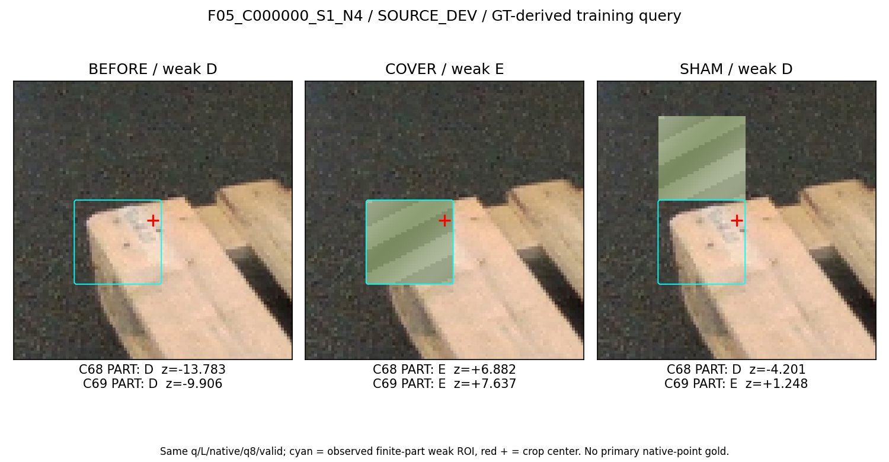
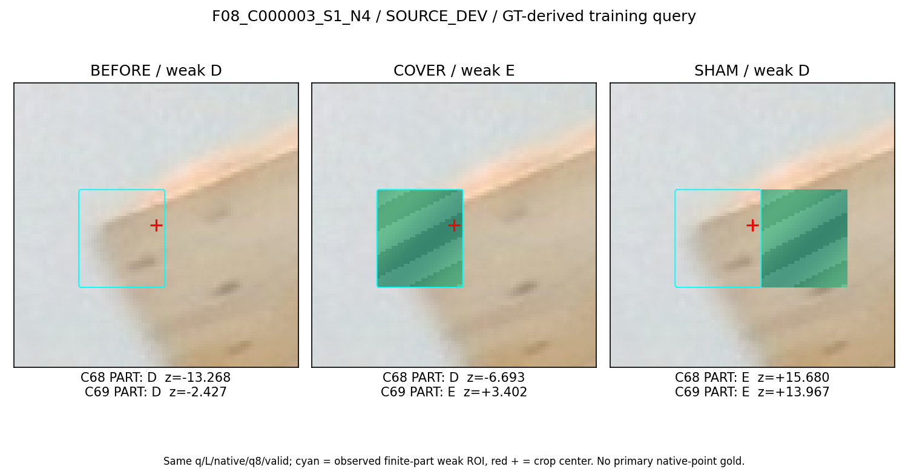

# V223: 점·부위 출력 분리 대조 — SOURCE의 공동 개선은 확인되지 않음

같은 입력과 서로 반대인 라벨이 모델을 혼란시킨다는 가설을 검사한 뒤, **합성 point0 감독과 공개 finite-part 약감독을 같은 출력에 줄지 분리할지** 실제 대조했다. C68/C69 각1,100 update를 한 번씩 완료했다. CF 검증 정답은 둘 다17/27, natural weak 검증도 둘 다9/12였다. 가림 하나를 회복했지만 보이는 상태 하나를 더 틀렸고, 세 상태를 모두 맞힌 CF 묶음은2/9→1/9로 줄었다. 출력 분리만으로 문제를 해결하지 못했다. 모델 선택·채택은 없다.

현재 사용자 평가223장에 새 추론·학습·문턱 적합을 하지 않았고 PnP도0이다. 최신 실사/v61/기존 가림 모델 비교는 [V220 동결 보고서](../query_visibility_expected_part_weak_frozen_real_benchmark_20261025_v220/PORTABLE_REPORT_KO.md)다. 이번 C68/C69의 실사 개선은 아직 측정하지 않았다. **별도 공개 보류 metadata360행 eager-parse 범위 예외**가 이 phase의 경로 조사 중 있었으며 아래에 공개한다. phase 전체의 보호 metadata 접근0을 주장하지 않는다.

## 1. 라벨 모순과 주소를 먼저 확인한 결과

기존 strong은 합성 own-image의 point0에 대한 ray/state 감독이다. query 중심 pixel 라벨이나 real native점 gold와 같지 않다. natural weak와 CF는 관찰자가 본 expected finite-part 영역에 대한 별도 약감독이다. 그 영역을 덮으면 weak E, 보존하면 weak D로 정의했으며 `native_point_DE_target=-1`을 유지한다. 가려진 점의 semantic visibility, query-pixel presence, finite-part bag visibility를 서로 재명명하지 않았다.

첫 metadata 검사에서 strong6096과 natural57/CF144 사이의 필수 FP32 condition32 일치가0쌍이었다. 정규화 조건은 같지만 다른 jitter crop인204쌍은 decoded RGB fingerprint가 없어 모순이라고 세지 않았다. 이후 실제 학습 decoder가 이미 읽은 입력으로 공통 fingerprint를 저장해 이 한계를 닫았다. 대상은 strong6096 + natural57 + CF144 =6297행, 서로 다른 입력 signature3638개, 중복 unordered pair6132개, **동일 입력에 반대 D/E인 그룹0개**였다. 이 범위에서 exact-input 라벨 모순은 발견되지 않았다. 모든 과거 데이터·라벨 전체의 무모순 증명이 아니며, 다른 의미의 두 목표를 한 출력에 학습시키는 일이 무해하다는 뜻도 아니다.

Fingerprint는 uint8 RGB96, bool valid96, int64 native, FP32 other-mask8·other-XY16을 같은 순서/형식으로 해시했다. 고정 XY-grid/SAM-zero와 RGB /255 조립은 공통이다. 원 GT나 보호 픽셀을 추가로 읽지 않았다. natural D48과 CF BEFORE48은 같은 입력·같은 D이며 FIT39는 손실에서 중복 factual 가중을 받는다. 서로 겹치는 평가 family를 합산한 headline은 만들지 않았다.

ROI 주소 감사에서는48부모 중 COVER가 crop 중심의4 raster sample을 비운 것이22개(FIT17/DEV5)였다. weak ROI centroid와 crop 중심의 거리는 RAW96 raster에서 median17.882px이었다. **이는 키포인트 GT 좌표오차≤3px와 다른 지표**이며, ROI centroid는 물리적인 점 GT가 아니다. 동일 condition32에서 ROI가 다른16그룹은 모두 같은 nominal witness의 jitter 형제였고 RGB가 서로 달랐다. 따라서 이미지까지 포함한 입력이 근본적으로 부족하다고 증명한 것은 아니다. 현재 q8이 encoder/pool 뒤에 합쳐진다는 구조적 사실도 실패 원인의 인과 증명은 아니다.

## 2. 실제 한 변수 대조

| 조건 | C68 shared control | C69 separate |
|---|---|---|
| 초기값 | 같은 V219 C65 | 같은 V219 C65 |
| 구조 | POINT/PART 두 출력,121561 parameters | 같은 구조·parameter 수 |
| PART 초기화 | 로드된 POINT direct/spatial head를 비공유 복제 | 같은 복제·전체 초기 tensor hash |
| strong point0 loss | PART에 전달 | POINT에 전달 |
| natural·CF finite-part loss | PART에 전달 | PART에 전달 |
| 공통 encoder·기존5개 task | 그대로 | 그대로 |
| 학습 | 1100 update | 1100 update |

C68의 POINT3202 parameters/6tensors는 의도적으로 사용하지 않아 gradient·AdamW state가 없다. C69는 두 출력을 모두 사용한다. 구조/초기값은 같지만 활성 task-head 수가 같다는 주장은 하지 않는다. encoder는 공유하므로 모든 목표 간 간접 영향까지 없앤 대조가 아니다. C65 warm start에는 과거 목표 혼합 이력이 남는다. scratch의 순수 분리 모델을 시험한 결과가 아니다.

두 팔 모두 동일한 old192 + strong32 + natural16 + CF4부모×3 =252행을 같은4개 RNG로 추출했다. optimizer를 비우고 AdamW lr.001/wd.0001/clip5를 썼다. 기존5개 loss + strong balanced BCE +.25 natural balanced BCE +.25 CF parent BCE(.25 BEFORE D+.5 COVER E+.25 SHAM D)를 유지했다. 바뀐 것은 strong loss의 출력 경로다. 새 backbone·GT ROI/reference/pose/mask 입력·라벨·문턱·데이터 선별은 없다. 새 probe·seed search·학습 재실행은0이다. 예산1100은 점수를 보기 전에 고정했다.

SOURCE는 V222와 정확히 같은 CF FIT39/DEV9묶음, natural FIT45(D39/E6)/DEV12(D9/E3), strong TRAIN6096(D5853/E243)이다. CF48은 nominal19+jitter29이고 독립 장면48개가 아니다. CF DEV는2 frame/component의4 nominal 부위와 jitter다. GT-derived 공개 학습 q8이며 production initializer query 전이를 증명하지 않는다. native2/6/7의 이 CF 부위 감독도 없다. 두 final checkpoint를 동결한 뒤 새 DEV 출력을 만들었고 DEV는 loss/pool/normalizer에서 제외했다. 개발 자료는 과거 관찰됐으므로 새 blind test가 아니다.

[실제 학습 완료](paired_source_fit_v1/COMPLETE.json) · [두 모델 선동결](paired_source_fit_v1/ALL2_FINAL_FROZEN_BEFORE_ANY_DEV_OR_REAL_OUTPUT.json) · [입력 fingerprint](paired_source_fit_v1/SOURCE_INPUT_FINGERPRINTS.json)

## 3. 혼동행렬·precision/recall·보류율

CM은 정답 D/E 행, 예측 D/E/U 열이다. primary finite-part 평가는 두 모델 모두 PART를 썼다. strong TRAIN 점수만 실제 감독받은 출력(C68 PART/C69 POINT)을 썼으며 이를 같은 PART 목표 성능으로 비교하지 않는다. z>=0을 E로 하는 고정 이진 판정이다. U0%는 보류 정책이 없는 결과이며 불확실성이 해결됐다는 뜻이 아니다.

| 분리한 평가 | C68 | C69 |
|---|---:|---:|
| CF FIT39묶음 세 상태 모두 정답 | 39/39 | 39/39 |
| CF FIT117 CM | [[78,0,0],[0,39,0]] | [[78,0,0],[0,39,0]] |
| CF DEV27 CM | [[14,4,0],[6,3,0]] | [[13,5,0],[5,4,0]] |
| CF DEV D precision / recall | 70.00% / 77.78% | 72.22% / 72.22% |
| CF DEV E precision / recall | 42.86% / 33.33% | 44.44% / 44.44% |
| CF DEV 전체 정답 | 17/27 | 17/27 |
| CF DEV BEFORE D / COVER E / SHAM D 정답 | 7/9 ·3/9 ·7/9 | 7/9 ·4/9 ·6/9 |
| CF DEV 세 상태 모두 정답 | 2/9 | 1/9 |
| natural DEV12 CM | [[7,2,0],[1,2,0]] | [[7,2,0],[1,2,0]] |
| natural DEV D precision / recall | 87.50% / 77.78% | 87.50% / 77.78% |
| natural DEV E precision / recall | 50.00% / 66.67% | 50.00% / 66.67% |
| natural DEV 전체 정답 | 9/12 | 9/12 |
| natural FIT 전체 정답 | 45/45 | 45/45 |
| strong TRAIN 실제 routed logit 정답 | 6096/6096 | 6096/6096 |
| 알려진 행의 U율 | 0% | 0% |

CF DEV 동일 행에서 E1개 회복/D1개 손상으로 순변화0이다. 가림 recall만은1/9 늘었으나 보이는 상태를 보존하는 성능과 묶음 정합성이 함께 개선되지 않았다. natural57의 판정 변화는0이다. 중심4 sample은 비우고 부위를 가린 DEV COVER5개는 둘 다1/5, 목표 부위를 유지하며 중심 sample 일부를 가린 SHAM3개는 둘 다3/3이었다. FIT 완전 정답은 학습 적합도다.

확장 shared control C68은 V222 C67의 저장 SOURCE6297개 logit과 **전부 bit-exact**했다(CF144/natural57/strong6096 최대 차이0, 판정 변화0). 이는 대조 기준 구현이 재현됐다는 증거이며 실사 전이 검증이 아니다.

[전체 수치 JSON](saved_source_comparison_v1/SOURCE_COMPARISON.json) · [CM·두 클래스 P/R 표](saved_source_comparison_v1/SOURCE_FAMILIES_SEPARATE_CM_PRECISION_RECALL.csv) · [DEV9묶음 전체 crop](saved_source_comparison_v1/PORTABLE_GALLERY_KO.md)

## 4. 실제로 달라진 두 사례

F05 S1 N4: 목표 부위를 보존한 SHAM을 C69가 새로 E로 오판해, 세 상태 완전 정답 하나를 잃었다.

F08 S1 N4: C69가 COVER를 회복했지만 SHAM의 E 오판이 남았다. 가림막 위치에 따른 부위 관계를 안정적으로 읽는 데 아직 실패한다.

Root는 이 두 변화 사례와 유지된 성공 F05S0N4·실패 F05S0N1의 최종 그림4장을 직접 확인했다. 전9장은 갤러리에 모두 보존했다. 청록 ROI와 빨간 중심은 표시만이며 학습 RGB에 없다. 원 부위 약감독이 실제 native 점 gold라는 의미도 아니다.

## 5. 접근 범위 예외와 재현 한계

실제 모델 QA도1회 PASS했다. 새 checkpoint2개와 지정된 C65 warm checkpoint1개를 검사해 C68 POINT6tensor가 C65와 정확히 같고 optimizer는 사용36개, C69는42개 상태가 각각1100 step임을 확인했다. 두 모델 모두121561 parameters/42finite state tensors이고 초기 확장 state와 공통 draw가 같다. 2200개 로그의 mask/hash/loss 합을 검산했다. CF144 PART CPU 재생의 최대 logit 차이는 C68 1.91e−5/C69 1.24e−5로 고정 허용치1e−4 이내였고 모든 판정 부호가 같았다. CF144의 effective-input fingerprint도 픽셀에서 독립 재구축했다. old192의 클래스 조건부 RNG는 원 target NPZ를 다시 열지 않아 완전히 재구성하지 않았고, strong/natural RGB는 재추론하지 않았다. QA PASS는 구현 검증이지 목표 해결 판정이 아니다.

[실제 모델·로그·CPU replay QA](provenance/V223_ACTUAL_MODEL_QA_A/actual_review_v1/REVIEW.json)

공개 SOURCE 경로 조사 담당 C가 V181 포인터를 따라 V159의 혼합 metadata JSONL을 eager parse했고, 그 안에 보류한 SOURCE_VALIDATION360행도 있었다. 허용 범위를 벗어났으므로 scope_compliance:false로 기록했다. 그360행의 값·분포·성능은 Root/A/B에게 전달되지 않았고 이번 설계·데이터 선택·학습·정규화·문턱·모델 선택에 사용하지 않았다. 추가 읽기를 중지했다. 모델 설계 근거는 이미 허용된 V222 SOURCE 결과와 공개 코드의 shared scalar 구조였다. 이 예외를 감추거나 phase 전체 보호 metadata 접근0/PASS라고 하지 않는다. 현재223 RGB/GT/특징/score를 이번에 읽거나 새 추론한 것은0이다.

[Root 범위 예외·조치](provenance/V223_ROOT_PREPARATION/ROOT_SCOPE_EXCEPTION_AND_CONTAINMENT.json) · [C의 비준수 범위 영수증과 readiness](provenance/V223_PUBLIC_SOURCE_COVERAGE_C/READINESS.json)

V109에는 자연 YCB surface teacher8000, V113에는 wood/foam teacher3200의 기존 이력이 있다. V176의 YCB-donor CF owner 학습과 서로 다른 자료다. 따라서 YCB depth/mask teacher 또는 paired supervision을 새 아이디어·미시도라고 말하지 않는다. YCB 표면 teacher는 auxiliary associated-surface이며 pallet native 의미를 자동 인증하지 않는다. 공식 [YCB-V annotation 형식](https://github.com/yuxng/YCB_Video_toolbox)과 [BOP 데이터 형식](https://github.com/thodan/bop_toolkit/blob/master/docs/bop_datasets_format.md)은 공개 pose/depth/mask 정보를 설명하지만, 이 사실만으로 현재 약감독의 키포인트 대응이 해결되지는 않는다.

입력 NPZ·상위 C65 원가중치·원 공개 전체 데이터는 이 phase에 복제하지 않고 기존 경로/SHA로 묶었다. 새 두 checkpoint와 실행 코드·로그·표·그림·QA는 원바이트로 보존한다. 외부 데이터가 없는 환경에서 보고서만으로 전체 학습을 즉시 재실행할 수 있다는 주장은 하지 않는다.

## 6. 다음에 해결할 것

동일 입력의 반대 라벨 오류는 이번6297행에서 찾지 못했고, 직접 출력 경로 분리도 공동 개선을 만들지 못했다. 이것만으로 모든 목표 간 간섭이 없다고 결론내릴 수는 없다. 공유 encoder·warm start·좁은 부위/장면·q8의 late fusion·GT-derived 학습 query와 생산 초기query 차이가 남아 있다. 물리 native gold·자연 외부 가림 일반화·보류 정책·실제 목재/정사각형 성능 개선도 미해결이다. SELF는 상류 기하 처리와 구분하며 위치 보정·PnP는 하지 않는다.

다음은 이미 존재하는 공개 natural surface teacher를 실제 RAW96 query/reference 의미·SELF/U 정의·TRAIN-only lineage에 맞춰 연결할 수 있는지 확인하고, 관찰 부위를 읽는 공간 표현과 자연 외부 가림 범위를 한 요인씩 검증하는 것이다. 같은 단순 출력 분리나 더 많은 epoch를 성공 처방으로 반복하지 않는다. 새로운 데이터는 현재 평가223에서 가져오지 않는다. 목표는 계속 진행 중이다.

[Root 결과](ROOT_RESULT.json) · [코드·실행·QA 원문 보존 목록](provenance/ARCHIVE_MANIFEST.json)
