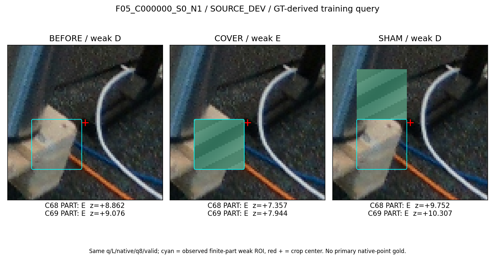
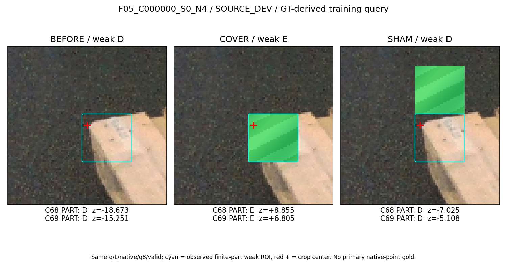
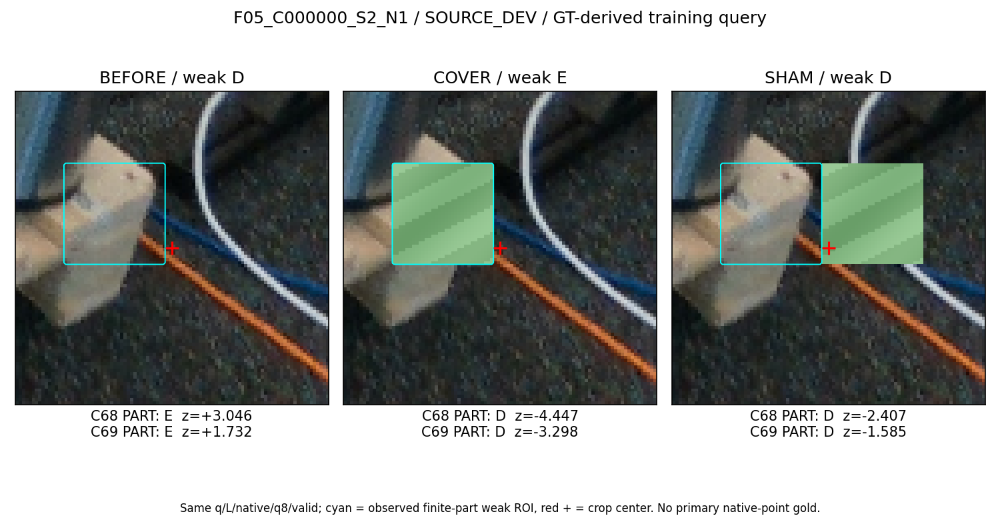
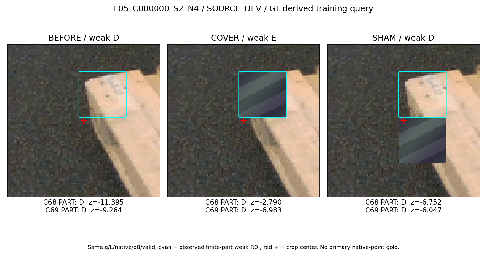
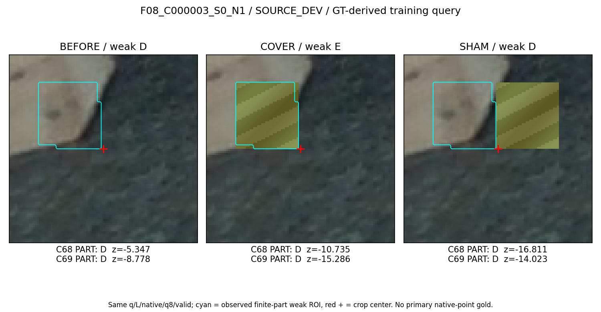
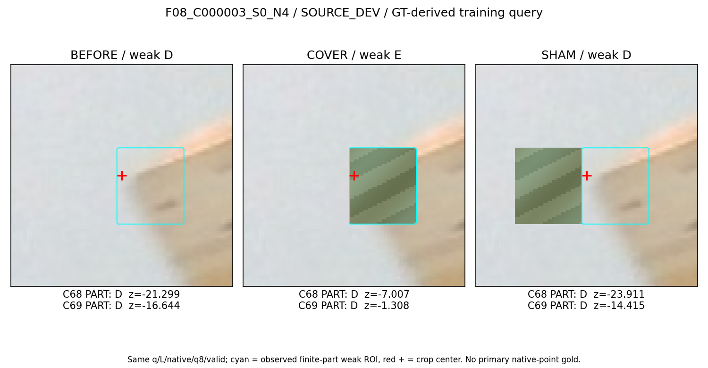
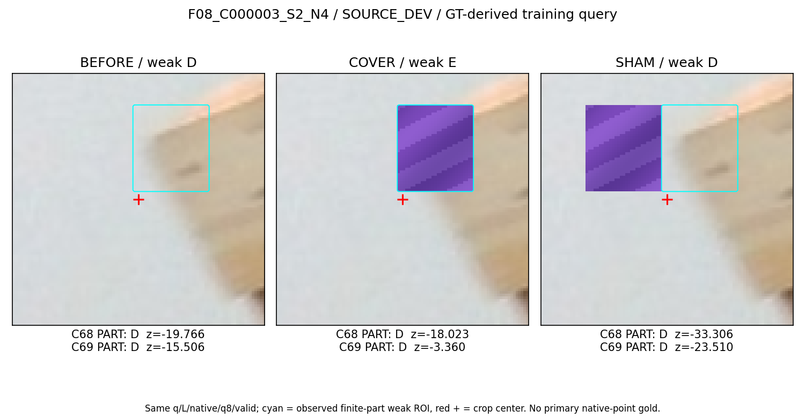

# All9 SOURCE DEV triplets with frozen C68/C69 outputs

GT-derived parent query; finite-part weak target, not native-point gold. Center + and cyan ROI are display annotations only. All training RGBs remain unmarked. Two frame/components; correlated nominal/jitter examples.

## F05_C000000_S0_N1

## F05_C000000_S0_N4

## F05_C000000_S1_N4

## F05_C000000_S2_N1

## F05_C000000_S2_N4

## F08_C000003_S0_N1

## F08_C000003_S0_N4

## F08_C000003_S1_N4

## F08_C000003_S2_N4

