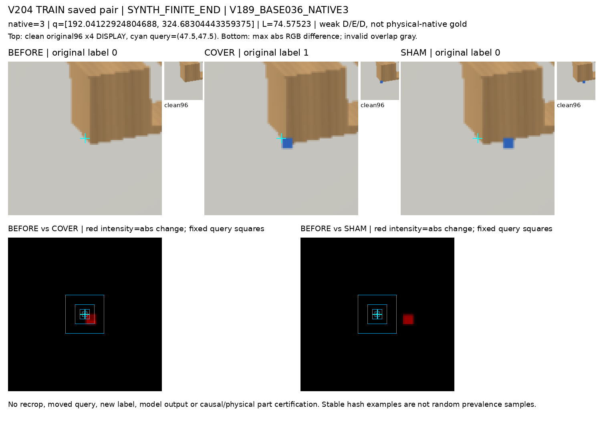
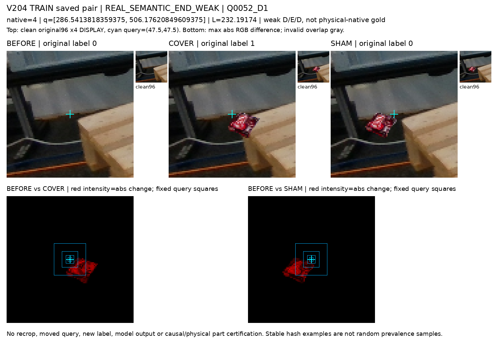

# V204 학습 자료의 query·가림 라벨 대응 진단

**현재 직접 가림 라벨은 선택한 끝부분의 상태를 가르칩니다. 원 query의 중앙 픽셀 상태와 항상 일치하지 않습니다.** TRAIN 109쌍 중 COVER 64쌍은 중앙 2×2에 변화가 없고, SHAM 6쌍은 중앙 2×2에 변화가 있었습니다. 중앙 변화만으로 native 가림 라벨을 맞거나 틀리다고 판정할 수는 없습니다.

## 원 query에서 무엇이 바뀌었나

아래는 중앙 창 안에 유효 RGB 변화가 하나 이상 있는 쌍의 수입니다. 원 RAW96의 중심(47.5,47.5), 사전 고정 창, max-channel absRGB≥1을 사용했습니다. 8·32 threshold와 개별 행은 원표에 모두 보존했습니다.

|source|pair|TRAIN 쌍|2×2|4×4|6×6|12×12|24×24|
|---|---|---:|---:|---:|---:|---:|---:|
|SYNTH_FINITE_END|COVER|82|30|36|45|65|76|
|SYNTH_FINITE_END|SHAM|82|2|2|2|8|34|
|REAL_SEMANTIC_END_WEAK|COVER|27|15|17|20|22|25|
|REAL_SEMANTIC_END_WEAK|SHAM|27|4|5|7|11|17|

전체 96×96에서는 COVER·SHAM 모두 109쌍 전부 변화했습니다. 6×6 중앙 창이 그대로인 COVER는 44/109, 24×24가 그대로인 COVER도 8/109입니다. 합성 COVER의 변화 픽셀 수는 36–100, 실사 기반 COVER는 283–2,633이었습니다. 크기·위치가 학습 지름길이 될 가능성은 남지만 실제 모델이 이를 사용했는지는 이번에 측정하지 않았습니다.

그림 위는 원 crop의 확대 표시이고 아래는 같은 query에서 비교한 변화량입니다. 작은 clean96가 원 입력이며 cyan cross는 표시용입니다. 실제 본 사례 수는 A 2개, root 2개(동일 사례), C 3개(다른 사례)입니다. 전체 12개 갤러리나 109쌍을 사람이 모두 판독했다는 뜻은 아닙니다.

## 공개 실사를 어떻게 사용했나

|자료|실제 TRAIN 범위|현재 감독의 의미|
|---|---|---|
|MR6D 원본 public|155프레임·4 source prefix, 1,240행, input U161|owner known239행/81프레임. TARGET/FOREIGN/BACKGROUND 중심 owner이며 native D/E gold가 아님|
|실사 기반 직접 끝부분 통제|12프레임·27 D/E/D쌍·1 connected component|선택한 finite-end 약라벨 81행. 새 자연 가림 native 라벨 81개라는 뜻이 아님|
|실사 기반 CF|46원프레임·159쌍·477변형·3,816행|owner known314행, 별도 약한 감독|
|YCB-V|59프레임·59 cutout·7장면·10객체 ID|외부 가림물 donor. 팔레트 native 보임 라벨의 출처가 아님|

MR6D의 published val 이름과 내부 SOURCE TRAIN 역할은 다릅니다. 허용된 기존 TRAIN은 val/000000·000002·000005·000006이며 publicheld의 원본은 열지 않았습니다. 103 graph component를 103개 독립 촬영으로 해석하지 않습니다. 원 프레임에서 관찰된 obj1 GT 인스턴스 220개와 query가 선택한 대상 인스턴스의 대응은 별개이며 아직 UNKNOWN입니다.

새로 조회한 MR6D 저장소는 기존에 쓰던 것과 **동일 저장소·동일 리비전**이었습니다. 새 데이터셋을 발견했다고 주장하지 않습니다. dynamic/mr/odyn이 기존 val 영상의 원 촬영과 겹치는지는 확인되지 않아 새 영상·GT payload를 받지 않았습니다. 공개 API 목록·객체명·README만 확인했습니다. [정정과 접근 범위](ROOT_MR6D_EXISTING_SOURCE_PROVENANCE_CLARIFICATION.json)

## 라벨·loss에서 확인한 것

직접 E는 선택한 finite-end의 COVER이며 다른 native·UNKNOWN을 E로 채우지 않습니다. TRAIN 2,784행 중 known D218/E109, UNKNOWN2,457, input U112를 보존했습니다. 합성 82쌍은 41base/41component, 실사 기반 27쌍은 12frame/1component입니다.

합성 COVER 82개는 broad support가 visible=1·foreign=1인 동시에 direct E=1입니다. 가린 끝부분 주변의 다른 구조는 보일 수 있으므로 의미가 다릅니다. 별도 출력이어서 동일 output에 모순 라벨을 강제한 증거는 없습니다. old5.mean+direct1은 backbone을 공유하지만 gradient 간섭·전이 실패의 인과는 이번 진단에서 입증하지 않았습니다. metadata RGB/valid hash의 D/E 충돌은 0이었으며, 전체 문맥 입력이 완전히 동일하다는 검사로 확대하지 않습니다.

## 다음에 바꿀 자료의 단위

V205는 기존 TRAIN의 다른 6프레임·원 native 48개를 사전 고정해 full frame과 원 crop을 함께 확인하는 파일럿으로 준비합니다. 목표는 자연 영상에서 선택한 대상과 의도한 native 부위의 보임 D, 외부 가림 E, 자기 가림 S, query 위치 이탈, UNKNOWN을 분리한 source 약한 관찰입니다. 주변에 아무 팔레트가 보이는 것만으로 D, 아무것도 안 보이는 것만으로 E를 주지 않습니다. 두 관찰자가 판단한 근거와 불일치를 남기며 human 평가 gold로 승격하지 않습니다.

이번 V204는 라벨 변경·새 학습·가중치/모델 forward·PnP·원 q/L/native 수정 없이 진행했습니다. 현재223장·publicheld·COMMON·기존 VAL 및 source HOLDOUT 결과를 읽어 새 문턱이나 모델을 고르지 않았습니다. 전체 목표는 미해결입니다.

## 표·코드·검산

- [실제 고정12 source crop 갤러리](paired_pixel_alignment_a/actual_train_pixel_alignment_v1/PORTABLE_GALLERY_KO.md)
- [전체 수치와 분모 JSON](paired_pixel_alignment_a/actual_train_pixel_alignment_v1/SUMMARY.json)
- [3,270개 window 기록](paired_pixel_alignment_a/actual_train_pixel_alignment_v1/QUERY_CENTER_FIXED_WINDOWS.csv)
- [654개 whole96 기록](paired_pixel_alignment_a/actual_train_pixel_alignment_v1/PAIR_WHOLE96_THRESHOLDS.csv)
- [원 pixel 진단 코드](paired_pixel_alignment_a/diagnose_train_paired_pixel_alignment.py)
- [독립 수치·3개 실제 그림 검토](independent_pixel_diagnostic_review_c/REVIEW.json)
- [공개 source의 수와 원 경로](public_source_coverage_b/KO.md)
- [라벨·loss 코드 근거](label_loss_contract_c/KO.md)
- [외부 공식 metadata와 출처](external_primary_sources_root/ATTRIBUTION_AND_READOUT_KO.md)
