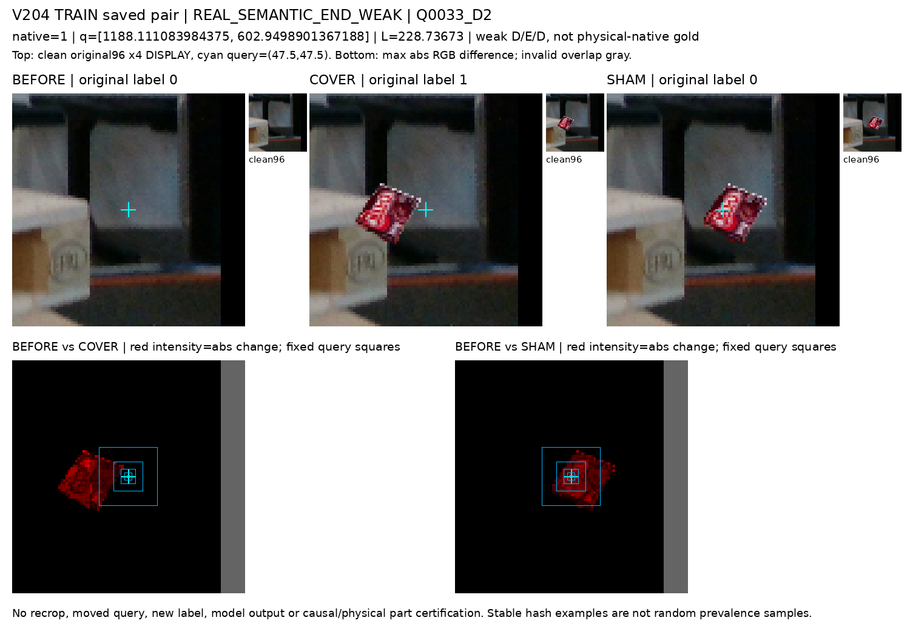
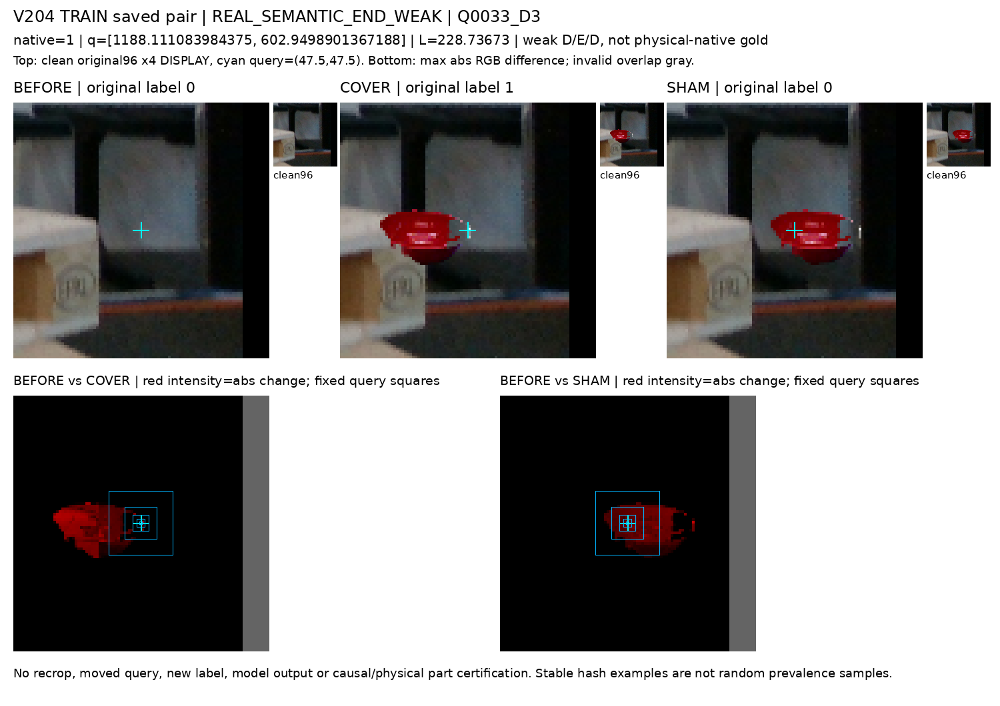
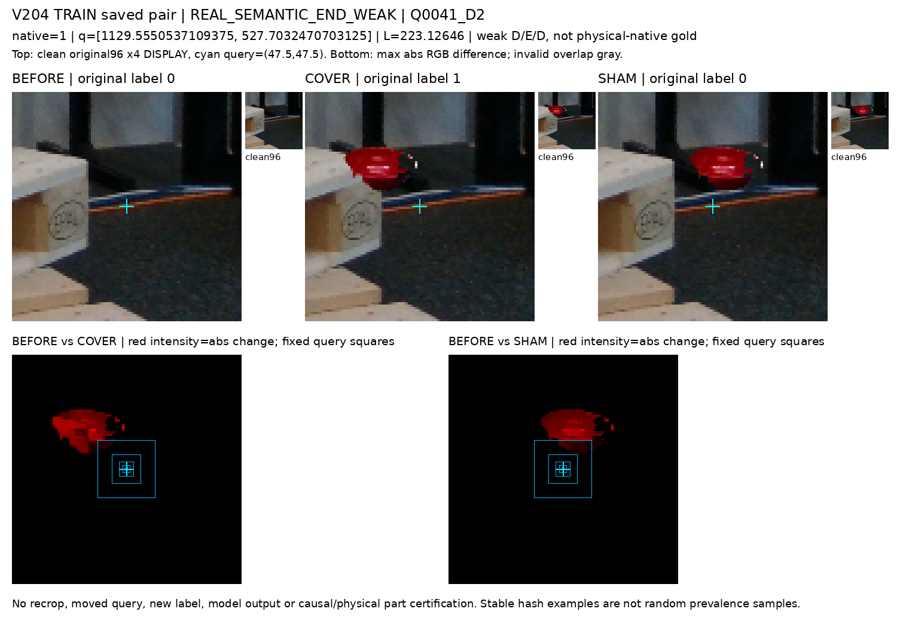
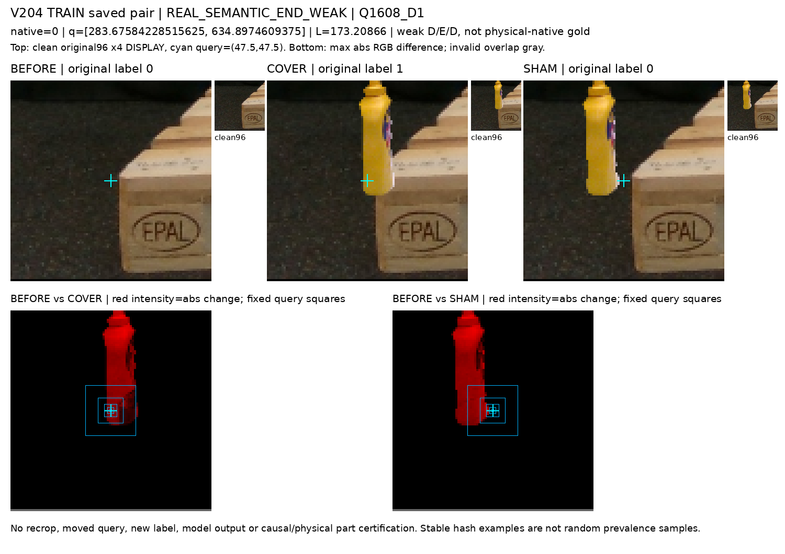
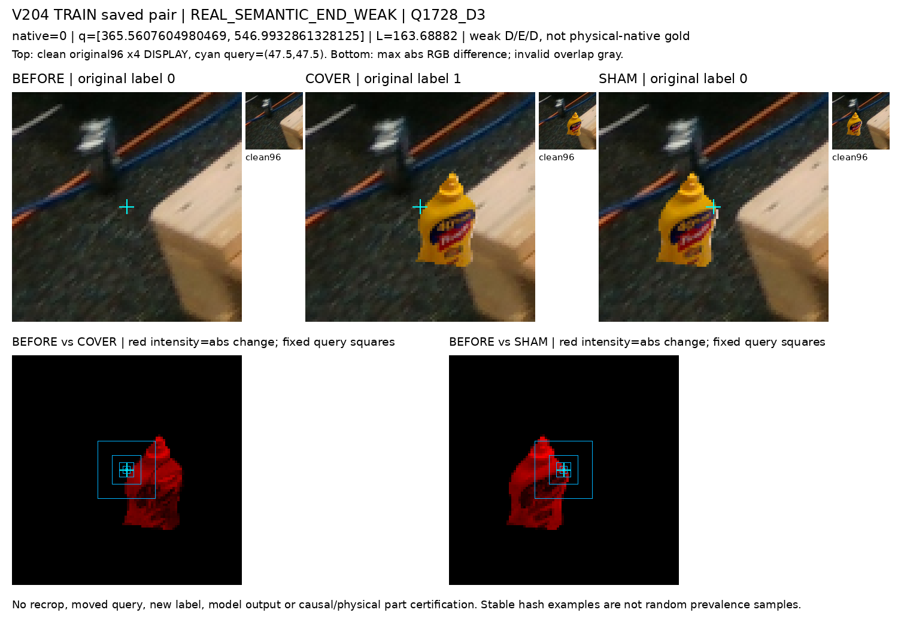
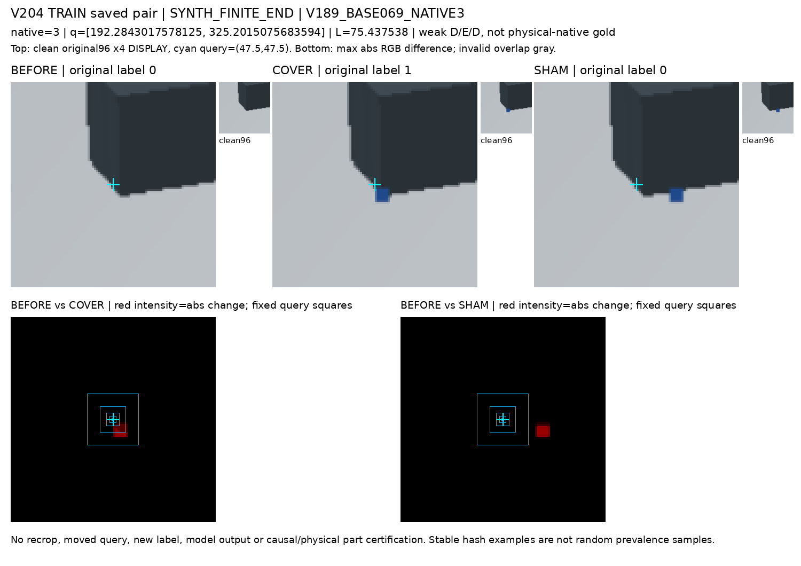
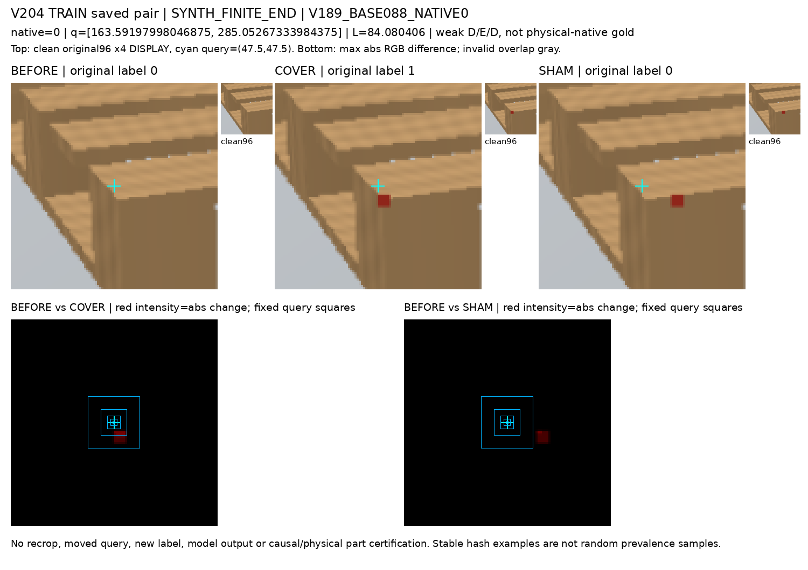
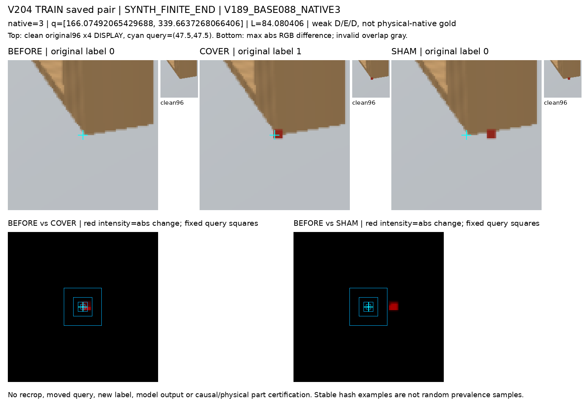
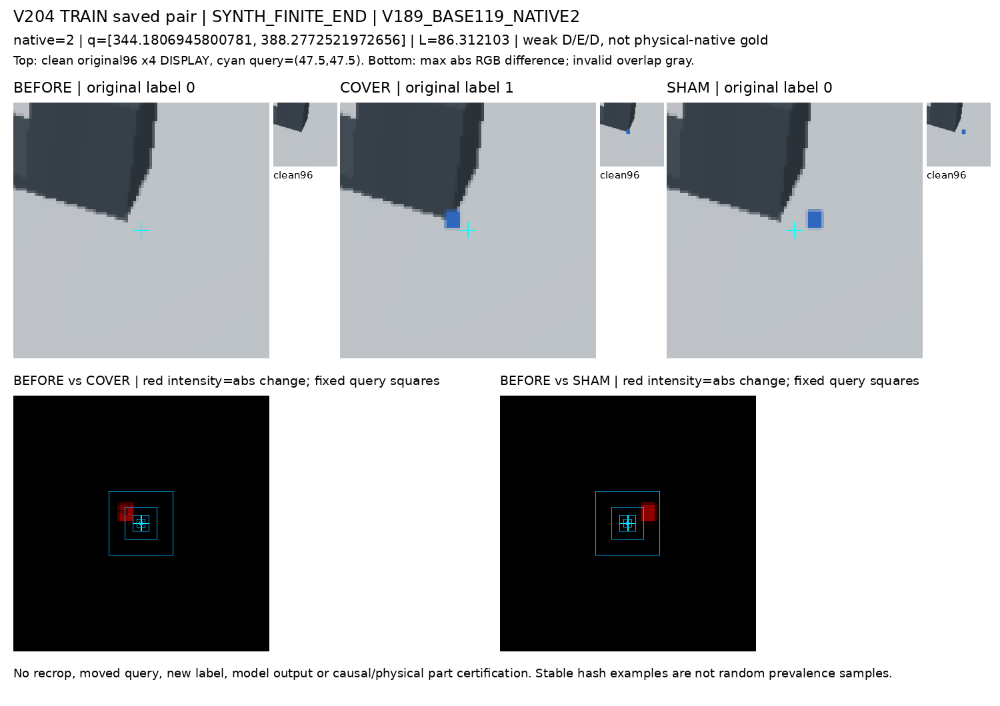
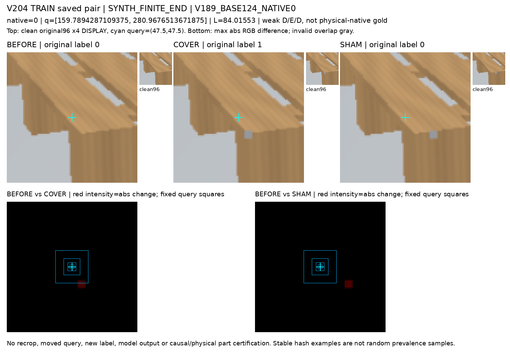

# V204 TRAIN paired pixel / 원 query 정렬 진단

TRAIN109 known D/E/D(합성82·공개실사 weak27)를 동일 원 q/L/native에서 비교했다. 두 source 권위는 서로 다르며 human native gold가 아니다. threshold는고정 maxabsRGB≥1/8/32이고valid intersection만 센다.

[수치요약](SUMMARY.json) · [window 전3270행](QUERY_CENTER_FIXED_WINDOWS.csv) · [window 집계90행](QUERY_CENTER_WINDOW_SUMMARY.csv) · [whole96 전654행](PAIR_WHOLE96_THRESHOLDS.csv) · [allnative TRAIN UNKNOWN/U 분모](TRAIN_ALL_NATIVE_TARGET_STATUS.csv)

그림은 입력 변경이 없는 원 crop의 표시 사본과 차이 heatmap이다. q가 아닌 곳의 edit가 원 finite-end를 가렸는지, 모델이 그 정보를 사용했는지까지 인증하지 않는다. stablehash 각source6은 무작위 대표표본이 아니다.

## Q0033_D2

## Q0033_D3

## Q0041_D2

## Q0052_D1

## Q1608_D1

## Q1728_D3

## V189_BASE036_NATIVE3

## V189_BASE069_NATIVE3

## V189_BASE088_NATIVE0

## V189_BASE088_NATIVE3

## V189_BASE119_NATIVE2

## V189_BASE124_NATIVE0

## 한계

- Only saved known TRAIN109 triplets; full TRAIN allnative UNKNOWN/U administrative census retained.
- Opaque container verification/unpack physically includes originalHOLDOUT rows; only TRAIN takes are compared or reported.
- Weak finite-end D/E/D authority is unchanged, not human native or physical point gold.
- This measures intervention pixel location relative to the originalquery, not endpoint identity or cause of model errors.
- Changed pixels away from query can coexist with a valid finite-end intervention; no target/label correction or admission decision.
- All inputs copied from immutable saved cache, no resampling/newquery/model/fit/weights/protected evaluation.
