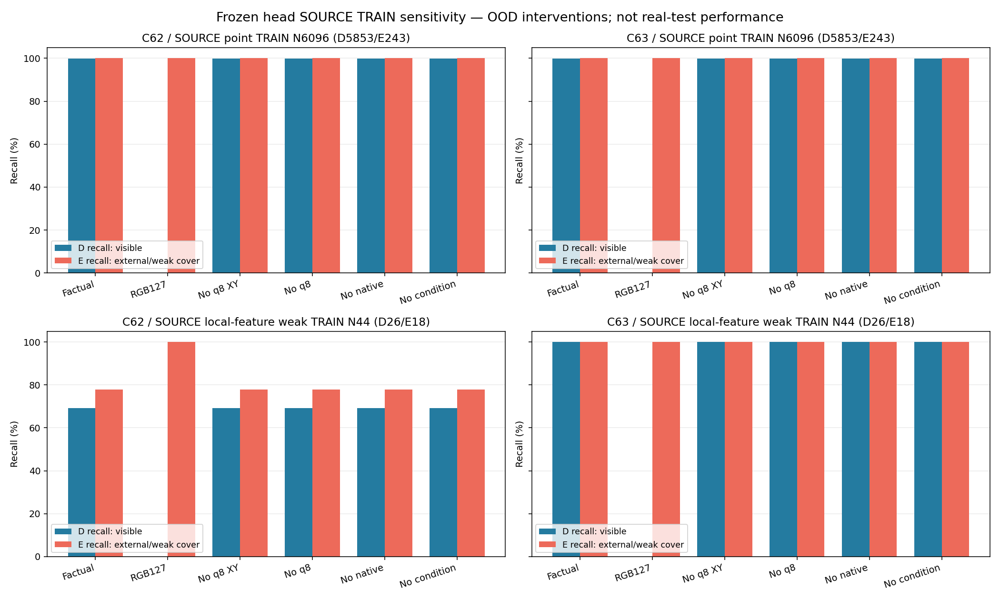
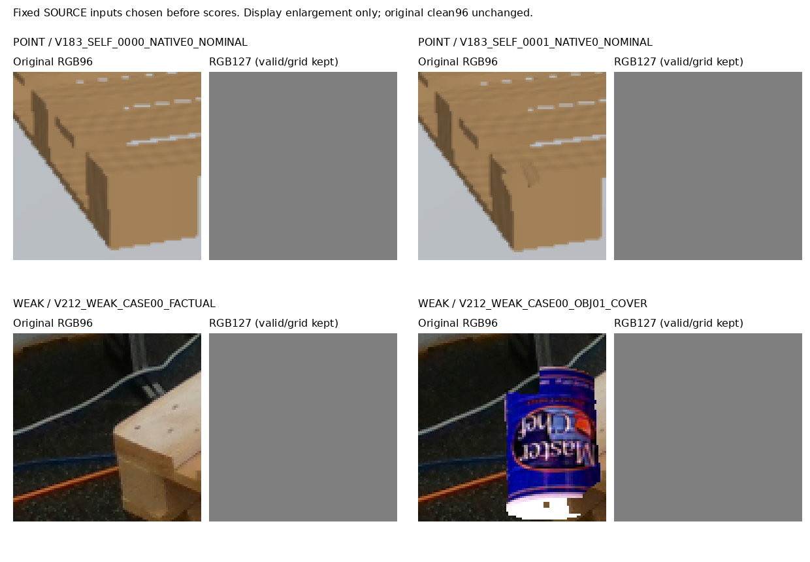

# V214 SOURCE TRAIN 영상·조건 의존 진단

동결 C62/C63의 SOURCE TRAIN 의존도만 검사했다. 모델2개×6조건×(point6096+weak44)=73,680개 scalar를 저장했다. 원 모델 출력을 먼저 재현하고, 가중치·원 q/L/native ID를 유지한 채 RGB 또는 condition branch 입력 일부만 바꿨다. 현재 실사·공개 HOLDOUT·SOURCE HOLDOUT의 새 추론이나 원장·배열 읽기는 없다. 과거 공개 요약에 노출된 이력은 별도 기록했다.

C63의 모든 condition branch를 제거했을 때 point6096와 weak44의 판정 변화는 각각0개다. 그러나 평균 절대 logit 변화는 point 1.43894, weak 0.96856로, condition 기여가 수학적으로0이라는 뜻은 아니다. C62는 point2개/weak0개가 바뀌었다. RGB127에서는 양팔의 모든 known 입력이 E가 되어 보이는 점 recall이0%다. 이 OOD 결과는 좌표 조건에만 의존한다는 설명을 약화시키지만 실사 전이 실패의 원인을 확정하지 않는다.

원 non-RGB 입력이 같은 pair는 point2310/4570과 weak18/18이다. 그중 실제 RGB가 다른 point462와 weak18에서 양팔 모두 factual logit 차이가1e-4보다 컸다. 이는 해당 SOURCE 계산이 RGB 변화에 반응한다는 증거이며 인간 native 의미나 실사 일반화의 증거가 아니다.

point7040 중 known6096(D5853/E243)만 forward했다. UNKNOWN944와 원 inputU64는 metadata에 유지하고 다시 판정하지 않았다. point는 own-image procedural point 상태이고 weak44는 공개3frame의 visible-feature 덮기 감독이다. 이 집합은 이미 학습에 쓴 자료다. constantRGB/조건제거는 OOD 민감도 검사로, 일반화 성능이나 실사 실패의 단일 원인을 증명하지 않는다. RGB127에서도 validity와 고정 XY grid가 남는다. 보류0은 이진 규칙의 결과이며 confidence가 아니다.

|모델|SOURCE 집합|조건|CM D/E행 × D/E/U열|D recall|E recall|E precision|원응답과 다른 수|U|
|---|---|---|---|---|---|---|---|---|
|C62|POINT|Factual|[[5847, 6, 0], [0, 243, 0]]|99.90%|100.00%|97.59%|0|0|
|C62|POINT|RGB127|[[0, 5853, 0], [0, 243, 0]]|0.00%|100.00%|3.99%|5847|0|
|C62|POINT|No q8 XY|[[5846, 7, 0], [0, 243, 0]]|99.88%|100.00%|97.20%|1|0|
|C62|POINT|No q8|[[5845, 8, 0], [0, 243, 0]]|99.86%|100.00%|96.81%|2|0|
|C62|POINT|No native|[[5846, 7, 0], [0, 243, 0]]|99.88%|100.00%|97.20%|1|0|
|C62|POINT|No condition|[[5845, 8, 0], [0, 243, 0]]|99.86%|100.00%|96.81%|2|0|
|C62|WEAK|Factual|[[18, 8, 0], [4, 14, 0]]|69.23%|77.78%|63.64%|0|0|
|C62|WEAK|RGB127|[[0, 26, 0], [0, 18, 0]]|0.00%|100.00%|40.91%|22|0|
|C62|WEAK|No q8 XY|[[18, 8, 0], [4, 14, 0]]|69.23%|77.78%|63.64%|0|0|
|C62|WEAK|No q8|[[18, 8, 0], [4, 14, 0]]|69.23%|77.78%|63.64%|0|0|
|C62|WEAK|No native|[[18, 8, 0], [4, 14, 0]]|69.23%|77.78%|63.64%|0|0|
|C62|WEAK|No condition|[[18, 8, 0], [4, 14, 0]]|69.23%|77.78%|63.64%|0|0|
|C63|POINT|Factual|[[5849, 4, 0], [0, 243, 0]]|99.93%|100.00%|98.38%|0|0|
|C63|POINT|RGB127|[[0, 5853, 0], [0, 243, 0]]|0.00%|100.00%|3.99%|5849|0|
|C63|POINT|No q8 XY|[[5849, 4, 0], [0, 243, 0]]|99.93%|100.00%|98.38%|0|0|
|C63|POINT|No q8|[[5849, 4, 0], [0, 243, 0]]|99.93%|100.00%|98.38%|0|0|
|C63|POINT|No native|[[5849, 4, 0], [0, 243, 0]]|99.93%|100.00%|98.38%|0|0|
|C63|POINT|No condition|[[5849, 4, 0], [0, 243, 0]]|99.93%|100.00%|98.38%|0|0|
|C63|WEAK|Factual|[[26, 0, 0], [0, 18, 0]]|100.00%|100.00%|100.00%|0|0|
|C63|WEAK|RGB127|[[0, 26, 0], [0, 18, 0]]|0.00%|100.00%|40.91%|26|0|
|C63|WEAK|No q8 XY|[[26, 0, 0], [0, 18, 0]]|100.00%|100.00%|100.00%|0|0|
|C63|WEAK|No q8|[[26, 0, 0], [0, 18, 0]]|100.00%|100.00%|100.00%|0|0|
|C63|WEAK|No native|[[26, 0, 0], [0, 18, 0]]|100.00%|100.00%|100.00%|0|0|
|C63|WEAK|No condition|[[26, 0, 0], [0, 18, 0]]|100.00%|100.00%|100.00%|0|0|

## 결과 전에 고정한 네 입력

네 사례는 대표 표본이 아니다. 첫 point D/E crop은 육안으로 비슷하지만 원q/L가 서로 달라 RGB4977/9216pixel이 다르며, 그 두 사례의 응답 차이를 가림 개입만의 효과로 읽지 않는다. weak factual/cover 사례에는 실제 bottle donor가 표시된다. actual visual receipt는 표시 가독성과 원crop 관찰만 확인하며 물리 native 정답·실제 차폐 원인을 새로 인증하지 않는다.

## SOURCE 감독 범위

PUBLIC SOURCE TRAIN155frame 중 weak44는3frame/8case/native0..4뿐이며 native5/6/7은 없다. 나머지152frame은 RGB가 없는 것이 아니다. 기존 public owner239행/81frame은 query 중심 소유자 보조 정답으로 native D/E와 다르다. Point known의 native6/7 E입력은2/4개이며 독립 장면 수가 아니다. 다음 SOURCE-only 작업은 새 프레임의 intended-part 대응을 확인하고 UNKNOWN을 보존하며 weak 감독 범위를 넓히는 것이다.

## 표·코드·관찰

- [native8 전체 표](source_train_modality_diagnosis_v2/NATIVE8_METRICS.csv)
- [모든 조건 full 표](source_train_modality_diagnosis_v2/FULL_AND_NATIVE8_METRICS.csv)
- [73,680 scalar 원장](source_train_modality_diagnosis_v2/ALL73680_SOURCE_TRAIN_CONDITION_SCALARS.jsonl)
- [동일 non-RGB 입력 pair](source_train_modality_diagnosis_v2/PAIR_INPUT_MATCHES_BEFORE_SCORE_READS.json)
- [pair별 응답 차이](source_train_modality_diagnosis_v2/PAIRED_SOURCE_VARIANT_CONDITION_CONTRASTS.jsonl)
- [감독 의미·공개 실사 coverage 감사](target_coverage_review_b/KO.md)
- [기존 pretrained 시도와 코드 readiness](pretrained_source_readiness_c/KO.md)
- [독립 저장 결과 감사](independent_saved_result_review_c/REVIEW.json)
- [실행 전 metadata gate 보완 기록](ROOT_PRE_EXECUTION_PAYLOAD_ANNOTATION_IDENTITY_FINDING_AND_BOUNDED_V2_REPAIR.json)

새 학습·문턱 조정·모델 채택·PnP 변경·전체 해결을 주장하지 않는다.
