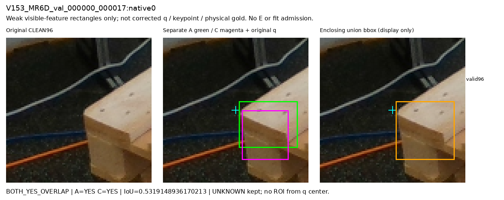
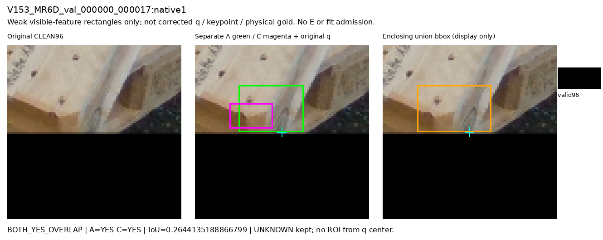
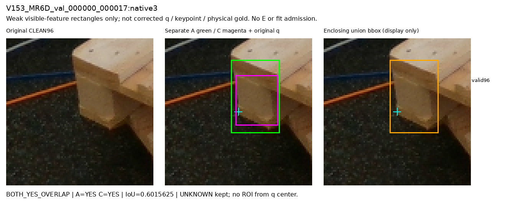
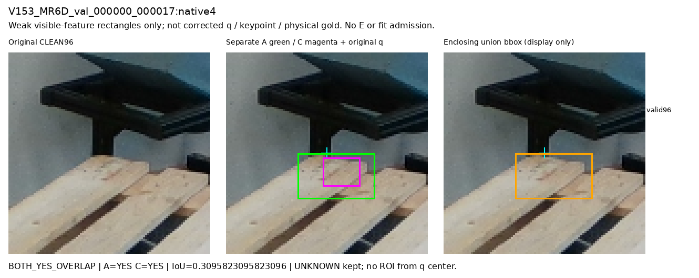
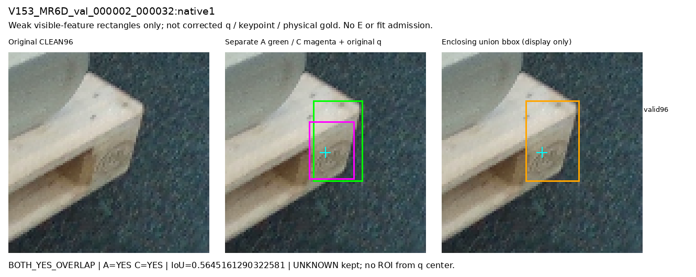
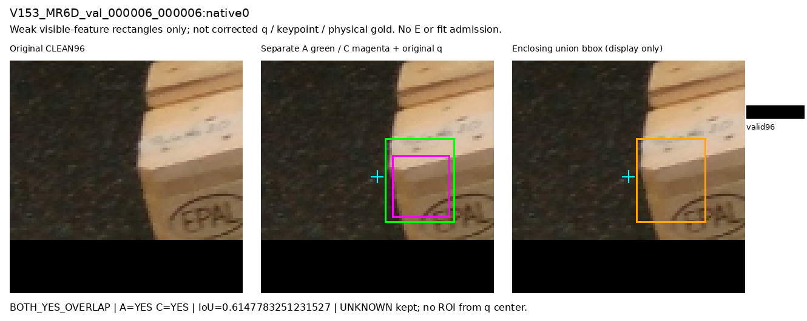
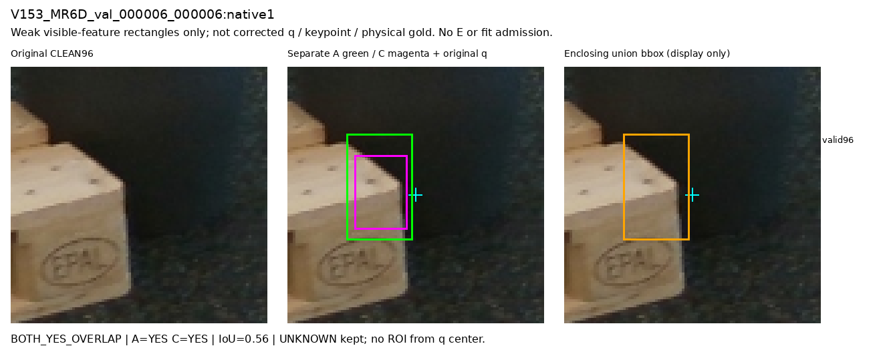
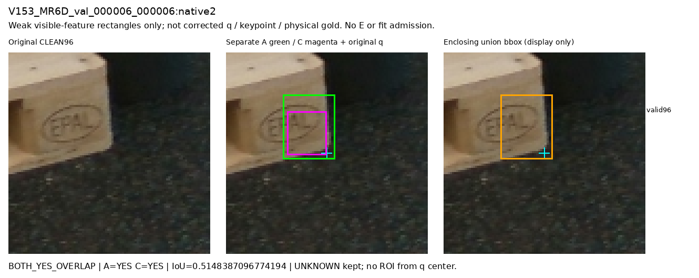

# V206 SOURCE TRAIN visible-feature witness8

두 assistant 원 ROI를 각각 보존한다. 사각형은 weak visible-feature/향후개입 근거이며 corrected q·keypoint·정답위치·physical gold가 아니다. 청록47.5십자는 원 query 표시일 뿐이다. UNKNOWN과 불일치를 보존하며 새 E·fit admission은 없다.

union bbox는 두 사각형을 둘러싼 표시용 상자이며 segmentation mask가 아니다. overlap/IoU는 기술 통계이고 문턱/모델선택 기준이 아니다. 고정8 모두의 의미적 실제 검토는 root가 별도로 기록한다.

## V153_MR6D_val_000000_000017:native0

BOTH_YES_OVERLAP | A=[50, 42, 88, 72] / C=[52, 48, 82, 80] | IoU=0.5319148936170213 (descriptive only)

## V153_MR6D_val_000000_000017:native1

BOTH_YES_OVERLAP | A=[24, 22, 59, 47] / C=[19, 32, 42, 45] | IoU=0.2644135188866799 (descriptive only)

## V153_MR6D_val_000000_000017:native3

BOTH_YES_OVERLAP | A=[43, 14, 74, 61] / C=[46, 24, 73, 56] | IoU=0.6015625 (descriptive only)

## V153_MR6D_val_000000_000017:native4

BOTH_YES_OVERLAP | A=[34, 48, 70, 69] / C=[46, 50, 63, 63] | IoU=0.3095823095823096 (descriptive only)

## V153_MR6D_val_000002_000032:native1

BOTH_YES_OVERLAP | A=[42, 23, 65, 61] / C=[40, 33, 61, 60] | IoU=0.5645161290322581 (descriptive only)

## V153_MR6D_val_000006_000006:native0

BOTH_YES_OVERLAP | A=[51, 32, 79, 66] / C=[54, 39, 77, 64] | IoU=0.6147783251231527 (descriptive only)

## V153_MR6D_val_000006_000006:native1

BOTH_YES_OVERLAP | A=[22, 25, 46, 64] / C=[25, 33, 44, 60] | IoU=0.56 (descriptive only)

## V153_MR6D_val_000006_000006:native2

BOTH_YES_OVERLAP | A=[27, 20, 51, 50] / C=[29, 28, 47, 48] | IoU=0.5148387096774194 (descriptive only)

