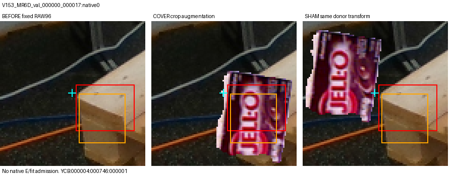
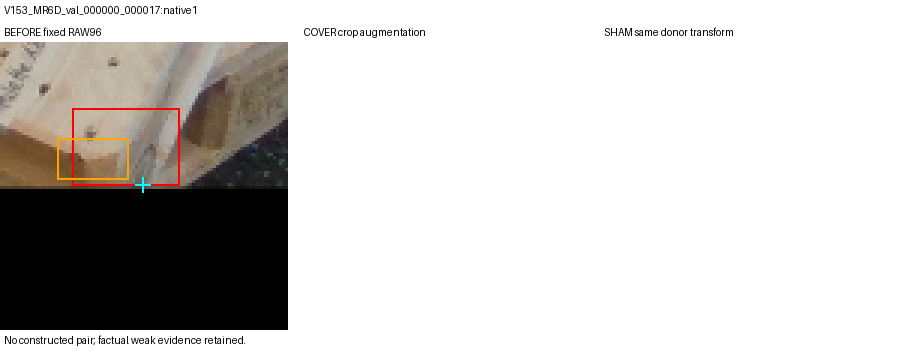
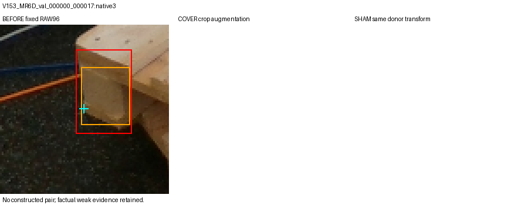
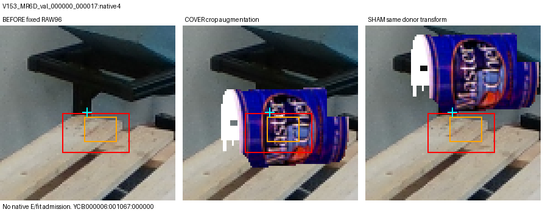
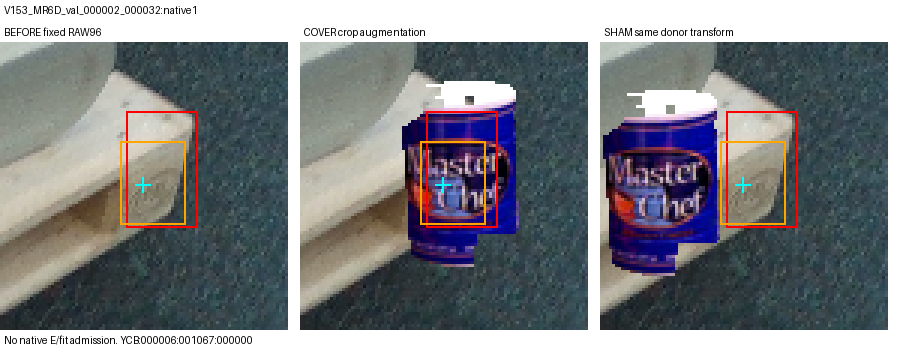
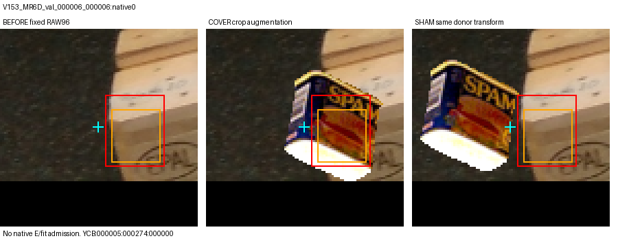
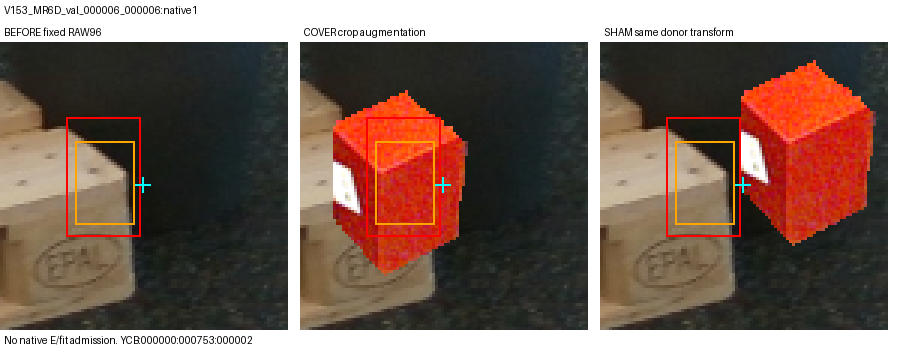
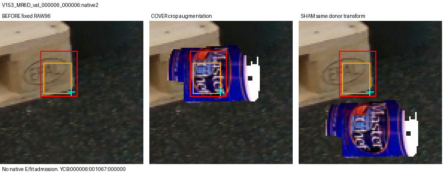

# 고정 SOURCE TRAIN 8개 RAW96 control pilot

원 q/L/native와 RAW96 샘플은 유지했다. 아래 개입은 샘플링 후 2D crop augmentation이며 물리 렌더링·native E gold·학습 admission이 아니다. 모든 80개 시도와 불가 상태를 보존했다.

[전체 80개 상태 CSV](ALL80_STATUS.csv) · [상세 JSONL](ALL80_ATTEMPTS.jsonl)

## 00 V153_MR6D_val_000000_000017:native0

[COVER_CLEAN96](attempts/CASE00_OBJ07/COVER_CLEAN96.png)
[SHAM_CLEAN96](attempts/CASE00_OBJ07/SHAM_CLEAN96.png)

## 01 V153_MR6D_val_000000_000017:native1

## 02 V153_MR6D_val_000000_000017:native3

## 03 V153_MR6D_val_000000_000017:native4

[COVER_CLEAN96](attempts/CASE03_OBJ01/COVER_CLEAN96.png)
[SHAM_CLEAN96](attempts/CASE03_OBJ01/SHAM_CLEAN96.png)

## 04 V153_MR6D_val_000002_000032:native1

[COVER_CLEAN96](attempts/CASE04_OBJ01/COVER_CLEAN96.png)
[SHAM_CLEAN96](attempts/CASE04_OBJ01/SHAM_CLEAN96.png)

## 05 V153_MR6D_val_000006_000006:native0

[COVER_CLEAN96](attempts/CASE05_OBJ09/COVER_CLEAN96.png)
[SHAM_CLEAN96](attempts/CASE05_OBJ09/SHAM_CLEAN96.png)

## 06 V153_MR6D_val_000006_000006:native1

[COVER_CLEAN96](attempts/CASE06_OBJ21/COVER_CLEAN96.png)
[SHAM_CLEAN96](attempts/CASE06_OBJ21/SHAM_CLEAN96.png)

## 07 V153_MR6D_val_000006_000006:native2

[COVER_CLEAN96](attempts/CASE07_OBJ01/COVER_CLEAN96.png)
[SHAM_CLEAN96](attempts/CASE07_OBJ01/SHAM_CLEAN96.png)
