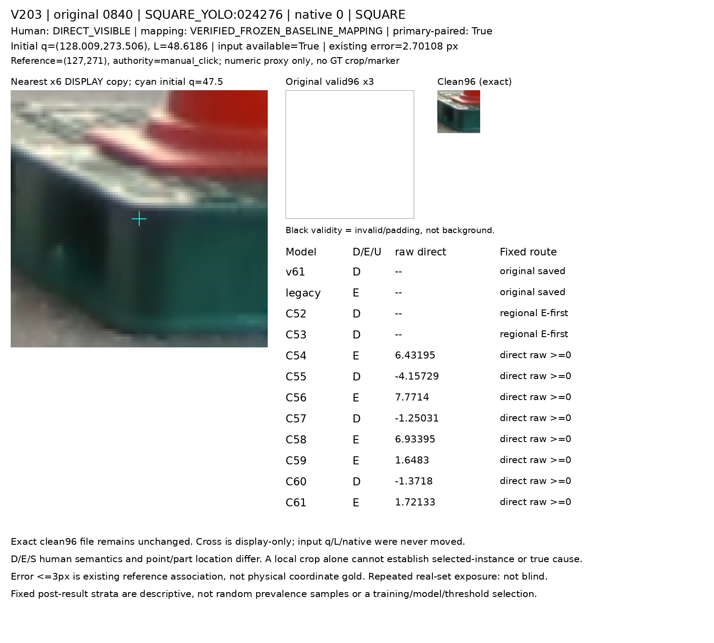
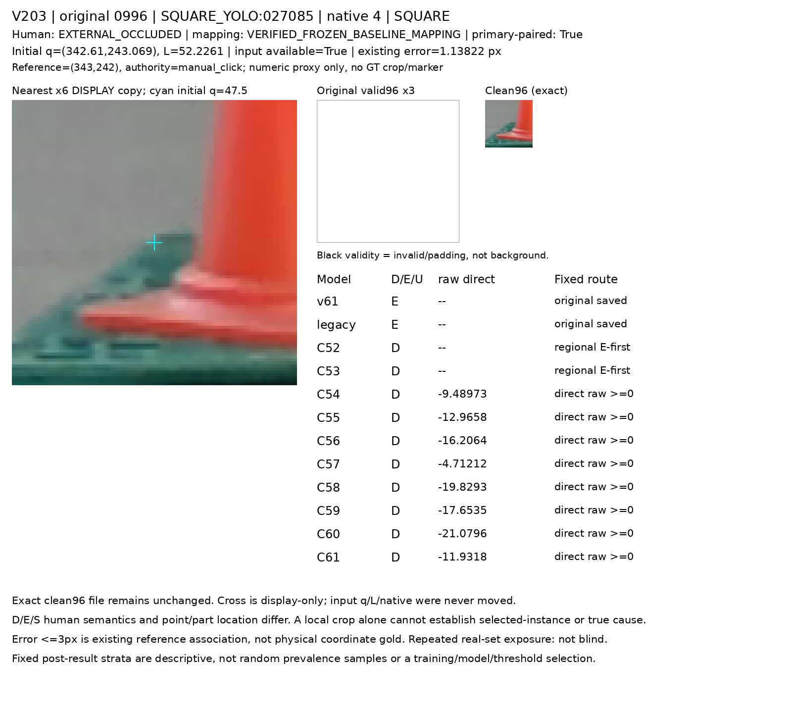

# V203 두 동결 spatial q8 head 실사 비교

두 고정 spatial q8 head C60/C61을 같은 원초기 q/L/native·RAW96에서 평가했다. C60은 native+other availability mask와 zero XY, C61은 같은 native/mask와 original q8 상대 XY다. 두 팔 모두 결과와 무관하게 사전 고정되었고 source 점수로 선택하지 않았다. 이번 보고서는 결과를 기술하며 모델을 채택하거나 전체 목표 해결을 주장하지 않는다.

C60은 주평가에서 D743/1147, E31/90, C61은 D771/1147, E26/90을 맞혔다. 이는 저장 confusion matrix의 정답 수이며 개별 사례의 paired recovery나 단일 원인 효과를 뜻하지 않는다.

주평가 분모는1237(D1147/E90)이며 기존10 저장모델과 새2모델을 모두 표시한다. CM 행은 기존 human D/E, 열은 D/E/U다. 원 전체 input U45/1784=2.52%는 주평가 U/N과 별개다. 목재/정사각 재질과 native8·SELF·public weak를 섞지 않는다.

|group|model|N|D|E|CM_D_E_by_D_E_U|D_precision|D_recall|E_precision|E_recall|U|U_rate|
|---|---|---|---|---|---|---|---|---|---|---|---|
|ALL|v61|1237|1147|90|[[260, 887, 0], [2, 88, 0]]|0.9923664122137404|0.22667829119442023|0.09025641025641026|0.9777777777777777|0|0.0|
|ALL|legacy|1237|1147|90|[[655, 319, 173], [3, 83, 4]]|0.9954407294832827|0.5710549258936356|0.2064676616915423|0.9222222222222223|177|0.14308811641067098|
|ALL|C52|1237|1147|90|[[821, 302, 24], [52, 33, 5]]|0.9404352806414662|0.7157802964254577|0.09850746268656717|0.36666666666666664|29|0.023443815683104285|
|ALL|C53|1237|1147|90|[[868, 273, 6], [70, 20, 0]]|0.9253731343283582|0.7567567567567568|0.06825938566552901|0.2222222222222222|6|0.004850444624090542|
|ALL|C54|1237|1147|90|[[698, 449, 0], [55, 35, 0]]|0.9269588313413014|0.6085440278988666|0.07231404958677685|0.3888888888888889|0|0.0|
|ALL|C55|1237|1147|90|[[831, 316, 0], [53, 37, 0]]|0.9400452488687783|0.7244986922406277|0.1048158640226629|0.4111111111111111|0|0.0|
|ALL|C56|1237|1147|90|[[711, 436, 0], [56, 34, 0]]|0.9269882659713168|0.6198779424585876|0.07234042553191489|0.37777777777777777|0|0.0|
|ALL|C57|1237|1147|90|[[729, 418, 0], [38, 52, 0]]|0.9504563233376793|0.6355710549258936|0.11063829787234042|0.5777777777777777|0|0.0|
|ALL|C58|1237|1147|90|[[650, 497, 0], [61, 29, 0]]|0.9142053445850914|0.5666957279860506|0.055133079847908745|0.32222222222222224|0|0.0|
|ALL|C59|1237|1147|90|[[603, 544, 0], [51, 39, 0]]|0.9220183486238532|0.5257192676547515|0.06689536878216124|0.43333333333333335|0|0.0|
|ALL|C60|1237|1147|90|[[743, 404, 0], [59, 31, 0]]|0.92643391521197|0.6477768090671316|0.07126436781609195|0.34444444444444444|0|0.0|
|ALL|C61|1237|1147|90|[[771, 376, 0], [64, 26, 0]]|0.9233532934131736|0.6721883173496077|0.06467661691542288|0.28888888888888886|0|0.0|

## 재질별 주평가

|group|model|N|D|E|CM_D_E_by_D_E_U|D_precision|D_recall|E_precision|E_recall|U|U_rate|
|---|---|---|---|---|---|---|---|---|---|---|---|
|WOOD_PRIMARY105|v61|645|616|29|[[145, 471, 0], [0, 29, 0]]|1.0|0.2353896103896104|0.058|1.0|0|0.0|
|WOOD_PRIMARY105|legacy|645|616|29|[[448, 65, 103], [2, 23, 4]]|0.9955555555555555|0.7272727272727273|0.26136363636363635|0.7931034482758621|107|0.16589147286821707|
|WOOD_PRIMARY105|C52|645|616|29|[[475, 120, 21], [21, 5, 3]]|0.9576612903225806|0.7711038961038961|0.04|0.1724137931034483|24|0.037209302325581395|
|WOOD_PRIMARY105|C53|645|616|29|[[471, 144, 1], [24, 5, 0]]|0.9515151515151515|0.7646103896103896|0.03355704697986577|0.1724137931034483|1|0.0015503875968992248|
|WOOD_PRIMARY105|C54|645|616|29|[[427, 189, 0], [21, 8, 0]]|0.953125|0.6931818181818182|0.04060913705583756|0.27586206896551724|0|0.0|
|WOOD_PRIMARY105|C55|645|616|29|[[492, 124, 0], [23, 6, 0]]|0.9553398058252427|0.7987012987012987|0.046153846153846156|0.20689655172413793|0|0.0|
|WOOD_PRIMARY105|C56|645|616|29|[[395, 221, 0], [15, 14, 0]]|0.9634146341463414|0.6412337662337663|0.059574468085106386|0.4827586206896552|0|0.0|
|WOOD_PRIMARY105|C57|645|616|29|[[401, 215, 0], [16, 13, 0]]|0.9616306954436451|0.650974025974026|0.05701754385964912|0.4482758620689655|0|0.0|
|WOOD_PRIMARY105|C58|645|616|29|[[344, 272, 0], [19, 10, 0]]|0.9476584022038568|0.5584415584415584|0.03546099290780142|0.3448275862068966|0|0.0|
|WOOD_PRIMARY105|C59|645|616|29|[[310, 306, 0], [14, 15, 0]]|0.9567901234567902|0.5032467532467533|0.04672897196261682|0.5172413793103449|0|0.0|
|WOOD_PRIMARY105|C60|645|616|29|[[411, 205, 0], [18, 11, 0]]|0.958041958041958|0.6672077922077922|0.05092592592592592|0.3793103448275862|0|0.0|
|WOOD_PRIMARY105|C61|645|616|29|[[460, 156, 0], [21, 8, 0]]|0.9563409563409564|0.7467532467532467|0.04878048780487805|0.27586206896551724|0|0.0|
|SQUARE118|v61|592|531|61|[[115, 416, 0], [2, 59, 0]]|0.9829059829059829|0.21657250470809794|0.12421052631578948|0.9672131147540983|0|0.0|
|SQUARE118|legacy|592|531|61|[[207, 254, 70], [1, 60, 0]]|0.9951923076923077|0.3898305084745763|0.1910828025477707|0.9836065573770492|70|0.11824324324324324|
|SQUARE118|C52|592|531|61|[[346, 182, 3], [31, 28, 2]]|0.9177718832891246|0.6516007532956686|0.13333333333333333|0.45901639344262296|5|0.008445945945945946|
|SQUARE118|C53|592|531|61|[[397, 129, 5], [46, 15, 0]]|0.8961625282167043|0.7476459510357816|0.10416666666666667|0.2459016393442623|5|0.008445945945945946|
|SQUARE118|C54|592|531|61|[[271, 260, 0], [34, 27, 0]]|0.8885245901639345|0.5103578154425612|0.09407665505226481|0.4426229508196721|0|0.0|
|SQUARE118|C55|592|531|61|[[339, 192, 0], [30, 31, 0]]|0.9186991869918699|0.6384180790960452|0.13901345291479822|0.5081967213114754|0|0.0|
|SQUARE118|C56|592|531|61|[[316, 215, 0], [41, 20, 0]]|0.8851540616246498|0.5951035781544256|0.0851063829787234|0.32786885245901637|0|0.0|
|SQUARE118|C57|592|531|61|[[328, 203, 0], [22, 39, 0]]|0.9371428571428572|0.6177024482109228|0.16115702479338842|0.639344262295082|0|0.0|
|SQUARE118|C58|592|531|61|[[306, 225, 0], [42, 19, 0]]|0.8793103448275862|0.576271186440678|0.0778688524590164|0.3114754098360656|0|0.0|
|SQUARE118|C59|592|531|61|[[293, 238, 0], [37, 24, 0]]|0.8878787878787879|0.551789077212806|0.0916030534351145|0.39344262295081966|0|0.0|
|SQUARE118|C60|592|531|61|[[332, 199, 0], [41, 20, 0]]|0.8900804289544236|0.6252354048964218|0.091324200913242|0.32786885245901637|0|0.0|
|SQUARE118|C61|592|531|61|[[311, 220, 0], [43, 18, 0]]|0.8785310734463276|0.5856873822975518|0.07563025210084033|0.29508196721311475|0|0.0|

## SELF 두 별도 cohort

paired same-query의21은 D_vs_ES eligibility 기준이며 전체 humanSELF136/same-slot 응답과 구분한다. 차이115의 세부 제외사유를 이 결과에서 새로 추측하지 않는다. 아래 binary hidden 응답은 학습된 SELF 판정이나 외부/self 원인 인증이 아니다.

|cohort|model|N|binary_hidden_response|visible_response|U|U_rate|learned_self_or_cause|
|---|---|---|---|---|---|---|---|
|paired_same_query_RGB|v61|21|12|9|0|0.0|False|
|paired_same_query_RGB|legacy|21|3|13|5|0.23809523809523808|False|
|paired_same_query_RGB|C52|21|2|18|1|0.047619047619047616|False|
|paired_same_query_RGB|C53|21|6|15|0|0.0|False|
|paired_same_query_RGB|C54|21|2|19|0|0.0|False|
|paired_same_query_RGB|C55|21|5|16|0|0.0|False|
|paired_same_query_RGB|C56|21|5|16|0|0.0|False|
|paired_same_query_RGB|C57|21|8|13|0|0.0|False|
|paired_same_query_RGB|C58|21|6|15|0|0.0|False|
|paired_same_query_RGB|C59|21|6|15|0|0.0|False|
|paired_same_query_RGB|C60|21|5|16|0|0.0|False|
|paired_same_query_RGB|C61|21|4|17|0|0.0|False|
|same_slot_pipeline|v61|136|21|115|0|0.0|False|
|same_slot_pipeline|legacy|136|118|13|5|0.03676470588235294|False|
|same_slot_pipeline|C52|136|38|95|3|0.022058823529411766|False|
|same_slot_pipeline|C53|136|27|106|3|0.022058823529411766|False|
|same_slot_pipeline|C54|136|38|98|0|0.0|False|
|same_slot_pipeline|C55|136|33|103|0|0.0|False|
|same_slot_pipeline|C56|136|51|85|0|0.0|False|
|same_slot_pipeline|C57|136|35|101|0|0.0|False|
|same_slot_pipeline|C58|136|59|77|0|0.0|False|
|same_slot_pipeline|C59|136|55|81|0|0.0|False|
|same_slot_pipeline|C60|136|58|78|0|0.0|False|
|same_slot_pipeline|C61|136|45|91|0|0.0|False|

## public weak center-owner만

원360/inputU108/knowncenter204/UNKNOWN156의 기존 weak center-owner 관찰이다. crop-anytarget나 native 가시성 D/E gold로 승격하지 않는다. legacy owner는 없는 것으로 유지한다.

|model|all_original_rows|known_center_truth|unknown_center_truth|original_input_U|T_precision_known|T_recall_including_U|nonT_recall_including_U|ownerF_precision_known|ownerF_recall_including_U|
|---|---|---|---|---|---|---|---|---|---|
|C52|360|204|156|108|0.3953488372093023|0.7083333333333334|0.8555555555555555|0.8214285714285714|0.23958333333333334|
|C53|360|204|156|108|0.5333333333333333|0.6666666666666666|0.9222222222222223|0.7540983606557377|0.4791666666666667|
|C54|360|204|156|108|0.3064516129032258|0.7916666666666666|0.7611111111111111|0.7741935483870968|0.25|
|C55|360|204|156|108|0.46511627906976744|0.8333333333333334|0.8722222222222222|0.7777777777777778|0.5104166666666666|
|C56|360|204|156|108|0.3389830508474576|0.8333333333333334|0.7833333333333333|0.7428571428571429|0.2708333333333333|
|C57|360|204|156|108|0.35555555555555557|0.6666666666666666|0.8388888888888889|0.75|0.4375|
|C58|360|204|156|108|0.3125|0.8333333333333334|0.7555555555555555|0.8387096774193549|0.2708333333333333|
|C59|360|204|156|108|0.30158730158730157|0.7916666666666666|0.7555555555555555|0.6296296296296297|0.17708333333333334|
|C60|360|204|156|108|0.3384615384615385|0.9166666666666666|0.7611111111111111|0.7878787878787878|0.2708333333333333|
|C61|360|204|156|108|0.3230769230769231|0.875|0.7555555555555555|0.8|0.25|
|v61|360|204|156|108|0.30434782608695654|0.2916666666666667|0.9111111111111111|None|None|

## 고정 입력 관찰 범위

사전 고정12 crop을 V200 clean96/valid PNG와 byte·pixel parity로 재사용했다. 렌더 완료와 실제 toolview는 다르다. actual visual receipt 2개만 인용하며 unread68/1784 전체를 봤다고 주장하지 않는다. CASE0840·0996은 기존 고정 진단 사례이며 새로운 학습 선택이 아니다.

## 한계

- Existing human D/E/S remains authority, no physical native/occlusion cause certification.
- Repeatedly exposed current223/publicheld45, not fresh blind. Legacy realCAL history preserved.
- Existing reference <=3px humanD461 is an association proxy, distinct from manualnear376; no GT crop or coordinate correction.
- Self paired21 uses D_vs_ES; full humanSELF136/same-slot response is separate. Difference115 exclusion detail not supplied.
- Public360/U108 center-owner weak consensus is separate, legacy owner missing; never native D/E gold.
- Twelve fixed cards are descriptive, not representative/all1784 inspection. No actual toolview or browser claim in generation.
- No arm adoption, model/data/architecture/threshold selection or resolved-goal claim. Source weak labels/source-held do not establish real transfer.

공개 source 직접 end 감독은 합성/기존 RGB weak 관찰이며 자연실사 native gold와 같지 않다. source TRAIN apparent fit이나 source HOLDOUT은 본 실사 전이의 증명이 아니다. q8 입력은 원 initializer 정보이며 GT/nominal endpoint/pose/PnP/새좌표 추정 입력이 아니다. 원 sampler와 q/L은 변경하지 않았다.

## 표·코드·감사 연결

- [12개 고정 gallery](fixed12_spatial_q8_real_visual_v1/PORTABLE_GALLERY_KO.md)
- [12개 gallery HTML](fixed12_spatial_q8_real_visual_v1/index.html)
- [모든 주평가 표](fixed12_spatial_q8_real_visual_v1/PRIMARY_ALL12_CM_P_R_U.csv)
- [SELF 두 cohort](fixed12_spatial_q8_real_visual_v1/SELF_TWO_COHORTS_ALL12.csv)
- [public weak만](fixed12_spatial_q8_real_visual_v1/PUBLIC_WEAK_CENTER_ONLY11.csv)
- [저장 evaluator](evaluation_preparation_a/evaluate_saved_spatial_q8_heads_real.py)
- [저장 평가 protocol](evaluation_preparation_a/PROTOCOL_BEFORE_REAL_ANNOTATION_OR_SAVED_SCORE_BODIES.json)
- [독립 수치감사](independent_saved_result_review_c/actual_review_v1/REVIEW.json)
- [prediction 봉인](frozen_C60_C61_real_predictions_v1/PREDICTION_SEAL.json)
- [본 보고서 코드](report_preparation_a/build_fixed12_and_korean_report.py)
- [본 보고서 protocol](report_preparation_a/PROTOCOL_BEFORE_SAVED_RESULTS_OR_FIXED_PNG_BODIES.json)
