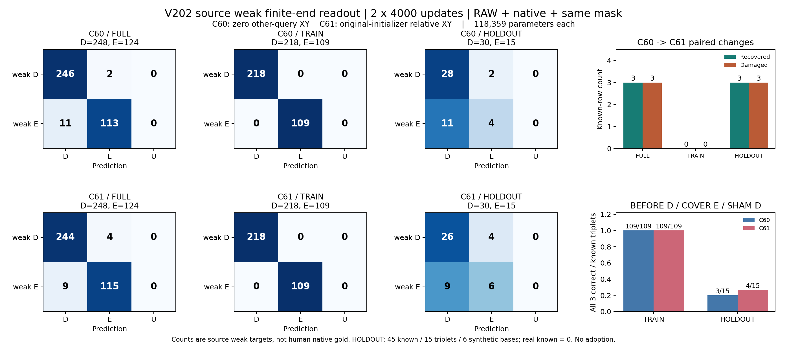

# V202 · 원 initial q8 공간문맥 source 비교

**Source HOLDOUT에서 E 정답은 4/15→6/15, D 정답은 28/30→26/30입니다. 합계는 두 팔 모두32/45로 순증0입니다. 실사 개선을 뜻하지 않으며 두 팔을 모두 후속 V203 고정 평가로 넘깁니다.**

두 RAW 팔은 원 backbone·shared64·direct scalar에 같은 zero-final residual MLP를 더한118,359파라미터 구조입니다. Native onehot8과 다른query의 원가용성mask8은 같고, C60은 다른query XY16을0으로, C61은 원 initializer q8의 상대좌표를 제공합니다. F64 차/나눗셈 후[-8,8] clip→FP32이며 self XY/mask는0입니다. q/L/native/U·원RGB96과 target은 바뀌지 않았습니다.

각4,000회·총8,000회 from-scratch, seed1810/direct RNG1811, 원192개5loss평균+별도 D16/E16 direct loss 가중치1, AdamW lr3e-4/wd1e-4/clip5를 고정했습니다. 두 final4000을 먼저 동결한 후 source 출력을 저장했고 실제 fit시간은382.95초입니다. 모든 loss에 원 component TRAIN mask와 별도 NOMINAL eligibility를 교차했습니다. 제외 SELF 비NOMINAL 행은 원 TRAIN 역할을 유지하며 HOLDOUT으로 바뀌지 않습니다. V199와는 recipe·budget·fit eligibility가 달라 이전 점수와의 차이를 q8의 인과효과로 해석하지 않습니다.

## 원분모와 해석범위

모든source domain 입력행73,976/팔을 보존합니다. 이 보고서의 primary는 DIRECT_CONTROL3,144행 중 기존 weak finite-end known372(D248/E124)이며 TRAIN327(D218/E109), HOLDOUT45(D30/E15)입니다. Known HOLDOUT은 이미 노출된 synthetic6base·15triplet뿐이며 real-end HOLDOUT known은0입니다. TRAIN에는 public real weak 감독도 포함됩니다. Weak finite-end D/E/D는 인간 native D/E gold나 물리 exactvertex 인증과 같지 않습니다.

Target UNKNOWN2,772와 원 inputU112를 별도로 보존합니다. HOLDOUT360행 중 known45·UNKNOWN315·inputU0입니다. known predictionU0은 불확실성이 해결됐다는 뜻이 아닙니다. HOLDOUT native4/6/7의 directknown은0이며, 이것을 canonical6/7 부재로 바꾸지 않습니다. Native6/7 directknown 부재만으로 관련 D/E coverage 실패라고 단정하지 않으며 upstream SELF·canonical 대응을 이 표에서 재분류하지 않습니다.

## D/E 혼동행렬·precision/recall

| 분모 | 팔 | D/E수 | CM [[D→D,E,U],[E→D,E,U]] | D P | E P | D R | E R | known예측U |
| --- | --- | --- | --- | --- | --- | --- | --- | --- |
| FULL | C60 | 248/124 | [[246,2,0],[11,113,0]] | 95.72% | 98.26% | 99.19% | 91.13% | 0 |
| FULL | C61 | 248/124 | [[244,4,0],[9,115,0]] | 96.44% | 96.64% | 98.39% | 92.74% | 0 |
| TRAIN | C60 | 218/109 | [[218,0,0],[0,109,0]] | 100.00% | 100.00% | 100.00% | 100.00% | 0 |
| TRAIN | C61 | 218/109 | [[218,0,0],[0,109,0]] | 100.00% | 100.00% | 100.00% | 100.00% | 0 |
| HOLDOUT | C60 | 30/15 | [[28,2,0],[11,4,0]] | 71.79% | 66.67% | 93.33% | 26.67% | 0 |
| HOLDOUT | C61 | 30/15 | [[26,4,0],[9,6,0]] | 74.29% | 60.00% | 86.67% | 40.00% | 0 |

TRAIN은 학습자료 apparent 성능입니다. 정사각형/목재 실사 성능이나 새로운 자연실사 일반화 결론을 이 수치로 내리지 않습니다.

## Paired 변화와 D/E/D 통제

| 분모 | known행 | 회복 | 손상 | 순증 | known triplet | C60 all3 | C61 all3 |
| --- | --- | --- | --- | --- | --- | --- | --- |
| FULL | 372 | 3 | 3 | 0 | 124 | 112 | 113 |
| TRAIN | 327 | 0 | 0 | 0 | 109 | 109 | 109 |
| HOLDOUT | 45 | 3 | 3 | 0 | 15 | 3 | 4 |

HOLDOUT known행은 C61이3개를 회복하고3개를 손상해 순증0입니다. 세 변형 전체가 맞는 triplet은3/15→4/15이며, triplet 기준 회복2·손상1입니다. 이 변화는 소수의 이미 알려진 source 통제에서의 연관이며 채택·모델선택 근거로 사용하지 않습니다.

## Source domain 분리

| 분모 | source domain | 팔 | known | CM D/E×D/E/U | D R | E R |
| --- | --- | --- | --- | --- | --- | --- |
| TRAIN | REAL_SEMANTIC_END_WEAK | C60 | 81 | [[54,0,0],[0,27,0]] | 100.00% | 100.00% |
| TRAIN | REAL_SEMANTIC_END_WEAK | C61 | 81 | [[54,0,0],[0,27,0]] | 100.00% | 100.00% |
| TRAIN | SYNTH_FINITE_END | C60 | 246 | [[164,0,0],[0,82,0]] | 100.00% | 100.00% |
| TRAIN | SYNTH_FINITE_END | C61 | 246 | [[164,0,0],[0,82,0]] | 100.00% | 100.00% |
| HOLDOUT | REAL_SEMANTIC_END_WEAK | C60 | 0 | [[0,0,0],[0,0,0]] | — | — |
| HOLDOUT | REAL_SEMANTIC_END_WEAK | C61 | 0 | [[0,0,0],[0,0,0]] | — | — |
| HOLDOUT | SYNTH_FINITE_END | C60 | 45 | [[28,2,0],[11,4,0]] | 93.33% | 26.67% |
| HOLDOUT | SYNTH_FINITE_END | C61 | 45 | [[26,4,0],[9,6,0]] | 86.67% | 40.00% |

## 원 native별 HOLDOUT

| native | H D/E수 | C60 CM | C61 CM | C60 E R | C61 E R | H targetUNKNOWN |
| --- | --- | --- | --- | --- | --- | --- |
| 0 | 6/3 | [[6,0,0],[3,0,0]] | [[4,2,0],[1,2,0]] | 0.00% | 66.67% | 36 |
| 1 | 10/5 | [[10,0,0],[3,2,0]] | [[10,0,0],[3,2,0]] | 40.00% | 40.00% | 30 |
| 2 | 8/4 | [[6,2,0],[3,1,0]] | [[6,2,0],[3,1,0]] | 25.00% | 25.00% | 33 |
| 3 | 2/1 | [[2,0,0],[0,1,0]] | [[2,0,0],[1,0,0]] | 100.00% | 0.00% | 42 |
| 4 | 0/0 | [[0,0,0],[0,0,0]] | [[0,0,0],[0,0,0]] | — | — | 45 |
| 5 | 4/2 | [[4,0,0],[2,0,0]] | [[4,0,0],[1,1,0]] | 0.00% | 50.00% | 39 |
| 6 | 0/0 | [[0,0,0],[0,0,0]] | [[0,0,0],[0,0,0]] | — | — | 45 |
| 7 | 0/0 | [[0,0,0],[0,0,0]] | [[0,0,0],[0,0,0]] | — | — | 45 |

FULL/TRAIN/HOLD의 모든 native·authority·UNKNOWN 예측분포 원표는 [저장 metrics JSON](saved_source_direct_end_evaluation_v2_PARTIAL_UNKNOWN_PRESERVED/SOURCE_DIRECT_WEAK_METRICS.json) 및 [CSV](saved_source_direct_end_evaluation_v2_PARTIAL_UNKNOWN_PRESERVED/SOURCE_DIRECT_WEAK_CONFUSIONS_AND_STRATA.csv)에 있습니다.

## 보존된 실패와 검산

초기 evaluator v1은 합법적인 BEFORE-only UNKNOWN에도 세 변형을 요구하는 guard 문제가 있어 실제 평가에 사용하지 않았습니다. v2는 anyknown이면 원D/E/D 세 변형을 요구하고, allUNKNOWN은 present/missing 변형을 그대로 보존합니다. 원3,144행은 native-attempt1,160묶음(complete992+partialUNKNOWN168)으로 남았고 누락 COVER/SHAM을 만들지 않았습니다. [v1 보존·수정기록](source_evaluation_preparation_b_v2/V1_PRESERVATION_AND_MINIMAL_REPAIR.json), [A 독립 preflight](evaluation_preflight_a/REVIEW.json), [평가 COMPLETE](saved_source_direct_end_evaluation_v2_PARTIAL_UNKNOWN_PRESERVED/COMPLETE.json)를 연결합니다.

C 실제 saved-fit 감사는 [PASS REVIEW](independent_saved_fit_review_c/actual_review_v1/REVIEW.json)로 확인됐습니다. C는 drawindices/hash와 logged scalar loss 산술·finitegrad, checkpoint2·sourcepacket24·META·저장수치를 검사했습니다. 신경망 loss/gradient값·activationtrace를 재실행한 전체훈련 독립재현은 아닙니다. 이 보고서는 저장 scalar/CSV/rowledger만 읽었고 모델·가중치·입력배열·새픽셀·실사/held/VAL/COMMON·새forward를 열지 않았습니다. 그림은 저장수치에서 만든 도식이며 실제source 이미지 또는 browser render를 보았다는 주장이 아닙니다. [원상세 JSON](ROOT_RESULTS.json), [SVG](report_b/SOURCE_DIRECT_CM_AND_PAIRED.svg), [보고서 생성 코드](report_b/build_source_report.py), [사실검사](report_b/FACTUAL_QA.json).

**두 팔 모두 후속 고정 실사 비교로 진행하며, 데이터·문턱·checkpoint·팔 선택이나 모델 채택은 하지 않았습니다. 전체 목표는 미해결입니다.**
