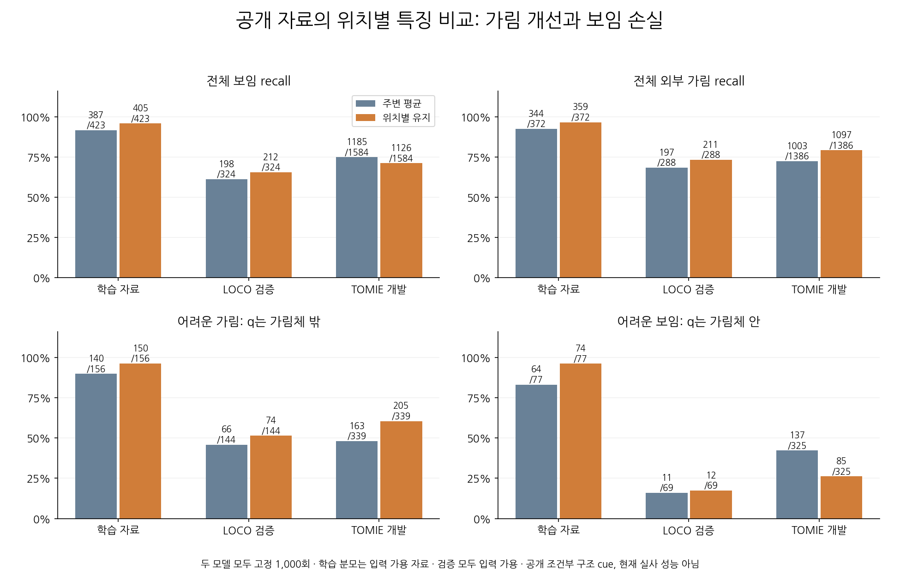
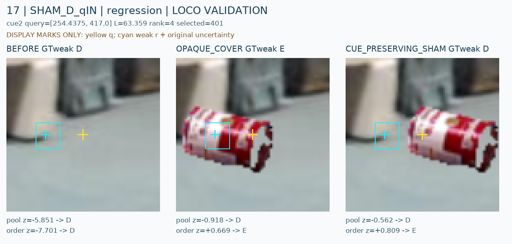
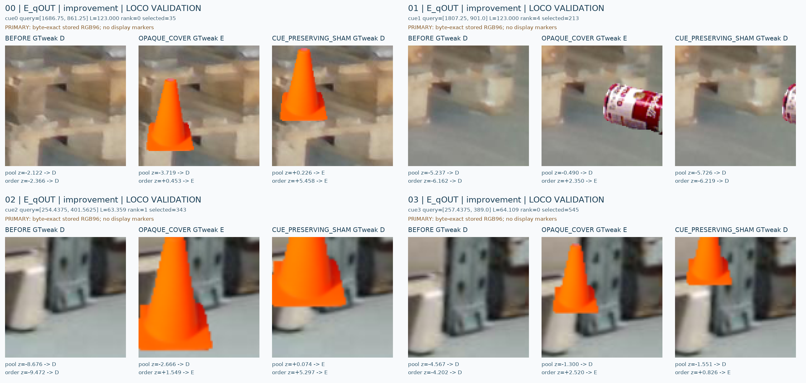
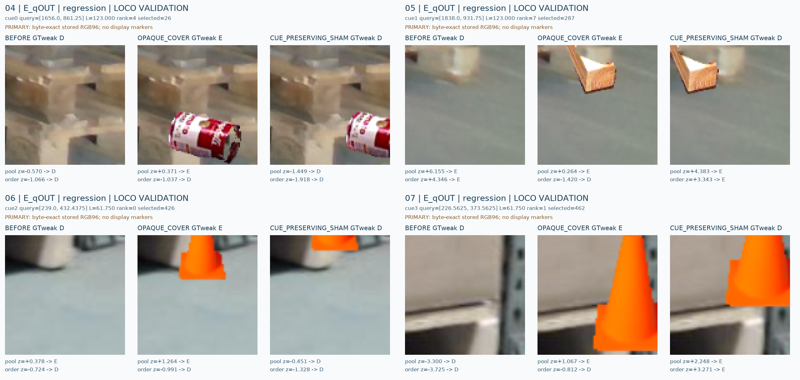

# V127 — query_visibility_spatial_stencil_control_20261023_v127

기존 보고서에서 추출한 게시용 파생 개요입니다. 원본 파일을 수정하거나 실험·평가를 다시 실행하지 않았습니다. 원문 해시와 링크 대응은 publication manifest로 확인합니다.

**상태:** {"fully_solved":false,"goal_status":"active"}

원본:

- [ROOT_PHASE_RESULT.json](ROOT_PHASE_RESULT.json) — SHA256 `df6e829cb30cac69c3b69e195f73f9ab56460a60b23c7d4039f0fbdbff11c643`
- [ROOT_READOUT_KO.html](ROOT_READOUT_KO.html) — SHA256 `2d31dbbc64aa2a9d0dca81d5c0617b2aa75473f1ff9067d13ff1ef99b3434fd7`
- [ROOT_RESULTS_KO.json](ROOT_RESULTS_KO.json) — SHA256 `54c0e9026c6315f5838cbc35c2b857398605f47da8ff4fb498e70a9cda69769c`

## 방법·목표의 원문 필드

`$.phase`

```text
V127_C19_MATCHED_LOCAL_STENCIL_SOURCE_CONTROL
```


## 입력·학습·평가 분모의 원문 필드

자동 추출 가능한 해당 최상위 필드가 없습니다. 원문 보고서와 phase receipt를 확인하십시오.

## 결론·실패·한계의 원문 필드

`$.outcome_KO`

```text
위치별 특징은 가림 정답을 늘렸지만 보임 정답을 줄였다. 두 목표를 함께 개선하는 해법으로 채택하지 않는다.
```

`$.limits_KO`

```text
[
  "TRAIN795는6cue/3원본의 상관 변형이다. VAL도26cue/6원본이며 TOMIE4장은 한 episode이고 반복 개발에 노출됐다.",
  "공개 자료의 라벨은 특정 기대 구조 영역의 조건부AUX이며 native8 인간 정답 또는 q픽셀 재질 정답이 아니다.",
  "nominal418433개 파라미터는 맞췄지만 pooled 반복 입력의 정보 rank는 더 작다. 순서 하나만의 인과 효과로 해석하지 않는다.",
  "기존18 source cohort용 새 특징은 없으므로 old15 회귀 기준 통과를 주장하지 않는다. 이번 두 모델을 현재 실사에서 재평가하거나 배포 모델로 채택하지 않았다."
]
```


## 코드·검증·전체 표·갤러리

아래 목록은 원 보고서가 참조한 파일의 경로를 다시 연결한 것입니다. 이 개요 작성 중 이미지 내용이나 raw 평가 데이터를 새로 검사하지 않았습니다.

- [query_visibility_spatial_stencil_control_20261023_v127/ROOT_READOUT_KO.html](ROOT_READOUT_KO.html)
- [query_visibility_spatial_stencil_control_20261023_v127/ROOT_RESULTS_KO.json](ROOT_RESULTS_KO.json)
- [query_visibility_spatial_stencil_control_20261023_v127/ROOT_REPORT_VISUAL_QA.json](ROOT_REPORT_VISUAL_QA.json)
- [query_visibility_spatial_stencil_control_20261023_v127/runs/C19_MATCHED_STENCIL_FIXED1000/CONTROL_COMPLETE.json](runs/C19_MATCHED_STENCIL_FIXED1000/CONTROL_COMPLETE.json)
- [query_visibility_spatial_stencil_control_20261023_v127/saved_feature_review/REVIEW.json](saved_feature_review/REVIEW.json)
- [query_visibility_spatial_stencil_control_20261023_v127/saved_fit_review/REVIEW.json](saved_fit_review/REVIEW.json)
- [query_visibility_spatial_stencil_control_20261023_v127/registered_native_teacher_feasibility/RESULT.json](registered_native_teacher_feasibility/RESULT.json)
- [query_visibility_spatial_stencil_control_20261023_v127/ROOT_NEW_REGISTERED_GEOMETRY_REVIEW.json](ROOT_NEW_REGISTERED_GEOMETRY_REVIEW.json)
- [query_visibility_spatial_stencil_control_20261023_v127/public_diversity_intake/FINAL_INTAKE_RECEIPT.json](public_diversity_intake/FINAL_INTAKE_RECEIPT.json)
- [query_visibility_spatial_stencil_control_20261023_v127/ROOT_NEXT_REGISTERED_RENDER_SCOPE_BEFORE_PIXELS.json](ROOT_NEXT_REGISTERED_RENDER_SCOPE_BEFORE_PIXELS.json)
- [query_visibility_spatial_stencil_control_20261023_v127/saved_case_gallery/GALLERY_KO.html](saved_case_gallery/GALLERY_KO.html)
- [query_visibility_spatial_stencil_control_20261023_v127/public_diversity_intake/GALLERY_KO.html](public_diversity_intake/GALLERY_KO.html)
- [query_visibility_spatial_stencil_control_20261023_v127/ROOT_PUBLIC24_ACTUAL_VISUAL_SCREEN.json](ROOT_PUBLIC24_ACTUAL_VISUAL_SCREEN.json)
- [query_visibility_training_duration_control_20261023_v124/ROOT_READOUT_KO.html](../query_visibility_training_duration_control_20261023_v124/ROOT_READOUT_KO.html)
- [query_visibility_spatial_stencil_control_20261023_v127/ROOT_C19_SOURCE_CONTROL_POLICY_BEFORE_FEATURES.json](ROOT_C19_SOURCE_CONTROL_POLICY_BEFORE_FEATURES.json)
- [query_visibility_spatial_stencil_control_20261023_v127/ROOT_PREEXECUTION_PRECISION_ADDENDUM.json](ROOT_PREEXECUTION_PRECISION_ADDENDUM.json)
- [query_visibility_spatial_stencil_control_20261023_v127/ROOT_FEATURE_API_CORRECTION_BEFORE_V2.json](ROOT_FEATURE_API_CORRECTION_BEFORE_V2.json)
- [query_visibility_spatial_stencil_control_20261023_v127/stencil_features_v2/FEATURE_COMPLETE.json](stencil_features_v2/FEATURE_COMPLETE.json)
- [query_visibility_spatial_stencil_control_20261023_v127/native_target_feasibility/RESULT.json](native_target_feasibility/RESULT.json)
- [query_visibility_spatial_stencil_control_20261023_v127/saved_case_gallery/GALLERY_COMPLETE.json](saved_case_gallery/GALLERY_COMPLETE.json)
- [query_visibility_spatial_stencil_control_20261023_v127/ROOT_C19_ACTUAL_CROP_OBSERVATIONS_KO.json](ROOT_C19_ACTUAL_CROP_OBSERVATIONS_KO.json)
- [query_visibility_spatial_stencil_control_20261023_v127/ROOT_SOURCE_NOMINAL_OFFSET_DIAGNOSIS.json](ROOT_SOURCE_NOMINAL_OFFSET_DIAGNOSIS.json)
- [query_visibility_spatial_stencil_control_20261023_v127/runs/C19_MATCHED_STENCIL_FIXED1000/POOLED9_REPEAT8/FIT_COMPLETE.json](runs/C19_MATCHED_STENCIL_FIXED1000/POOLED9_REPEAT8/FIT_COMPLETE.json)
- [query_visibility_spatial_stencil_control_20261023_v127/runs/C19_MATCHED_STENCIL_FIXED1000/ORDERED_OUTER8/FIT_COMPLETE.json](runs/C19_MATCHED_STENCIL_FIXED1000/ORDERED_OUTER8/FIT_COMPLETE.json)

## 원 보고서의 그림

원 보고서 참조 순서의 처음 최대4개를 표시합니다. 새 outcome 선택이나 전수 이미지 검증을 뜻하지 않습니다. 전체 갤러리는 위 원문 링크에서 확인합니다.

[query_visibility_spatial_stencil_control_20261023_v127/visual_followup/C19_MATCHED_SPATIAL_COMPARISON_KO.png](visual_followup/C19_MATCHED_SPATIAL_COMPARISON_KO.png)



[query_visibility_spatial_stencil_control_20261023_v127/saved_case_gallery/figures/CASE_17_MARKED.png](saved_case_gallery/figures/CASE_17_MARKED.png)



[query_visibility_spatial_stencil_control_20261023_v127/saved_case_gallery/figures/CONTACT_E_qOUT_improvement_RAW.png](saved_case_gallery/figures/CONTACT_E_qOUT_improvement_RAW.png)



[query_visibility_spatial_stencil_control_20261023_v127/saved_case_gallery/figures/CONTACT_E_qOUT_regression_RAW.png](saved_case_gallery/figures/CONTACT_E_qOUT_regression_RAW.png)




현재 사용자 목표 전체의 해결·새 모델 채택·실사 가림 원인 확정을 이 파생 개요가 추가로 주장하지 않습니다. UNKNOWN/U와 불리한 결과, 실패 실행 및 수정 provenance는 원문대로 보존해야 합니다.
