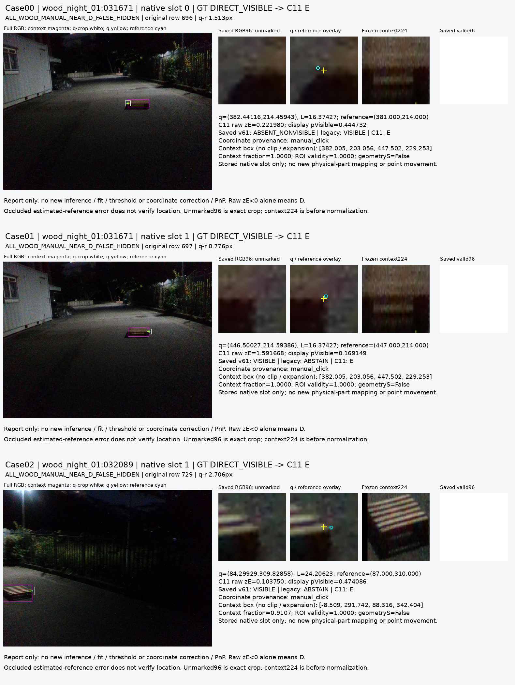
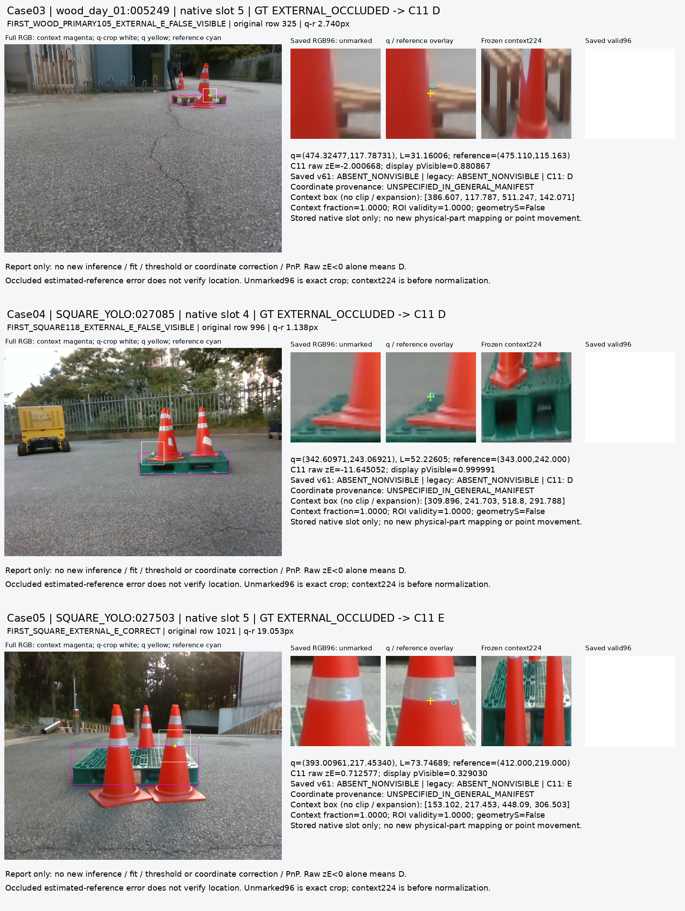

# V111 — query_visibility_spatial_target_query_features_20261023_v111

기존 보고서에서 추출한 게시용 파생 개요입니다. 원본 파일을 수정하거나 실험·평가를 다시 실행하지 않았습니다. 원문 해시와 링크 대응은 publication manifest로 확인합니다.

**상태:** {"completed":true}

원본:

- [ROOT_READOUT_KO.html](ROOT_READOUT_KO.html) — SHA256 `406db9edde1d12b390147242cf17afe09a735291feaa8d1defaf49143fbe5ff6`
- [ROOT_RESULTS_KO.json](ROOT_RESULTS_KO.json) — SHA256 `8393f84a39f905021f75bc70d236fb16c183dce7b2a73abb18d20b30700c57df`

## 방법·목표의 원문 필드

`$.goal_complete`

```text
false
```

`$.metric_definition`

```text
{
  "matrix_rows": [
    "human_D",
    "human_external_E"
  ],
  "matrix_columns": [
    "D",
    "binary_hidden_E_response",
    "U"
  ],
  "precision_scope": "D/E cohort only",
  "recall_denominator": "all original GT class rows including U predictions",
  "human_S_not_merged_into_external_E": true
}
```


## 입력·학습·평가 분모의 원문 필드

`$.primary_paired_same_query_RGB`

```text
{
  "excerpt": "[{\"cohort\": \"paired_same_query_RGB\", \"group\": \"WOOD_PRIMARY105\", \"model\": \"v61\", \"human_D_N\": 616, \"human_external_E_N\": 29, \"D_pred_D\": 145, \"D_pred_hidden\": 471, \"D_pred_U\": 0, \"E_pred_D\": 0, \"E_pred_hidden\": 29, \"E_pred_U\": 0, \"D_precision\": 1.0, \"D_recall\": 0.2353896103896104, \"external_E_response_precision\": 0.058, \"external_E_response_recall\": 1.0, \"unresolved_rate\": 0.0, \"hidden_response_not_learned_S\": true, \"matrix_D_E_by_pred_D_E_U\": [[145, 471, 0], [0, 29, 0]], \"U_N\": 0}, {\"cohort\": \"paired_same_query_RGB\", \"group\": \"WOOD_PRIMARY105\", \"model\": \"legacy\", \"human_D_N\": 616, \"human_external_E_N\": 29, \"D_pred_D\": 448, \"D_pred_hidden\": 65, \"D_pred_U\": 103, \"E_pred_D\": 2, \"E_pred_hidden\": 23, \"E_pred_U\": 4, \"D_precision\": 0.9955555555555555, \"D_recall\": 0.7272727272727273, \"external_E_response_precision\": 0.26136363636363635, \"external_E_response_recall\": 0.7931034482758621, \"unresolved_rate\": 0.16589147286821707, \"hidden_response_not_learned_S\": true, \"matrix_D_E_by_pred_D_E_U\": [[448, 65, 103], [2, 23, 4]], \"U_N\": 107}, {\"cohort\": \"paired_same_query_RGB\", \"group\": \"WOOD_PRIMARY105\", \"model\": \"V111_C11_RAW\", \"human_D_N\": 616, \"human_external_E_N\": 29, \"D_pred_D\": 598, \"D_pred_hidden\": 18, \"D_pred_U\": 0, \"E_pred_D\": 11, \"E_pred_hidden\": 18, \"E_pred_U\": 0, \"D_precision\": 0.9819376026272578, \"D_recall\": 0.9707792207792207, \"external_E_response_precision\": 0.5, \"external_E_response_recall\": 0.6206896551724138, \"unresolved_rate\": 0.0, \"hidden_response_not_learned_S\": true, \"matrix_D_E_by_pred_D_E_U\": [[598, 18, 0], [11, 18, 0]], \"U_N\": 0}, {\"cohort\": \"paired_same_query_RGB\"",
  "truncated": true
}
```


## 결론·실패·한계의 원문 필드

`$.frozen_decision`

```text
{
  "selected_source_update": 1800,
  "raw_logit_threshold": 0,
  "D_rule": "z<0",
  "E_response_rule": "z>=0",
  "probability_display_only": true,
  "fixed_before_current223_and_separate_fresh_V112": true,
  "current_driven_choice_of_C11_vs_C1": false
}
```

`$.limits_KO`

```text
[
  "current223은 반복 개발에 노출된 기존 평가 묶음이다. 독립적인 새 holdout 성능으로 해석하지 않는다.",
  "C11과 C1 중 하나를 private 지표로 다시 선택하지 않는다. source step1800·raw logit0 동결을 유지한다.",
  "가시성 분류는 위치 정확성 분류가 아니다. 가려진 reference의 작은 q-r 오차는 검증된 좌표 정답을 뜻하지 않는다.",
  "source는 조건부 AUX 및 reference-associated surface proxy이다. human/native junction gold가 아니며, 일부 source q는 emulated q이다.",
  "기존 public source VAL은 반복 개발에 노출됐다. 119 rank triplet은18 base query·9 image에 군집하며 natural E VAL2개도 같은 영상이다.",
  "YCB8000개는 모두 TRAIN이다. 자연 실영상 held-out 검증으로 승격하지 않는다.",
  "기존 ImageNet descriptor와 비교해 backbone과 spatial target/query 표현이 함께 바뀌었다. 개선 원인을 하나로 분리한 ablation이 아니다.",
  "기하 self 필터는 기존 초기 추정 경로이며 learned S나 정확한 원인 판별을 뜻하지 않는다. native 대응·인간 주석의 불확실성을 보존한다.",
  "실제 crop 사례는 postfit 오류 진단이다. 모델·threshold·좌표·라벨·평가 대상 선택을 바꾸는 자료로 사용하지 않는다."
]
```


## 코드·검증·전체 표·갤러리

아래 목록은 원 보고서가 참조한 파일의 경로를 다시 연결한 것입니다. 이 개요 작성 중 이미지 내용이나 raw 평가 데이터를 새로 검사하지 않았습니다.

- [query_visibility_spatial_target_query_features_20261023_v111/ROOT_RESULTS_KO.json](ROOT_RESULTS_KO.json)
- [query_visibility_spatial_target_query_features_20261023_v111/saved_source_review/REVIEW.json](saved_source_review/REVIEW.json)
- [query_visibility_spatial_target_query_features_20261023_v111/saved_current_review/REVIEW.json](saved_current_review/REVIEW.json)
- [query_visibility_spatial_target_query_features_20261023_v111/private_evaluation/C11_FROZEN_CURRENT223/evaluation/CURRENT_PRIMARY_RESULTS.json](private_evaluation/C11_FROZEN_CURRENT223/evaluation/CURRENT_PRIMARY_RESULTS.json)
- [query_visibility_spatial_target_query_features_20261023_v111/current_failure_visual_diagnosis/RESULT.json](current_failure_visual_diagnosis/RESULT.json)
- [query_visibility_spatial_target_query_features_20261023_v111/current_failure_visual_diagnosis/ALL6_CASES_AND_PROVENANCE_V2.json](current_failure_visual_diagnosis/ALL6_CASES_AND_PROVENANCE_V2.json)
- [query_visibility_spatial_target_query_features_20261023_v111/runs/C11_DINOV2_SPATIAL_TARGET_QUERY/FIT_COMPLETE.json](runs/C11_DINOV2_SPATIAL_TARGET_QUERY/FIT_COMPLETE.json)
- [query_visibility_spatial_target_query_features_20261023_v111/runs/C11_DINOV2_SPATIAL_TARGET_QUERY/SOURCE_RESULTS.json](runs/C11_DINOV2_SPATIAL_TARGET_QUERY/SOURCE_RESULTS.json)
- [query_visibility_spatial_target_query_features_20261023_v111/runs/C11_DINOV2_SPATIAL_TARGET_QUERY/SOURCE_GATE_RESULTS.json](runs/C11_DINOV2_SPATIAL_TARGET_QUERY/SOURCE_GATE_RESULTS.json)
- [query_visibility_spatial_target_query_features_20261023_v111/runs/C11_DINOV2_SPATIAL_TARGET_QUERY/MODEL_FREEZE.json](runs/C11_DINOV2_SPATIAL_TARGET_QUERY/MODEL_FREEZE.json)
- [query_visibility_spatial_target_query_features_20261023_v111/ROOT_SOURCE_ADMISSION_FOR_FROZEN_CURRENT_EVAL.json](ROOT_SOURCE_ADMISSION_FOR_FROZEN_CURRENT_EVAL.json)
- [query_visibility_spatial_target_query_features_20261023_v111/ROOT_CURRENT_COMPARISON_OPERATOR_BEFORE_INPUT_READ.json](ROOT_CURRENT_COMPARISON_OPERATOR_BEFORE_INPUT_READ.json)
- [query_visibility_spatial_target_query_features_20261023_v111/private_evaluation/C11_FROZEN_CURRENT223/INFERENCE_SEAL.json](private_evaluation/C11_FROZEN_CURRENT223/INFERENCE_SEAL.json)
- [query_visibility_spatial_target_query_features_20261023_v111/private_evaluation/C11_FROZEN_CURRENT223/INPUT_PREPARATION_AUDIT.json](private_evaluation/C11_FROZEN_CURRENT223/INPUT_PREPARATION_AUDIT.json)
- [query_visibility_spatial_target_query_features_20261023_v111/private_evaluation/C11_FROZEN_CURRENT223/evaluation/EVALUATION_SEAL.json](private_evaluation/C11_FROZEN_CURRENT223/evaluation/EVALUATION_SEAL.json)
- [query_visibility_spatial_target_query_features_20261023_v111/independent_feature_preparation_review/REVIEW.json](independent_feature_preparation_review/REVIEW.json)

## 원 보고서의 그림

원 보고서 참조 순서의 처음 최대4개를 표시합니다. 새 outcome 선택이나 전수 이미지 검증을 뜻하지 않습니다. 전체 갤러리는 위 원문 링크에서 확인합니다.

[query_visibility_spatial_target_query_features_20261023_v111/current_failure_visual_diagnosis/CONTACT_01_V2.png](current_failure_visual_diagnosis/CONTACT_01_V2.png)



[query_visibility_spatial_target_query_features_20261023_v111/current_failure_visual_diagnosis/CONTACT_02_V2.png](current_failure_visual_diagnosis/CONTACT_02_V2.png)




현재 사용자 목표 전체의 해결·새 모델 채택·실사 가림 원인 확정을 이 파생 개요가 추가로 주장하지 않습니다. UNKNOWN/U와 불리한 결과, 실패 실행 및 수정 provenance는 원문대로 보존해야 합니다.
