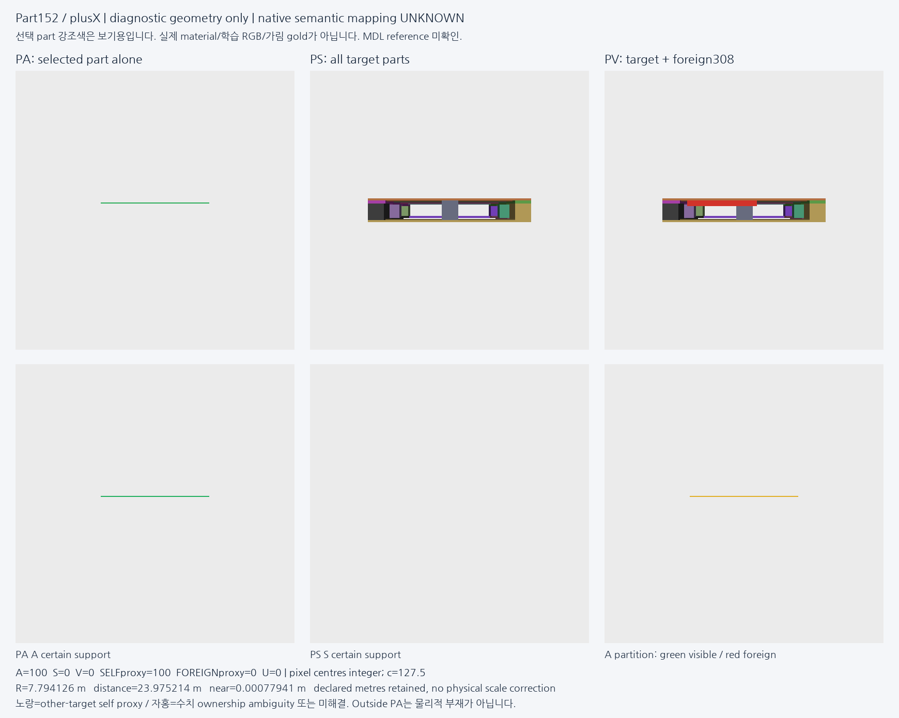
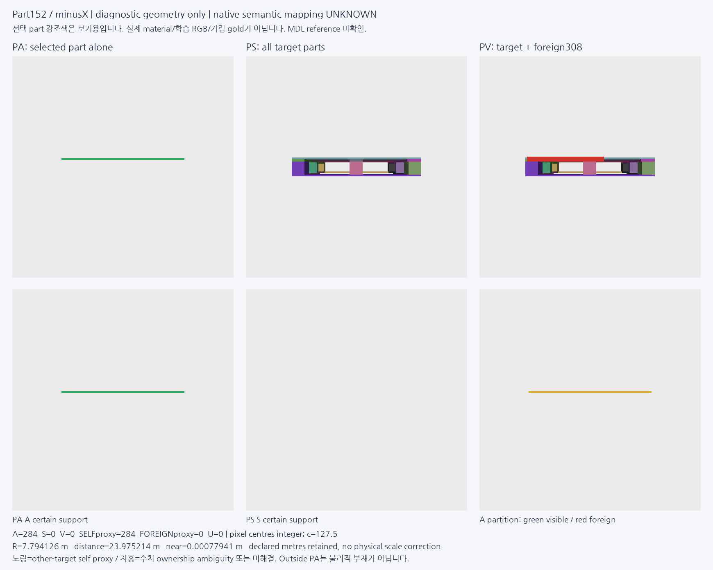
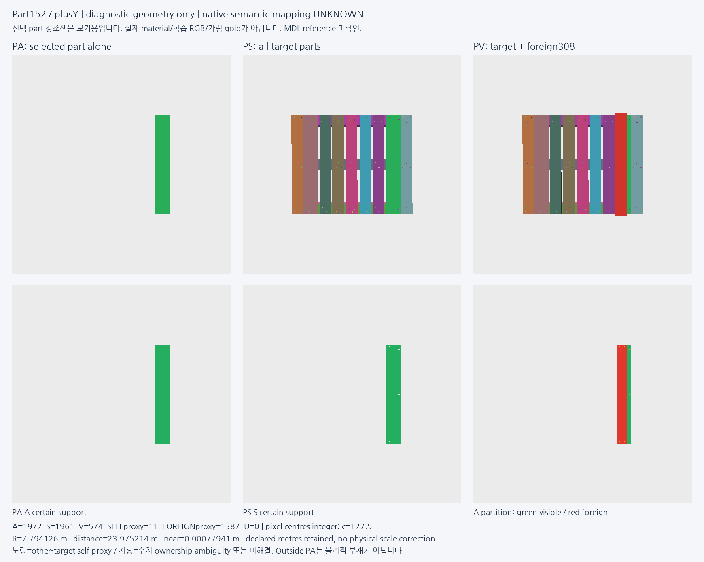
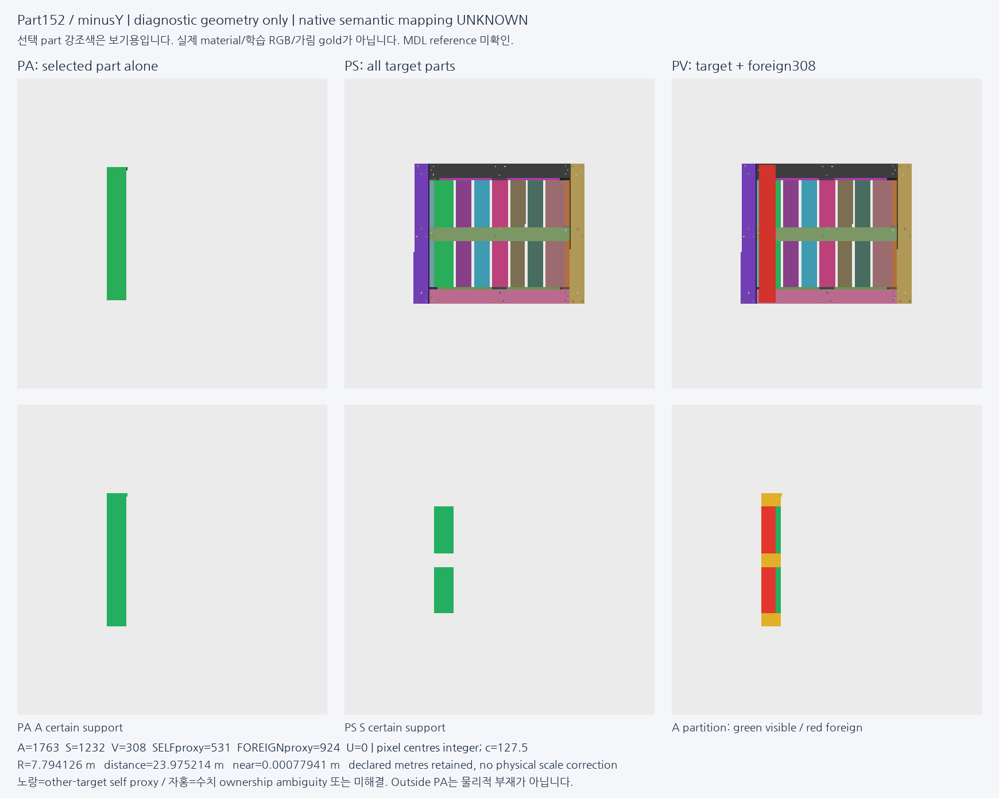

# V93 — query_visibility_synthetic_part_teacher_20261023_v93

기존 보고서에서 추출한 게시용 파생 개요입니다. 원본 파일을 수정하거나 실험·평가를 다시 실행하지 않았습니다. 원문 해시와 링크 대응은 publication manifest로 확인합니다.

**상태:** 명시된 완료 receipt 없음 — 완료 단정하지 않음

원본:

- [ROOT_READOUT_KO.html](ROOT_READOUT_KO.html) — SHA256 `d64af3011b25e69ef65fcda7aa436d40c10e22298b22161fec2abb1c0b70ff6f`

## 방법·목표의 원문 필드

자동 추출 가능한 해당 최상위 필드가 없습니다. 원문 보고서와 phase receipt를 확인하십시오.

## 입력·학습·평가 분모의 원문 필드

자동 추출 가능한 해당 최상위 필드가 없습니다. 원문 보고서와 phase receipt를 확인하십시오.

## 결론·실패·한계의 원문 필드

자동 추출 가능한 해당 최상위 필드가 없습니다. 원문 보고서와 phase receipt를 확인하십시오.

## 코드·검증·전체 표·갤러리

아래 목록은 원 보고서가 참조한 파일의 경로를 다시 연결한 것입니다. 이 개요 작성 중 이미지 내용이나 raw 평가 데이터를 새로 검사하지 않았습니다.

- [query_visibility_physical_cue_aux_20261023_v91/ROOT_READOUT_KO.html](../query_visibility_physical_cue_aux_20261023_v91/ROOT_READOUT_KO.html)
- [query_visibility_synthetic_part_teacher_20261023_v93/ROOT_PHASE_RESULTS_KO.json](ROOT_PHASE_RESULTS_KO.json)
- [query_visibility_synthetic_part_teacher_20261023_v93/raster_prototype/FIXED_PART152_SIX_CAMERAS/RASTER_OUTPUT_SEAL.json](raster_prototype/FIXED_PART152_SIX_CAMERAS/RASTER_OUTPUT_SEAL.json)
- [query_visibility_synthetic_part_teacher_20261023_v93/independent_geometry_review/GEOMETRY_AUDIT.json](independent_geometry_review/GEOMETRY_AUDIT.json)
- [query_visibility_synthetic_part_teacher_20261023_v93/independent_raster_preparation_review/REVIEW.json](independent_raster_preparation_review/REVIEW.json)
- [query_visibility_synthetic_part_teacher_20261023_v93/independent_actual_raster_audit/REVIEW.json](independent_actual_raster_audit/REVIEW.json)
- [query_visibility_synthetic_part_teacher_20261023_v93/independent_fixed6_visual_review/VISUAL_REVIEW_KO.json](independent_fixed6_visual_review/VISUAL_REVIEW_KO.json)
- [query_visibility_synthetic_part_teacher_20261023_v93/saved_aux_query_crop_diagnosis/FINAL_SAVED_AUX_CROP_DIAGNOSIS_SEAL.json](saved_aux_query_crop_diagnosis/FINAL_SAVED_AUX_CROP_DIAGNOSIS_SEAL.json)
- [query_visibility_synthetic_part_teacher_20261023_v93/semantic_contract_draft/EXPECTED_PART_CUE_MINIMUM_SEMANTIC_CONTRACT_DRAFT_V2_KO.md](semantic_contract_draft/EXPECTED_PART_CUE_MINIMUM_SEMANTIC_CONTRACT_DRAFT_V2_KO.md)

## 원 보고서의 그림

원 보고서 참조 순서의 처음 최대4개를 표시합니다. 새 outcome 선택이나 전수 이미지 검증을 뜻하지 않습니다. 전체 갤러리는 위 원문 링크에서 확인합니다.

[query_visibility_synthetic_part_teacher_20261023_v93/raster_prototype/FIXED_PART152_SIX_CAMERAS/plusX.png](raster_prototype/FIXED_PART152_SIX_CAMERAS/plusX.png)

[query_visibility_synthetic_part_teacher_20261023_v93/raster_prototype/FIXED_PART152_SIX_CAMERAS/minusX.png](raster_prototype/FIXED_PART152_SIX_CAMERAS/minusX.png)

[query_visibility_synthetic_part_teacher_20261023_v93/raster_prototype/FIXED_PART152_SIX_CAMERAS/plusY.png](raster_prototype/FIXED_PART152_SIX_CAMERAS/plusY.png)

[query_visibility_synthetic_part_teacher_20261023_v93/raster_prototype/FIXED_PART152_SIX_CAMERAS/minusY.png](raster_prototype/FIXED_PART152_SIX_CAMERAS/minusY.png)

현재 사용자 목표 전체의 해결·새 모델 채택·실사 가림 원인 확정을 이 파생 개요가 추가로 주장하지 않습니다. UNKNOWN/U와 불리한 결과, 실패 실행 및 수정 provenance는 원문대로 보존해야 합니다.
