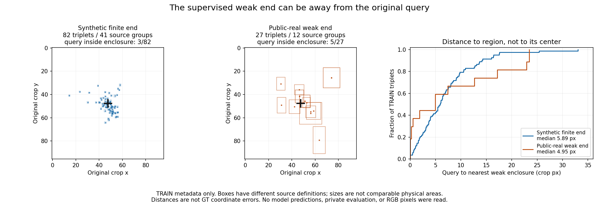

# V201: 학습에서 묻는 끝부위와 초기 query·8점 문맥의 실제 대응

작성: 2026-10-25 KST. **성능 개선·채택은 아직 확인하지 못했다. 이번 단계는 새 학습 없이 실제 SOURCE TRAIN 메타데이터의 대응을 확인했다.**

## 이전보다 무엇이 나아졌고, 무엇은 아직 안 되는가

첨부 V193 검토 시점 이후 그룹 단위 source 분할, 동결 비교, native 번호 조건부 head까지 실행했다. 그러나 최신 C59도 기존 실사 학습 legacy 참조군을 넘었다고 말할 수 없다. 다음 표는 **V200의 저장 집계 재사용**이며 V201에서 새로 추론·평가한 결과가 아니다.

같은 사람 D/E query 1,237개(D1,147/E90), SELF·OOF·미주석·대응 UNKNOWN은 별도다.

| 모델 | 보이는 점 D 재현율 | 외부 가림 E 재현율 | E 정밀도 | 예측 보류 U |
|---|---:|---:|---:|---:|
| v61 | 22.67% | 97.78% | 9.03% | 0 / 0.00% |
| legacy | 57.11% | 92.22% | 20.65% | 177 / 14.31% |
| C55 | 72.45% | 41.11% | 10.48% | 0 / 0.00% |
| C57 | 63.56% | 57.78% | 11.06% | 0 / 0.00% |
| C59 | 52.57% | 43.33% | 6.69% | 0 / 0.00% |

C55→C57은 E 정답37→52와 함께 D 정답831→729의 손상이 있다. C59는 C57보다 D 정답126개·E 정답13개가 적다. C59와 같은 구조의 zero8 대조 C58은 D650/E29 정답이고, C59는 D603/E39다. native 번호 추가의 이번 효과는 E 정답 수 +10/D 정답 수 −47이며, 보편적으로 번호가 무용하다는 결론은 아니다.

legacy는 과거 real-CAL 학습 참조군이고, v61은 query-pixel presence를 평가 D/E에 연결한 기존 응답이다. 같은 학습 목표·자료의 등조건 모델로 취급하지 않는다. 새로운 direct head의 U0은 불확실성 해결의 증거가 아니다. 원 전체1,784 query의 input U45도 유지된다. 반복 노출한 실사 개발 평가이며 독립 blind 일반화 주장은 없다.

[V200 전체 비교·혼동행렬·목재/정사각형·SELF·좌표 참조별 표](../query_visibility_native_heads_frozen_real_benchmark_20261024_v200/PORTABLE_REPORT_KO.md)

## 이번에 새로 확인한 사실

**1. 합성 원래 q8는 실제 초기 검출기의 출력이다.** V132의 동결 YOLO가 원 PNG에서 최고 score 후보의 `keypoints_xy` native0..7을 그대로 반환하고, 그 q/L이 V180→V183/V194로 이어진다. GT cuboid 투영을 초기 좌표로 넣은 것이 아니다. 입력 전용 원 메타데이터의 앞 TRAIN4,096행과 scene512의 q/L을 실제 대조했다. VAL 부분은 읽지 않았고 원파일 전체 SHA 재계산으로 가장하지 않았다. 공개 실사 q8는 기존 source input facts와의 저장값 join을 확인했으며 그 upstream initializer 실행까지 이번에 재감사한 것은 아니다.

**2. 모델이 학습한 direct 라벨은 중심 픽셀 소속과 다르다.** 각 triplet의 선택된 native에 연결한 finite-end만 BEFORE=D/COVER=E/SHAM=D다. 총109쌍·327 known weak 라벨이며 나머지7점의2,289행은 UNKNOWN이다. 후보 상자는 원96 crop 안에 있으나 query 중심과 같다는 계약은 없다.

| source | TRAIN triplet | base/원 frame | query가 후보 상자 안 | query→가장 가까운 후보 영역 거리 중앙값 |
|---|---:|---:|---:|---:|
| 합성 finite-end | 82 | 41 | 3 | 5.89 px |
| 공개 실사 weak end | 27 | 12 | 5 | 4.95 px |

공개 실사27쌍은12개 원 frame에서 왔으며 고정 split상1개 component에 속한다. 27개 독립 장면이나327개 독립 자연 가림 정답으로 세지 않는다.

검정 십자는 원 query, 파랑·주황 상자는 저장 weak-end 후보다. 거리는 **96 crop 단위의 후보 상자 거리**이며 실제 GT 좌표 오차가 아니다. 합성 finite-end와 공개 실사 enclosure의 정의·불확실성이 달라 상자 크기를 물리 면적처럼 비교하지 않는다. 떨어져 있다는 사실만으로 query·라벨이 틀렸거나 전이 실패 원인이 입증되지는 않는다.

**3. 입력 번호가 renderer canonical 코너를 고정하지 않는다.** 실제 합성 TRAIN에서 native0은 canonical0/1/4/5에, native3은 canonical2/3/6/7에 대응한다. 이는 저장된 frame convention의 signed-quarter permutation이며 초기 검출기 출력의 재배열이나 GT-best 탐색이 아니다. native6/7의 direct known0을 물리 canonical6/7 미학습으로 해석하면 틀린다. 그 두 canonical은 native2/3을 통해 각각9/4 triplet 포함된다. 공개 실사27쌍은 canonical crosswalk가 미제공이며 weak 권위를 유지한다. 사람 D/E 평가를 폐기하거나 완벽한 물리 GT를 새 필수 조건으로 삼지 않는다.

**4. q8 메타데이터는 실제로 join 가능하되, 가용성 마스크가 필요하다.** 원 group/native8/q/L/flag를 저장 메타데이터와 대조했다. 모든 TRAIN q가 수치상 finite여도 input U1,145행은 그대로 U다. finite 여부만으로 가용성을 재정의하지 않는다.

| 입력 pool | TRAIN 행 | 원 input U | 원 문맥 group 수 |
|---|---:|---:|---:|
| SELF_SCENE15 | 52,800 | 480 | 440 |
| BEFORE_ANCHOR4 | 3,520 | 32 | 440 |
| PUBLIC | 1,240 | 161 | 155 |
| CF | 3,816 | 360 | 477 |
| DIRECT | 2,784 | 112 | 348 |
| 합계 | 64,160 | 1,145 | 서로 겹치는 pool이므로 합산해 독립 장면으로 세지 않음 |

SELF_SCENE15는 active crop q/L만 움직이고 원 scene q8는 고정이다. BEFORE_ANCHOR4는 원 BEFORE q8를 네 이미지 변형에서 고정한다. CF/DIRECT도 RGB 편집 후 initializer 재실행 결과로 부르지 않는다. 메타데이터 컨테이너에는 HOLDOUT 역할 행도 물리적으로 포함됐으나 위 집계는 고정 TRAIN role만 사용했고 HOLDOUT target/pixel/score 배열은 열지 않았다.

## 다음 학습에 적용할 계약

원 RGB96와 query/L/native/U를 유지하고, 같은 원 group의 초기8점과 availability만 조건 후보로 사용한다. GT end 상자·canonical 정답·pose·참조 좌표는 모델 입력에 넣지 않는다. 이번 조건 검토는 추가 위치 보정이나 PnP 작업이 아니다.

단, self slot을0으로 지워도 `(q_other−active_q)/active_L`에는 active-only jitter의 공통 이동·스케일 정보가 남는다. 이는 배포 가능한 입력이라는 사실과 별개인 source 증강 위험이다. 가상 기하 예제는 이 정보가 수학적으로 남음을 보여 주며, 실제 모델이 그 shortcut을 사용했다는 증거는 아니다. other7만의 기준점·스케일로 정규화하면 active q/L jitter에 불변이지만 crop 안 대상 위치와의 공간 연결도 사라진다. 어느 쪽도 자동 정답으로 채택하지 않는다.

**다음 실험은 RGB와 원 초기8점의 공간 관계를 함께 읽는 작은 조건부 head와 대응 대조군을 source TRAIN에서 준비하는 것이다.** active-only jitter 단서를 분리하는 대조를 먼저 고정하고, source component split·weak/UNKNOWN·원 sampler·문턱을 보존한다. 현재 실사223·public-held·COMMON·VAL 및 source HOLDOUT 결과로 head·데이터·문턱을 고르지 않는다. 같은109쌍에 학습 시간·seed만 늘리는 시도로 대체하지 않는다. 이번 단계에서는 그 head의 구현·fit·성능 평가를 시작하지 않았다.

## 확인 범위와 재현 자료

- 실제 saved source metadata census 및 입력 전용 TRAIN prefix 대조. source NPZ/원 RGB/가중치/모델·SAM·initializer forward/PnP 실행0.
- all109 후보 투영·영역 거리와 선택12의288행 q/L/native/U 대조. root도109행의 raw→crop 투영·거리·inside를 별도 계산했다.
- 독립 scalar 가상24검사, B가 기존 고정 TRAIN contact2장+BEFORE 전체문맥2장 실제 판독. 전체109 그림을 봤다고 주장하지 않는다. 새 metadata 도표는 root와 독립 검토자가 별도 확인했다.
- V200 집계는 사용자 상태 비교 설명에만 재사용했다. 새 설계의 근거는 SOURCE TRAIN 대응과 코드 계약이다. 새 평가 row ledger·logit·checkpoint는 읽지 않았다.
- q8 export 정렬 중 real group에 variant_index가 없는 KeyError1회는 원 코드·실패 기록을 보존하고 canonical BEFORE/COVER/SHAM 정렬로 고쳐 metadata census를 완료했다.

| 자료 | 링크 |
|---|---|
| 실제 q8 출처·전수 메타데이터 확인 | [A 검토](q8_provenance_a/KO.md), [pool CSV](q8_provenance_a/POPULATION_TRAIN_Q8_CENSUS.csv), [native CSV](q8_provenance_a/TRAIN_NATIVE_Q8_CENSUS.csv) |
| 전체109쌍 대상 대응 | [B 검토](target_correspondence_b/KO.md), [109 CSV](target_correspondence_b/ALL109_TRAIN_FINITE_END_QUERY_CORRESPONDENCE.csv), [native→canonical](target_correspondence_b/NATIVE_CANONICAL_COUNTS.csv) |
| 실제 입력만의 고정12 q8 | [JSON](q8_provenance_a/SELECTED12_ORIGINAL_Q8_METADATA.json) |
| 입력 정보·jitter 대조 | [독립 계약](independent_input_contract_c/KO.md), [가상 검사](independent_input_contract_c/INVENTED_FIXTURES.json) |
| 실제 TRAIN 산술 검산 | [독립 QA](independent_train_census_review_c/REVIEW.json) |
| 실제 본 원 그림·한계 | [4장 관찰 기록](target_correspondence_b/ACTUAL_FIXED_TRAIN_VISUAL_OBSERVATIONS.json) |
| 공개 실사 q와 end 사례 | [기존 contact](../query_visibility_train_only_target_contract_readout_20261024_v197/fixed_train_target_contract_viewer_v1/TRIPLET_00/CONTACT_SELECTED_WEAK_END.png), [BEFORE 문맥](../query_visibility_train_only_target_contract_readout_20261024_v197/fixed_train_target_contract_viewer_v1/TRIPLET_00/BEFORE_FULL_CONTEXT_DISPLAY.png) |
| 합성 q와 end 사례 | [기존 contact](../query_visibility_train_only_target_contract_readout_20261024_v197/fixed_train_target_contract_viewer_v1/TRIPLET_01/CONTACT_SELECTED_WEAK_END.png), [BEFORE 문맥](../query_visibility_train_only_target_contract_readout_20261024_v197/fixed_train_target_contract_viewer_v1/TRIPLET_01/BEFORE_FULL_CONTEXT_DISPLAY.png) |
| 도표 재현 | [script](build_train_correspondence_figure.py), [완료·해시](scientific_readout_v1/COMPLETE.json), [root 실제 보기](ROOT_ACTUAL_TRAIN_METADATA_FIGURE_QA.json) |

첨부 V193 문서는 조언이며 새 사용자 명령으로 간주하지 않았다. 그 문서의 엄격 합성 전용 전제는 사용자가 이후 허용한 공개 실사 학습 계약과 다르다. 본 작업은 **합성+공개 실사 허용, 현재 평가셋 학습·선택 금지**를 적용했다. source-only를 synthetic-only로 부르지 않는다. V182 COMMON fit_admission=false와 금지 경로 제외도 유지한다.
