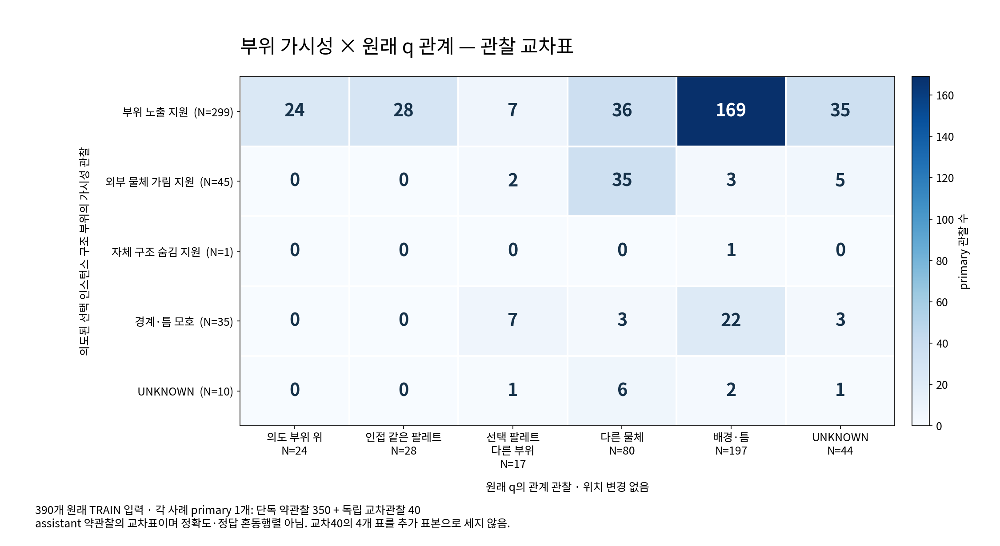
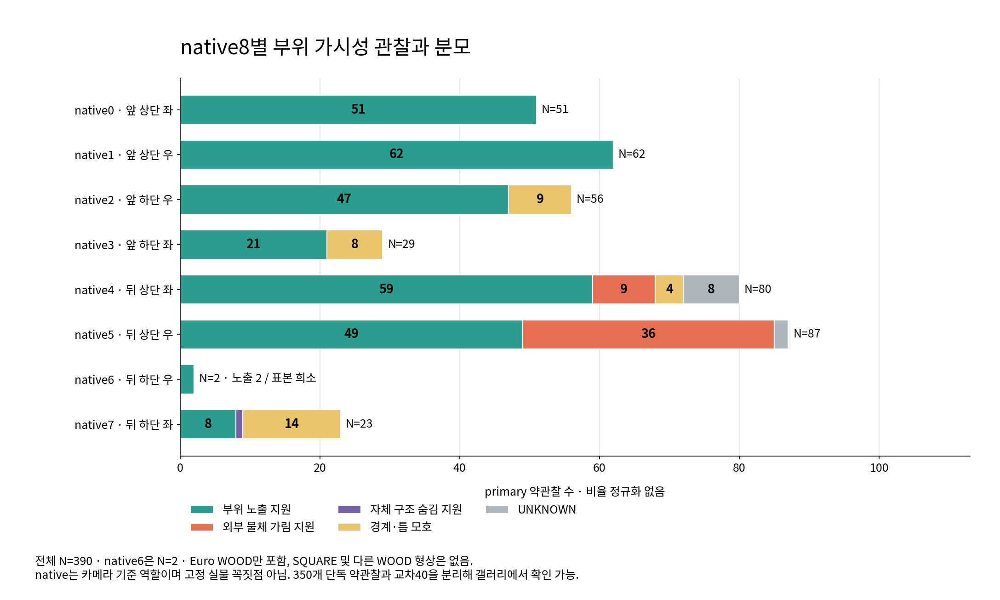
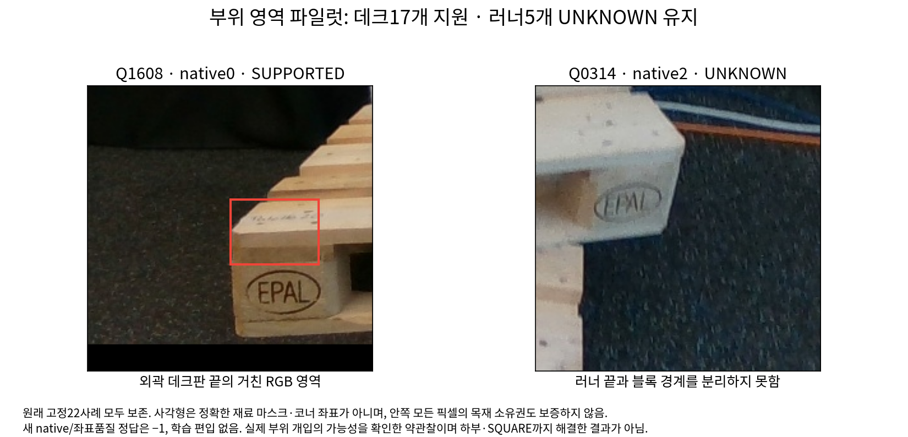

# V163 — query_visibility_train_native_part_witness_20261024_v163

기존 보고서에서 추출한 게시용 파생 개요입니다. 원본 파일을 수정하거나 실험·평가를 다시 실행하지 않았습니다. 원문 해시와 링크 대응은 publication manifest로 확인합니다.

**상태:** {"completed":true,"selected_model":null,"adopted":false,"fully_solved":false,"goal_status":"active_unsolved"}

원본:

- [ROOT_PHASE_RESULT.json](ROOT_PHASE_RESULT.json) — SHA256 `6acd2202a3d9a4602b542696a1d6d02fb3bac3697b3edc6efad2c4f28522fb55`
- [ROOT_READOUT_KO.html](ROOT_READOUT_KO.html) — SHA256 `da8251fab21742ae73c44ce985000043e2ed7cf77077626d4d6a66ccd01774fc`
- [ROOT_RESULTS_KO.json](ROOT_RESULTS_KO.json) — SHA256 `936934b5ce389dde4b406ecf0379d11fb63c57dd8a85d3ef8f9850857b97b564`

## 방법·목표의 원문 필드

`$.schema`

```text
V163_ROOT_ACTUAL_PUBLIC_TRAIN_NATIVE_PART_WITNESS_DIAGNOSIS_COMPLETE_UNSOLVED
```

`$.runner_method_nuance`

```text
러너만의 분할은 끝점 외관 차폐를 위해 논리적으로 필수는 아니다. 그러나 모든 실제 RGB상 후보 끝을 포함하는 보수적 enclosure는 별도 약영역 제안·검토가 필요하다. 현재5UNKNOWN은 변경하지 않았다.
```


## 입력·학습·평가 분모의 원문 필드

`$.source_rows`

```text
390
```

`$.primary_observations`

```text
{
  "selected_instance_correspondence": {
    "CLEAR": 390
  },
  "native_part_visibility": {
    "VISIBLE_SUPPORTED": 299,
    "BOUNDARY_OR_GAP_AMBIGUOUS": 35,
    "EXTERNAL_BLOCK_SUPPORTED": 45,
    "UNKNOWN": 10,
    "SELF_HIDE_SUPPORTED": 1
  },
  "query_relation": {
    "ON_INTENDED_PART_SUPPORTED": 24,
    "FOREIGN_OBJECT": 80,
    "BACKGROUND_OR_GAP": 197,
    "UNKNOWN": 44,
    "NEAR_INTENDED_PART_SAME_SELECTED_PALLET": 28,
    "OTHER_SELECTED_PALLET_PART": 17
  },
  "part_cover_readiness": {
    "WEAK_CANDIDATE_PART_VISIBLE_AND_Q_RELATED": 52,
    "UNKNOWN_NOT_ADMITTED": 338
  }
}
```

`$.primary_part_visible_query_background`

```text
169
```

`$.old_TARGET53_primary`

```text
{
  "OTHER_SELECTED_PALLET_PART": 12,
  "UNKNOWN_OR_DISAGREEMENT": 1,
  "VISIBLE_PART_AND_Q_ON_OR_NEAR": 40
}
```

`$.old_role_x_new_part_primary`

```text
{
  "D": {
    "BOUNDARY_OR_GAP_AMBIGUOUS": 33,
    "EXTERNAL_BLOCK_SUPPORTED": 2,
    "SELF_HIDE_SUPPORTED": 1,
    "UNKNOWN": 7,
    "VISIBLE_SUPPORTED": 298
  },
  "E": {
    "BOUNDARY_OR_GAP_AMBIGUOUS": 2,
    "EXTERNAL_BLOCK_SUPPORTED": 43,
    "UNKNOWN": 3,
    "VISIBLE_SUPPORTED": 1
  }
}
```

`$.training_admitted`

```text
false
```

`$.new_training_updates_or_encoder_model_calls`

```text
0
```


## 결론·실패·한계의 원문 필드

`$.interpretation_KO`

```text
[
  "대상 팔레트의 중심 목재 소유와 의도한 native 끝 부위의 가시성·q 관계는 다르다. oldTARGET53 중12개는 같은 팔레트의 다른 부위였다.",
  "원래 E49 중43개는 새primary에서도 외부 차폐 지지가 있어 라벨 정의 차이만으로 모든 일반화 실패를 설명할 수 없다.",
  "보이는 부위와 q배경의 공존169개는 위치 오류 수나 정확도 수가 아니다. 모서리의 재료 경계·래스터화·명목 기준점 불확실성이 남는다.",
  "네 판독은 같은 계열 assistant의 역사적 문맥이 있는 약관찰이다. 350개단독·40개교차의 근거강도를 분리하고 불일치는 다수결로 제거하지 않았다.",
  "현재 actualmodel 성능 개선·새 모델 채택은 없다. 마지막 실제 학습 V162의 공개held 약라벨 E2/52→3/52, D93/102동일이라는 부정 결과는 유지한다."
]
```


## 코드·검증·전체 표·갤러리

아래 목록은 원 보고서가 참조한 파일의 경로를 다시 연결한 것입니다. 이 개요 작성 중 이미지 내용이나 raw 평가 데이터를 새로 검사하지 않았습니다.

- [query_visibility_train_native_part_witness_20261024_v163/ROOT_RESULTS_KO.json](ROOT_RESULTS_KO.json)
- [query_visibility_train_native_part_witness_20261024_v163/ROOT_READOUT_KO.html](ROOT_READOUT_KO.html)
- [query_visibility_train_native_part_witness_20261024_v163/ROOT_ACTUAL_SOURCE_VISUAL_AND_JOIN_QA.json](ROOT_ACTUAL_SOURCE_VISUAL_AND_JOIN_QA.json)
- [query_visibility_train_native_part_witness_20261024_v163/ROOT_SCOPE_BEFORE_NATIVE_PART_WITNESS_PIXELS.json](ROOT_SCOPE_BEFORE_NATIVE_PART_WITNESS_PIXELS.json)
- [query_visibility_train_native_part_witness_20261024_v163/ROOT_ACTUAL_RENDER_TERMINAL_FAILURE.json](ROOT_ACTUAL_RENDER_TERMINAL_FAILURE.json)
- [query_visibility_train_native_part_witness_20261024_v163/evidence_recovered_v3/COMPLETE.json](evidence_recovered_v3/COMPLETE.json)
- [query_visibility_train_native_part_witness_20261024_v163/root_blind_review/ROOT_BLIND_CROSS40_SEALED.json](root_blind_review/ROOT_BLIND_CROSS40_SEALED.json)
- [query_visibility_train_native_part_witness_20261024_v163/join_observations/ALL390_REVIEW_BARRIER_AND_SUMMARY.json](join_observations/ALL390_REVIEW_BARRIER_AND_SUMMARY.json)
- [query_visibility_train_native_part_witness_20261024_v163/join_observations/CROSS40_AGREEMENT_BEFORE_HISTORICAL_LABEL_JOIN_V2.json](join_observations/CROSS40_AGREEMENT_BEFORE_HISTORICAL_LABEL_JOIN_V2.json)
- [query_visibility_train_native_part_witness_20261024_v163/ROOT_FINAL_CROSS_AMENDMENT_AND_FULL390_JOIN_REVIEW.json](ROOT_FINAL_CROSS_AMENDMENT_AND_FULL390_JOIN_REVIEW.json)
- [query_visibility_train_native_part_witness_20261024_v163/historical_label_diagnosis/COMPLETE.json](historical_label_diagnosis/COMPLETE.json)
- [query_visibility_train_native_part_witness_20261024_v163/reviewer_a/part_region_pilot/COMPLETE.json](reviewer_a/part_region_pilot/COMPLETE.json)
- [query_visibility_train_native_part_witness_20261024_v163/reviewer_b/runner_enclosure_method_review/METHOD_REVIEW.json](reviewer_b/runner_enclosure_method_review/METHOD_REVIEW.json)
- [query_visibility_train_native_part_witness_20261024_v163/full390_visual_readout/index.html](full390_visual_readout/index.html)
- [query_visibility_train_native_part_witness_20261024_v163/full390_visual_readout/READOUT_COMPLETE.json](full390_visual_readout/READOUT_COMPLETE.json)
- [query_visibility_native_part_counterfactual_20261024_v164/ROOT_DESIGN_BEFORE_NATIVE_PART_COUNTERFACTUAL_PIXELS.json](../query_visibility_native_part_counterfactual_20261024_v164/ROOT_DESIGN_BEFORE_NATIVE_PART_COUNTERFACTUAL_PIXELS.json)
- [query_visibility_counterfactual_frozen_features_20261024_v162/ROOT_READOUT_KO.html](../query_visibility_counterfactual_frozen_features_20261024_v162/ROOT_READOUT_KO.html)
- [query_visibility_train_native_part_witness_20261024_v163/historical_label_diagnosis/SUMMARY.json](historical_label_diagnosis/SUMMARY.json)

## 원 보고서의 그림

원 보고서 참조 순서의 처음 최대4개를 표시합니다. 새 outcome 선택이나 전수 이미지 검증을 뜻하지 않습니다. 전체 갤러리는 위 원문 링크에서 확인합니다.

[query_visibility_train_native_part_witness_20261024_v163/full390_visual_readout/PART_VISIBILITY_QUERY_RELATION_OBSERVATION_COUNTS.png](full390_visual_readout/PART_VISIBILITY_QUERY_RELATION_OBSERVATION_COUNTS.png)



[query_visibility_train_native_part_witness_20261024_v163/full390_visual_readout/NATIVE8_PART_VISIBILITY_OBSERVATION_COUNTS.png](full390_visual_readout/NATIVE8_PART_VISIBILITY_OBSERVATION_COUNTS.png)



[query_visibility_train_native_part_witness_20261024_v163/ROOT_COARSE_PART_REGION_PILOT.png](ROOT_COARSE_PART_REGION_PILOT.png)




현재 사용자 목표 전체의 해결·새 모델 채택·실사 가림 원인 확정을 이 파생 개요가 추가로 주장하지 않습니다. UNKNOWN/U와 불리한 결과, 실패 실행 및 수정 provenance는 원문대로 보존해야 합니다.
