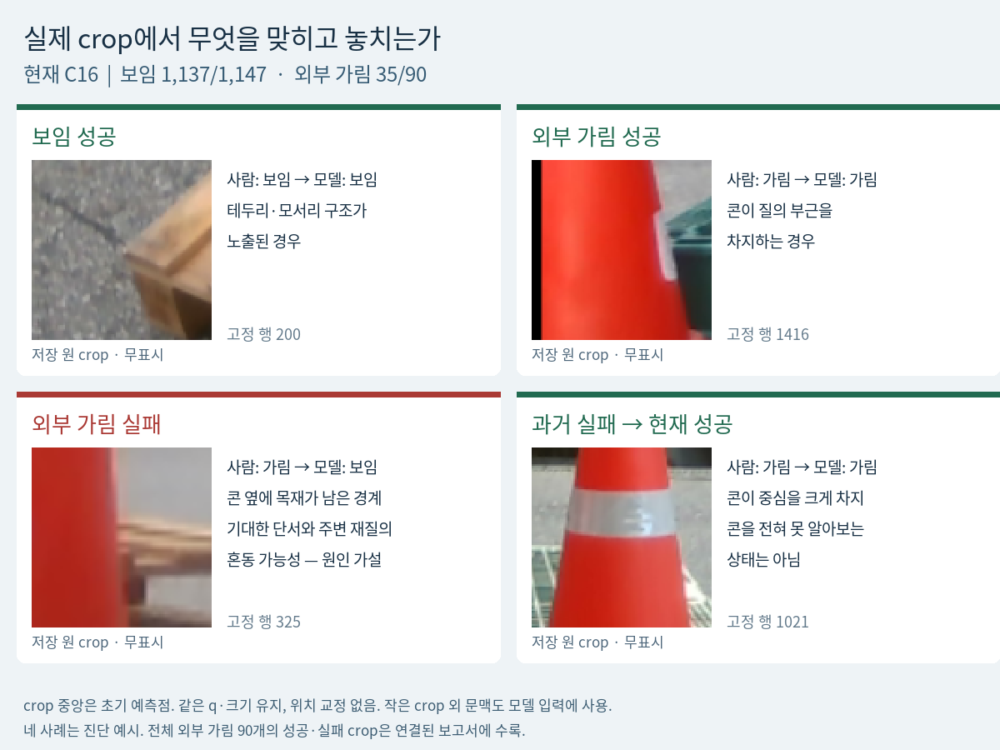
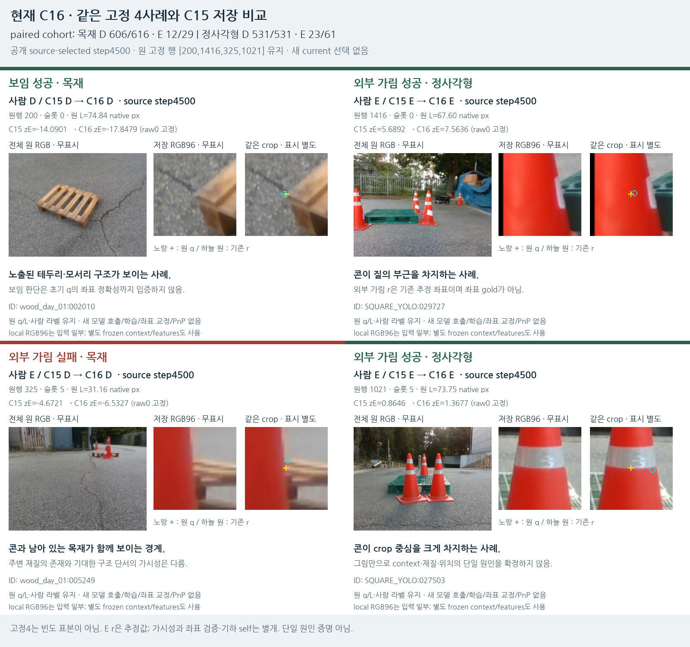
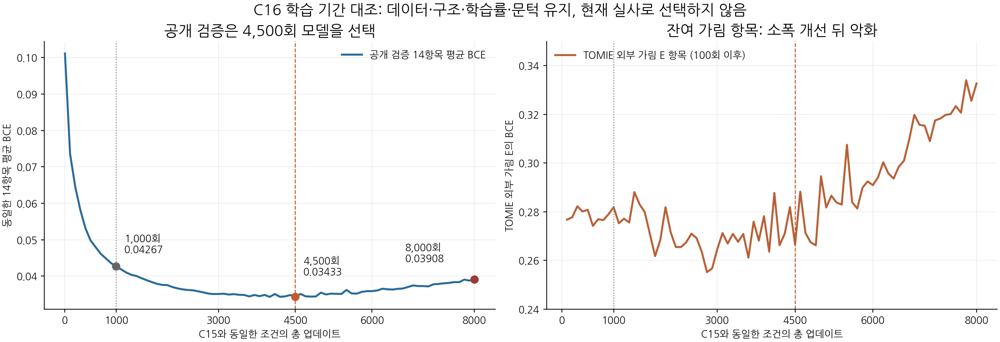
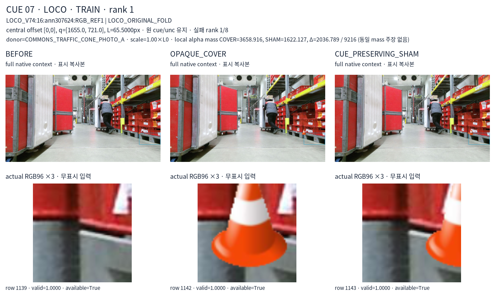

# V124 — query_visibility_training_duration_control_20261023_v124

기존 보고서에서 추출한 게시용 파생 개요입니다. 원본 파일을 수정하거나 실험·평가를 다시 실행하지 않았습니다. 원문 해시와 링크 대응은 publication manifest로 확인합니다.

**상태:** {"completed":true,"fully_solved":false,"goal_status":"active"}

원본:

- [ROOT_PHASE_RESULT.json](ROOT_PHASE_RESULT.json) — SHA256 `3c70b9b8105ba0cfa22802c231d930166baeab24924aa0dabc9b2d90f2c11fc2`
- [ROOT_READOUT_KO.html](ROOT_READOUT_KO.html) — SHA256 `426ffa8355d237b44b570fcfc6b719e34998f80de7b9bf0c8161eca172a9ff15`
- [ROOT_RESULTS_KO.json](ROOT_RESULTS_KO.json) — SHA256 `0747b8b9bd2a7204c2f8599a25de06c56ba21bf372b5b2be53fcf8230efca13b`

## 방법·목표의 원문 필드

`$.phase`

```text
C16 duration-only control + saved-current visual diagnosis
```

`$.goal_assessment_KO`

```text
초기 기하로 self를 분리한 뒤 보임/외부가림을 판단하는 목표가 과도하다는 증거는 없다. 다만 모든 작은 crop에서 숨은 부품 식별·좌표 정확성·가림을100% 동시에 확정한다는 목표는 현재 증거와 입력으로 보장할 수 없다.
```


## 입력·학습·평가 분모의 원문 필드

`$.current_primary_comparison`

```text
{
  "excerpt": "[{\"cohort\": \"paired_same_query_RGB\", \"group\": \"WOOD_PRIMARY105\", \"model\": \"v61\", \"human_D_N\": 616, \"human_external_E_N\": 29, \"D_pred_D\": 145, \"D_pred_hidden\": 471, \"D_pred_U\": 0, \"E_pred_D\": 0, \"E_pred_hidden\": 29, \"E_pred_U\": 0, \"D_precision\": 1.0, \"D_recall\": 0.2353896103896104, \"external_E_response_precision\": 0.058, \"external_E_response_recall\": 1.0, \"unresolved_rate\": 0.0, \"hidden_response_not_learned_S\": true}, {\"cohort\": \"paired_same_query_RGB\", \"group\": \"WOOD_PRIMARY105\", \"model\": \"legacy\", \"human_D_N\": 616, \"human_external_E_N\": 29, \"D_pred_D\": 448, \"D_pred_hidden\": 65, \"D_pred_U\": 103, \"E_pred_D\": 2, \"E_pred_hidden\": 23, \"E_pred_U\": 4, \"D_precision\": 0.9955555555555555, \"D_recall\": 0.7272727272727273, \"external_E_response_precision\": 0.26136363636363635, \"external_E_response_recall\": 0.7931034482758621, \"unresolved_rate\": 0.16589147286821707, \"hidden_response_not_learned_S\": true}, {\"cohort\": \"paired_same_query_RGB\", \"group\": \"WOOD_PRIMARY105\", \"model\": \"V111_C11_RAW\", \"human_D_N\": 616, \"human_external_E_N\": 29, \"D_pred_D\": 598, \"D_pred_hidden\": 18, \"D_pred_U\": 0, \"E_pred_D\": 11, \"E_pred_hidden\": 18, \"E_pred_U\": 0, \"D_precision\": 0.9819376026272578, \"D_recall\": 0.9707792207792207, \"external_E_response_precision\": 0.5, \"external_E_response_recall\": 0.6206896551724138, \"unresolved_rate\": 0.0, \"hidden_response_not_learned_S\": true}, {\"cohort\": \"paired_same_query_RGB\", \"group\": \"WOOD_PRIMARY105\", \"model\": \"V119_C14_RAW\", \"human_D_N\": 616, \"human_external_E_N\": 29, \"D_pred_D\": 599, \"D_pred_hidden\": 17, \"D_pred_U\": 0, \"E_pred_D\": 20, \"E_pred_hidden\": 9, \"E_pred_U\": 0, \"",
  "truncated": true
}
```

`$.public_source_boundary_coverage`

```text
{
  "known_COVER_E": 2070,
  "q_inside_foreground_alpha": 2070,
  "known_SHAM_D": 2070,
  "q_outside_foreground_alpha": 2070,
  "semantic_E_q_outside_example_count": 0,
  "correlated_rows_not_independent_scenes": true
}
```


## 결론·실패·한계의 원문 필드

`$.outcome_KO`

```text
학습 기간 연장 후 보임1130→1137/1147, 외부가림35→35/90. 반복 학습만으로 잔여55개 외부가림을 해결하지 못했다.
```

`$.limits_KO`

```text
[
  "현재223은 평가 전용으로 사용했지만 과거 개발에 노출된 자료이므로 독립 blind test가 아니다.",
  "사람 E의 숨은 reference는 추정/미지정 출처이며 정확한 좌표 gold가 아니다. D/E 판단 성공이 초기 좌표 검증을 뜻하지 않는다.",
  "최근 추가4896행은9장 원본·32개 약한 구조 단서에서 파생됐고, 추가 TRAIN known846행은3장 LOCO 원본의6개 단서다. 전체 이전 학습 자료의 원본 수를3장이라고 말하지 않는다.",
  "공개 실사 배경과 물체 cutout을 사용한 COVER/SHAM은 조건부 AUX 정답이다. 자연 가림의 native 키포인트 gold와 같지 않다.",
  "공개 source의 COVER2070행 q가 전부 alpha 내부라는 것은 이 source의 구성 빈틈이다. 전체 이전 데이터나 실제 실패55개의 단일 원인 증명이 아니다.",
  "자기 가림은 기존 초기 기하 경로이며 학습 D/E와 분리했다. 현재 실사로 문턱·checkpoint·모델 arm을 선택하지 않았다.",
  "고정4사례는 정성 진단 표본이고, 전체 E90 갤러리는 이 평가의 오류 목록이다. 어느 쪽도 자연 환경 전체의 원인 빈도 증명은 아니다.",
  "전체1784개에서 입력 U45개와 주 비교 D/E1237개 안의 U0개는 서로 다른 분모다."
]
```


## 코드·검증·전체 표·갤러리

아래 목록은 원 보고서가 참조한 파일의 경로를 다시 연결한 것입니다. 이 개요 작성 중 이미지 내용이나 raw 평가 데이터를 새로 검사하지 않았습니다.

- [query_visibility_training_duration_control_20261023_v124/ROOT_READOUT_KO.html](ROOT_READOUT_KO.html)
- [query_visibility_training_duration_control_20261023_v124/ROOT_RESULTS_KO.json](ROOT_RESULTS_KO.json)
- [query_visibility_training_duration_control_20261023_v124/ROOT_REPORT_VISUAL_QA.json](ROOT_REPORT_VISUAL_QA.json)
- [query_visibility_training_duration_control_20261023_v124/runs/C16_EXACT_C15_DURATION_CONTROL_8000/FIT_COMPLETE.json](runs/C16_EXACT_C15_DURATION_CONTROL_8000/FIT_COMPLETE.json)
- [query_visibility_training_duration_control_20261023_v124/runs/C16_EXACT_C15_DURATION_CONTROL_8000/MODEL_FREEZE.json](runs/C16_EXACT_C15_DURATION_CONTROL_8000/MODEL_FREEZE.json)
- [query_visibility_training_duration_control_20261023_v124/private_evaluation/C16_FROZEN_CURRENT223/INFERENCE_SEAL.json](private_evaluation/C16_FROZEN_CURRENT223/INFERENCE_SEAL.json)
- [query_visibility_training_duration_control_20261023_v124/private_evaluation/C16_FROZEN_CURRENT223/evaluation/EVALUATION_SEAL.json](private_evaluation/C16_FROZEN_CURRENT223/evaluation/EVALUATION_SEAL.json)
- [query_visibility_training_duration_control_20261023_v124/saved_source_review/REVIEW.json](saved_source_review/REVIEW.json)
- [query_visibility_training_duration_control_20261023_v124/saved_current_review/REVIEW.json](saved_current_review/REVIEW.json)
- [query_visibility_training_duration_control_20261023_v124/ROOT_PUBLIC_QUERY_BOUNDARY_COVERAGE_AUDIT.json](ROOT_PUBLIC_QUERY_BOUNDARY_COVERAGE_AUDIT.json)
- [query_visibility_training_duration_control_20261023_v124/visual_followup/all_external90/MAPPING_AND_COUNTS.json](visual_followup/all_external90/MAPPING_AND_COUNTS.json)
- [query_visibility_training_duration_control_20261023_v124/public_intake/FINDINGS.json](public_intake/FINDINGS.json)
- [query_visibility_training_duration_control_20261023_v124/private_evaluation/C16_FROZEN_CURRENT223/evaluation/CURRENT_PRIMARY_RESULTS.json](private_evaluation/C16_FROZEN_CURRENT223/evaluation/CURRENT_PRIMARY_RESULTS.json)
- [query_visibility_training_duration_control_20261023_v124/visual_followup/C16_FIXED4_MAPPING_AND_METRICS.json](visual_followup/C16_FIXED4_MAPPING_AND_METRICS.json)

## 원 보고서의 그림

원 보고서 참조 순서의 처음 최대4개를 표시합니다. 새 outcome 선택이나 전수 이미지 검증을 뜻하지 않습니다. 전체 갤러리는 위 원문 링크에서 확인합니다.

[query_visibility_training_duration_control_20261023_v124/visual_followup/INLINE_SUCCESS_FAILURE_C16_KO.png](visual_followup/INLINE_SUCCESS_FAILURE_C16_KO.png)



[query_visibility_training_duration_control_20261023_v124/visual_followup/C16_FIXED4_SUCCESS_FAILURE.png](visual_followup/C16_FIXED4_SUCCESS_FAILURE.png)



[query_visibility_training_duration_control_20261023_v124/source_visual_followup/SOURCE_DURATION_CURVES.png](source_visual_followup/SOURCE_DURATION_CURVES.png)



[query_visibility_flat_pallet_cue_source_20261023_v122/fixed_corpus_visual_review/CUE_07_CENTRAL_RANK_01.png](../query_visibility_flat_pallet_cue_source_20261023_v122/fixed_corpus_visual_review/CUE_07_CENTRAL_RANK_01.png)




현재 사용자 목표 전체의 해결·새 모델 채택·실사 가림 원인 확정을 이 파생 개요가 추가로 주장하지 않습니다. UNKNOWN/U와 불리한 결과, 실패 실행 및 수정 provenance는 원문대로 보존해야 합니다.
