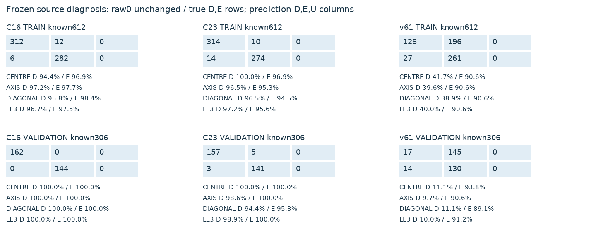
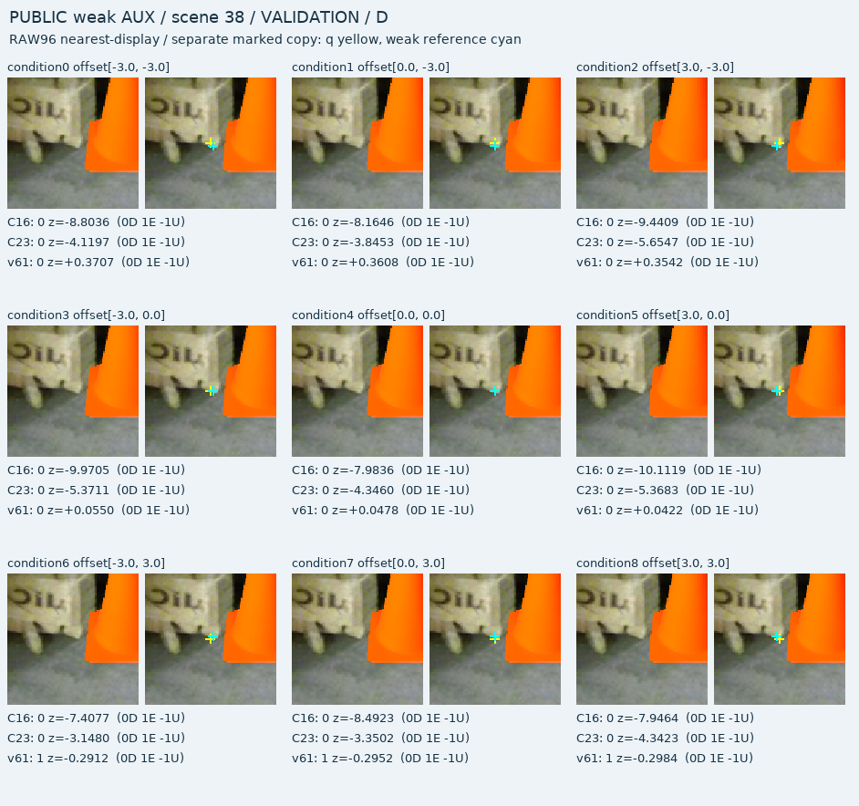
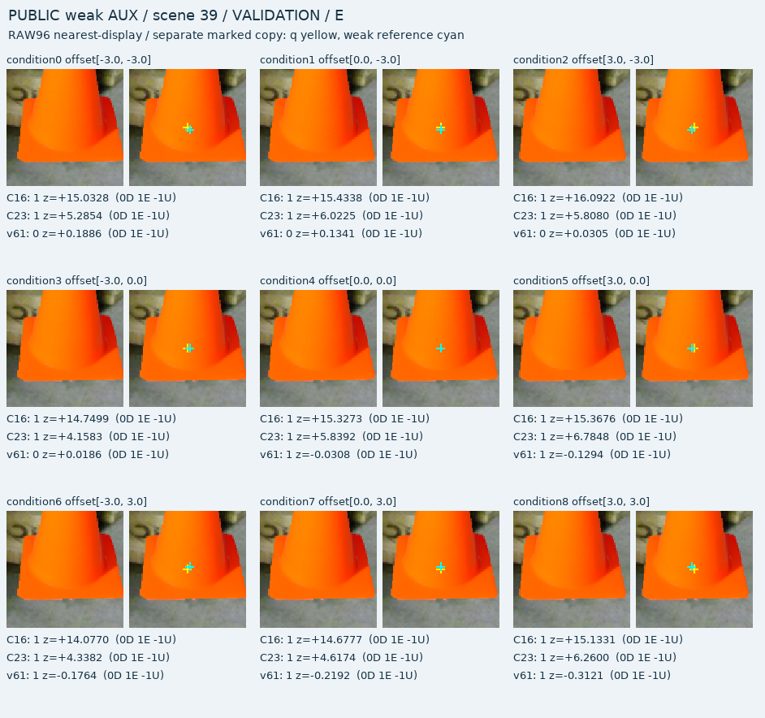
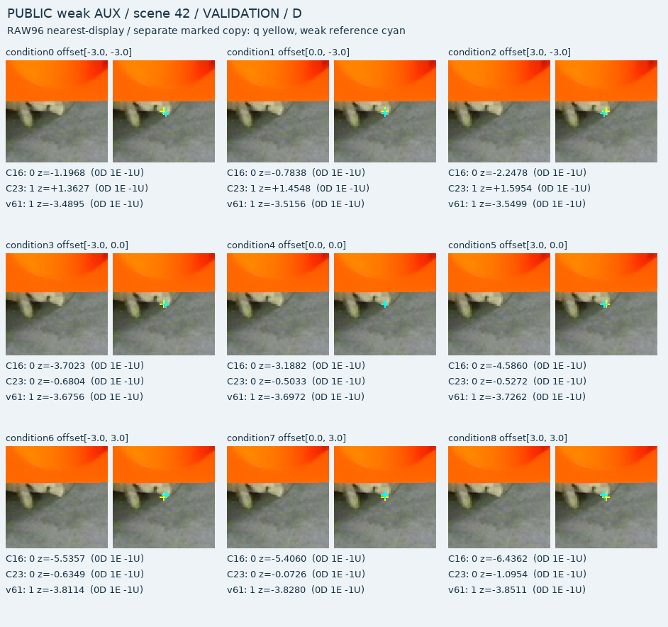
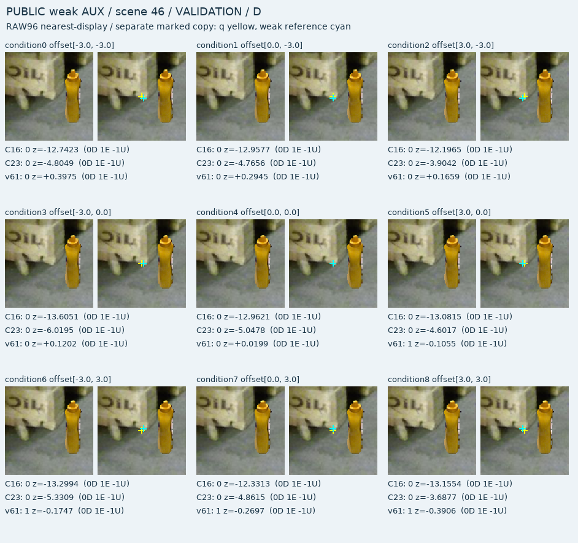

# V131 현재 진전과 한계

원문: [query_visibility_public_small_query_jitter_20261024_v131/ROOT_READOUT_KO.html](../../archive/task-2/pallet-keypoint-visibility/query_visibility_public_small_query_jitter_20261024_v131/ROOT_READOUT_KO.html)

원 HTML SHA256: `d82f89ced61c77864b628c4be8fbd07778a4d2224308d781e5446686b228149d`

원 img ordinal 1–5 / 5. 원 순서 유지; 이미지 pixel decode/모델/평가 재실행 없음.

## 원 이미지 1

원문 직전 heading

```text
공개 데이터 진단
```

원 alt

```text
세 동결 모델의 혼동행렬과 이동별 recall
```



## 원 이미지 2

원문 직전 heading

```text
Scene 38
```

원 alt

```text
Scene 38의9개 q 조건 crop과 점수
```



## 원 이미지 3

원문 직전 heading

```text
Scene 39
```

원 alt

```text
Scene 39의9개 q 조건 crop과 점수
```



## 원 이미지 4

원문 직전 heading

```text
Scene 42
```

원 alt

```text
Scene 42의9개 q 조건 crop과 점수
```



## 원 이미지 5

원문 직전 heading

```text
Scene 46
```

원 alt

```text
Scene 46의9개 q 조건 crop과 점수
```


