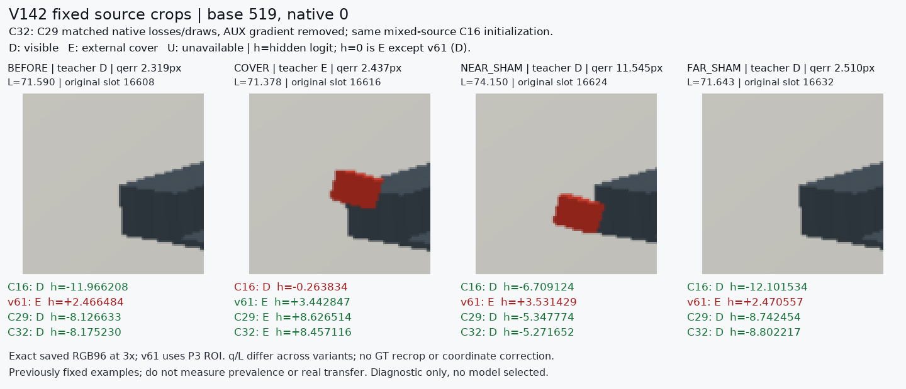
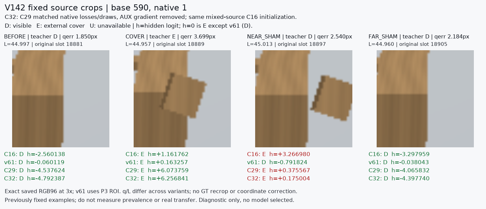

# AUX→native gradient 대조

원문: [query_visibility_native_target_gradient_control_20261024_v142/ROOT_READOUT_KO.html](../../archive/task-2/pallet-keypoint-visibility/query_visibility_native_target_gradient_control_20261024_v142/ROOT_READOUT_KO.html)

원 HTML SHA256: `5cf05188b4d21370478020e7ca0f2c55674e4ebd0e5285df6a90a5c35979b672`

원 img ordinal 1–2 / 2. 원 순서 유지; 이미지 pixel decode/모델/평가 재실행 없음.

## 원 이미지 1

원문 직전 heading

```text
기존 고정 crop: base519 / native0
```



## 원 이미지 2

원문 직전 heading

```text
기존 고정 crop: base590 / native1
```


